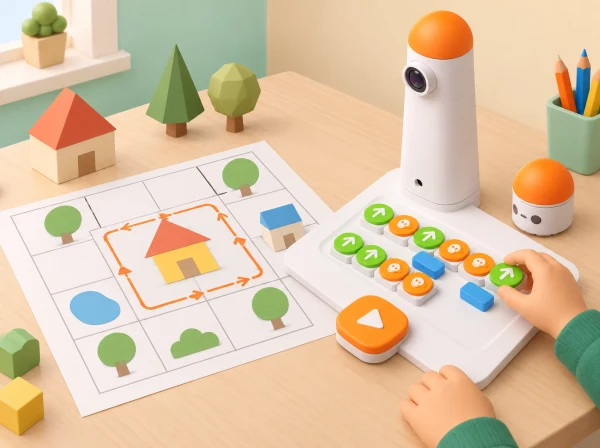
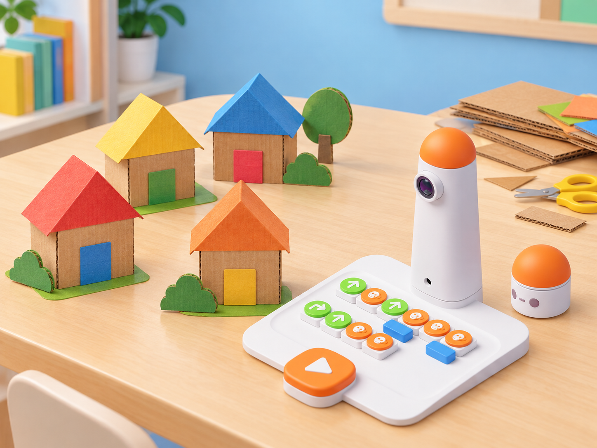

_El Coding Set i MatataBot acompanyen un mapa de caselles amb una casa geomètrica i una ruta tancada._

## ❓ Repte i intenció

En quatre sessions, l’alumnat investiga com els moviments i els girs creen figures, escriu programes repetits i transforma cartó net recuperat en una maqueta col·lectiva. Cada casa combina un contorn quadrat, un sostre triangular i una porta quadrada més menuda. L’encàrrec conserva les quatre cases, el muntatge i la decoració del projecte oficial; situa el resultat en un barri valencià imaginari i fa visible quina part traça el robot i quina construeix l’alumnat. Les tisores i la cinta formen part del treball manual, no són un requisit perquè MatataBot dibuixe directament.

## 🎯 Aprenentatges i vocabulari

- Construir un recorregut que represente els costats d’un quadrat i distingir moviment recte i gir.
- Compondre una casa amb formes geomètriques i explicar com s’ha obtingut cada contorn.
- Usar cartró recuperat per crear una maqueta i relacionar-la amb el dibuix programat.
- Canviar una forma, tornar a provar el programa i defensar el disseny amb una evidència.

## 🧰 Materials i preparació

Prepareu Coding Set complet, quadrícula pròpia, paper quadriculat o cartó pla gran, retalls nets de capses, llapis de colors, cinta o cola, tisores d’aula, regle, plantilla d’angles de 60°, 90° i 120°, targetes amb moviments i bucles i una graella de registre. El traçat amb tinta requereix l’Artist Add-On compatible, retoladors i el suport corresponent; comproveu que el centre en disposa i seguiu-ne les instruccions. Sense el complement, MatataBot recorre les línies de caselles i l’alumnat trasllada el disseny al paper: aquesta alternativa no atribueix dibuix al Coding Set base. Trieu cartó net, sec, sense grapes ni vores esmolades, i talleu-lo amb supervisió.

Feu una prova de calibratge curta per comprovar quant avança MatataBot amb una ordre i com l’angle programat afecta la direcció. No pressuposeu que cada costat dibuixat coincideix amb una casella exacta. Marqueu el punt inicial i l’orientació del robot en cada intent.

## 📅 Seqüència didàctica · quatre sessions de 45 minuts

El pla oficial *MatataBot’s Cozy House* dura 55 minuts (10 guiats, 30 d’activitat i 15 de retorn). Ací es reparteix en quatre sessions de 45 minuts per a poder predir, provar, construir i revisar amb més calma; la temporalització local no és l’oficial.

### **Sessió 1 · Del residu a la forma.**

#### Fase 1 · Activem i prediem

Presenteu l’encàrrec de convertir cartó net recuperat en una xicoteta maqueta útil per explicar geometria. Pregunteu quines parts del cartó encara es poden aprofitar i com distingim reutilitzar d’enviar un residu al reciclatge. Mostreu una casa feta amb un quadrat i un triangle; distingiu costat, vèrtex, angle interior i trajectòria, i demaneu que l’alumnat prediga quin gir necessita el robot per passar d’un costat al següent.

#### Fase 2 · Explorem i construïm

Amb una fitxa que representa MatataBot, recorreu un quadrat i un triangle equilàter. Mesureu els angles interiors amb una plantilla i anoteu quant gira el robot quan passa d’un costat al següent. El docent modela com es combinen moviment, gir, angle i bucle per representar la paret quadrada i el sostre triangular; identifiqueu quines peces són del kit base i quines pertanyen a l’Artist Add-On.

#### Fase 3 · Expliquem i registrem

Programeu un costat recte i un gir; compareu un gir de 90° amb un de 120°. Dibuixeu i etiqueteu l’angle interior i el gir exterior.

#### Fase 4 · Apliquem i millorem

Expliqueu que en un triangle equilàter cada angle interior és 60° i que el gir exterior per continuar el contorn és 120°. En parelles, una persona prediu i l’altra col·loca els blocs; executeu i canvieu de rol. Els blocs numèrics indiquen la longitud del moviment recte; el gir es defineix amb el bloc d’angle corresponent, sense aplicar-li un bloc numèric.

#### Fase 5 · Comprovem i reflexionem

Completeu «el gir programat és … perquè l’angle interior és …». **Evidència:** dos croquis amb gir interior/exterior etiquetat i predicció comprovada. **Pregunta docent:** què podem tornar a utilitzar del cartó net i quina funció té el bucle en la figura?

### **Sessió 2 · Una casa és una composició de formes.**

#### Fase 1 · Activem i prediem

Dibuixeu una casa amb parets quadrades, sostre triangular i porta quadrada més menuda. Predigueu quants segments i girs caldran i decidiu on comença i acaba cada tram.

#### Fase 2 · Explorem i construïm

Prepareu un programa que combine el contorn quadrat de la casa i el sostre triangular en una mateixa seqüència, fent servir blocs de moviment, d’angle i de bucle; els blocs numèrics poden ajustar els trams rectes quan el kit ho permet, però no són un paràmetre del bloc de gir. Marqueu el punt d’inici i planifiqueu l’ordre dels trams perquè el sostre quede connectat al contorn. Cada casa incorpora una porta quadrada més menuda. Si el muntatge o el suport del retolador obliga a reposicionar MatataBot, tracteu la porta com un traçat separat i anoteu-ho; no afirmeu que el robot alça el llapis.

#### Fase 3 · Expliquem i registrem

Proveu com el bloc de bucle repeteix el patró costat–gir d’una forma regular. Compareu el programa amb i sense bucle i anoteu què es repeteix i què queda fora de la repetició. Una parella comprova si el programa combinat representa parets i sostre sense confondre el gir del robot amb l’angle interior del dibuix.

#### Fase 4 · Apliquem i millorem

Si el robot no tanca el contorn, comproveu primer l’orientació i el nombre de repeticions; després reviseu la distància. Dibuixeu la seqüència final de la casa i la porta.

#### Fase 5 · Comprovem i reflexionem

**Evidència:** diagrama que relaciona forma, moviment, gir i repetició. Quina part del programa s’ha pogut simplificar amb el bucle?

### **Sessió 3 · Quatre cases amb cartró recuperat.**

#### Fase 1 · Activem i prediem

Classifiqueu retalls nets per mida i decidiu què es pot reutilitzar sense comprar material nou. Cada equip prediu quins elements de la casa podrà construir amb els retalls disponibles.

#### Fase 2 · Explorem i construïm

Dissenyeu almenys quatre cases A–D. En cadascuna manteniu un cos quadrat, un sostre triangular i una porta quadrada més menuda; canvieu una sola decisió de disseny —proporció, orientació o decoració— per a poder comparar resultats.

#### Fase 3 · Expliquem i registrem

Proveu els quatre recorreguts sobre la graella o amb l’Artist Add-On disponible. Traslladeu els contorns a cartó recuperat, retalleu les quatre cases i les seues portes quadrades, i uniu les peces amb cinta o cola per muntar una maqueta de barri. Registreu la quantitat de cartó recuperat que heu utilitzat —per nombre de peces o per àrea aproximada— i separeu els retalls nets que encara es puguen reutilitzar.

_Les cases són manualitats de l’alumnat; MatataBot programa recorreguts geomètrics i no talla, munta ni transporta les peces._

#### Fase 4 · Apliquem i millorem

Reaprofiteu retalls de portes i sostres com a finestres, camins o peces de pati, si continuen nets i segurs. Uniu les cases en un barri sense cobrir els recorreguts necessaris per a la prova. Compareu l’ús de cartó recuperat amb la previsió inicial; aquesta dada descriu els materials de la maqueta, no l’impacte ambiental complet d’un habitatge.

#### Fase 5 · Comprovem i reflexionem

**Evidència:** quatre dissenys identificables, un programa provat i una nota sobre l’ús dels materials. Expliqueu quin retall heu pogut reutilitzar i com.

### **Sessió 4 · Canviem una forma i defensem el disseny.**

#### Fase 1 · Activem i prediem

Trieu un triangle rectangle o obtusangle, un rectangle o una estrella de cinc puntes i predigueu quins girs calen. Identifiqueu quines formes es poden provar amb els blocs d’angle de l’Artist Add-On que té el centre; les figures no disponibles es modelen en paper i no es presenten com a traçades pel robot.

#### Fase 2 · Explorem i construïm

Construïu el traçat amb blocs quan siga possible. Si un valor no es pot programar exactament, completeu-lo amb una maqueta manual i identifiqueu clarament les dues representacions.

#### Fase 3 · Expliquem i registrem

Canvieu una variable cada vegada —llargària, gir, repeticions o punt d’inici— i registreu si el contorn es tanca i quantes ordres calen.

#### Fase 4 · Apliquem i millorem

Una altra parella llig el diagrama i intenta repetir el programa. A partir del resultat, reviseu una instrucció o expliqueu per què la versió actual és reproduïble. Si decoreu MatataBot, feu-ho amb una targeta o una escena al costat del robot; no enganxeu materials al cos ni tapeu càmera, obertures, rodes o peces de programació.

#### Fase 5 · Comprovem i reflexionem

Mostreu el barri i expliqueu una decisió geomètrica, una reparació del codi i una manera concreta de reaprofitar els retalls. **Preguntes de tancament:** com descriu el bucle el patró costat–gir?, quina altra forma podríeu programar?, i com podeu reutilitzar el cartó sense confondre la maqueta amb un dibuix fet per MatataBot? **Evidència:** programa final anotat, comentari d’un altre equip i justificació dels límits del dibuix o del kit.

## 📊 Registre i criteris d’avaluació

Per a cada figura, anoteu nom, costats, gir programat, angle interior previst, nombre d’ordres, si el contorn es tanca i canvi entre versions. Valoreu si l’equip descompon la casa en figures, diferencia gir exterior i angle interior, usa una repetició amb sentit, manté un punt d’inici i comprova una errada amb una prova, i explica què s’ha pogut reutilitzar. La precisió artística no és el criteri central: importa justificar l’estratègia i distingir el resultat del robot del dibuix manual que s’hi inspira.

## ♿ Accés i seguretat

Oferiu quadrícules ampliades, punt d’inici en relleu, peces de gir impreses en gran i plantilles de casa amb alguns trams preparats. L’alumnat pot participar com a planificador/a, operador/a de blocs, observador/a de trajectòria, registrador/a, constructor/a de cartró o relator/a; no cal manipular tisores ni blocs per contribuir. Per a una primera prova, useu un únic quadrat; com a ampliació, compareu un triangle equilàter amb un rectangle, paral·lelogram o figura de més costats. Tallar i enganxar es fa amb materials nets i tisores adequades, sense agulles, grapes ni plàstics tallants.

## 🌱 Sostenibilitat i connexió local

La maqueta representa un barri de la Comunitat Valenciana amb habitatges, ombra, pati i espais compartits; eviteu afirmar que una sola forma de casa és més sostenible sense dades. Les peces recuperades s’identifiquen i es reutilitzen abans de reciclar-les, i els equips poden registrar quant material nou han necessitat. Aquesta comparació descriu només la maqueta de classe, no l’impacte ambiental complet d’un edifici.

## 🔗 Referents oficials i adaptació

Adapta [MatataBot’s Cozy House](https://matatalab.com/en/node/85), que proposa 10 minuts de modelatge de protecció ambiental i dels blocs de moviment, angle, nombre i bucle; 30 minuts per a programar almenys quatre cases amb cos quadrat, sostre triangular i porta quadrada més menuda, retallar-les, muntar-les i decorar-les; i 15 minuts de reflexió sobre reutilització i ampliació a formes complexes. Aquesta proposta redistribueix el projecte en quatre sessions locals de 45 minuts per a fer visibles predicció, prova, registres, accessibilitat i revisió entre parelles; aquesta duració és pròpia, no la temporalització oficial. Conserva els quatre prototips, les portes, el programa combinat, la manualitat, el muntatge, la decoració i les preguntes sobre bucles, residus i altres formes. Els blocs numèrics s’associen als moviments rectes i els blocs d’angle als girs; no es descriuen com a paràmetres intercanviables. La decoració es trasllada a una targeta o escena al costat de MatataBot per no cobrir cap peça del set. També incorpora [Draw triangles](https://matatalab.com/en/node/84): el gir de 120° traça un angle interior de 60° en el triangle equilàter, i l’alumnat contrasta després triangles aguts, rectangles i obtusangles. Sense Artist Add-On, el robot recorre una graella i l’alumnat completa el traçat en paper; la figura no s’atribueix al robot com si dibuixara directament. Els mapes, esbossos, targetes, criteris i visuals IA són propis.
