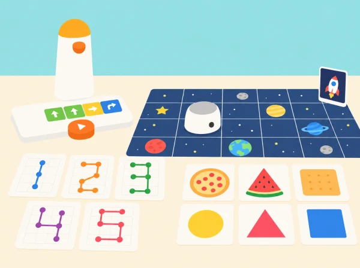
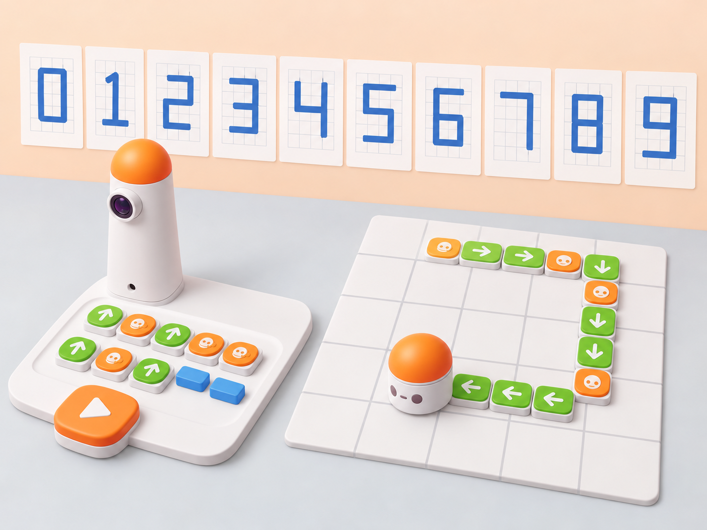

_Una fira creada per l’aula connecta programació tangible, matemàtiques i imaginació._

## ❓ Repte i intenció

La classe organitza tres espais de descoberta. En cada un, els equips fan una predicció, preparen una seqüència amb els blocs tangibles i comproven què ha fet MatataBot. La fira posa el focus en explicar les decisions i comparar procediments, no en acabar primer.

## 🎯 Aprenentatges i vocabulari

- Interpretar ordres tangibles i convertir-les en instruccions que una altra persona puga seguir.
- Classificar formes i representar nombres amb les peces, la graella i les convencions de la fira.
- Aplicar girs i repeticions per construir una figura geomètrica i una constel·lació pròpia.
- Explicar les estratègies matemàtiques als visitants i revisar una estació a partir del retorn rebut.

## Abans de començar

Comproveu que el Coding Set inclou el robot, la torre de control i la taula de programació. Prepareu una graella pròpia, targetes grans amb aliments ficticis i formes, paper quadriculat, retoladors solubles i cartolines. Per a les activitats de traçat, useu l’Artist Add-On només si forma part de la dotació; si no, el robot recorre la figura sobre una quadrícula i l’alumnat dibuixa el resultat en paper.

Useu caselles de **10 × 10 cm** quan MatataBot haja de recórrer físicament la graella: és la mida recomanada pel fabricant perquè coincidisca amb un avanç. Abans de començar, comproveu l’alineació amb una ordre curta i registreu qualsevol desviació; no canvieu l’escala del mapa per compensar-la. Les làmines de xifres són representacions originals sobre graella, no programes oficials ni una promesa que el robot puga dibuixar sense accessori.

## 📅 Seqüència didàctica

### **Obrim la fira i llegim ordres.**

#### Fase 1 · Activem i prediem

Mostreu MatataBot, la torre i la taula de control. Abans de provar res, demaneu que cada equip prediga què fa cada part i com es mourà el robot amb una seqüència curta.

#### Fase 2 · Explorem i construïm

Seguiu una seqüència d’ordres d’esquerra a dreta. En una quadrícula original, marqueu inici, destinació i bandera, i assageu la ruta amb el dit abans de col·locar les peces.

#### Fase 3 · Expliquem i registrem

Distingiu «gira a l’esquerra» de «mou-te cap a l’esquerra» i registreu el camí amb fletxes o blocs tangibles.

#### Fase 4 · Apliquem i millorem

Busqueu un segon camí que arribe al mateix punt sense creuar una bandera aliena. Compareu les dues seqüències i corregiu una ordre si el recorregut no coincideix amb la predicció.

#### Fase 5 · Comprovem i reflexionem

**Evidència:** programa ordenat, predicció i explicació d’un gir. Quina instrucció descriu una rotació i quina descriu un desplaçament?

### **El rebost de les formes.**

#### Fase 1 · Activem i prediem

Classifiqueu targetes d’aliments dibuixats segons la forma geomètrica prominent —triangle, quadrat, cercle o rectangle— i expliqueu quina part de la imatge heu utilitzat per a decidir.

#### Fase 2 · Explorem i construïm

Trieu una forma amb una targeta aleatòria i programeu una ruta fins a la casella corresponent. Si voleu usar un dau, deixeu que trie el repte de la ronda, no qui pot participar.

#### Fase 3 · Expliquem i registrem

Anoteu la forma triada, la seqüència d’ordres i l’orientació inicial del robot abans d’executar el programa.

#### Fase 4 · Apliquem i millorem

Si la ruta no funciona, registreu on s’ha desviat i corregiu una sola ordre. Eviteu que una classificació amb més d’una interpretació es convertisca en una resposta incorrecta: l’equip ha d’explicar el criteri que ha triat.

#### Fase 5 · Comprovem i reflexionem

**Evidència:** classificació argumentada i seqüència provada. Quina instrucció heu revisat i quin resultat us ha permés comprovar-la?

### **Del 0 al 9: xifres en ruta.**

#### Fase 1 · Activem i prediem

Compareu una xifra escrita a mà amb una xifra construïda sobre una graella de trams rectes. Expliqueu que les formes de la fitxa són glifs geomètrics simplificats: no reprodueixen el traç cal·ligràfic de cada persona. Predigueu quins trams requereixen avançar, retrocedir o girar i quins no es poden unir en un únic recorregut sense alçar el llapis o reposicionar el robot.

#### Fase 2 · Explorem i construïm

En equips, descomposeu les deu xifres (0–9) en trams ortogonals d’una graella pròpia. Comenceu amb 0, 1 i 7; després repartiu 2–6, 8 i 9 entre els equips i intercanvieu les targetes perquè una altra parella reconstruïsca cada forma. Marqueu l’orientació inicial, numereu els trams i convertiu-los en ordres disponibles del kit. Per a una línia discontínua o una xifra que exigisca alçar el llapis, tanqueu el programa, reposicioneu el robot i registreu cada subtraçat per separat.

#### Fase 3 · Expliquem i registrem

Registreu els trams, els girs i el nombre d’ordres de cada xifra. Creeu una xifra de l’aula inventada, sense utilitzar una data personal real.

#### Fase 4 · Apliquem i millorem

Executeu cada recorregut des del mateix punt inicial i compareu-lo amb la targeta. Si hi ha Artist Add-On compatible, fixeu-hi el retolador segons les instruccions del fabricant i proveu el traçat sobre paper gran; amb el kit base, MatataBot recorre les caselles sense dibuixar i l’alumnat ressegueix o marca el camí a mà. Identifiqueu una repetició útil —per exemple, els quatre costats d’un contorn quadrat— i compareu la seqüència desplegada amb el bucle. Després, creeu un codi de data fictícia triat per la classe (com ara el número d’una setmana o d’una parada), mai una data de naixement o una altra dada personal.

_Les xifres són models didàctics sobre quadrícula; el MatataBot del kit base recorre les caselles, però no deixa tinta sense el complement de dibuix._

#### Fase 5 · Comprovem i reflexionem

**Evidència:** col·lecció de les deu targetes 0–9 amb orientació, trams i seqüència; prova o simulació identificada de cada ruta; i una data fictícia codificada. Quina xifra ha requerit més subtraçats i quines ordres heu pogut substituir per un bucle?

### **Triangles que giren.**

#### Fase 1 · Activem i prediem

Construïu un triangle equilàter amb una fitxa i una corda. Predigueu quina peça d’angle cal perquè el robot gire cap al costat següent.

#### Fase 2 · Explorem i construïm

Compareu el gir de 120° amb l’angle interior de 60°. Representeu amb una plantilla els tres angles interiors i el gir exterior necessari per a continuar el contorn.

#### Fase 3 · Expliquem i registrem

Expliqueu amb un dibuix que el gir del robot és l’angle exterior suplementari. Anoteu els valors i les peces d’angle triades.

#### Fase 4 · Apliquem i millorem

Exploreu després un triangle rectangle o obtusangle en la quadrícula. L’Artist Add-On és opcional i, sense l’accessori, representeu les longituds en paper; distingiu el traçat calculat del dibuix fet a mà.

#### Fase 5 · Comprovem i reflexionem

**Evidència:** dibuix anotat que diferencia gir i angle interior. Quina suma o relació permet comprovar que els valors són coherents?

### **El cel de la fira.**

#### Fase 1 · Activem i prediem

En un mural comú, cada equip dissenya una constel·lació amb formes geomètriques i prediu quina ruta connectarà les seues estrelles sense travessar les d’un altre grup.

#### Fase 2 · Explorem i construïm

Amb Artist Add-On, els equips poden dibuixar directament sobre paper gran. Amb el kit base, marquen la ruta en una graella i completen el mural a mà.

#### Fase 3 · Expliquem i registrem

Anoteu les ordres i una dada matemàtica del disseny, com el nombre de costats, els girs o la longitud de la ruta en caselles.

#### Fase 4 · Apliquem i millorem

Proveu la ruta i reviseu els canvis necessaris per a connectar les estrelles sense interrompre les altres constel·lacions. Combineu les figures en una composició comuna.

#### Fase 5 · Comprovem i reflexionem

Cada grup presenta les ordres i els canvis fets durant les proves. **Evidència:** constel·lació col·laborativa i demostració comentada.

## 📋 Avaluació i evidències

Recolliu la predicció inicial, el programa tangible, el registre de proves i l’explicació final. Observeu si l’alumnat: classifica formes amb un criteri explícit; ordena moviments i girs; relaciona l’angle exterior de gir amb l’angle interior del triangle; identifica una repetició útil; i revisa el programa a partir del resultat observat. Valoreu també que l’explicació siga comprensible per a un altre equip.

## Rotació de grups i retorn

Organitzeu equips de tres: planificador/a, operador/a i observador/a. Amb un sol kit, els grups passen per les estacions en rotació; mentre esperen, poden provar el programa amb una fitxa sobre la quadrícula o resoldre la classificació i la predicció en paper. En cada canvi de rol, la persona observadora registra si el robot es va desviar, quin indici van usar i quina instrucció van canviar. En la mostra final, cada equip explica una decisió matemàtica i una limitació del dibuix automatitzat. La coavaluació se centra en claredat de la llegenda, coherència entre predicció i resultat i respecte dels torns, no en la bellesa ni la velocitat.

## ♿ Més d’una manera de participar

Oferiu targetes amb contrast alt i relleu, quadrícules grans amb punt de partida marcat i programes amb menys ordres. Qui no manipule les peces pot fer de persona que prediu, de registradora de proves, de narradora o de responsable de comprovar les formes. L’Artist Add-On és opcional: totes les missions es poden completar amb el Coding Set i materials de paper.

## 🔗 Referents oficials i adaptació

La primera sessió reinterpreta la presentació del robot, la torre, la taula de control i les ordres de [Hello, Matatalab Robots!](https://matatalab.com/en/node/88). Les sessions següents adapten, en un context propi, [Big Eater](https://matatalab.com/en/node/80) (classificació de targetes per forma i planificació de ruta), [Draw Arabic numbers with Matatalab!](https://matatalab.com/en/node/87) (traçat de xifres amb moviments i bucles), [Draw triangles](https://matatalab.com/en/node/84) (girs exteriors i angles interiors) i [Travel in universe](https://matatalab.com/en/node/83) (composició d’una obra geomètrica col·laborativa). Les targetes, graelles, preguntes i imatge són originals; les activitats de dibuix directe requereixen Artist Add-On, per això s’ofereix una alternativa completa amb paper.
