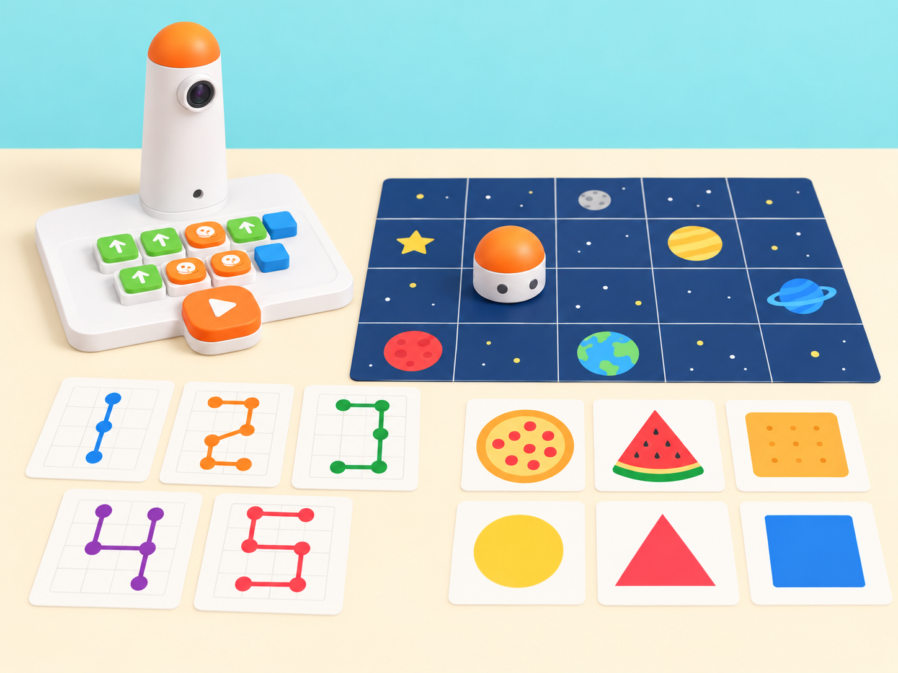
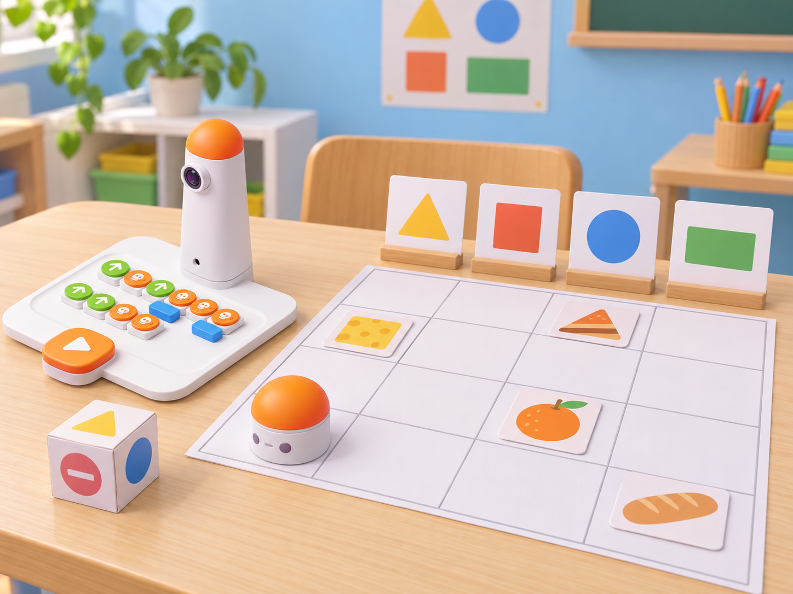
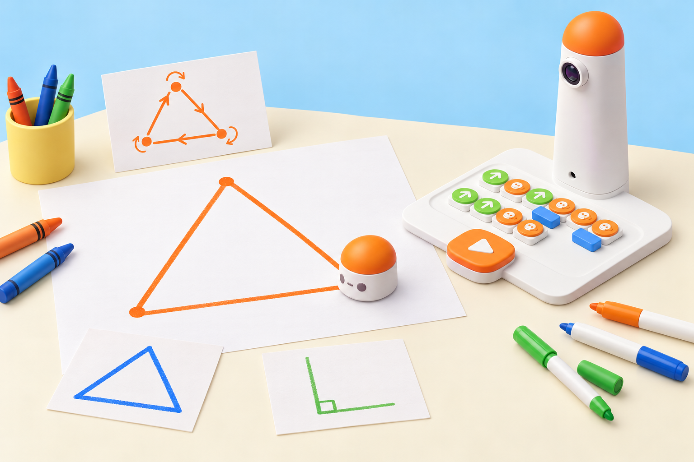
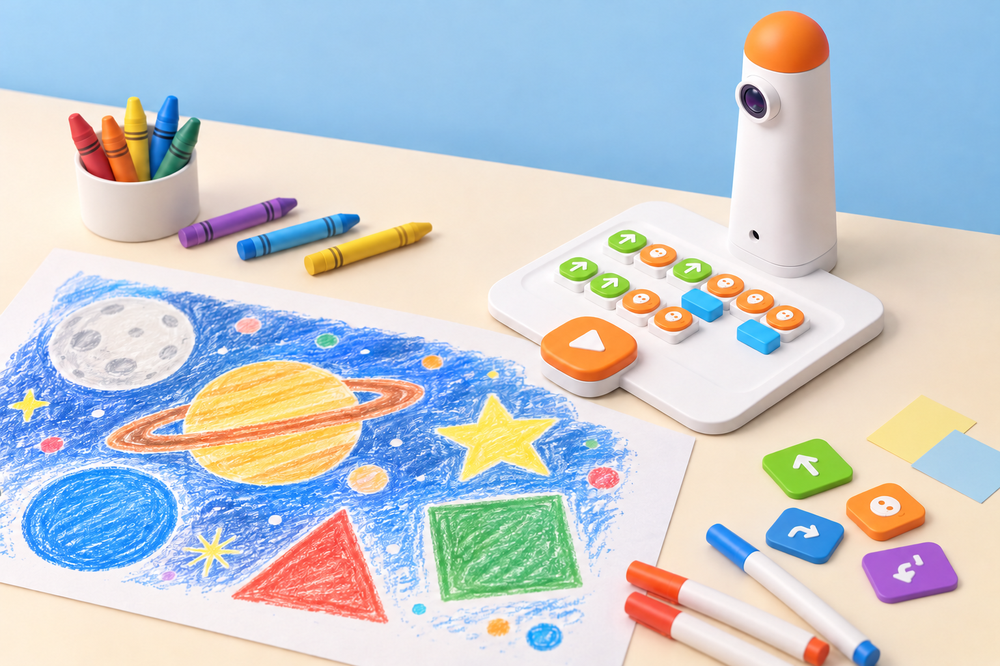

_La torre llig els blocs físics del tauler; les formes, els nombres i les figures del mapa són materials de paper que interpreta l’alumnat, no senyals que MatataBot reconega._

## ❓ Repte i intenció

La classe organitza tres espais de descoberta. En cada un, els equips fan una predicció, preparen una seqüència amb els blocs tangibles i comproven què ha fet MatataBot. La fira posa el focus en explicar les decisions i comparar procediments, no en acabar primer.

## 🎯 Aprenentatges i vocabulari

- Interpretar ordres tangibles i convertir-les en instruccions que una altra persona puga seguir.
- Classificar formes i representar nombres amb les peces, la graella i les convencions de la fira.
- Aplicar girs i repeticions per construir una figura geomètrica i una constel·lació pròpia.
- Explicar les estratègies matemàtiques als visitants i revisar una estació a partir del retorn rebut.

## Abans de començar

Comproveu que el Coding Set inclou el robot, la torre de control i la taula de programació. Prepareu una graella pròpia, targetes grans amb aliments ficticis i formes, paper quadriculat, retoladors solubles i cartolines. Per al joc de la parada, afegiu una graella física 4 × 4 de 10 × 10 cm, setze targetes planes d’aliments amb silueta clara, quatre mòduls de forma, una segona còpia de les quatre formes per a triar el repte a l’atzar, un dau manual de sis cares i un full de registre de torns. Aquesta segona còpia i el registre són materials propis per fer transparent el sorteig. Per a les activitats de traçat, useu l’Artist Add-On només si forma part de la dotació; si no, el robot recorre la figura sobre una quadrícula i l’alumnat dibuixa el resultat en paper.

Useu caselles de **10 × 10 cm** quan MatataBot haja de recórrer físicament la graella: és la mida recomanada pel fabricant perquè coincidisca amb un avanç. Abans de començar, comproveu l’alineació amb una ordre curta i registreu qualsevol desviació; no canvieu l’escala del mapa per compensar-la. Les làmines de xifres són representacions originals sobre graella, no programes oficials ni una promesa que el robot puga dibuixar sense accessori.

## 📅 Seqüència didàctica

### **Obrim la fira i llegim ordres.**

#### Fase 1 · Activem i prediem

Mostreu les tres parts principals del Coding Set: MatataBot, torre de control i tauler. En grups de quatre, assigneu els rols de connexió, observació, programació i registre; identifiqueu cada peça i expliqueu com penseu que es comuniquen. Comproveu que el robot i la torre estan carregats, engegueu-los i feu l’aparellament segons la guia del model del centre. Abans d’executar, cada equip prediu què llegirà la torre i què farà MatataBot amb una ordre.

#### Fase 2 · Explorem i construïm

En una quadrícula pròpia, marqueu una casella d’inici, una bandera com a destinació i dues banderes d’altres equips que no es poden travessar. Llegiu els blocs disponibles d’esquerra a dreta i feu que cada grup cree una seqüència amb avançar, retrocedir, girar a l’esquerra o girar a la dreta. Primer assageu la ruta amb el dit; després, col·loqueu les peces al tauler, comproveu que la seqüència està completa i executeu-la. MatataBot no llig les banderes ni evita les d’altres equips: les persones han de planificar i validar el recorregut.

#### Fase 3 · Expliquem i registrem

Distingiu amb el cos i amb una fitxa de robot dos conceptes: «gira a l’esquerra» canvia l’orientació sobre la mateixa casella; «avança» desplaça el robot cap a la casella que té davant. No existeix una ordre de desplaçament lateral en aquest repte. Registreu la seqüència i dibuixeu l’orientació de MatataBot abans i després de cada gir.

#### Fase 4 · Apliquem i millorem

Busqueu una segona ruta vàlida fins a la mateixa bandera sense travessar les destinacions dels altres equips. Compareu les dues seqüències i comproveu quina usa menys ordres de moviment, mantenint separats els girs del recompte. Si la posició final no coincideix amb la predicció, localitzeu la primera ordre que ha provocat la diferència, canvieu només eixa peça i repetiu la prova.

#### Fase 5 · Comprovem i reflexionem

Abans de canviar de repte, amb l’acompanyament docent, retireu els blocs del tauler i torneu-los al seu lloc; així el programa anterior no es barreja amb el següent. Tanqueu amb preguntes concretes: com s’anomenen les tres parts del set?, quina peça fa girar sense avançar?, heu arribat a la bandera sense travessar-ne cap altra?, i quina prova us ha permés confirmar-ho?

**Evidència:** programa ordenat, predicció i ruta observada, comparació amb una segona solució i explicació d’un gir. L’objectiu és una ruta vàlida i comprensible, no ser el grup més ràpid.

### **La parada de formes del mercat.**

#### Fase 1 · Activem i prediem

Introduïu una parada fictícia del mercat de l’horta amb targetes d’aliments representats com a formes senzilles: una coca triangular, un formatge quadrat, una taronja circular i un pa rectangular. Aclariu que són pictogrames de joc: no afirmen que els aliments reals tinguen sempre eixa forma. Mostreu com es juga, expliqueu les regles i modeleu una ruta fins a una targeta. **Temps orientatiu:** 10 minuts de presentació guiada, com en el pla oficial.

#### Fase 2 · Explorem i construïm

Prepareu una graella de 4 × 4 caselles de 10 × 10 cm per a la prova física i repartiu-hi targetes planes d’aliments. Col·loqueu els quatre mòduls de forma —triangle, quadrat, cercle i rectangle— aleatòriament al costat oposat al punt d’inici. Barregeu la segona còpia de formes perquè qui juga trie una categoria pendent a l’atzar. El dau té quatre cares de forma, una cara «atura la ronda» i una «torna a tirar». En parelles, alterneu qui tria el repte, qui programa i qui comprova la ruta. Cada persona té un llançament per ronda; interpreteu «torna a tirar» com l’única excepció permesa, amb una tirada addicional com a màxim. Si ix «atura», la ronda acaba; si ix una forma diferent de la seleccionada, espereu el torn següent. Si la categoria ja s’ha completat, la persona registra el torn i passa el dau; no queda eliminada del joc.

#### Fase 3 · Expliquem i registrem

Quan el dau coincidisca amb la categoria seleccionada, busqueu en la graella una targeta d’aliment amb eixa silueta. Si el camí que té davant no porta a cap targeta d’eixa forma, traslladeu MatataBot a un altre punt d’inici al costat del mapa, orientat cap a l’objectiu; no modifiqueu les ordres per a simular un sensor. Anoteu forma, ubicació inicial, orientació i seqüència prevista. Planifiqueu el recorregut amb els blocs de moviment i gir de 90° del kit, i comproveu la ruta amb el dit abans de programar.

#### Fase 4 · Apliquem i millorem

Completeu la programació en un sol intent. Si MatataBot arriba a la targeta, una persona l’arreplega manualment i la posa al mòdul de forma corresponent; el robot no reconeix la silueta ni recull l’aliment. Si no hi arriba, registreu la primera diferència i no torneu a programar dins d’eixe torn, tal com indica el repte oficial. Reviseu l’error després de la ronda o en una estació de pràctica sense dau; així es conserva la regla del joc sense penalitzar l’aprenentatge. Si una targeta admet més d’una interpretació, l’equip justifica la seua classificació amb el contorn geomètric acordat.

_Les targetes i el dau són materials de paper. Una persona retira la targeta quan el robot hi arriba; MatataBot no reconeix formes ni arreplega aliments._

#### Fase 5 · Comprovem i reflexionem

Continueu fins que les quatre categories tinguen una targeta o s’acabe el temps acordat. Una categoria ja completada no rep una segona targeta; si el dau la torna a indicar, qui té el torn passa a ser observador/a i registra la ruta abans de cedir-lo. **Temps orientatiu:** 30 minuts de joc en parelles i 5 minuts de retorn. Tanqueu amb preguntes concretes: quins altres aliments o objectes tenen estes formes?, què canvia quan el punt d’inici és fix?, i com heu planificat una ruta des de l’orientació inicial? **Evidència:** quatre categories amb targeta, registre de torns, una ruta prevista i el resultat observat. La rapidesa no puntua.

### **Del 0 al 9: xifres en ruta.**

#### Fase 1 · Activem i prediem

Compareu una xifra escrita a mà amb una xifra construïda sobre una graella de trams rectes. Expliqueu que les formes de la fitxa són glifs geomètrics simplificats: no reprodueixen el traç cal·ligràfic de cada persona. Predigueu quins trams requereixen avançar, retrocedir o girar i quins no es poden unir en un únic recorregut sense alçar el llapis o reposicionar el robot.

#### Fase 2 · Explorem i construïm

En equips, descomposeu les deu xifres (0–9) en trams ortogonals d’una graella pròpia. Comenceu amb 0, 1 i 7; després repartiu 2–6, 8 i 9 entre els equips i intercanvieu les targetes perquè una altra parella reconstruïsca cada forma. Marqueu l’orientació inicial, numereu els trams i convertiu-los en ordres disponibles del kit. Per a una línia discontínua o una xifra que exigisca alçar el llapis, tanqueu el programa, reposicioneu el robot i registreu cada subtraçat per separat.

#### Fase 3 · Expliquem i registrem

Registreu els trams, els girs i el nombre d’ordres de cada xifra. Creeu una xifra de l’aula inventada, sense utilitzar una data personal real.

#### Fase 4 · Apliquem i millorem

Executeu cada recorregut des del mateix punt inicial i compareu-lo amb la targeta. Si hi ha Artist Add-On compatible, fixeu-hi el retolador segons les instruccions del fabricant i proveu el traçat sobre paper gran; amb el kit base, MatataBot recorre les caselles sense dibuixar i l’alumnat ressegueix o marca el camí a mà. Identifiqueu una repetició útil —per exemple, els quatre costats d’un contorn quadrat— i compareu la seqüència desplegada amb el bucle. Després, creeu un codi de data fictícia triat per la classe (com ara el número d’una setmana o d’una parada), mai una data de naixement o una altra dada personal.

_Les xifres són models didàctics sobre quadrícula; el MatataBot del kit base recorre les caselles, però no deixa tinta sense el complement de dibuix._

#### Fase 5 · Comprovem i reflexionem

**Evidència:** col·lecció de les deu targetes 0–9 amb orientació, trams i seqüència; prova o simulació identificada de cada ruta; i una data fictícia codificada. Quina xifra ha requerit més subtraçats i quines ordres heu pogut substituir per un bucle?

### **Triangles que giren: angle interior i gir del robot ([Draw triangles](https://matatalab.com/en/node/84)).**

**Objectiu:** comprovar que els tres angles interiors d’un triangle equilàter són de 60° i sumen 180°, i descobrir per què el bloc de gir ha de mesurar 120°. La fitxa oficial pressuposa que l’alumnat ja coneix els tipus d’angles i triangles; en aquesta adaptació, oferiu una plantilla visual i una construcció corporal abans de passar a la programació. La proposta oficial s’adreça a 6–11 anys; ací les ajudes i la complexitat es regulen per l’edat i els coneixements del grup.

**Materials:** Coding Set; si n’hi ha, Artist Add-On o Pro Set amb els blocs d’angle i retolador compatible; paper blanc, retoladors esborrables a l’aigua i ceres. Sense el complement, feu les proves de gir sobre la graella i representeu les figures en paper.

#### Fase 1 · Activem i prediem

**Temps orientatiu: 5 minuts.** Repasseu angles aguts, rectes i obtusos i els triangles que els contenen. Amb una plantilla, modeleu un triangle equilàter i mostreu un programa que en recórrega el contorn. Pregunteu quina magnitud representa el bloc: l’angle interior dibuixat o el gir que fa el robot per continuar.

#### Fase 2 · Explorem i construïm

**Temps orientatiu: 30 minuts per a les fases 2–4.** Amb el complement, traceu un triangle equilàter sobre paper: useu un bloc de gir de 120° en cada vèrtex i compareu-lo amb l’angle interior de 60°. Representeu els tres angles interiors i comproveu que sumen 180°. Expliqueu que el valor del bloc és l’angle suplementari al de la figura: `180° − 120° = 60°`. Amb el kit base, feu el gir en una graella de prova i dibuixeu el contorn a mà; no afirmeu que MatataBot dibuixa sense l’accessori.

#### Fase 3 · Expliquem i registrem

_El triangle i les targetes són representacions de paper. El traçat automàtic requereix Artist Add-On o Pro Set; amb el kit base, la figura es dibuixa a mà._

Proveu també blocs per a girs de 90°, aguts i obtusos. Anoteu el valor del bloc i l’angle interior observat en una taula amb les columnes **gir programat**, **angle interior**, **tipus de triangle** i **resultat del traç**. Compareu si l’angle dibuixat és sempre suplementari al gir programat.

#### Fase 4 · Apliquem i millorem

En parelles, una persona planteja un repte —triangle rectangle, agut o obtús— i l’altra programa primer el gir i després usa blocs d’avanç per a completar el tercer costat; accepteu que el costat final puga quedar més llarg o més curt en la primera prova. Canvieu els rols i compareu les figures. Com a depuració, reviseu una ordre de gir cada vegada. Si el model del centre ho permet, proveu i anoteu si els blocs numèrics poden combinar-se amb els de gir; no pressuposeu que un paràmetre d’avanç modifica l’angle.

#### Fase 5 · Comprovem i reflexionem

**Temps orientatiu: 10 minuts.** Compartiu les figures i reviseu la diferència entre gir i angle interior. **Evidència:** una figura anotada, la taula de valors i l’explicació de per què el triangle equilàter usa un gir de 120° per a obtindre un angle interior de 60°. **Preguntes:** què passaria amb un triangle equilàter més gran? Per què un bucle és útil per a repetir tres girs i tres costats? Podríeu adaptar la idea a un paral·lelogram o a un pentagrama? Aquestes dues figures són extensions opcionals, no requisits de la tasca principal.

### **El cel de la fira: viatgem per l’univers ([Travel in universe](https://matatalab.com/en/node/83)).**

**Objectiu:** crear en equip una imatge de l’univers amb formes programades, acolorir-la i explicar-ne els elements. El pla oficial no requereix coneixements previs; en aquesta versió, abans de programar recordem les formes bàsiques i els girs practicats en les sessions anteriors.

**Materials:** un full blanc gran, ceres i retoladors esborrables a l’aigua; Coding Set; i, només si el centre en disposa, Artist Add-On o Pro Set amb els retoladors compatibles. Prepareu també paper de prova per a calibrar el traçat i targetes pròpies de cercle, triangle, quadrat i estrela de cinc puntes.

#### Fase 1 · Activem i prediem

**Temps orientatiu: 5 minuts.** Observeu una imatge de l’univers i repasseu com s’usa MatataBot per a dibuixar formes. Presenteu el vocabulari *univers*, *triangle*, *quadrat*, *cercle* i *pentagrama*; cada equip tria quins elements vol incloure en el mural i els situa en un esbós. El robot no necessita «entendre» l’univers: són les persones qui decideixen i expliquen què representa cada forma.

#### Fase 2 · Explorem i construïm

**Temps orientatiu: 30 minuts.** Repartiu els rols de disseny, programació, observació i acolorit. Amb Artist Add-On o Pro Set disponible, proveu primer cada forma sobre paper esborrable i, quan la ruta siga llegible, traceu-la en el full gran; programeu figures per separat i afegiu-les a una composició conjunta. Sense el complement, useu el robot per a recórrer una ruta en la graella i dibuixeu les formes a mà sobre el mural: aquesta alternativa no presenta el Coding Set base com un robot que dibuixa.

_El mural és una creació manual de l’alumnat. El traçat amb robot requereix Artist Add-On o Pro Set; amb el kit base, MatataBot només recorre una ruta i el dibuix es fa a mà._

#### Fase 3 · Expliquem i registrem

Anoteu quines ordres i valors s’han emprat per a cada figura, qui l’ha programada i si s’ha traçat amb accessori o completat a mà. Cada equip explica una forma geomètrica i assenyala quina part del dibuix és pròpia; no presenteu els valors de gir com si foren els angles interiors de la figura.

#### Fase 4 · Apliquem i millorem

Reviseu el traç sobre el paper de prova; si la figura no tanca, canvieu una sola ordre o duració i torneu a provar-la. Acoloreu el mural amb ceres i retoladors i connecteu les figures en una composició d’equip. Si s’intercanvien «gir a l’esquerra» i «gir a la dreta», predigueu si canvia la figura, l’orientació o totes dues coses i comproveu-ho en una mostra menuda.

#### Fase 5 · Comprovem i reflexionem

**Temps orientatiu: 10 minuts.** Presenteu els elements del mural i conteu un viatge imaginat per l’univers. Mostreu una predicció i el canvi que ha fet falta per a millorar el resultat. **Evidència:** obra col·laborativa acolorida, registre d’ordres i una explicació oral o visual. **Preguntes per al retorn:** el bloc de graus indica l’angle interior de la figura o el gir del robot? Què passa al dibuix si canviem esquerra i dreta? Si poguéreu viatjar per l’univers, triaríeu MatataBot o una nau imaginària, i per què?

## 📋 Avaluació i evidències

Recolliu la predicció inicial, el programa tangible, el registre de proves i l’explicació final. Observeu si l’alumnat: classifica formes amb un criteri explícit; ordena moviments i girs; relaciona l’angle exterior de gir amb l’angle interior del triangle; identifica una repetició útil; i revisa el programa a partir del resultat observat. Valoreu també que l’explicació siga comprensible per a un altre equip.

## Rotació de grups i retorn

Organitzeu equips de tres: planificador/a, operador/a i observador/a. Amb un sol kit, els grups passen per les estacions en rotació; mentre esperen, poden provar el programa amb una fitxa sobre la quadrícula o resoldre la classificació i la predicció en paper. En cada canvi de rol, la persona observadora registra si el robot es va desviar, quin indici van usar i quina instrucció van canviar. En la mostra final, cada equip explica una decisió matemàtica i una limitació del dibuix automatitzat. La coavaluació se centra en claredat de la llegenda, coherència entre predicció i resultat i respecte dels torns, no en la bellesa ni la velocitat.

## ♿ Més d’una manera de participar

Oferiu targetes amb contrast alt i relleu, quadrícules grans amb punt de partida marcat i programes amb menys ordres. Qui no manipule les peces pot fer de persona que prediu, de registradora de proves, de narradora o de responsable de comprovar les formes. L’Artist Add-On és opcional: totes les missions es poden completar amb el Coding Set i materials de paper.

## 🔗 Referents oficials i adaptació

La primera sessió reinterpreta la presentació del robot, la torre, la taula de control i les ordres de [Hello Matatalab Robots!](https://matatalab.com/en/node/88). La segona adapta [Big Eater](https://matatalab.com/en/node/80): classificar quatre tipus d’aliments per forma; preparar una graella de 16 caselles, quatre mòduls i un dau amb quatre formes, «atura» i «torna a tirar»; triar una categoria, planificar i programar una ruta en un sol intent; i retirar manualment la targeta només quan el robot hi arriba. El pla oficial indica 10 minuts de modelatge, 30 de joc en parelles i 5 de retorn, i inclou una extensió amb inici fix i la cerca de formes en objectes quotidians. La pàgina també diu que cada alumne té una tirada per ronda i inclou una cara de «torna a tirar»; ací interpretem aquesta cara com una excepció d’una única tirada addicional i ho marquem com a decisió local. Les sessions següents adapten, en un context propi, [Draw Arabic numbers with Matatalab!](https://matatalab.com/en/node/87) (traçat de xifres amb moviments i bucles), [Draw triangles](https://matatalab.com/en/node/84) (girs exteriors i angles interiors) i [Travel in universe](https://matatalab.com/en/node/83) (composició d’una obra geomètrica col·laborativa). Les targetes, graelles, preguntes i imatges són originals; les activitats de dibuix directe requereixen Artist Add-On, per això s’ofereix una alternativa completa amb paper.
