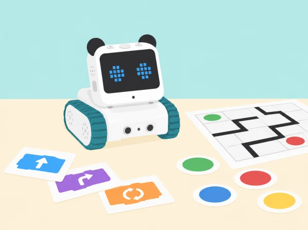

_El museu és una proposta pròpia; cada mòdul construeix un joc petit amb codi visible i proves repetibles._

## 🌱 Situació i producte final

L’alumnat prepara una exposició interactiva per a la comunitat educativa. En parelles, dissenya jocs i reptes que combinen pantalla LED, botons, variables, sensors reals i moviment. Cada sessió deixa un artefacte provable i un registre breu de decisions. La progressió proposa una interpretació local per a cadascun dels 24 títols CSTA publicats per Makeblock. Els plans docents s’han contrastat directament per a les lliçons 1, 3, 4, 13, 14, 15, 17 i 18. Per a les lliçons 1–16, els objectius públics del curs diferent *Codey Rocky & Neuron Discovery* permeten una comprovació addicional, però no substitueixen les fitxes CSTA. La resta de sessions s’identifica com a adaptació pròpia del títol i l’objectiu públic. No incorpora Neuron ni cap accessori extern com a requisit.

Quan un repte oficial es basa en una història o joc concret, ací es transforma en un context de barri o centre. Cap activitat utilitza dades personals, velocitat corporal o sons enregistrats. Les proves de moviment es fan en una zona buida i amb una persona observadora.

## 🎯 Aprenentatges i vocabulari

- Reconéixer els components de Codey Rocky que es proven i relacionar botons, sensors i pantalla amb les respostes programades.
- Construir programes amb seqüències, repeticions, condicions, variables i funcions segons el repte de cada lliçó.
- Crear animacions i mecàniques de joc, i provar-les amb casos previstos i casos que poden fer fallar el programa.
- Depurar una instrucció concreta i explicar els límits de cada joc o moviment abans de compartir-lo amb una altra persona.

## 📅 Seqüència completa · 24 sessions

### **L1 · El secret de Codey Rocky · del problema al primer programa (40 min).**

#### Fase 1 · Activem i prediem (5 min)

Mostreu Codey Rocky apagat i un conjunt de targetes amb robots de contextos diferents. En parelles, relacioneu cada robot amb una tasca possible i expliqueu quina observació us ha fet triar-la. Diferencieu una funció comprovada d’una suposició: aquesta activitat no demana activar reconeixement facial ni cap servei d’intel·ligència artificial.

#### Fase 2 · Explorem i construïm (10 min)

Observeu les dues parts del robot de la dotació. Codey conté el controlador, pantalla LED, botons, llums, altaveu i sensors integrats; Rocky n’és la base mòbil, amb motors i sensor frontal inferior. Feu un inventari dibuixat de les peces que realment veieu i assenyaleu una capacitat que vulgueu comprovar. No afegiu accessoris externs al mapa del kit.

#### Fase 3 · Expliquem i registrem (10 min)

Construïu un esquema propi **idea → programa → càrrega → acció**. Expliqueu que un programa és una seqüència d’instruccions que es tradueix a blocs; el robot només executa allò que s’ha programat i carregat. En mBlock 5, localitzeu escenari, categories de blocs i àrea de codi. Feu una predicció abans de connectar cap dispositiu.

#### Fase 4 · Apliquem i millorem (10 min)

Connecteu Codey amb el cable USB, enceneu-lo i seleccioneu el port sèrie correcte en mBlock 5. Creeu una acció mínima amb l’esdeveniment de prémer A i una icona de pantalla; carregueu el programa, desconnecteu el cable de dades i poseu el robot sobre una superfície estable abans de provar-lo. Si no respon, reviseu alimentació, port, mode de càrrega i esdeveniment, d’un en un.

#### Fase 5 · Comprovem i reflexionem (5 min)

**Evidència:** inventari de Codey/Rocky, diagrama idea-programa-acció, captura o dibuix dels blocs, resultat de la prova i una dificultat resolta. Tanqueu amb les frases «hui he aprés…», «el problema era…» i «l’he resolt…»; es pot respondre amb text, dibuix o explicació oral.

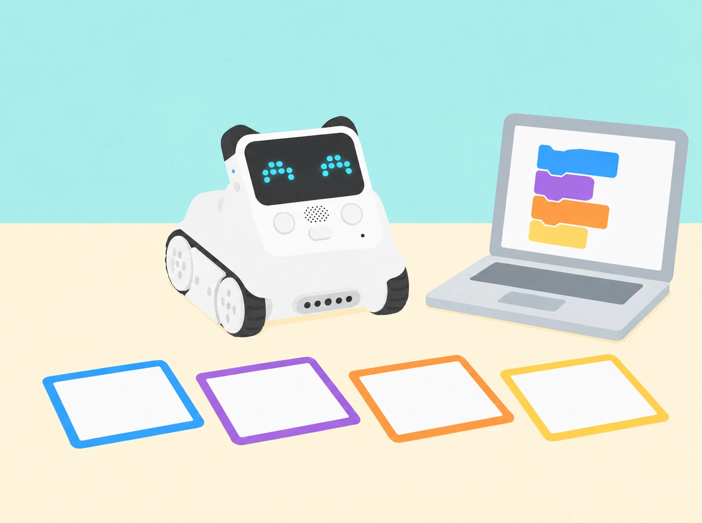

_Les targetes i la interfície són una representació pròpia; el robot parteix del model Codey Rocky treballat a classe._

### **L2 · Botons i expressions programades (40 min).**

#### Fase 1 · Activem i prediem (5 min)

Recordeu una entrada i una eixida de la lliçó anterior. Presenteu una situació neutral: “quan entrem en una aula fosca, premem l’interruptor i s’encén el llum”. Identifiqueu l’acció que inicia la resposta i predigueu què passaria si no es produïra. En aquesta SDA, les icones de pantalla són símbols triats per l’equip: no mesuren ni representen l’estat emocional de cap persona.

#### Fase 2 · Explorem i construïm (10 min)

Feu una versió pròpia del joc desconnectat «Segueix les instruccions»: assigneu tres o quatre senyals geomètrics a accions simples de paper, com alçar una targeta, dibuixar una forma o girar una fitxa. Una persona mostra el senyal i el grup executa l’acció acordada; proveu una ronda lenta i una amb els senyals en un altre ordre. Qui preferisca no fer moviments pot ser qui mostra les targetes, marca la seqüència o comprova si la resposta correspon al senyal.

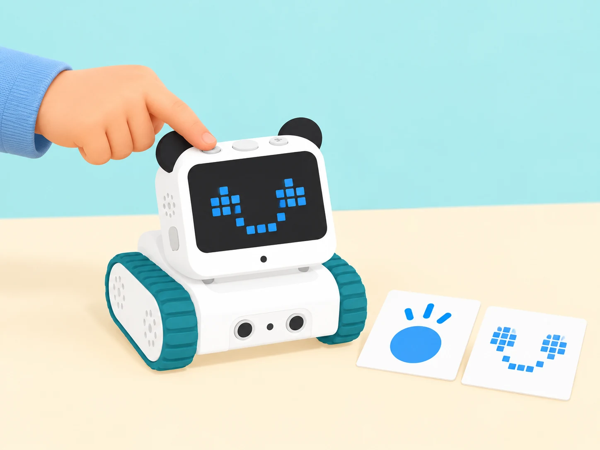

_La imatge mostra una entrada física i una resposta visual programada; els símbols no descriuen emocions reals._

#### Fase 3 · Expliquem i registrem (10 min)

En mBlock, localitzeu un esdeveniment d’inici i els blocs «quan es prem A», «B» i «C». Seguiu amb el dit el programa model i expliqueu la relació entrada–resposta. Distingiu l’esdeveniment (inici o botó premut) de l’acció programada (mostrar una icona, reproduir un so o combinar les dues). Abans de carregar res, dibuixeu una taula amb les tres entrades, la resposta esperada i una comprovació; si la versió de l’app o el dispositiu no mostra algun bloc, anoteu la diferència i continueu amb les entrades disponibles.

#### Fase 4 · Apliquem i millorem (10 min)

En parelles, programeu una resposta diferent per a cada botó amb símbols i sons propis o d’ús lliure. Feu una primera prova guiada i després canvieu els rols: una persona programa i l’altra comprova, sense tocar el projecte. Proveu cada entrada almenys dues vegades i una vegada l’inici; registreu si la resposta coincideix amb la taula. Ajusteu un bloc cada vegada. El so és opcional: oferiu sempre una versió silenciosa i no useu etiquetes com “content”, “trist” o “enfadat” per inferir com se sent qui participa.

#### Fase 5 · Comprovem i reflexionem (5 min)

Cada parella presenta una resposta del seu programa i explica quin esdeveniment la desencadena. Una altra parella tria una entrada i comprova si el resultat coincideix amb la predicció; si no, l’equip assenyala el primer bloc que cal revisar i proposa una prova nova. **Evidència:** joc desconnectat, taula d’entrades i eixides, programa amb esdeveniments, registre de proves i una explicació breu d’un canvi. La valoració se centra en la relació causa–resposta i en la claredat del codi.

### **L3 · Dissenyem una animació amb seqüències (40 min).**

#### Fase 1 · Activem i prediem (5 min)

Presenteu una escena de biblioteca: una persona arriba, deixa un llibre i tanca el prestatge. Ordeneu tres vinyetes i compareu què deixa de tindre sentit si se n’intercanvien dues. Anomeneu *seqüència* el conjunt d’accions ordenades que completa una tasca.

#### Fase 2 · Explorem i construïm (10 min)

Una persona fa de robot i una altra li dona instruccions per a arribar a una marca i dibuixar una icona. La persona-robot executa literalment les ordres, sense completar passos que no s’han dit. Anoteu una ambigüitat i reescriviu-la abans de repetir.

#### Fase 3 · Expliquem i registrem (10 min)

Obriu un programa amb l’esdeveniment «quan es prem A» i encadeneu quatre fotogrames propis de pantalla amb una duració curta per a cadascun: icona inicial, canvi, gest visual i icona final. Expliqueu com l’ordre dels blocs determina l’animació; no cal representar cares o emocions.

#### Fase 4 · Apliquem i millorem (10 min)

Dibuixeu un fotograma en una graella LED de cinc per cinc. Dupliqueu-ne el bloc, canvieu uns pocs píxels i repetiu la seqüència fins que una altra parella puga reconéixer el moviment o missatge. Carregueu-la i ajusteu l’ordre o la duració a partir d’una observació concreta.

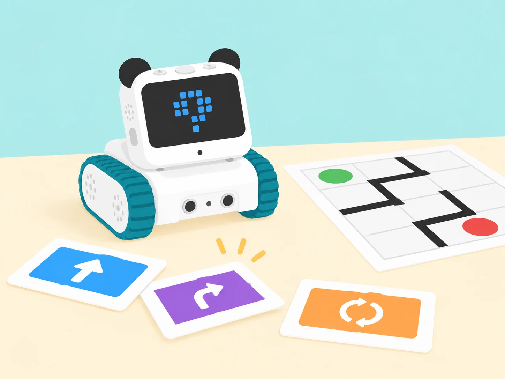

_La graella i les targetes són materials didàctics propis; l’animació s’executa a la matriu LED del robot._

#### Fase 5 · Comprovem i reflexionem (5 min)

**Evidència:** vinyetes ordenades, programa de quatre fotogrames, predicció, comentari de l’audiència i una revisió. Un altre equip explica què ha entés abans de rebre el títol de la peça.

### **L4 · Detectem i corregim un error (40 min).**

#### Fase 1 · Activem i prediem (5 min)

Expliqueu que un *bug* és un defecte del programa que provoca una diferència entre el resultat esperat i l’observat. Poseu un exemple quotidià —una instrucció que omet una parada— i distingiu-lo d’una limitació del sensor o d’un problema de connexió.

#### Fase 2 · Explorem i construïm (15 min)

Prepareu tres programes curts amb un error cadascun: una ruta de maqueta que no arriba a una clau dibuixada; una parada que no s’activa abans d’un obstacle tou; i un compte arrere que no acaba mostrant el missatge final. L’últim cas substitueix la bomba fictícia del material d’origen per una càpsula de missatge segura. Abans d’executar, cada parella escriu el resultat esperat; després registra el punt on la prova es desvia.

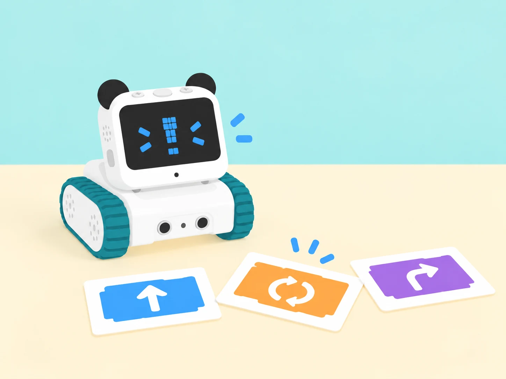

_Les targetes són material propi de prova; el robot no detecta errors de programa automàticament._

#### Fase 3 · Expliquem i registrem (5 min)

Descriviu el símptoma i compareu-lo amb el programa. Reviseu esdeveniment inicial, ordre, valor i condició; separeu els errors de codi dels errors de maquinari. No canvieu simultàniament diversos blocs.

#### Fase 4 · Apliquem i millorem (10 min)

Canvieu una sola instrucció, torneu a executar el mateix cas i comproveu si s’ha resolt la desviació. Si no, desfeu el canvi i proveu una hipòtesi diferent. Una parella revisora intenta reproduir el resultat amb les mateixes condicions.

#### Fase 5 · Comprovem i reflexionem (5 min)

**Evidència:** predicció, símptoma, hipòtesi, canvi únic, resultat i conclusió. Marqueu si la causa era un bloc, una connexió o una expectativa mal definida; no doneu per corregit un error fins que una prova ho confirme.

### **L5 · Bucle comptat (40 min).**

#### Fase 1 · Activem i prediem (5 min)

Recupereu la seqüència d’animació de L3. En una tira de quatre vinyetes, representeu una granota dibuixada que es prepara, salta, aterra i es prepara de nou mentre travessa quatre illots de la marjal. Marqueu quin fragment es repeteix quatre vegades i quines accions passen només abans o després del bucle. Aclarim que és una història mostrada a la matriu LED: Codey Rocky no es desplaça pels illots.

#### Fase 2 · Explorem i construïm (10 min)

Ordeneu tres targetes de paper —preparar la granota, saltar i aterrar— i afegiu una pausa perquè es puga llegir cada fotograma. Feu que una altra parella execute el fragment quatre vegades. Després, compareu la tira de tres instruccions dins d’un únic bucle comptat amb la mateixa tira copiada quatre vegades; marqueu què queda dins de `repeteix` i què s’executa només una vegada abans o després.

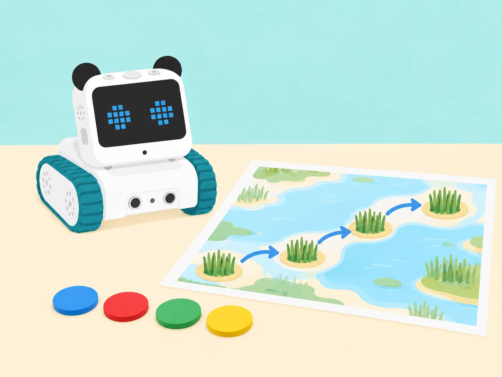

_Les quatre marques modelen el nombre d’iteracions; el robot no identifica hàbitats ni compta les parades per si mateix._

#### Fase 3 · Expliquem i registrem (10 min)

En mBlock, programeu amb el botó A una animació original a la pantalla de Codey: mostreu dos dibuixos propis (granota preparada i salt), afegiu una pausa breu per a llegir-los i repetiu la seqüència amb `repeteix (4)`. Després del bucle, mostreu una icona final diferent. Seguiu les quatre iteracions amb una taula de traça: número de volta i fotograma observat. Canvieu el recompte a 3, torneu a executar-lo i comproveu que la seqüència final es mostra només quan el bucle acaba. Expliqueu quin esdeveniment inicia el programa i com el nombre de repeticions determina el final.

#### Fase 4 · Apliquem i millorem (10 min)

En parelles, creeu una segona versió canviant només una decisió cada vegada: l’esdeveniment d’inici, el nombre de salts, els dibuixos o el so opcional. Afegiu una història de la marjal i intercanvieu els programes: l’equip visitant prediu quantes iteracions farà i identifica quan apareix el fotograma final. Si la versió no coincideix amb la predicció, localitzeu el bloc que determina el recompte abans de modificar-lo. El so es pot substituir per una pausa visual; els dibuixos representen una història inventada, no una observació de fauna.

#### Fase 5 · Comprovem i reflexionem (5 min)

Cada parella presenta l’animació i respon: què representa una iteració, quantes n’hi ha i com sap el programa que ha d’acabar? Autoavaluació: **blau**, identifique la seqüència repetida; **groc**, use el bucle per a fer quatre iteracions observables; **violeta**, canvie el recompte o l’esdeveniment i explique com afecta el resultat. Registreu un problema trobat i com l’heu resolt. **Evidència:** storyboard, animació activada per un esdeveniment, quatre fotogrames/cicles traçats, prova del recompte alternatiu i retorn d’una altra parella.

**Pregunta docent:** què determina que el bucle acabe després del nombre de voltes acordat?

### **L6 · Bucle continu (40 min).**

#### Fase 1 · Activem i prediem (5 min)

Recupereu el programa de L5 i compareu `repeteix (4)` amb una seqüència que no té un nombre fix de voltes. Useu el cicle de llum i foscor com a exemple natural que es repeteix, i dibuixeu tres fotogrames per representar una alba i una posta de sol sobre la marjal. Predigueu quin programa acabarà després d’un nombre establit i quin continuarà fins que algú el detinga.

#### Fase 2 · Explorem i construïm (10 min)

En mBlock, feu una animació finita amb un esdeveniment de botó i un `repeteix`; després, creeu-ne una segona amb un altre botó i poseu la seqüència dins de `per sempre`. Alterneu tres fotogrames propis amb pauses prou llargues perquè es puguen llegir. Abans de provar el bucle infinit, identifiqueu el control de parada de l’entorn. Si la versió de mBlock ofereix un esdeveniment del botó C i un bloc per a aturar tots els scripts, assigneu-los aquesta funció i comproveu-la amb el robot quiet. Si no hi són, useu el control d’aturada de mBlock. En MicroPython, la documentació oficial mostra el botó C cridant `codey.stop_all_scripts()`; aquesta API no implica que el mateix bloc estiga disponible en mBlock.

#### Fase 3 · Expliquem i registrem (10 min)

Compareu els programes bloc a bloc: quin té un nombre de voltes definit i quin no incorpora cap eixida natural? Executeu-los i registreu inici, dos cicles observats, ordre d’aturada i resposta final. Verifiqueu la via de parada que heu triat: el botó C només si heu pogut programar-lo en l’entorn disponible; si no, el control de mBlock. Anoteu quin mètode ha funcionat i expliqueu per què un bucle infinit necessita un control de parada accessible.

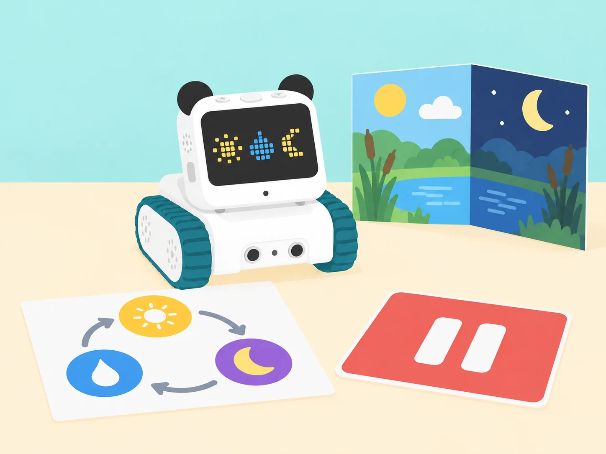

_El paisatge de dia i nit és una metàfora de paper; la placa no mesura el cicle natural en aquesta activitat._

#### Fase 4 · Apliquem i millorem (10 min)

En parelles, canvieu les imatges, l’ordre, una pausa o el so opcional i proveu si la història continua sent comprensible en tots dos programes. L’equip revisor comprova que la versió comptada acaba sola i que la versió contínua respon a l’aturada. No feu pampallugues ràpides ni sons sobtats; qui ho preferisca pot analitzar les targetes de fotogrames en paper, amb la mateixa predicció de bucle.

#### Fase 5 · Comprovem i reflexionem (5 min)

Cada equip presenta les dues animacions i respon quina utilitza `repeteix`, quina `per sempre` i com n’ha comprovat la finalització. Completeu una autoavaluació: un bucle comptat de la vida quotidiana, un procés cíclic que no té un final fix i una precaució necessària quan un programa continua actiu. **Evidència:** storyboard de tres fotogrames, dos programes amb esdeveniments diferents, registre de cicles/aturada, retorn d’una altra parella i autoavaluació.

**Pregunta docent:** com sap l’usuari que el bucle està actiu i com pot acabar-lo?

### **L7 · Cursa I: colors i obstacles (40 min).**

#### Fase 1 · Activem i prediem (5 min)

Recupereu el treball anterior: recordeu què és un error de programa i distingiu `repeteix` de `per sempre` amb un exemple oral breu. Després, contrasteu-ho amb la condició: una decisió `si` comprova un valor i només aleshores executa una instrucció. Feu una «capsa de condicions» amb targetes de prova fàcils d’identificar i no personals (per exemple, «la fitxa és verda»): qui trau una targeta decideix si es compleix i segueix la instrucció associada. En parelles, creeu una targeta pròpia de repte amb una resposta per al cas vertader i una altra per al fals. Predigueu com podria respondre Codey davant d’una bandera verda o d’un obstacle en una pista de maqueta. No és una cursa de velocitat.

#### Fase 2 · Explorem i construïm (10 min)

Identifiqueu el mòdul IR de Rocky i comproveu el seu selector d’orientació: cap avall per llegir color/superfície, cap avant per detectar un obstacle. Són dues configuracions de prova, no dues lectures simultànies. Prepareu una porta amb targeta verda i una altra de color diferent; en una segona taula, poseu un obstacle tou i ample. Manteniu la base parada mentre canvieu l’orientació i comproveu al bloc de sensor què llig cada posició.


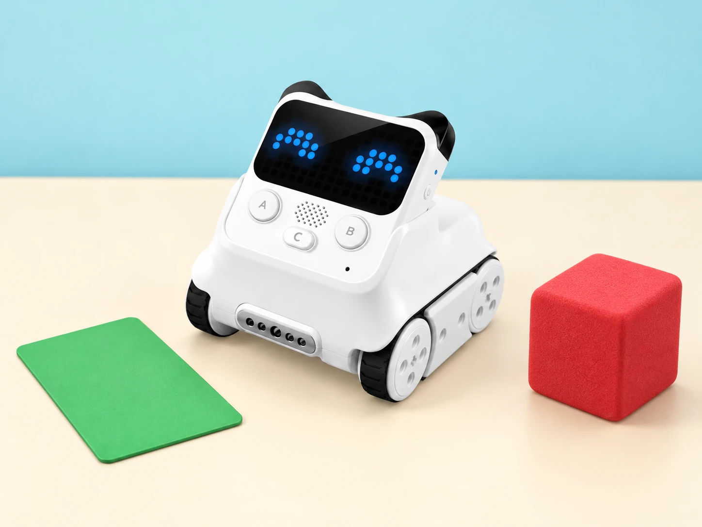

_Els objectes són estàtics; la lectura de color i la detecció d’obstacles es proven en orientacions diferents, no alhora._

#### Fase 3 · Expliquem i registrem (10 min)

En la configuració cap avall, programeu el botó A i una condició `si color = verd`: avanceu només un tram curt a velocitat baixa si la lectura coincideix; altrament, quedeu-vos aturats. En la configuració cap avant, feu una prova independent `si obstacle detectat`: atureu-vos, gireu a l’esquerra una quantitat limitada i avanceu només una casella de maqueta abans d’aturar-vos. El bloc de proximitat es tracta com una detecció, no com una mesura exacta de distància. Registreu per separat orientació, entrada, valor/estat, condició vertadera o falsa i resposta.

```blocks
quan es prem A
  si el color llegit és verd
    avança a velocitat baixa un tram curt
  si no
    atura els motors

quan es prem A  // en la prova amb el sensor orientat cap avant
  si es detecta un obstacle
    atura els motors
    gira a l'esquerra una vegada
    avança una casella i atura
```

#### Fase 4 · Apliquem i millorem (10 min)

Completeu una bateria de casos en dues tandes: amb el sensor cap avall, targeta verda i no verda; cap avant, obstacle present i absent. Feu tres intents per cas sense moure la llum ni el material entre lectures. Si el color no es reconeix de manera estable, augmenteu la superfície de la targeta o useu una targeta d’entrada simulada. Si l’obstacle no es detecta, reviseu l’orientació i el bloc utilitzat. No combineu els resultats com si el robot haguera llegit ambdues entrades en un mateix instant.

#### Fase 5 · Comprovem i reflexionem (5 min)

**Evidència:** dibuix de les dues orientacions del sensor, taules independents de casos vertaders/falsos, programes o simulacions identificades i una revisió justificada. Expliqueu quin bloc representa una decisió booleana i per què la lectura de color i la d’obstacle s’han provat en moments diferents.

**Pregunta docent:** quina observació ha fet certa cada condició i què canvia quan girem el sensor?
### **L8 · L’estació de servei i el túnel de la marjal (40 min).**

#### Fase 1 · Activem i prediem (5 min)

Recupereu les condicions vertadera/falsa de L7 i compareu diverses instruccions `si` amb un `repeteix` que conté una condició. El repte principal adapta la reentrada al circuit de *The Racing Game II*: Codey Rocky arriba a una estació de servei en tres orientacions possibles —cap a l’esquerra, cap a la dreta o cap avant— i ha de trobar l’única eixida. Predigueu què indica l’obstacle davant del sensor i per què cal tornar a comprovar-lo després de cada gir. Com a segona prova independent, travessareu un túnel fosc i comparareu lectures de llum amb un operador. No es llegiran color, obstacle i llum alhora.

#### Fase 2 · Explorem i construïm (10 min)

Construïu amb llibres o cartó una estació en forma d’U, amb tres costats tancats, una única eixida i una recta de pista davant; prepareu també un túnel curt de cartolina per a la prova de llum, separada de la ruta. Situeu el robot en les tres orientacions inicials del repte, sempre dins de l’U i amb espai lliure per a girar. Gireu el sensor IR cap avant i comproveu que detecta les parets; useu el sensor de llum integrat només en la prova del túnel. Abans d’engegar, retireu qualsevol objecte solt i valideu la distància d’aturada a potència baixa.

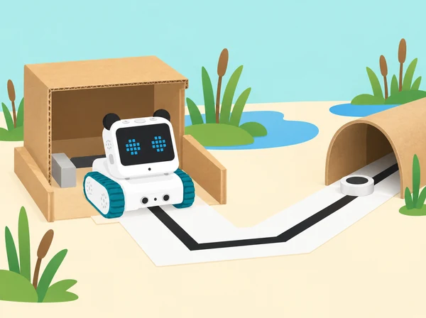

_Il·lustració pròpia de la maqueta de L8; el túnel i el traçat són materials d’aula, no un escenari oficial ni una construcció real de l’Albufera._

#### Fase 3 · Expliquem i registrem (10 min)

Programeu l’eixida amb una condició dins d’un bucle comptat: si hi ha una paret davant, gireu a la dreta 90°; repetiu la comprovació tres vegades com a màxim. Quan el sensor veja l’eixida lliure, el robot s’hi haurà orientat sense dependre de la posició inicial. En arribar a l’obertura, gireu a l’esquerra 90° per incorporar-vos a la recta del circuit i avanceu a la velocitat més alta que hàgeu comprovat abans que cap roda sobreïsca del traçat. Anoteu orientació inicial, nombre de girs, eixida detectada i resultat de la incorporació.

```blocks
quan es prem A
  repeteix 3 vegades
    si hi ha obstacle davant
      gira a la dreta 90 graus
  si l'eixida està lliure
    gira a l'esquerra 90 graus
    avança pel circuit a velocitat validada
```

El bucle és finit i limita els girs a tres intents; no l’embolcalleu amb un `per sempre`. La consigna oficial de continuar a gran velocitat s’adapta a una velocitat màxima local validada, perquè una recta curta o una bateria baixa poden fer perdre el control del model.

#### Fase 4 · Apliquem i millorem (10 min)

Proveu la ruta des de les tres orientacions, amb tres intents comparables per orientació. Registreu els girs i si arriba a la pista; canvieu una sola part del codi si falla. Com a extensió del repte oficial, en arribar a l’estació el Codey pot mostrar una expressió inventada i un indicador lluminós; afegiu un so breu i baix només si tot el grup el troba còmode. No feu sonar l’altaveu mentre el robot es mou. En una tanda separada, useu el sensor de llum de Codey per comparar el passadís clar amb el túnel ombrejat. Registreu primer les lectures i trieu un llindar entre els valors observats: són valors relatius del sensor, no lux calibrats. Dins d’un segon `repeteix 3`, llegiu la llum, espereu un segon i apliqueu l’operador `<`: si queda per davall del llindar, enceneu l’indicador RGB blanc i reduïu la velocitat; si no, apagueu l’indicador i manteniu la velocitat de prova. Feu tres lectures per condició i no presenteu el llindar com una mesura de seguretat real.

```blocks
repeteix 3 vegades
  llig la llum ambiental
  espera 1 segon
  si la llum és menor que el llindar
    encén l’indicador RGB blanc
    mou-te a velocitat reduïda
  si no
    apaga l’indicador RGB
    mantín la velocitat de prova
```

#### Fase 5 · Comprovem i reflexionem (5 min)

Compareu els girs observats en les tres orientacions i la taula de llum clara/ombra. Expliqueu per què el bucle redueix codi repetit, què retorna una comparació `<` i quina diferència hi ha entre el mòdul IR orientat cap avant i el sensor de llum de Codey. **Evidència:** diagrama de l’estació amb tres orientacions inicials, registre de nou intents de reentrada, dos programes amb bucles finits i condicions, valors de llum i revisió d’una prova.

**Pregunta docent:** quines parts del repte reutilitzen un bucle i quina lectura del sensor justifica cada condició?

### **L9 · Una barra que respon al paisatge sonor (40 min).**

#### Fase 1 · Activem i prediem (5 min)

Al museu escolar de l’Albufera, una pantalla interpreta l’activitat sonora de l’entorn com una barra de tres altures. Sense gravar ni identificar cap font, predigueu què hauria de mostrar davant d’una lectura baixa, mitjana o alta. El sensor retorna un valor de nivell relatiu; no és una mesura calibrada de decibels ni permet saber qui o què ha produït el so.

#### Fase 2 · Explorem i construïm (10 min)

Localitzeu el sensor de so de Codey en la versió de mBlock disponible i observeu com canvia la lectura davant de tres estímuls suaus i acordats. No feu crits ni sorolls sobtats: es pot treballar amb el soroll ambient habitual o amb una seqüència de valors simulats en paper si el sensor o el bloc no està disponible. Anoteu que la lectura depén del dispositiu, la distància i l’entorn; no enregistreu àudio.

#### Fase 3 · Expliquem i registrem (10 min)

Construïu la barra de tres altures amb tres condicions dins d’un únic bucle `per sempre`. El pla docent defineix `nivell > 20`, `10–20` i `nivell < 10`, i demana l’operador **i** per a la franja central; el quadern d’alumnat escriu aquesta franja com `10 < nivell < 20`, sense assignar explícitament els valors exactes 10 i 20. Perquè la proposta local classifique totes les lectures, acordem i anotem una convenció pròpia: 10 i 20 també mostren la barra mitjana (`10 ≤ nivell ≤ 20`). Són llindars didàctics del repte, no valors universals del sensor. Traceu 9, 10, 15, 20 i 21 abans de provar-los.

```blocks
per sempre
  llig el nivell de so
  si nivell > 20
    mostra barra alta
  si nivell >= 10 i nivell <= 20
    mostra barra mitjana
  si nivell < 10
    mostra barra baixa
```

| Lectura de prova | Eixida local | Motiu |
|---:|---|---|
| 9 | Barra baixa | Menor que 10 |
| 10 | Barra mitjana | Límit assignat a la franja central per convenció local |
| 15 | Barra mitjana | Dins de la franja central |
| 20 | Barra mitjana | Límit assignat a la franja central per convenció local |
| 21 | Barra alta | Major que 20 |

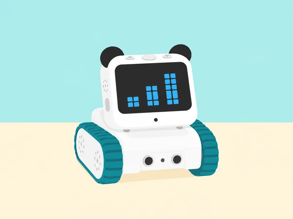

_Representació visual de tres nivells: la pantalla mostra una resposta programada, no un valor de decibels ni una gravació._

#### Fase 4 · Apliquem i millorem (10 min)

Comproveu cada frontera (9, 10, 20 i 21) amb l’entrada real o amb valors simulats, i contrasteu-la amb la taula. Després, feu l’extensió oficial: afegiu una resposta de color amb l’indicador RGB o dividiu una de les franges en dos nivells. Manteniu el bucle de lectura i torneu a provar totes les fronteres que puga afectar el canvi.

#### Fase 5 · Comprovem i reflexionem (5 min)

**Evidència:** taula de valors i eixides per als cinc casos, programa amb condició dins del bucle continu i una explicació de com l’operador **i** delimita la franja intermèdia.

**Pregunta docent:** quina part de l’assignació de 10 i 20 ve de la font i quina és la convenció que hem acordat per al nostre programa? Com comprovem que cap lectura queda sense una resposta definida?
### **L10 · Funcions de bon dia (40 min).**

#### Fase 1 · Activem i prediem (5 min)

Recupereu una condició de L9 i expliqueu què fa el programa si és certa o falsa. Recordeu també com s’inicia un projecte carregat a Codey i com vau trobar un error de codi en L4. Presenteu l’obertura del museu de la marjal: abans d’entrar el públic, cal preparar una animació de benvinguda. Pregunteu com podem donar un nom curt a una seqüència d’accions perquè siga fàcil de tornar a cridar. Una funció agrupa instruccions sota un nom; no és només un esdeveniment ni una animació.

#### Fase 2 · Explorem i construïm (10 min)

En equips, repartiu targetes amb funcions fictícies d’obertura (preparar la pantalla, mostrar la icona, fer una pausa, reproduir un so opcional) i algunes que no corresponen a l’esdeveniment. Doneu un nom clar a cada grup d’accions, trieu quines funcions cal cridar quan Codey s’inicia i ordeneu-les. Compareu si alguna sobra, si una s’ha cridat dues vegades o si el nom no descriu les accions. Es pot llegir la seqüència sense representar-la corporalment.


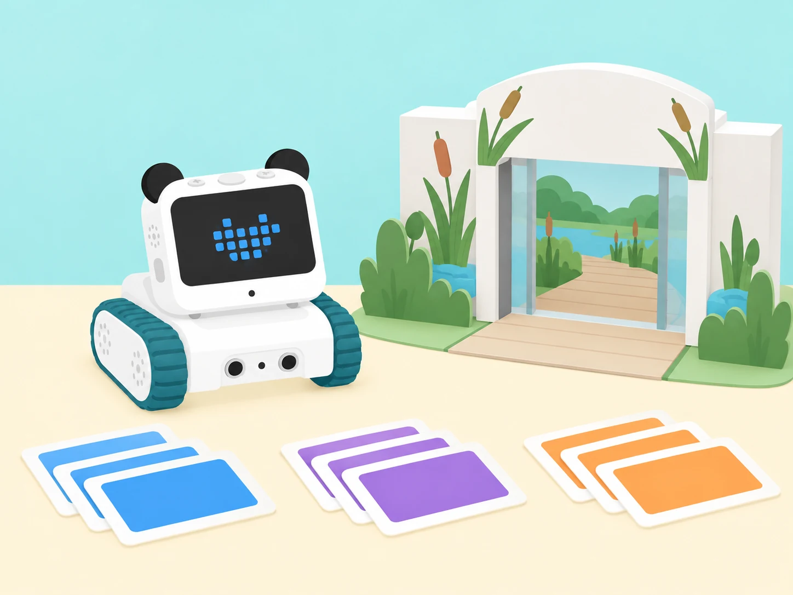

_Les targetes modelen funcions creades per l’alumnat; no són blocs ni accessoris oficials del kit._

#### Fase 3 · Expliquem i registrem (10 min)

En mBlock 5, obriu **Els meus blocs / My Blocks**, creeu una funció pròpia `benvinguda_marjal` i definiu-hi una animació de dos fotogrames a la matriu: icona de la marjal, pausa llegible, icona de benvinguda i esborrat. Després, crideu-la des de l’esdeveniment d’inici de Codey. Traceu l’ordre: esdeveniment → crida → instruccions de la funció → final de la seqüència. Registreu la diferència entre definir una funció i cridar-la.

```blocks
defineix benvinguda_marjal
  mostra icona de la marjal
  espera 1 segon
  mostra icona de benvinguda
  espera 1 segon
  esborra la matriu

quan Codey inicia
  crida benvinguda_marjal
```

#### Fase 4 · Apliquem i millorem (10 min)

Personalitzeu els dos fotogrames i compareu la funció amb una versió que repetisca els mateixos blocs sense funció. Com a extensió, afegiu un esdeveniment del botó A que cride de nou `benvinguda_marjal`: comproveu que una única definició serveix tant en iniciar com en prémer A. El so és opcional; mantingueu l’alternativa visual silenciosa.

#### Fase 5 · Comprovem i reflexionem (5 min)

**Evidència:** targetes ordenades, animació de dos fotogrames, funció definida i cridada en iniciar, segona crida opcional des d’A, traça de l’execució i comparació amb la versió sense funció.

**Pregunta docent:** què passa si definim una funció però no la cridem, i com sabem que el nom representa realment les instruccions que conté?

### **L11 · Petit vigilant I: missions i distàncies (40 min).**

#### Fase 1 · Activem i prediem (5 min)

Recupereu la funció `benvinguda_marjal` de L10: què vol dir definir-la i què cal fer perquè s’execute? Recordeu una errada que vau depurar en L4 i la relació entre distància, velocitat i temps. El museu escolar vol una maqueta de patrulla amb dos recintes quadrats connectats per un passadís. En parelles, dibuixeu l’inici, els dos quadrats i la connexió; mesureu un costat i el passadís amb la mateixa unitat. Predigueu quina seqüència es pot encapsular en una funció repetible i quines dades falten abans de calcular el temps del trajecte.

#### Fase 2 · Explorem i construïm (10 min)

Marqueu la ruta sobre paper gran o amb cinta de pintor en una zona de terra lliure i plana; manteniu el robot allunyat de taules, escales i passadissos de circulació. Mesureu la distància que recorre Codey Rocky durant un segon a una potència baixa i repetible; repetiu tres vegades i calculeu `velocitat = distància ÷ temps` amb la mitjana de les tres lectures. Anoteu costat, connexió, potència, durada i distància observada. El valor d’exemple del manual (14 cm per costat i 7 cm/s a potència 50%) és només una dada per practicar el càlcul: mesureu el robot real abans d’usar-lo.


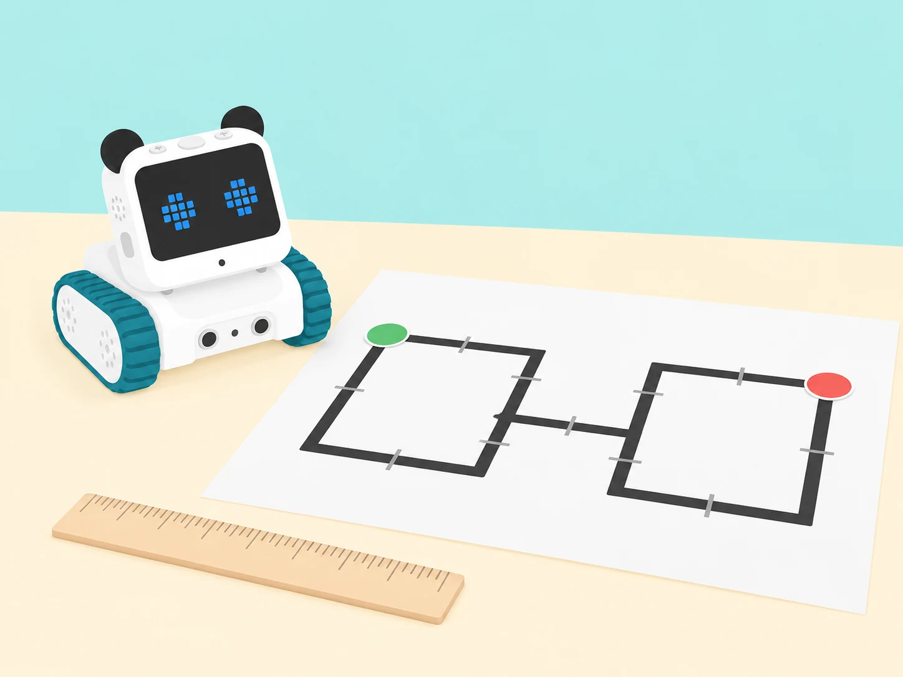

_El plànol representa una patrulla en superfície plana; les distàncies i el temps s’han de mesurar amb el robot disponible._

#### Fase 3 · Expliquem i registrem (10 min)

Definiu `quadrat` com quatre repeticions de «avança una longitud de costat i gira a la dreta». Calculeu el temps aproximat de cada costat amb `temps = distància ÷ velocitat mesurada`, i calibreu per separat el temps de gir de 90° en una prova curta. Si un costat mesura 14 cm i el robot recorre 7 cm/s en la prova, el càlcul inicial és 2 s; no pressuposeu que eixa relació es manté a qualsevol potència o superfície.

```blocks
defineix quadrat
  repeteix 4
    avança durant temps_costat
    gira a la dreta durant temps_gir

quan es prem A
  crida quadrat
  avança durant temps_connexio
  crida quadrat
```

Traceu al mapa la distància total prevista: `2 × (4 × costat) + connexió`. Expliqueu per què cridar la funció dues vegades repeteix el perímetre i per què el tram de connexió va entre les dues crides.

#### Fase 4 · Apliquem i millorem (10 min)

Executeu una volta a potència baixa amb una persona al costat del robot i compareu la posició final amb la línia. Ajusteu una sola dada cada vegada (temps de costat, potència o gir), torneu a provar i registreu l’error. Després, completeu el trajecte amb les dues crides de `quadrat`. Com a extensió que apareix en el manual complementari de Codey Rocky & Neuron, proveu una condició de so alt amb una targeta o una lectura ambiental suau: registreu un cas per davall, un igual i un per damunt del llindar triat, sense gravar ni demanar crits. El manual proposa que el robot avance o gire a màxima potència; en aquesta adaptació, la condició activa només una icona LED estacionària, perquè un so sobtat no inicie un desplaçament inesperat.

#### Fase 5 · Comprovem i reflexionem (5 min)

**Evidència:** mapa mesurat, tres lectures de calibratge i la seua mitjana, càlcul de velocitat i temps, funció `quadrat` cridada dues vegades i comparació entre posició prevista i observada.

**Pregunta docent:** quina dada hem mesurat en el robot i quina part del càlcul continua sent una estimació que depén del terra i de la bateria?
### **L12 · Petit vigilant II: patrullem la segona planta (40 min).**

#### Fase 1 · Activem i prediem (5 min)

Recupereu el plànol de patrulla de la primera planta, construït en L11, i expliqueu com reutilitzàveu `quadrat`. El repte oficial augmenta la dificultat amb més sales i passadissos: cal definir dues funcions, una per al quadrat superior i una altra per a l’inferior, amb girs en sentits oposats, i repetir la seqüència de sales superiors. En la nostra maqueta, dibuixareu una ruta pròpia amb una sala inferior, dues superiors i tres connexions. Predigueu per què les dues funcions de sala no poden compartir el mateix sentit de gir. El robot no puja escales: cada planta és un plànol pla diferent.

#### Fase 2 · Explorem i construïm (10 min)

Dibuixeu un plànol propi pla amb una sala inferior i dues superiors, unides per tres passadissos rectes; marqueu inici, final i sentit del recorregut. Mesureu costats i connexions amb una unitat comuna. Reutilitzeu la velocitat i els girs calibrats en L11, però repetiu la calibració si han canviat terra, càrrega o potència. Una altra parella segueix la ruta amb el dit i comprova que les sales superior i inferior requereixen sentits de gir diferents.

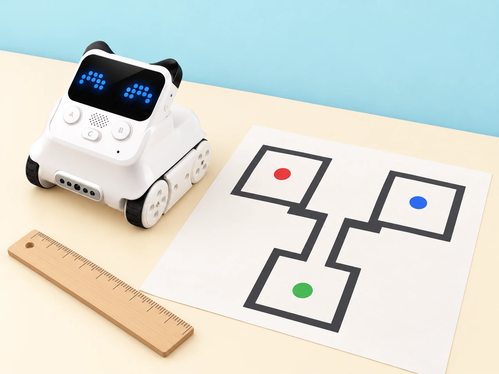

_Les dues plantes són mapes de paper independents: Codey Rocky no puja escales ni patrulla un edifici real._

#### Fase 3 · Expliquem i registrem (10 min)

Definiu `quadrat_inferior` amb quatre avanços i girs a la dreta, i `quadrat_superior` amb quatre avanços i girs a l’esquerra. Creeu `planta_2_marjal`: crideu primer la sala inferior, avanceu una connexió i, dues vegades, crideu la sala superior i avanceu una connexió. Assigneu el programa al botó A. Abans de provar, calculeu `distància recta = 3 × (4 × costat) + 3 × passadís`; estimeu el temps recte dividint aquesta distància per la velocitat mesurada i sumeu per separat els 12 girs calibrats. El plànol i les mesures són propis, no una còpia del mapa de la targeta oficial.

```blocks
defineix quadrat_inferior
  repeteix 4
    avança durant temps_costat
    gira a la dreta 90 graus

defineix quadrat_superior
  repeteix 4
    avança durant temps_costat
    gira a l’esquerra 90 graus

defineix planta_2_marjal
  crida quadrat_inferior
  avança durant temps_passadís
  repeteix 2
    crida quadrat_superior
    avança durant temps_passadís

quan es prem A
  crida planta_2_marjal
```

Compareu el càlcul amb la traça del programa. Identifiqueu les dues funcions de sala i `planta_2_marjal` com la funció principal. Expliqueu com la repetició evita duplicar les dues sales superiors i per què la sala inferior gira en sentit contrari.

#### Fase 4 · Apliquem i millorem (10 min)

Proveu primer cada tipus de sala i després una connexió, sempre a potència baixa. Registreu distància prevista i observada per tram; canvieu una sola durada cada vegada. Quan la ruta funciona, afegiu l’extensió oficial: una icona a la pantalla i un indicador de llum en acabar cada sala; el so és opcional, breu i de volum baix, només quan el robot està aturat. Executeu la patrulla completa amb una persona observadora al costat. Atureu-la si ix del mapa o s’acosta a una zona ocupada. Si no hi ha una zona segura, valideu la composició de funcions amb una fitxa i codi en paper.

#### Fase 5 · Comprovem i reflexionem (5 min)

**Evidència:** dos plànols propis, funcions `quadrat_inferior` i `quadrat_superior`, funció `planta_2_marjal` amb repetició, càlcul de distància/temps, registre de proves per tram i extensió visual. Cada parella presenta la seua solució, rep una observació concreta d’una altra parella i completa una autoavaluació sobre funcions, bucles i calibratge.

**Pregunta docent:** quina part de la patrulla de la primera planta hem reutilitzat i quins valors cal recalcular quan canvien ruta, superfície, bateria o gir?
### **L13 · La caixa de llavors de l’hort (40 min).**

#### Fase 1 · Activem i prediem (5 min)

Presenteu un registre fictici del banc comunitari de llavors amb 10 fitxes. Expliqueu la variable com un contenidor amb nom i valor que es pot reemplaçar. En parelles, proposeu un nom clar per a la reserva i prediu què passa quan n’afegim, en traiem o comparem el valor amb un llindar.

#### Fase 2 · Explorem i construïm (10 min)

Prepareu el registre amb `reserva = 10` i targetes que adapten tota la partida oficial. En ordre, llegiu-les i actualitzeu la variable; una altra persona comprova cada càlcul.

| Targeta pròpia del banc de llavors | Canvi de `reserva` |
|---|---:|
| Plantem 2 fitxes | −2 |
| Si una targeta de temperatura simulada indica més de 5 °C, recuperem 10 fitxes del magatzem de classe | +10 si es compleix |
| Preparem 3 fitxes al migdia | −3 |
| Arriba una aportació de 5 fitxes | +5 |
| Compartim 3 fitxes amb un altre banc | −3 |
| Una etiqueta es trenca i apartem 4 fitxes del recompte | −4 |
| Juguem 3 rondes de pedra-paper-tisora: guanyar +1, perdre −1, empatar 0 | segons cada ronda |
| Usem una fitxa més | −1 |
| Intercanviem 7 fitxes per material de planter | −7 |
| Si `reserva < 5`, reposició des del magatzem de classe | +10 si es compleix |
| Si `reserva > 12`, Codey mostra una icona de celebració | eixida visual |

La temperatura és una entrada simulada en una targeta: Codey Rocky no la mesura en aquesta activitat. Les fitxes són valors del joc, no llavors reals ni indicacions per a recollir-les de l’entorn. Amb una targeta de temperatura simulada de 6 °C i les rondes guanyar/perdre/empat, la traça és `10 → 8 → 18 → 15 → 20 → 17 → 13 → 13 → 12 → 5`. Registreu cada pas i comproveu els dos llindars també per separat: `4 < 5` activa la reposició i `5 < 5` no; `13 > 12` activa la resposta i `12 > 12` no.


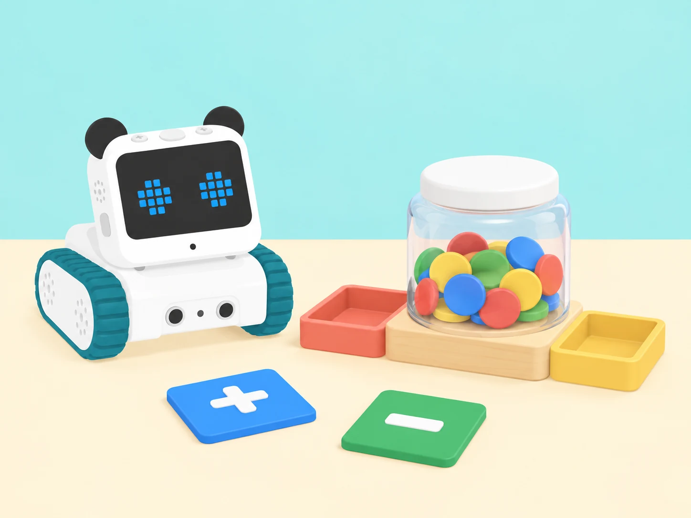

_Les fitxes representen valors de programació; el robot no pesa ni detecta les llavors._

#### Fase 3 · Expliquem i registrem (10 min)

Traduïu als blocs una assignació inicial, un canvi positiu i un de negatiu, la comparació de temperatura simulada i les dues condicions de reserva. Si `reserva < 5`, augmenteu-la en 10 i mostreu el valor nou; si `reserva > 12`, mostreu una icona de celebració. Anoteu valor anterior, operació, valor nou i resposta de cada condició. Els llindars són regles del joc d’aula, no recomanacions agronòmiques.

#### Fase 4 · Apliquem i millorem (10 min)

Comproveu també les variables de moviment amb Codey Rocky en una zona lliure: assigneu `velocitat = 30` i feu un avanç d’un segon; atureu i registreu el resultat. Després assigneu `angle = 70` i proveu el gir; canvieu el valor a 140 i compareu-lo. Si la reserva supera 12, la resposta del joc original és una volta completa de celebració: proveu-la només a potència baixa, amb l’espai buit i una persona observadora; si no és segur o el valor depén de la configuració, useu una animació LED i identifiqueu el moviment com a simulat. Marqueu sempre quan una prova és física o simulada.

#### Fase 5 · Comprovem i reflexionem (5 min)

**Evidència:** traça completa de les targetes, proves de frontera 4/5 i 12/13, programa amb canvis i comparacions, prova o simulació de velocitat/gir i una revisió. Expliqueu què guarda `reserva`, com canvia i per què el valor exactament igual al llindar no activa una condició estricta.

**Pregunta docent:** quin canvi del valor ha provocat la resposta del programa?
### **L14 · Operacions amb el marcador del mercat (40 min).**

#### Fase 1 · Activem i prediem (5 min)

Obriu un marcador fictici que comença a zero. Predigueu què mostrarà després d’afegir una unitat amb A o llevar-ne una amb B; decidiu com representareu valors negatius sense convertir el joc en una puntuació d’alumnes.

#### Fase 2 · Explorem i construïm (10 min)

Creeu una variable `marcador` i assigneu-li el valor 0 en iniciar el programa. Configureu A perquè l’incremente en 1 i B perquè el decremente en 1. Mostreu el resultat en la matriu LED després de cada canvi. Compareu l’operació manual amb el bloc de canvi de variable i observeu què significa restar quan el valor és zero.


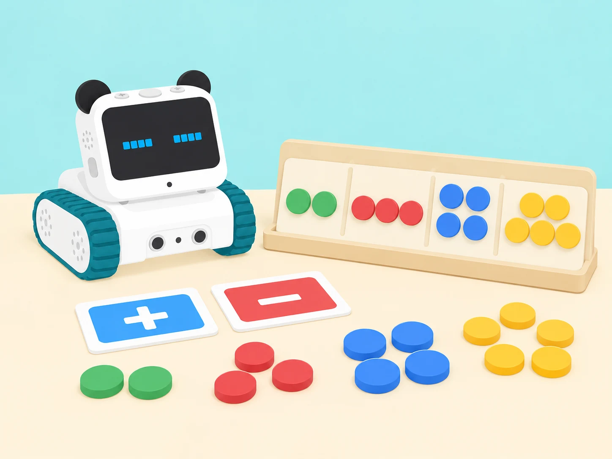

_Els materials són un model de classe; les operacions les calcula el programa, no la imatge ni un sensor del robot._

#### Fase 3 · Expliquem i registrem (10 min)

El repte oficial presenta dues tasques separades. Primer proveu la versió de suma/resta; després guardeu-la o substituïu-la per la versió de multiplicació/divisió. No afegiu els dos programes als mateixos botons alhora: així, A no activarà dues operacions inesperades. En la segona versió, inicialitzeu `marcador` a `4`; A multiplica el valor per 2 i B el divideix per 2. En cada cas, calculeu el resultat amb un bloc d’operadors, assigneu-lo a la mateixa variable i mostreu-lo.

```blocks
quan Codey inicia
  fixa marcador a 4
  mostra marcador

quan es prem A
  fixa marcador a (marcador × 2)
  mostra marcador

quan es prem B
  fixa marcador a (marcador ÷ 2)
  mostra marcador
```

Traceu manualment les dues versions amb `0`, `4` i `−4`. En la versió d’operacions, compareu també `marcador = 3`: dividir un nombre imparell entre 2 pot produir un valor no enter segons els blocs i el tipus de dada de la versió instal·lada. Anoteu el que el programa mostra en lloc de suposar que sempre arrodoneix de la mateixa manera.

#### Fase 4 · Apliquem i millorem (10 min)

Canvieu el valor inicial i el factor (per exemple, de 2 a 3), i repetiu les proves en una còpia de la segona versió. Verifiqueu quin tipus de forma accepta el bloc de variable com a operand i manteniu la mateixa variable en l’inici, A i B. Recordeu que la pantalla mostra valors entre −999 i 9999; si el càlcul ix d’aquest interval, anoteu el límit en lloc d’interpretar la pantalla com un resultat complet.

#### Fase 5 · Comprovem i reflexionem (5 min)

**Evidència:** les dues versions diferenciades, inicialització de la variable, taula d’entrades/operacions/resultats per a casos positius, negatius i imparells, i comparació entre càlcul manual i pantalla.

**Pregunta docent:** per què cal guardar el resultat nou en la mateixa variable perquè el marcador continue acumulant els canvis?
### **L15 · La càpsula d’arribada (40 min).**

El pla oficial treballa variables, compte arrere i aleatorietat dins d’un joc d’explosió. Ací en conservem la lògica de programació i eliminem l’explosiu, la por i el pas ràpid del robot entre persones: usem una càpsula de missatge en una taula estable, amb cancel·lació clara i senyal final neutre.

#### Fase 1 · Activem i prediem (5 min)

Mostreu una variable `temps` que comença en 30 i una càpsula de paper. Predigueu quantes actualitzacions hi haurà si el programa resta una unitat cada segon i què ha de mostrar la pantalla quan arribe a zero.

#### Fase 2 · Explorem i construïm (10 min)

En iniciar, assigneu 30 a `temps` i mostreu-lo en la matriu. En prémer A, comenceu el compte arrere: espereu un segon, resteu 1, mostreu el valor i repetiu 30 vegades. Quan `temps` arriba a 0, atureu el bucle i mostreu «missatge llest» amb una llum d’un color acordat; ometeu el so intens del recurs i oferiu sempre una versió silenciosa. El robot no es passa de mà en mà: els equips roten una targeta de torn.


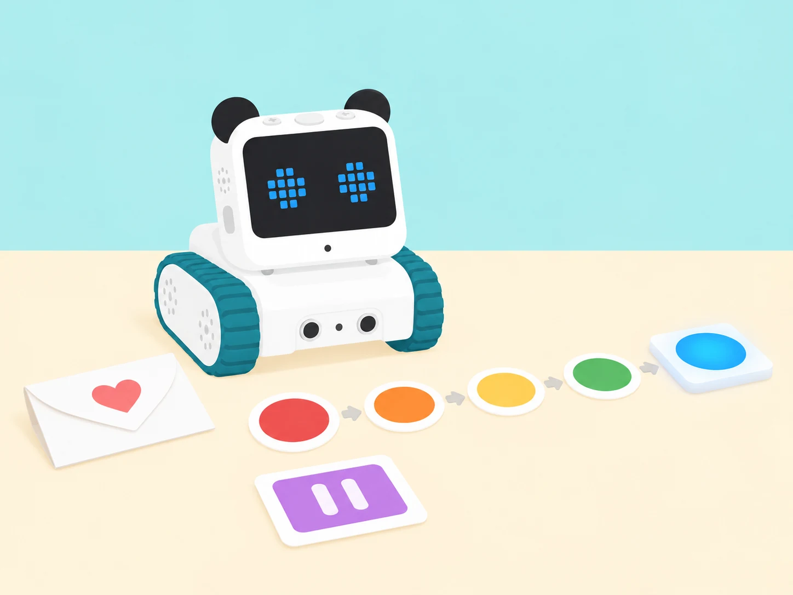

_La càpsula substitueix el context d’explosiu del recurs d’origen; no hi ha objectes ni sons d’amenaça._

#### Fase 3 · Expliquem i registrem (10 min)

Traceu els primers tres segons i el final. Comproveu que el valor inicial, la repetició i la condició d’aturada donen 30 actualitzacions, no 29 ni 31. Registreu què passa si el programa s’inicia dues vegades i si una persona prem el control abans que acabe. La cancel·lació és una ampliació pròpia i s’assaja en un projecte separat; no pot deixar scripts del compte arrere executant-se en segon pla.

#### Fase 4 · Apliquem i millorem (10 min)

Feu dues ampliacions com a projectes separats. En una còpia del compte arrere, afegiu B com a cancel·lació: ha d’aturar els scripts de temps i mostrar «pausa»; verifiqueu que el temporitzador no continua després. En un segon projecte, adapteu la tasca oficial *The Explosive Number* a un comptador cooperatiu de fitxes: inicialitzeu `objectiu` i `comptador` a zero; en prémer A, genereu un objectiu aleatori d’1 a 20 i reinicieu el comptador; cada pulsació de B suma 1 i mostra el nou valor. Quan `comptador = objectiu`, mostreu «missatge llest» i una llum neutra, sense efectes d’explosió. No programeu el compte arrere i el comptador en els mateixos botons.

```blocks
quan Codey inicia
  fixa objectiu a 0
  fixa comptador a 0

quan es prem A
  fixa comptador a 0
  fixa objectiu a nombre aleatori entre 1 i 20
  mostra icona de preparació

quan es prem B
  canvia comptador en 1
  mostra comptador
  si comptador = objectiu
    mostra «missatge llest»
    encén la llum neutra
```

Per provar-ho sense esperar a l’atzar, substituïu temporalment l’assignació aleatòria per objectius fixos 1 i 20; després proveu `objectiu − 1`, `objectiu` i `objectiu + 1`. Només la igualtat ha d’activar el missatge. Restaureu el bloc aleatori i comproveu que cada A reinicia `comptador` abans d’una ronda nova. L’atzar serveix per al joc, no per a seguretat o xifratge.

#### Fase 5 · Comprovem i reflexionem (5 min)

**Evidència:** diagrama d’estats, traça de 30 actualitzacions, cancel·lació provada en un projecte separat i taula de proves del comptador amb objectius fixos, igualtat i valors adjacents; després, comprovació del reinici amb l’objectiu aleatori.

**Pregunta docent:** quina part de la lògica continua sent útil quan canviem el context de bomba a càpsula de missatge?
### **L16 · Pedra, paper i tisora (40 min).**

#### Fase 1 · Activem i prediem (5 min)

Representeu les tres opcions amb símbols neutres i acordeu la regla: pedra guanya a tisora, tisora a paper i paper a pedra; dues opcions iguals són empat. Abans de programar, completeu una matriu amb les nou combinacions i decidiu com registrareu el resultat sense guardar noms ni puntuacions individuals.

#### Fase 2 · Explorem i construïm (10 min)

Inicialitzeu `gest`, `guanys`, `derrotes` i `empats` a zero. Quan Codey Rocky es sacseja, assigneu a `gest` un nombre aleatori entre 0 i 2 i mostreu el símbol corresponent en la matriu LED. En el quadern d’alumnat i el manual docent, la correspondència és **0 = pedra, 1 = tisora, 2 = paper**; un altre resum oficial de la unitat intercanvia els valors de tisora i paper. Ací seguim la correspondència del repte docent i la mantindrem igual en totes les targetes i proves. Si mBlock no exposa el giroscopi o l’atzar, useu A i targetes de nombres, i identifiqueu-ho com a simulació.

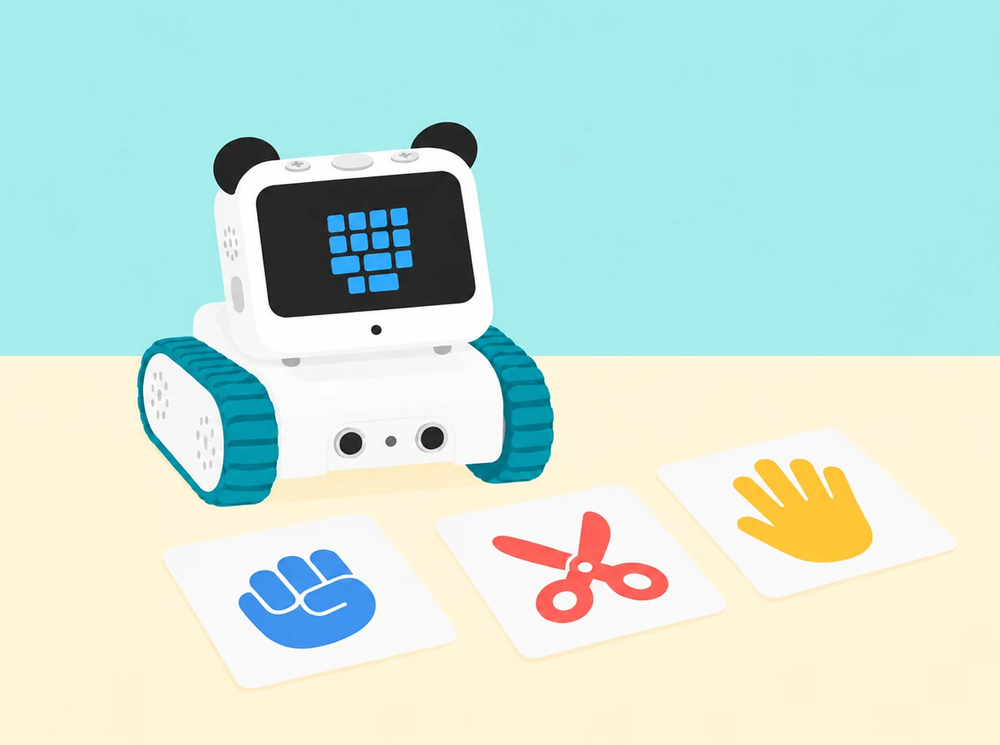

_Les targetes fan visibles les tres opcions del joc; la matriu del robot mostra el gest generat pel programa._

#### Fase 3 · Expliquem i registrem (10 min)

Després de comparar el gest de Codey amb el de la parella, registreu el resultat amb els botons: A suma 1 a `guanys`, B suma 1 a `derrotes` i C suma 1 a `empats`. Cada botó mostra una expressió pròpia diferent; un so breu i baix és opcional i sempre es pot substituir per la resposta visual. Traceu les nou combinacions i comproveu que només canvia el comptador triat. El robot genera el seu gest però no classifica automàticament el resultat: l’equip aplica les regles i prem el botó corresponent. Manteniu un màxim de sis esdeveniments de programa (inici, sacsejada, A/B/C i llum). L’atzar determina el gest del joc; no és una predicció ni una mesura sobre les persones.

```blocks
quan Codey es sacseja
  estableix gest a nombre aleatori entre 0 i 2
  si gest = 0
    mostra símbol pedra
  si no, si gest = 1
    mostra símbol tisora
  si no
    mostra símbol paper

quan es prem A
  canvia guanys per 1
  mostra expressió de celebració
quan es prem B
  canvia derrotes per 1
  mostra expressió de revisió
quan es prem C
  canvia empats per 1
  mostra expressió tranquil·la

quan la llum ambiental supera 2
  si guanys + derrotes + empats > 0
    mostra guanys / (guanys + derrotes + empats)
  si no
    mostra «sense rondes»
```

#### Fase 4 · Apliquem i millorem (10 min)

Executeu la matriu completa de nou combinacions i reviseu si cada resultat coincideix amb les regles. Com a extensió, mostreu en decimal la proporció `guanys ÷ (guanys + derrotes + empats)` quan hi haja almenys una ronda i la lectura de llum ambiental siga superior a 2. Hi ha una discrepància en el recurs oficial: el text diu «superior a 2», però el bloc d’exemple mostra la condició `< 2`; aquesta proposta segueix el text i ho registra com una convenció local. Proveu lectures 1, 2 i 3: només 3 ha de mostrar la proporció. El sensor dona una lectura pròpia del dispositiu, no lux calibrats; si el bloc no està disponible, simuleu les tres lectures. Per expressar després el resultat com a percentatge, multipliqueu la proporció per 100. Abans de dividir, comproveu que `guanys + derrotes + empats > 0`.

#### Fase 5 · Comprovem i reflexionem (5 min)

**Evidència:** taula d’interpretació `0/1/2`, matriu de les nou combinacions, programa de gest aleatori, traça dels tres comptadors, comprovació del límit de sis esdeveniments, proves de llum 1/2/3 i una prova que evita dividir per zero abans de la primera ronda.

**Pregunta docent:** quines variables canvien en cada resultat i què ens diu —i què no ens diu— la proporció de victòries d’un joc?

### **L17 · Un circuit jugable per al museu (40 min).**

La guia docent oficial de *My Speedway* demana dissenyar escena i personatge, controlar el cotxe amb les quatre fletxes, retornar a l’inici quan ix de la pista, mostrar «win!» en tocar la línia roja de meta i afegir com a ampliació arbres que es mouen cap arrere. Aquesta adaptació crea un joc digital original d’un recorregut pel barri: no usa vehicles reals, rànquings ni proves de conducció. Recupera de L16 variables i condicions, i converteix la lliçó en un cicle complet de disseny, prova, retorn i revisió.

#### Fase 1 · Activem i prediem (5 min)

Mostreu tres referències de jocs (o dibuixos propis) i compareu com el color, la forma i el fons ajuden a entendre un personatge i el seu recorregut. Trieu un lloc fictici pròxim —pati, plaça o camí de l’horta— i definiu la idea del joc, l’estil visual, el punt d’inici, el color de la pista, la zona fora de ruta i la línia roja d’arribada. Esbosseu un mapa amb aquests cinc elements abans d’obrir mBlock.

#### Fase 2 · Explorem i construïm (10 min)

En mBlock, dibuixeu o munteu un fons original amb pista ampla i distingible, línia d’inici, línia roja de meta i una zona fora de pista d’un color uniforme. Creeu un personatge digital original o adapteu-ne un de la biblioteca, assigneu-li un nom i establiu una posició inicial. Programeu les fletxes amunt, avall, esquerra i dreta amb desplaçaments curts; afegiu una alternativa de tecles en pantalla o targetes de direcció perquè no calga prémer ràpidament.


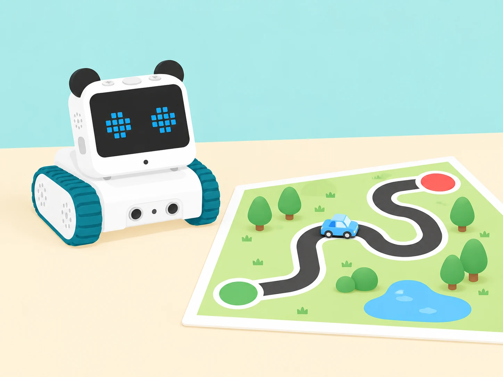

_El robot envia controls al joc de pantalla; no és un cotxe físic ni una prova de conducció._

#### Fase 3 · Expliquem i registrem (10 min)

Escriviu primer les regles en una taula de decisió. La meta roja s’ha de comprovar abans que el retorn per eixida de pista, perquè el color de meta no active les dues respostes alhora. Quan el joc està actiu, les fletxes actualitzen la posició; si el personatge toca la meta roja, canvia a l’estat `guanyat`, mostra «win!» durant dos segons i ignora més controls; si toca la zona fora de pista, torna a la posició inicial. Feu pseudocodi i proveu separadament: dins de ruta, fora de pista, tocar meta i prémer després d’haver guanyat.

```blocks
quan s'inicia el joc
  fixa estat a «actiu»
  vés a la posició inicial
  per sempre
    si estat = «actiu» i toca la línia roja
      fixa estat a «guanyat»
      mostra «win!» durant 2 segons
    si estat = «actiu» i toca el color de fora de pista
      vés a la posició inicial

quan es prem una fletxa
  si estat = «actiu»
    mou el personatge en la direcció indicada
```

#### Fase 4 · Apliquem i millorem (10 min)

Afegiu l’ampliació oficial: arbres del fons es desplacen cap arrere mentre el cotxe digital avança; el moviment del fons ha de ser decoratiu i no alterar les regles de col·lisió. Proveu la partida amb una altra parella. Aquesta anota una instrucció confusa, un cas límit i una cosa que ja s’entén; reviseu una sola decisió de disseny i repetiu els casos afectats. No puntueu velocitat ni compareu persones.

#### Fase 5 · Comprovem i reflexionem (5 min)

**Evidència:** storyboard i fons/personatge originals, pseudocodi, controls de quatre direccions, taula de decisió, proves reproduïbles de pista/meta/fora de pista/estat guanyat, efecte opcional del fons, retorn entre parelles i autoavaluació sobre què s’ha dissenyat, quin error s’ha corregit i quina versió és més clara.

**Pregunta docent:** quina regla fa que el joc continue sent comprensible quan el personatge arriba al límit o a la meta?
### **L18 · Un joc amb el giroscopi de Codey (40 min).**

#### Fase 1 · Activem i prediem (5 min)

Compareu com es controla un joc en ordinador, mòbil o consola i trieu una idea pròpia de recorregut. Definiu què representa inclinar Codey cap a l’esquerra i cap a la dreta, quin missatge rebrà el personatge del joc i com s’aturarà la partida. Inclinar el robot és una opció voluntària; es pot seguir la mateixa predicció des del diagrama o amb tecles.

#### Fase 2 · Explorem i construïm (10 min)

Dissenyeu una escena i un personatge originals en mBlock. Creeu els esdeveniments **Codey inclinat a l’esquerra** i **Codey inclinat a la dreta**; cadascun mostra una icona i envia el missatge corresponent. Configureu el cotxe virtual perquè, en rebre el missatge, s’ature primer qualsevol altre script del mateix sprite i després comence un gir continu en el sentit indicat. Manteniu Codey sobre la taula i inclineu-lo suaument, sense alçar-lo ni sacsar-lo. Si el calibratge del giroscopi està disponible en la versió de l’entorn, calibreu-lo abans de provar.


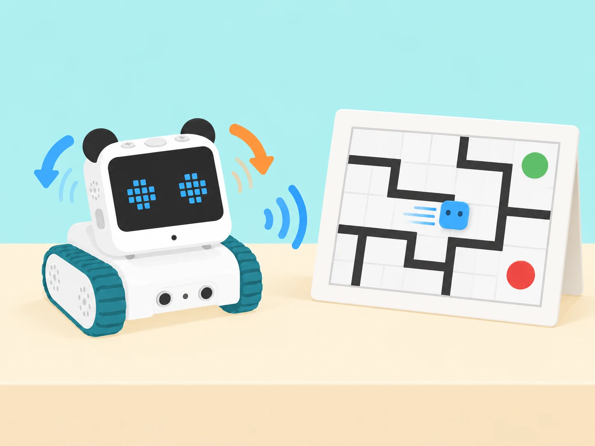

_El moviment representat és del personatge virtual; el robot es manté quiet mentre envia les entrades._

#### Fase 3 · Expliquem i registrem (10 min)

Traceu la cadena entrada del giroscopi → missatge → aturada de l’script anterior → resposta de l’sprite. Proveu esquerra → dreta → esquerra, tornada a posició neutra i absència de missatge quan Codey està pla. En una còpia, lleveu temporalment el bloc d’aturada i feu el canvi esquerra/dreta: observeu com els dos bucles poden quedar actius i conflictuar. Restaureu-lo i comproveu que només es mou en la direcció del missatge més recent.

```blocks
quan Codey s'inclina a l'esquerra
  mostra icona esquerra
  envia «gira_esquerra»

quan Codey s'inclina a la dreta
  mostra icona dreta
  envia «gira_dreta»

quan el personatge rep «gira_esquerra»
  atura els altres scripts d'aquest personatge
  per sempre
    digues «esquerra»
    gira 1 grau
    avança 1 pas

quan el personatge rep «gira_dreta»
  atura els altres scripts d'aquest personatge
  per sempre
    digues «dreta»
    gira 1 grau
    avança 1 pas
```

#### Fase 4 · Apliquem i millorem (10 min)

Trieu una idea de joc nova (per exemple, seguir un canal, esquivar una taca o arribar a una fita), construïu-ne un prototip curt, proveu-lo i corregiu una incidència cada vegada. Compareu els controls disponibles i trieu-ne un segons el joc i les necessitats del grup:

| Control | Punt fort | Límit a comprovar |
|---|---|---|
| Inclinació de Codey | Interacció directa amb el giroscopi integrat | Cal ajustar el gest i mantindre el robot estable sobre la taula |
| Teclat | Direcció precisa i ràpida | Requereix ordinador i prémer tecles |
| Targetes de direcció | Permet predir i acordar ordres sense dispositiu d’entrada | Una persona ha de traduir cada targeta a l’acció del joc |

Registreu per a cada alternativa precisió percebuda, facilitat d’ús i equipament necessari; són observacions d’aula, no mesures universals. Afegiu o retireu una opció a partir del retorn i repetiu la prova. Una variable d’estat pot substituir els missatges com a ampliació, però compareu-ne la llegibilitat amb el broadcast abans de triar.

#### Fase 5 · Comprovem i reflexionem (5 min)

**Evidència:** escena/personatge, diagrama d’entrada–missatge–aturada–sprite, codi dels dos receptors, registre de la prova esquerra/dreta/neutre i del conflicte reproduïble sense aturada, i comparació entre inclinació, teclat i targetes. Autoavaluació sobre el control triat i la depuració dels scripts.

**Autoavaluació:** «he creat un control interactiu», «el conflicte que he trobat era…», «l’he resolt aturant…».

**Pregunta docent:** què passa si no parem l’altre script abans d’enviar el missatge de gir contrari?
### **L19 · Mecàniques de joc I (40 min).**

#### Fase 1 · Activem i prediem (5 min)

Recupereu el joc de recorregut de L17 i convertiu-lo en una ruta virtual per a una barqueta missatgera de la marjal. Abans de tocar el codi, definiu tres tipus de regles: què representen els elements de joc, quines accions pot fer el personatge i quin resultat tanca la partida. Acordeu també una regla comuna i transparent perquè totes les persones juguen en les mateixes condicions.

#### Fase 2 · Explorem i construïm (10 min)

Dibuixeu una pista ampla amb inici, meta i una zona exterior ben diferenciada; useu colors diferents per al canal, l’exterior i la meta, i no els feu tocar-se. En aquesta primera versió no afegiu obstacles ni cronòmetre. En mBlock, connecteu Codey i feu que A i B envien missatges de control a la barqueta; si la connexió no és disponible, useu les fletxes del teclat o targetes equivalents. Definiu en una targeta de regles què vol dir «dins de la pista», què passa quan se n’ix i com es reconeix l’arribada.

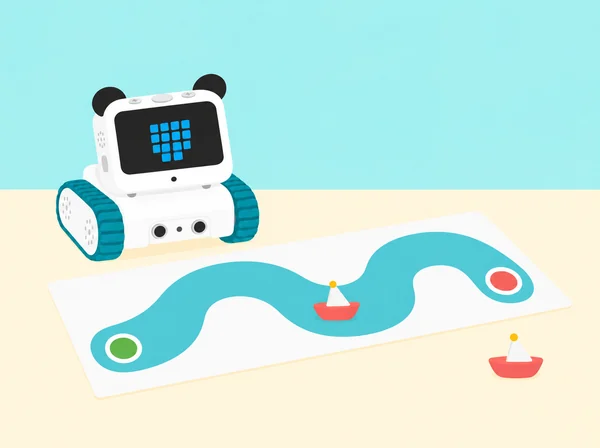

_El mapa il·lustra la regla de límit del joc; la barqueta és un personatge digital i no un robot físic._

#### Fase 3 · Expliquem i registrem (10 min)

Programeu els casos previstos amb branques excloents: si la barqueta toca la meta, mostra el senyal final i deixa de rebre ordres; si no, però toca l’exterior, torna a l’inici; altrament, continua pel canal. Així, una mateixa lectura no pot reiniciar i acabar la partida en el mateix cicle. El personatge de joc pot ser una il·lustració original: no es presenta com un robot físic ni com una representació exacta de fauna local.

```blocks
quan es prem A en Codey
  envia el missatge «avança»
quan es prem B en Codey
  envia el missatge «gira»

quan el personatge rep «avança» o «gira»
  mou el personatge segons l'ordre
  si toca la meta
    mostra «missió completada»
    atura els controls
  si no, si toca la zona exterior
    torna a l'inici
    reinicia la ruta
  si no
    continua la ruta
```

Traceu una partida que segueix la ruta, una que ix del canal i una que arriba a la meta. Proveu també una configuració incorrecta en què meta i exterior comparteixen color: detecteu el conflicte, separeu les zones i repetiu. En cada cas, comproveu que el resultat correspon a la targeta de regles.

#### Fase 4 · Apliquem i millorem (10 min)

Feu una prova d’ús amb una parella que no haja programat la ruta. Observeu si pot explicar les regles només amb la pantalla i les instruccions disponibles. Recolliu un comentari concret i canvieu una sola condició o element del fons abans de repetir la prova. Per a començar, amplieu el canal i retireu els girs. Per a augmentar el repte, reduïu-ne l’amplària o afegiu una volta amb un temps acordat; cada equip compara el seu propi prototip abans/després, sense classificació entre persones.

#### Fase 5 · Comprovem i reflexionem (5 min)

**Evidència:** targeta de regles (elements, accions i resultats), escena amb tres colors separats, controls amb missatges o via alternativa, taula de veritat dels casos interior/meta/exterior, prova del solapament corregit, versió inicial i revisada, i una iteració basada en el retorn.

**Pregunta docent:** quina regla explica millor què ha de fer qui juga quan ix del canal o arriba a la meta?

### **L20 · Mecàniques de joc II (40 min).**

#### Fase 1 · Activem i prediem (5 min)

Recupereu el prototip de L19 i distingiu tres maneres de crear conflicte: un obstacle fix o mòbil, un oponent (un altre personatge o obstacle que competeix per l’espai) i un dilema amb opcions que tenen avantatges diferents. L’obstacle mòbil farà el paper de conflicte principal; més avant afegireu un missatge col·leccionable i una tria de ruta. Predigueu com canvia una sola regla cada vegada.

#### Fase 2 · Explorem i construïm (10 min)

Afegiu una branca a la deriva que baixa des de la part superior de la pantalla. Si toca la barqueta, aquesta torna a l’inici; després d’una pausa breu, la branca reapareix des de dalt. Si no hi ha contacte i la branca arriba al marge inferior, desapareix i la ruta continua. Feu-la gran i lenta en la primera prova, i afegiu controls visibles per a pausar o reiniciar.

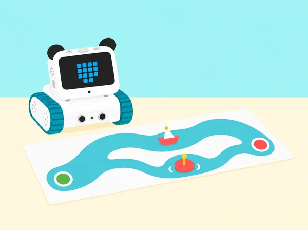

_L’escena representa un obstacle, un objecte col·leccionable i dues rutes; les regles concretes es proven al prototip de mBlock._

#### Fase 3 · Expliquem i registrem (10 min)

Representeu les regles amb pseudocodi i una taula d’estats. La branca i una fitxa de missatge cauen alhora: si la branca toca la barqueta, es reinicia la posició i no es compta cap recollida d’aquell cicle; si no hi ha contacte amb la branca, però la barqueta toca la fitxa abans que arribe a terra, `missatges` augmenta en 1 i la fitxa desapareix; si la fitxa arriba a terra, desapareix sense sumar. En arribar al final del canal, el joc s’atura. Feu que la branca i la fitxa reapareguen després d’una pausa, amb posicions separades perquè una ronda siga possible.

| Estat/esdeveniment | Resposta esperada | Evidència |
|---|---|---|
| Branca toca la barqueta | Torna a l’inici i la branca reapareix després d’una pausa | Posició abans/després |
| Branca passa sense tocar | Continua el joc | Cap reinici |
| Barqueta toca fitxa abans de terra | Suma un missatge i oculta la fitxa | Comptador +1 |
| Fitxa arriba a terra | La fitxa desapareix sense sumar | Comptador sense canvi |
| Barqueta arriba a la meta | Mostra «missió completada» i atura els controls | Estat final |

Proveu cada transició amb posicions fixades abans d’activar les aparicions aleatòries. Comproveu també que la col·lisió amb la branca tinga prioritat si els dos objectes queden superposats en una mateixa lectura.

```blocks
quan comença la partida
  fixa estat a «en curs»
  fixa missatges a 0
  situa la barqueta a l'inici
  per sempre
    si estat = «en curs»
      mou branca i fitxa cap avall
      si la barqueta toca la meta
        fixa estat a «completat»
        mostra «missió completada»
      si no, si la barqueta toca la branca
        situa la barqueta a l'inici
        amaga la branca
        espera 1 segon
        mostra la branca a dalt
      si no, si la barqueta toca la fitxa i la fitxa no ha arribat a terra
        canvia missatges per 1
        amaga la fitxa
      si la fitxa arriba a terra
        amaga la fitxa
```

#### Fase 4 · Apliquem i millorem (10 min)

Una altra parella prova el joc sense instruccions orals. Ajusteu una sola variable —velocitat de caiguda, mida de la branca, pausa entre aparicions o amplària de la ruta— i repetiu els casos afectats. Com a dilema, oferiu una drecera més curta però estreta i un camí més llarg però ample. Abans de triar, cada parella prediu el cost i el benefici; després registreu longitud en caselles, nombre de girs i missatges recollits, sense cronòmetre ni comparació entre grups. La versió guiada pot eliminar l’obstacle mòbil; el repte avançat combina branca, fitxa i tria de ruta.

#### Fase 5 · Comprovem i reflexionem (5 min)

**Evidència:** prototip de L19 amb obstacle que reapareix, fitxa que es recull abans de caure i drecera estreta; taula d’estats, valors abans/després del comptador, prova de contacte/no contacte i arribada, predicció i registre de les dues rutes, retorn entre parelles i una versió revisada.

**Pregunta docent:** quin canvi ha fet el repte més interessant i quina evidència mostra que les regles encara són comprensibles i justes?

### **L21 · Ràpid i segur (40 min).**

#### Fase 1 · Activem i prediem (5 min)

Recupereu la ruta virtual de L19–L20 i completeu-ne les condicions de victòria i de reinici. En aquesta sessió, Codey és el comandament d’un personatge digital dins d’mBlock: el robot físic es queda quiet sobre la taula, no participa en una cursa ni es mou a gran velocitat. Predigueu què ha de passar quan el cotxe virtual completa una volta, ix de la pista o toca un obstacle.

#### Fase 2 · Explorem i construïm (10 min)

Dibuixeu una pista tancada i prou ampla, una línia blava de meta, una zona fora de pista i un obstacle gràfic. Col·loqueu l’inici just després de la línia blava i marqueu-lo com a «encara no ha eixit» fins que el personatge passe per la meta una primera vegada; així no guanya en començar. Useu A/B de Codey per enviar missatges al personatge en mBlock; si no hi ha connexió, manteniu el control amb teclat o targetes. Prepareu un senyal visual de victòria i una resposta sonora opcional, sempre amb una alternativa visual silenciosa.

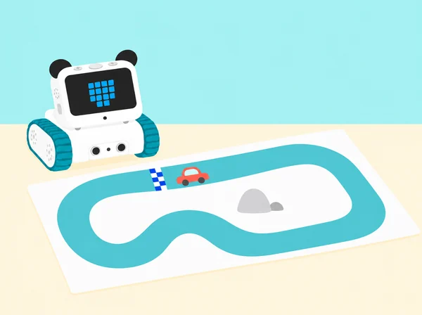

_El cotxe és un personatge digital controlat per Codey; la unitat física no es mou durant aquesta activitat._

#### Fase 3 · Expliquem i registrem (10 min)

Implementeu estats excloents. Si el personatge ix de la pista o toca el ratpenat, perd la volta: torna a l’inici i reinicia `ha_eixit_meta` a fals. Si no s’ha produït una pèrdua, marqueu `ha_eixit_meta` quan el personatge ja no toque la línia blava; només quan aquesta variable és certa i el cotxe torna a tocar la línia, completa una volta, mostra un senyal de victòria i pot reproduir un so breu. Per a una extensió de diverses voltes, augmenteu `voltes` en cada creuament vàlid, poseu `ha_eixit_meta` a fals mentre travessa la línia i continueu fins a l’objectiu triat; una línia roja pot definir una segona meta amb un altre resultat. Registreu l’estat abans i després de cada esdeveniment. Comproveu que la posició d’inici no activa la victòria i que només el retorn a la línia després del recorregut compta com a volta.

```blocks
quan comença la partida
  situa el cotxe virtual a l'inici
  estableix estat a «en curs»
  estableix ha_eixit_meta a fals

mentre estat és «en curs»
  si el cotxe ix de la pista o toca l'obstacle
    torna el cotxe a l'inici
    estableix ha_eixit_meta a fals
    reinicia la partida
  si no
    si el cotxe no toca la línia blava
      estableix ha_eixit_meta a cert
    si ha_eixit_meta i el cotxe toca la línia blava
      mostra el senyal de victòria
      reprodueix un so breu (opcional)
      estableix estat a «volta completada»
```

#### Fase 4 · Apliquem i millorem (10 min)

Convideu una parella a provar el joc i observar si entén la meta, el reinici i l’obstacle sense explicació oral. Canvieu una regla cada vegada i repetiu els casos. Com a extensions del material oficial, oferiu una volta dins d’un temps personal, diverses voltes o una segona meta roja amb un resultat diferent; cap temps es publica ni es compara entre persones. La pista ampla, menys obstacles, control per teclat i feedback visual silenciós són l’opció guiada.

#### Fase 5 · Comprovem i reflexionem (5 min)

**Evidència:** pista digital amb línia blava, obstacle i missatges de control; diagrama d’estats; proves d’inici sense victòria, volta completada, eixida de pista i contacte amb obstacle; i, si s’activa, una ampliació de diverses voltes o meta roja. El registre confirma que so i resposta visual tenen funcions equivalents i que una revisió ve del playtesting.

**Pregunta docent:** com sap el programa que el cotxe ha completat una volta i no acaba de començar-la?

### **L22 · Corbes amb Codey Rocky (40 min).**

#### Fase 1 · Activem i prediem (5 min)

Recordeu que Rocky es mou amb dues rodes motrius. Representeu-les amb dues fitxes —o, si el grup ho prefereix, amb dues persones que mostren fletxes sense haver de desplaçar-se— i proveu tres casos: les dues rodes avancen igual, una roda avança més que l’altra i una roda queda quieta mentre l’altra avança. Predigueu quin cas produeix una recta, un cercle ample o un gir més tancat. Aquest model és una simplificació: no reprodueix la fricció ni les diferències entre motors reals.

#### Fase 2 · Explorem i construïm (10 min)

En mBlock, localitzeu el bloc de moviment que permet ajustar la potència de les rodes de Rocky (0–100) i prepareu una pista ampla de paper, amb inici i parada ben visibles. Proveu primer un tram recte amb potències iguals; després, una volta circular i una semicircular modificant la diferència entre les dues rodes. Manteniu una potència baixa, deixeu espai lliure al voltant i atureu el programa abans de recol·locar el robot. No cal perseguir una forma geomètrica perfecta: el propòsit és relacionar la diferència de velocitat de les rodes amb la curvatura observada.

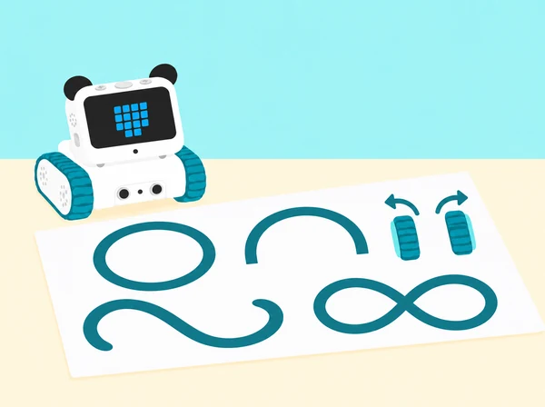

_Les trajectòries són una representació pròpia del repte de corbes; les potències indicades en mBlock s’han de provar amb el robot disponible._

#### Fase 3 · Expliquem i registrem (10 min)

Dissenyeu al mapa una ruta que combine una circumferència i una semicircumferència i intercanvieu-la amb una altra parella. Abans d’executar-la, anoteu els valors triats per a cada roda i la forma esperada; després, marqueu la traça real amb un llapis o amb una tira de paper. Registreu si el robot completa la corba, on s’obri o es tanca i quina diferència de potència ho pot explicar. Repetiu la prova sense canviar els valors per distingir una desviació puntual d’un resultat consistent.

#### Fase 4 · Apliquem i millorem (10 min)

Dibuixeu una corba en S i acordeu un temps ample per completar-la com a prova de planificació, no com a competició entre persones. Dividiu-la en trams, indiqueu quan canvia el sentit de la corba i proveu el recorregut amb Codey Rocky en una zona delimitada. Canvieu una sola diferència de potència o la durada d’un tram, torneu a provar i compareu les traces. Com a ampliació del repte oficial, dissenyeu corbes consecutives o un huit; intercanvieu el mapa amb una altra parella perquè puga predir-ne l’ordre abans de programar-lo.

#### Fase 5 · Comprovem i reflexionem (5 min)

**Evidència:** mapa propi amb cercle, semicercle i corba en S; valors de les dues rodes; traces previstes i observades; i una modificació justificada. Feu una autoavaluació breu: «En aquesta sessió he aprés que…», «durant la prova m’ha costat…» i «ho he resolt…».

**Pregunta docent:** com canvia la trajectòria quan una roda gira més de pressa que l’altra, i per què el mateix programa pot dibuixar una corba diferent en una altra superfície?

### **L23 · Gir i obstacles (40 min).**

#### Fase 1 · Activem i prediem (5 min)

Recupereu les traces corbes de L22 i presenteu un tram recte del camí escolar amb un obstacle tou al mig. Rocky ha de continuar el recorregut quan el camí és lliure i fer una desviació quan el sensor IR frontal detecta l’obstacle. Predigueu quines ordres ha d’executar en cada cas i dibuixeu una ruta lateral que el deixe avançar paral·lelament a l’obstacle. Aclariu que és una maqueta didàctica: no prova que el robot puga circular amb seguretat per un carrer real.

#### Fase 2 · Explorem i construïm (10 min)

Comproveu que el mòdul de color del Rocky, que incorpora el sensor de proximitat IR, mira cap avant i que mBlock ofereix el bloc de detecció d’obstacles. En una pista plana, ampla i sense vores exposades, programeu l’inici amb A i una condició: si el sensor detecta l’obstacle, gireu a la dreta, avanceu un tram curt a potència reduïda, gireu a l’esquerra i continueu; si no en detecta cap, avanceu a baixa potència. Si «Els meus blocs» està disponible, agrupeu la maniobra en `esquivar_obstacle()`; altrament, conserveu-la com una seqüència de blocs visible. Si el sensor o el firmware no són compatibles, simuleu l’entrada amb targetes i etiqueteu la prova com a simulació.

```blocks
quan es prem A
per sempre
  si obstacle detectat
    gira a la dreta 90°
    avança amb potència baixa durant 1 s
    gira a l’esquerra 90°
  altrament
    avança amb potència baixa durant 1 s
```

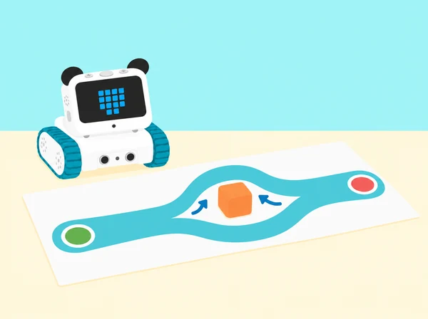

_El recorregut és una maqueta pròpia per provar la resposta del sensor IR; no representa una instrucció per circular en un espai públic._

#### Fase 3 · Expliquem i registrem (10 min)

Executeu primer el programa amb el camí lliure i després amb l’obstacle tou al davant, sempre des de la mateixa marca. Registreu l’estat esperat, la lectura o resposta del sensor, les ordres executades i si Rocky recupera el sentit inicial del recorregut. Repetiu cada cas una vegada sense canviar el programa. Si la lectura apareix com una distància, anoteu-la com a valor aproximat del sensor; no la convertiu en una garantia sobre objectes, persones o distàncies reals.

#### Fase 4 · Apliquem i millorem (10 min)

Canvieu el sentit de la desviació per provar l’extensió oficial d’esquivar cap a l’altre costat i compareu quina versió manté millor l’orientació de la ruta. Afegiu, quan siga adequat, una expressió a la matriu LED i un so breu i suau en detectar l’obstacle; manteniu sempre un senyal visual equivalent i deixeu el so desactivat si dificulta l’escolta o la concentració. Una persona observadora pot mostrar «lliure» o «obstacle» amb targetes perquè l’equip contraste la condició abans d’activar el robot. Intercanvieu el diagrama amb una altra parella, que ha de predir el resultat dels dos casos. Modifiqueu una sola ordre cada vegada i manteniu sempre una persona responsable de la parada; no poseu els dits davant de les rodes ni del sensor.

#### Fase 5 · Comprovem i reflexionem (5 min)

**Evidència:** mapa de la desviació, programa o funció visible, taula amb els casos lliure/obstacle, dues execucions per cas i un canvi justificat. Si s’activa el feedback, registreu també l’expressió LED i el so opcional, amb la seua alternativa visual.

**Pregunta docent:** quina part del recorregut depén de la lectura IR i quines situacions reals no podem donar per resoltes amb aquesta prova?

### **L24 · Segueix la línia (40 min).**

#### Fase 1 · Activem i prediem (5 min)

Dissenyeu una maqueta de ruta entre un centre d’interpretació de l’Albufera i un observatori d’aus: la cinta negra representa el camí i els espais clars, l’aigua o els camps. Localitzeu el sensor de color inferior de Rocky i el seu punt de llum RGB. Predigueu si la lectura de llum reflectida serà més alta sobre la línia o sobre el fons i expliqueu per què el valor pot canviar amb la superfície o la llum de l’aula. És un model de taula, no una proposta per circular en l’entorn natural. La lectura és una unitat pròpia del sensor, no una mesura en lux.

#### Fase 2 · Explorem i construïm (10 min)

Comproveu que el sensor inferior i el bloc de lectura de llum reflectida funcionen. Mostreu el valor en la matriu LED de Codey en temps real i prepareu targetes amb superfícies diferents. Mesureu primer la superfície clara i després la cinta negra; repetiu la lectura amb el punt RGB situat a la vora de la línia, tal com proposa el quadern. Feu tres lectures per superfície, anoteu-ne els valors i calculeu un llindar inicial entre els valors típics de fons i línia. Registreu cada valor sense anomenar-lo lux ni suposar que serà igual en tots els robots.

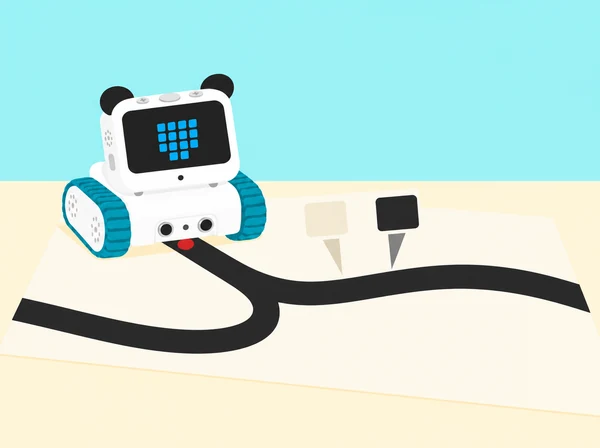

_La il·lustració assenyala el punt de lectura que es compara amb les superfícies clares i fosques._

#### Fase 3 · Expliquem i registrem (10 min)

Simuleu la regla amb una fitxa i fletxes: quan la lectura queda d’un costat del llindar, representeu una correcció de 45° cap a un costat; quan queda a l’altre, representeu la correcció oposada. És una versió de taula del joc de simulació del quadern, sense exigir moviments corporals. Després, programeu Rocky perquè avance a potència baixa i corregisca alternativament la direcció segons la lectura; el llindar i el sentit de cada correcció s’han de comprovar amb les dades i l’orientació del sensor de la unitat disponible. Comenceu en un tram recte ample, afegiu una corba només quan la resposta siga repetible i deixeu una zona d’aturada lliure.

```blocks
quan es prem A
  llig les superfícies clara i fosca
  estableix llindar entre les dues lectures
  per sempre
    mostra la lectura reflectida
    si lectura queda al costat de línia del llindar
      corregeix lleument cap a un costat
    altrament
      corregeix lleument cap a l’altre costat
    avança a potència baixa
```

_Esbós de lògica, no una seqüència de blocs amb noms universals: calibreu el llindar, el sentit de gir i la potència amb el mBlock i el Rocky del centre._

#### Fase 4 · Apliquem i millorem (10 min)

Proveu el recorregut de maqueta entre el centre d’interpretació i l’observatori, primer en recta i després amb una corba ampla. Registreu on Rocky perd o recupera la línia i quantes de tres proves arriba a la meta. Canvieu només el llindar entre negre i clar o la potència de moviment, repetiu les tres proves i compareu la traça. Si el sensor o la versió no són compatibles, completeu la mateixa seqüència amb lectures simulades i marqueu clarament què s’ha mesurat i què s’ha representat.

#### Fase 5 · Comprovem i reflexionem (5 min)

**Evidència:** taula de tres lectures sobre fons, línia i vora; llindar triat i justificació; algorisme de correcció; traça del recorregut i recompte de tres proves abans/després d’un únic canvi. Adjunteu també la simulació en paper si el sensor no està disponible.

**Pregunta docent:** com ajuda el llindar, calculat amb les lectures del vostre Rocky, a corregir la direcció i per què no podem copiar-lo sense provar-lo en una altra unitat o superfície?
## 🧰 Maquinari, programari i dependències

Codey Rocky, ordinador amb versió compatible de mBlock, cable USB o connexió provada i materials plans de cartó. Useu exclusivament mòduls integrats comprovats en la unitat: botons, pantalla, indicador RGB, altaveu, sensor de so/llum, potenciòmetre, giroscopi, emissor/receptor IR i sensor de color/distància del xassís, segons el model i firmware. Les activitats L21–L24 necessiten el Rocky i el seu sensor corresponent; si no està disponible, feu el mateix algorisme en simulació. Neuron queda fora d’aquesta adaptació.

## 🛡️ Seguretat, privacitat i inclusió

Limiteu les proves mòbils a una taula estable o pista tancada sense vores, cablatge ni obstacles durs. El sensor de so no registra ni identifica veus. Oferiu botons o teclat com a alternatives al giroscopi, codi en paper quan hi haja dificultats de connexió i funcions equivalents per a qui no manipule el robot.

## 🧪 Evidències i avaluació

Al llarg de les 24 sessions, cada parella conserva un guió de disseny, pseudocodi, programa, taula de proves i canvi justificat. El museu final incorpora instruccions accessibles, una demostració i una nota que explica què mesura cada sensor i què no pot concloure. S’avaluen descomposició, seqüència, bucles, condicions, variables, funcions, depuració, prova i col·laboració.

## 🔗 Repertori oficial adaptat

Aquesta seqüència adapta les 24 lliçons CSTA publicades per Makeblock: [The Secret of Codey Rocky](https://www.makeblock.com/pages/codey-rocky-robot-toys-for-kids), *Press Buttons to Change Emotions*, *To Be an Animation Designer*, *Identify the Bug*, *The Steamed Bread Can’t Jump*, *The Jumping Steamed Bread*, *The Racing Game I/II*, *Volume Bar*, *Good Morning! Functions*, *The Tiny Patroller I/II*, *The Squirrel’s Nuts Box*, *Mathematical Operations*, *The Bomb*, *Rock-Paper-Scissors*, *My Speedway*, *Game Control Schemes*, *Game Mechanics I/II*, *Fast and Furious*, *Make a Turn*, *Make a Turn Avoid Obstacles* i *Line-Following Car*. Cada repte s’ha reinterpretat amb materials i context propis. Les fitxes consultables directament s’enllacen a la [pàgina oficial del curs CSTA](https://www.makeblock.com/pages/codey-rocky-robot-toys-for-kids): [L1](https://res-us.makeblock.com/doc/course/Codey%20Rocky/Lesson%2001%20The%20Secret%20of%20Codey%20Rocky_Sheet.pdf), [L3](https://res-us.makeblock.com/doc/course/Codey%20Rocky/Lesson%2003%20To%20Be%20an%20Animation%20Designer_Sheet.pdf), [L4](https://res-us.makeblock.com/doc/course/Codey%20Rocky/Lesson%2004%20Identify%20the%20Bug_Sheet.pdf), [L13](https://res-us.makeblock.com/doc/course/Codey%20Rocky/Lesson%2013%20The%20Squirrel%E2%80%99s%20Nuts%20Box_Sheet.pdf), [L14](https://res-us.makeblock.com/doc/course/Codey%20Rocky/Lesson%2014%20Mathematical%20Operations_Sheet.pdf), [L15](https://res-us.makeblock.com/doc/course/Codey%20Rocky/Lesson%2015%20The%20Bomb_Sheet.pdf), [L17](https://res-us.makeblock.com/doc/course/Codey%20Rocky/Lesson%2017%20My%20Speedway_Sheet.pdf) i [L18](https://res-us.makeblock.com/doc/course/Codey%20Rocky/Lesson%2018%20Game%20Control%20Schemes_Sheet.pdf). Per a L2, el fabricant publica el [manual docent de *Basic Coding Courses*](https://qiniu.makeblock.com/education-makeblock-com/SampleofTeachersBook.pdf) i el [quadern d’alumnat](https://qiniu.makeblock.com/education-makeblock-com/studentbook.pdf): s’hi contrasten esdeveniments, senyals geomètrics, blocs d’inici i de botó, pràctica per parelles i presentació. La seqüència local adapta aquests elements amb símbols propis, sense atribuir estats emocionals reals. Per a L5–L6, el quadern confirma les animacions amb bucle comptat i infinit, la progressió entre repeticions finites i contínues, l’activació per esdeveniment, la creació d’històries, la presentació i l’autoavaluació; l’aturada de L6 usa la funció oficial [`stop_all_scripts()`](https://github.com/Makeblock-official/micropython-api-doc/blob/master/docs/codey%26rocky/codey/script%20control.rst) com a recurs de control local. El quadern d’alumnat també permet contrastar els objectius de *Make a Turn* (repàs de conceptes bàsics de robòtica i disseny d’una ruta per a Codey Rocky) i *Line-Following Car* (aplicacions, intensitat reflectida i seguiment), però no equival als plans docents complets. La mateixa font conté una lliçó diferent, *Avoid Obstacles*, amb funcions, matemàtiques i obstacles; la usem com a referència complementària i no com a prova del pla CSTA *Make a Turn Avoid Obstacles*. Els objectius del curs separat [Codey Rocky & Neuron Discovery](https://support.makeblock.com/hc/en-us/articles/25494707612823-Codey-Rocky-Neuron-Discovery) només s’usen com a comprovació complementària per a L1–L16; no es barregen els dos repertoris.

Makeblock publica a banda el curs [Codey Rocky & Neuron Discovery](https://support.makeblock.com/hc/en-us/articles/25494707612823-Codey-Rocky-Neuron-Discovery), de 34 lliçons. Només s’hi podran adaptar unitats compatibles amb la dotació quan es confirme quins components Neuron hi ha disponibles; aquesta fitxa no els pressuposa.
