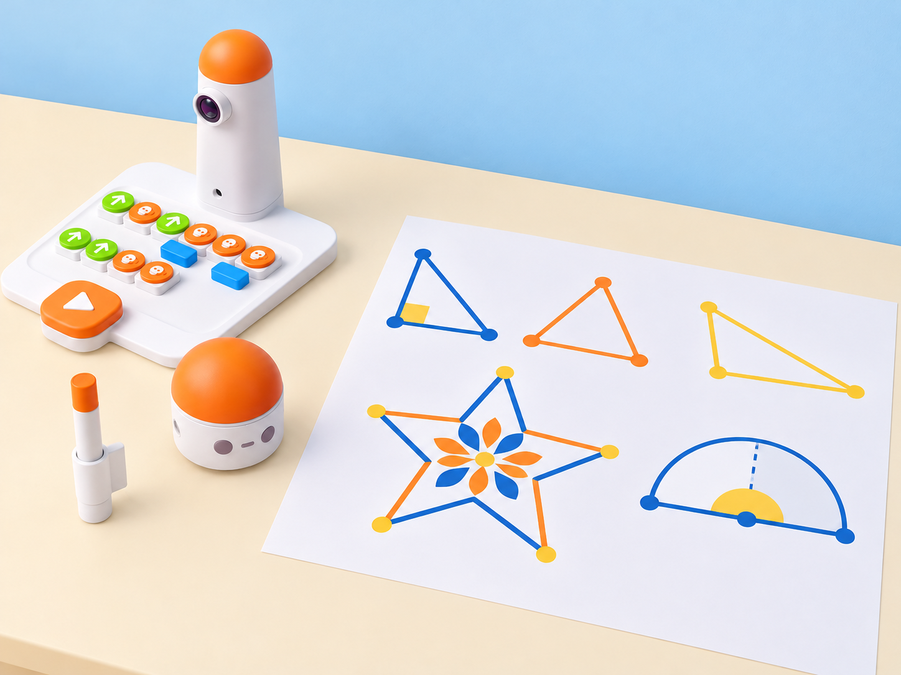
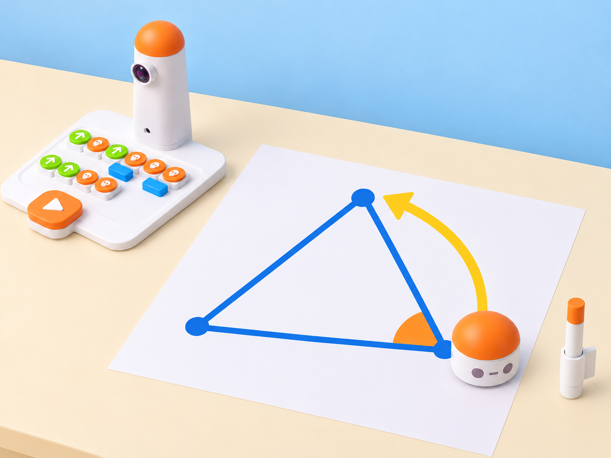

_La làmina és una composició pròpia. El dibuix amb tinta només es fa si el centre disposa de l'Artist Add-On; amb el kit base, MatataBot recorre la seqüència sense dibuixar._

## Situació, repte i intenció

El grup prepara una mostra de geometria per a un passadís de l'escola. A partir de patrons de ceràmica i rajoles de l'entorn, cada parella dissenya una roseta pròpia i investiga com representar-hi triangles diferents. El repte és distingir l'angle interior de la figura del gir que executa el robot: quan MatataBot completa un costat i gira per continuar el contorn, el bloc d'angle representa el gir exterior suplementari.

La proposta adapta l'activitat pública *Draw triangles* de Matatalab: recupera el triangle equilàter, la suma dels angles interiors, la prova amb angles rectes, aguts i obtusos, el treball per parelles i l'extensió amb un pentagrama o paral·lelogram. La seqüència, la roseta, les targetes de repte i els registres són originals. Si no hi ha Artist Add-On, les parelles fan que el robot recórrega una quadrícula sense llapis i traslladen el traçat al paper; aquesta alternativa no atribueix dibuix al Coding Set base.

**Pregunta guia:** com podem saber quin gir ha de fer el robot quan volem construir un angle interior determinat?

## Aprenentatges i vocabulari

- Classificar angles aguts, rectes i obtusos, i reconéixer-los dins de triangles.
- Comprovar que els angles interiors d'un triangle sumen 180° i que els tres angles d'un triangle equilàter mesuren 60°.
- Relacionar l'angle interior amb el gir exterior suplementari que necessita el robot per continuar el contorn.
- Escriure, provar i depurar una seqüència de blocs d'angle i moviment amb una predicció explícita.
- Crear una composició geomètrica original i comunicar quina part és una ruta del robot i quina part és decoració manual.

**Vocabulari clau:** vèrtex, costat, angle interior, gir exterior, suplementari, agut, recte, obtús, equilàter, programa, repetició.

## Materials i preparació

- Coding Set: MatataBot, torre, tauler, blocs de moviment, gir, angle i bucle disponibles al centre.
- Artist Add-On compatible només si el centre el té: suport, llapis i blocs d'angle. La guia oficial enumera deu valors amb dos blocs per valor (30°, 36°, 45°, 60°, 72°, 108°, 120°, 135°, 144° i 150°); inventarieu les peces físiques abans de planificar el traçat i no forceu cap bloc.
- Paper gran, regla, llapis, cartolina, targetes originals amb angles interiors i una quadrícula amb punt d'inici i orientació marcats.
- Full de registre amb columnes **figura**, **angle interior previst**, **bloc de gir**, **predicció**, **resultat observat** i **revisió**.

Comproveu el terra o la superfície del tauler, la càrrega del robot i la lectura correcta de la torre. En la prova amb llapis, assegureu el paper perquè no es desplace. No confongueu el nombre imprés en un bloc d'angle amb l'angle interior dibuixat: la guia del fabricant indica que el robot traça el seu suplementari. Amb el kit base, feu la mateixa prova com a recorregut sobre quadrícula i registreu que la figura de paper l'ha dibuixada l'alumnat.

## Seqüència didàctica

### De la rajola al triangle (50 min)

#### Fase 1 · Activem i prediem

Mostreu una rajola o una fotografia de ceràmica i una plantilla original amb tres triangles. L'alumnat marca vèrtexs i costats, classifica els angles com a aguts, rectes o obtusos i prediu si tots els triangles poden tindre els mateixos angles.

#### Fase 2 · Explorem i construïm

Amb regle i transportador opcional, construïu un triangle equilàter gran sobre paper. Mesureu els tres angles i anoteu les dades abans de provar el robot. Una parella construeix una segona còpia amb tires de paper; si les longituds són iguals, compareu-ne els angles sense dependre del color de la plantilla.

#### Fase 3 · Expliquem i registrem

Completeu una taula amb els tres angles interiors. Comproveu que cadascun és de 60° i que junts sumen 180°. Dibuixeu una fletxa al vèrtex per indicar la direcció en què continuarà el robot després d'arribar-hi.

#### Fase 4 · Apliquem i millorem

Un equip explica la figura sense dir la resposta i l'altre comprova les mesures. Si els costats o angles no concorden, reviseu la construcció abans de programar; així separeu un error de dibuix d'un error de seqüència.

#### Fase 5 · Comprovem i reflexionem

**Evidència:** triangle amb vèrtexs i mesures anotades, suma dels angles i predicció escrita. **Pregunta docent:** quina prova tenim que la figura és equilàtera i no només sembla regular?

### Un gir exterior per a cada vèrtex (50 min)

#### Fase 1 · Activem i prediem

Col·loqueu MatataBot amb el nas orientat al primer costat del triangle. En un vèrtex, compareu l'angle interior de 60° amb el canvi de direcció necessari per seguir el contorn. Cada parella dibuixa les dues mesures en colors o símbols diferents i prediu quin valor haurà d'indicar el bloc d'angle.

#### Fase 2 · Explorem i construïm

Reviseu la guia del fabricant i prepareu la seqüència amb tres costats i girs repetits. En la versió amb Artist Add-On, feu primer una prova curta sobre paper; en la versió base, col·loqueu el robot sobre una quadrícula i compteu els passos de cada costat. La proposta oficial assenyala que per al triangle equilàter es fan servir blocs de gir de 120°, no de 60°, perquè el valor del traç interior i el gir del robot són suplementaris.

#### Fase 3 · Expliquem i registrem

Registreu la relació 60° + 120° = 180°. Indiqueu clarament en quina columna està l'angle de la figura i en quina el bloc que utilitza el robot. Si la interfície o el bloc del centre no mostra un valor comprovat, descriviu el gir observat i no inventeu la peça necessària.

#### Fase 4 · Apliquem i millorem

Executeu o simuleu una volta completa i observeu si el robot torna prop del punt inicial i amb una orientació coherent. Canvieu una variable cada vegada: angle del bloc, longitud del costat o punt d'inici. Amb l'accessori, retireu el llapis durant les proves de posició per evitar marques superposades.

#### Fase 5 · Comprovem i reflexionem

**Evidència:** seqüència anotada, dibuix dels dos angles i comparació entre predicció i resultat. **Criteri:** l'equip explica per què 60° és l'angle interior mentre 120° és el gir exterior del triangle equilàter.

_Esquema conceptual del gir: el bloc d’angle només es prova amb Artist Add-On; amb el kit base es valida la seqüència com a recorregut, sense dibuix amb tinta._

### Reptes de triangles: recte, agut i obtús (50 min)

#### Fase 1 · Activem i prediem

Prepareu tres targetes originals amb reptes de triangle: un amb un angle recte, un amb angles aguts i un amb un angle obtús. Abans de col·locar blocs, cada parella dibuixa l'angle interior desitjat i escriu quin gir exterior l'ajudaria a continuar el costat.

#### Fase 2 · Explorem i construïm

Per torns, una persona proposa el repte i l'altra prepara primer el gir al vèrtex i després una seqüència de moviment per completar els costats. La guia oficial planteja que el costat final pot quedar inicialment massa llarg o curt: useu-ho com a dada de calibratge, mesureu la diferència i anoteu quin bloc cal ajustar. Si no hi ha Artist Add-On, el robot recorre la ruta en la quadrícula i l'equip completa el triangle en paper.

#### Fase 3 · Expliquem i registrem

Compareu l'angle interior del dibuix amb el gir codificat. Classifiqueu el resultat i expliqueu què ha passat amb el tancament del triangle. No canvieu alhora longitud i gir; manteniu el registre prou clar perquè una altra parella puga repetir la prova.

#### Fase 4 · Apliquem i millorem

Intercanvieu les targetes amb una altra parella. L'equip visitant comprova si el programa correspon al repte i prova una sola millora. Si el tauler del centre només admet girs en valors fixos, trieu un repte possible amb els blocs reals o presenteu la part no executable com a model de paper, no com a funció provada del robot.

#### Fase 5 · Comprovem i reflexionem

**Evidència:** tres targetes amb mesures, seqüències i una nota de depuració. **Pregunta docent:** com has distingit que calia canviar l'angle d'un vèrtex i no la llargària del costat?

### Una roseta pròpia per a l'escola (50 min)

#### Fase 1 · Activem i prediem

Observeu les proves i identifiqueu una figura que es puga repetir al voltant d'un centre. Cada equip dibuixa una roseta geomètrica inspirada en formes de l'entorn, sense copiar una rajola concreta; marqueu quins elements es poden recórrer amb el robot i quins es completaran a mà.

#### Fase 2 · Explorem i construïm

Dissenyeu una composició pròpia amb triangles i una repetició senzilla. Si el centre disposa de l'accessori, proveu el traçat amb blocs d'angle i bucle seguint el manual; sense ell, programeu el recorregut de vèrtexs i dibuixeu la roseta amb regla i llapis. L'extensió opcional és plantejar un paral·lelogram o pentagrama com a problema per a una altra sessió, no assumir que el programa quedarà resolt amb una seqüència que no s'ha comprovat.

#### Fase 3 · Expliquem i registrem

Afegiu una llegenda amb els angles interiors mesurats i els girs provats. Una altra parella ha de poder identificar el punt d'inici, l'ordre de les peces i quines parts de la composició són manuals.

#### Fase 4 · Apliquem i millorem

Feu una prova d'intercanvi: el grup visitant interpreta la llegenda i reconstrueix el recorregut o la simulació. Registreu on dubta, reviseu una instrucció i torneu-la a provar. Manteniu els materials de retall i adhesiu en una estació amb supervisió.

#### Fase 5 · Comprovem i reflexionem

**Evidència:** roseta, llegenda, seqüència, registre de la prova d'una altra parella i una explicació del límit entre accessori i kit base. **Tancament:** «El gir que més ens ha sorprés és… perquè…».

## Evidències i avaluació

Recolliu les plantilles mesurades, les targetes de repte, els programes o simulacions, les proves abans/després i la roseta final. Valoreu si l'alumnat classifica els angles, comprova la suma de 180°, distingeix interior i exterior, canvia una variable cada vegada i comunica els límits de la seua prova. La precisió de dibuix, l'ús del color i la velocitat no són criteris d'èxit.

## Participació, accessibilitat i seguretat

Oferiu plantilles amb angles en relleu, peces grans per a representar vèrtexs, quadrícules d'alt contrast i mesures impreses per a qui no puga usar el transportador. Es pot participar com a programador/a, mesurador/a, verificador/a, relator/a o dissenyador/a de targetes. L'audició i la manipulació fina no són necessàries. Manteniu els dits fora de la trajectòria del robot, assegureu el paper i useu tisores escolars amb supervisió; no munteu l'accessori de llapis si no teniu el model i les instruccions compatibles.

## Referents i adaptació

- Matatalab, [Draw triangles](https://matatalab.com/en/node/84): activitat pública que treballa classificació d'angles i triangles, suma de 180°, triangle equilàter, gir de 120° per al contorn, proves amb triangles rectangles/aguts/obtusos, intercanvi de reptes en parelles i extensió amb paral·lelogram o pentagrama.
- Matatalab, [Artist Add-On](https://matatalab.com/en/node/64): inventari de deu valors de bloc d'angle, instruccions per combinar blocs d'angle amb moviment i gir, i aclariment que el bloc descriu el gir suplementari.

Aquesta situació amplia els objectius i procediments públics amb una seqüència original de quatre sessions, proves calibrables, una temàtica de ceràmica local, accessibilitat i una alternativa completa amb el kit base. No reprodueix les imatges, materials gràfics ni redacció de Matatalab; el traçat amb tinta queda condicionat a l'Artist Add-On real i compatible del centre.
