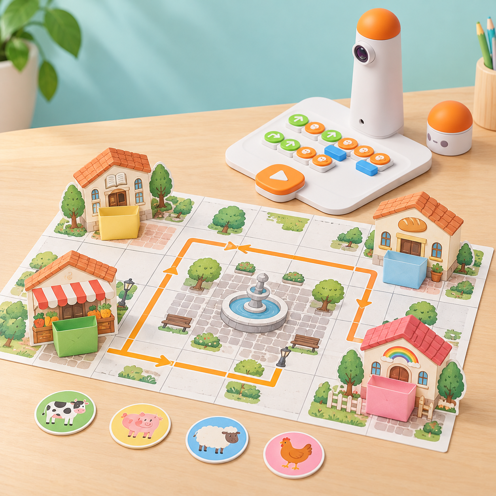
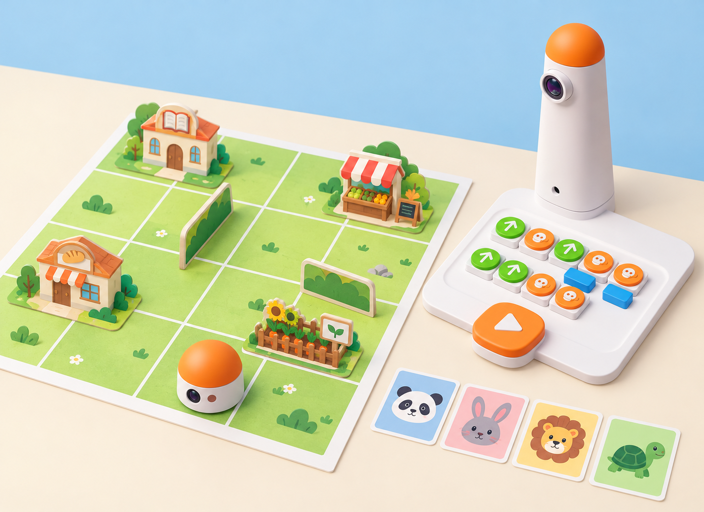
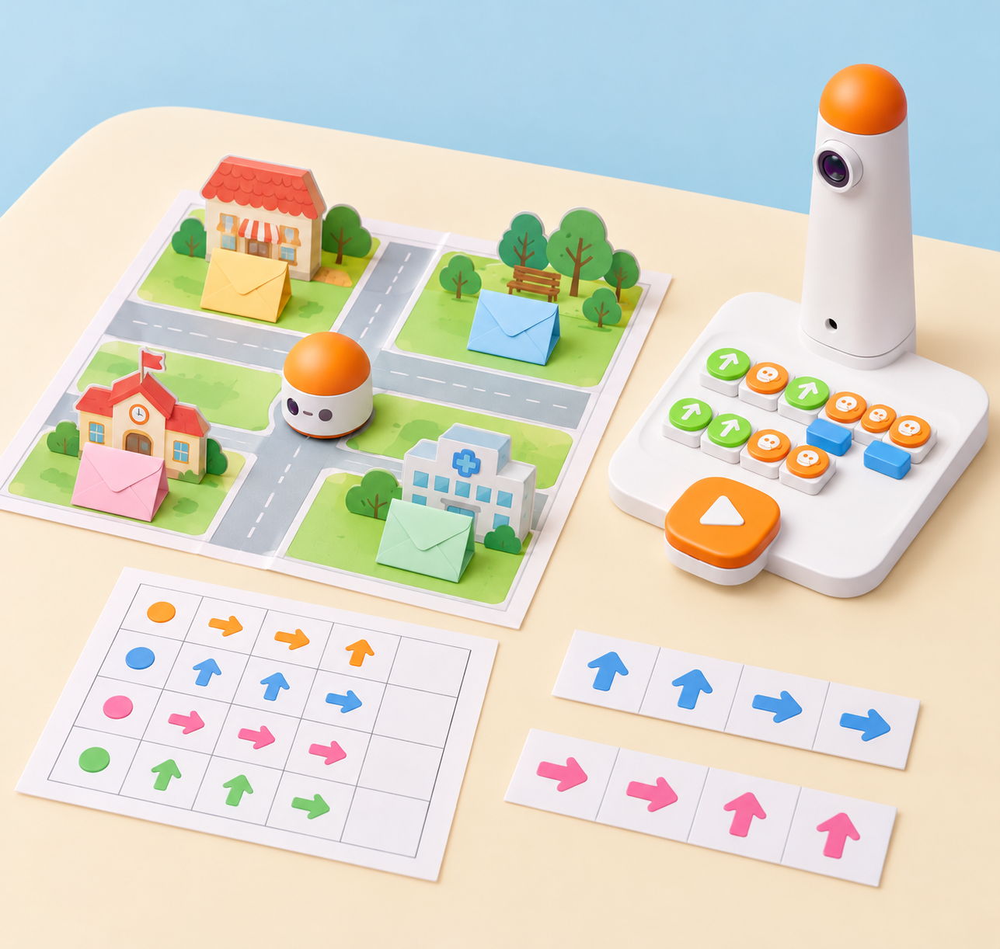

_Les butxaques amaguen les fitxes perquè l’alumnat les recorde; una persona les col·loca o les recupera manualment. MatataBot només executa la ruta programada._

## Situació, repte i intenció

Quatre animals de cartolina visiten llocs d’un poble inspirat en l’entorn valencià: la biblioteca, el mercat, el forn i el viver escolar. La classe prepara una maqueta plana amb quadrícula i una butxaca de paper a cada edifici. En una primera ronda, es programa MatataBot per a portar una fitxa a cada lloc; una persona la col·loca dins de la butxaca i el grup inventa una frase que ajude a recordar la visita. Després, les butxaques es tanquen i cal recordar on és cada animal, planificar la ruta de retorn i comprovar-la.

La proposta adapta el pla oficial de Matatalab *Deliver Animals*: quatre animals de granja viatgen a quatre llocs de la comunitat; cada arribada obri una història sobre la destinació. El pla proposa revisar els blocs de moviment i preparar llocs, animals i obstacles durant 10 minuts; dedicar-ne 30 al lliurament, la narració i, com a ampliació, una sola ruta amb les quatre destinacions; i tancar amb 5 minuts de retorn i preguntes. Ací es mantenen eixa progressió, el record de les destinacions i la possibilitat de programar el recorregut complet. Els llocs, els materials, les històries i el registre són propis i locals. La col·locació o retirada de cada fitxa la fa una persona: no atribuïm al MatataBot un mecanisme de descàrrega.

**Pregunta guia:** quina pista de la nostra història ens ajuda a recordar la destinació, i com podem comprovar que la ruta de retorn és correcta?

## Aprenentatges i vocabulari

- Descompondre un trajecte en ordres de moviment i estimar quantes caselles cal avançar o retrocedir.
- Associar cada fitxa amb una destinació i una història creada pel grup, i recuperar la informació de memòria.
- Construir i llegir una graella amb inici, orientació, quatre llocs i rutes transitables.
- Comparar la predicció amb el recorregut, detectar el primer punt de divergència i corregir una ordre cada vegada.
- Explicar què fa MatataBot i què fan les persones: el robot no veu, recorda ni arreplega les fitxes.

**Paraules clau:** seqüència, casella, destinació, paràmetre, estimació, memòria, història, depuració, prova.

## Materials i preparació

- Coding Set complet: MatataBot, torre, tauler de control i blocs de moviment; carregueu i aparelleu els components segons la guia del model del centre.
- Una graella de paper gran basada en les caselles del tauler o una ruta comprovada amb el robot; manteniu constant la distància entre caselles i marqueu inici i orientació.
- Quatre edificis menuts de cartó amb una butxaca de paper fàcil d’obrir, quatre fitxes grans d’animals i targetes amb biblioteca, mercat, forn i viver. Les fitxes no han de poder entrar en cap peça del robot.
- Full de registre amb columnes **animal**, **lloc visitat**, **frase-pista**, **ruta d’anada**, **ruta de retorn**, **predicció** i **resultat**; targetes de fletxa i nombre per a planificar abans de tocar els blocs.

Feu una prova prèvia entre les caselles que triareu i comproveu la longitud real del pas, el gir i l’orientació inicial del MatataBot. Si el mapa no coincideix amb la distància del model, ajusteu-ne la quadrícula abans de la classe. Col·loqueu les butxaques al costat de la ruta, sense impedir el moviment ni tapar caselles; la persona adulta administra les fitxes.

## Seqüència didàctica

### Sessió 1 · Construïm el poble i provem les rutes (45 min)

#### Fase 1 · Activem i prediem

Presenteu les quatre fitxes d’animals i els quatre llocs. Pregunteu què podria fer cada animal en una visita i com recordaríem una destinació si després no la poguérem veure. Cada parella dibuixa una ruta fins a dos llocs i estima les ordres abans de muntar-la.

#### Fase 2 · Explorem i construïm

En equips de quatre, repartiu rols de planificació, programació, observació i registre. Marqueu un punt d’inici i una orientació fixa; construïu la quadrícula i poseu els edificis amb les butxaques fora del pas del robot. Proveu una ruta senzilla amb blocs del kit i ajusteu el mapa fins que la distància entre caselles siga consistent.

#### Fase 3 · Expliquem i registrem

Llegiu en veu alta una ruta com una seqüència ordenada: inici, ordres, gir i arribada. El grup observador contrasta les ordres amb el mapa i registra quantes caselles separen cada lloc de l’inici; distingiu la coordenada del mapa de les ordres que realment rep el robot.

#### Fase 4 · Apliquem i millorem

Intercanvieu els mapes entre dos equips. L’equip visitant ha de trobar una ruta fins a un edifici sense que li la dicten. Si la predicció falla, localitzeu la primera ordre que no concorda amb el mapa, canvieu-ne només una i torneu a executar-la.

#### Fase 5 · Comprovem i reflexionem

**Evidència:** mapa llegible amb inici, orientació, quatre destinacions i una ruta provada; registre de la predicció i l’ajust. **Pregunta:** què hem hagut de fixar perquè un altre equip poguera repetir el nostre recorregut?

### Sessió 2 · Lliurem els animals i inventem pistes (45 min)

**Correspondència amb *Deliver Animals*:** reserveu aproximadament 10 minuts per a repassar els blocs i muntar les quatre destinacions amb obstacles; 30 minuts per a programar i narrar els lliuraments; i 5 minuts per a compartir una història i respondre preguntes de comprovació. En aquesta adaptació, el registre i la construcció de pistes s’integren en les cinc fases següents.

#### Fase 1 · Activem i prediem

Cada membre de l’equip tria una fitxa d’animal i, abans de programar, inventa una frase breu que explique per què visita un lloc. La frase ha de relacionar l’animal i la destinació amb una pista fàcil de recordar; no cal que descriga un fet real sobre l’animal.

#### Fase 2 · Explorem i construïm

Per torns, planifiqueu amb targetes la ruta des de l’inici fins al lloc triat. Compteu els avanços i els girs, poseu els blocs en l’ordre previst i demaneu a una altra persona que els revise abans de prémer *Play*. Repetiu el procés per a les quatre fitxes, mantenint el mateix inici i acordant si el robot torna a l’inici entre trajectes.

_Les destinacions, les barreres i les fitxes són materials de paper. Una persona col·loca cada animal després de l’arribada; el robot només executa les ordres._

#### Fase 3 · Expliquem i registrem

En arribar, l’adult o un alumne amb el rol acordat col·loca manualment l’animal dins de la butxaca. Qui ha creat la frase la diu al grup i l’equip anota animal, lloc, pista i ruta. MatataBot no col·loca ni amaga la fitxa.

#### Fase 4 · Apliquem i millorem

Compareu dues pistes: quina ajuda més a distingir les quatre destinacions sense dir-ne directament el nom? Reescriviu una frase massa semblant a una altra i comproveu que cada animal queda associat a un únic lloc. En cada nova ronda, canvieu els rols perquè totes les persones planifiquen i programen.

Quan les quatre visites funcionen per separat, encadeneu-les com a ampliació en una única seqüència, tal com suggereix el pla oficial. Si el kit i el mode utilitzat ofereixen un bloc de música predefinida, l’equip pot afegir-lo després d’una arribada; és opcional i no substitueix la comprovació de la ruta. Una persona col·loca manualment cada fitxa en la parada corresponent.

#### Fase 5 · Comprovem i reflexionem

**Evidència:** quatre fitxes amagades, quatre associacions animal–lloc i quatre frases-pista registrades, més les rutes d’anada. **Pregunta:** quina part de la història ens ajuda a recuperar cada associació?

### Sessió 3 · Recordem i recuperem les fitxes (45 min)

#### Fase 1 · Activem i prediem

Tanqueu les butxaques i aparteu el registre. Escolteu les quatre frases-pista sense mostrar els llocs; cada alumne relaciona una frase amb una destinació i explica la seua predicció abans de tocar el robot.

_Les fitxes queden amagades en les butxaques. L’alumnat recorda i programa la ruta; una persona obri la butxaca i comprova la predicció._

#### Fase 2 · Explorem i construïm

Trieu una destinació i reconstruïu de memòria la ruta d’anada; després planifiqueu com tornar a l’inici amb les ordres disponibles. Dibuixeu les dues seqüències en targetes separades i comproveu-les sobre la quadrícula abans de carregar-les al tauler. Si el programa del model no permet guardar rutes, feu cada trajecte com una execució independent.

#### Fase 3 · Expliquem i registrem

Executeu el trajecte i arribeu a la butxaca indicada. Abans d’obrir-la, verbalitzeu quin animal espereu trobar i quina frase ho justifica; la persona encarregada obri el model i recupera manualment la fitxa. Anoteu predicció, resultat i nombre d’ordres.

#### Fase 4 · Apliquem i millorem

Repetiu amb les altres tres destinacions. Quan una ruta no arribe, compareu inici, orientació, comptatge i ordre de gir. Si la destinació és correcta però la fitxa esperada no, reviseu primer la pista i l’associació de memòria; no canvieu el programa per corregir un record equivocat.

#### Fase 5 · Comprovem i reflexionem

**Evidència:** quatre recuperacions amb predicció prèvia, justificació amb la frase, ruta i resultat real. **Pregunta:** com distingim una errada de memòria d’una errada de programació?

### Sessió 4 · Inventem un repte per a una altra classe (45 min)

#### Fase 1 · Activem i prediem

Cada equip rep una graella neta i decideix quines quatre destinacions locals usarà. Predigueu quin lloc serà més fàcil de trobar i quina pista podria fer recordar cada animal sense confondre’l amb els altres.

#### Fase 2 · Explorem i construïm

Dissenyeu quatre butxaques de paper i un recorregut amb interseccions clares. Una parella prepara les rutes d’anada i l’altra comprova que cada animal es pot lliurar i recuperar des de l’inici amb els blocs del kit. Escriviu les quatre històries-pista en targetes separades i numereu-les segons un codi acordat, no segons la solució.

#### Fase 3 · Expliquem i registrem

Intercanvieu el repte amb una altra parella: expliqueu només les regles, llegiu les pistes i deixeu que l’altre equip deduïsca les destinacions, planifique les rutes i recupere les fitxes. Registreu les preguntes que necessiten aclariment i el primer punt de cada ruta que no coincideix amb el mapa.

#### Fase 4 · Apliquem i millorem

Reviseu una pista ambigua o una intersecció confusa i torneu a provar el repte. Manteniu les mateixes distàncies i el mateix punt d’inici durant la comparació; no canvieu alhora el mapa, la pista i el programa.

#### Fase 5 · Comprovem i reflexionem

**Evidència:** repte complet amb quatre pistes, mapa, rutes de prova i una revisió basada en el retorn d’un altre equip. **Tancament:** cada grup assenyala una cosa que ha recordat amb la història i una que ha comprovat amb el robot.

## Evidències i avaluació

Useu el registre per observar si l’alumnat fixa un inici i una orientació; compta ordres amb coherència; associa les pistes amb les destinacions; formula una predicció abans de revelar la fitxa; i depura per separat errors de record i de ruta. Guardeu el mapa final, les quatre històries, les seqüències d’anada/retorn i una nota d’autoavaluació: «ho he planificat», «ho he pogut recordar» i «he comprovat la ruta». Valoreu l’explicació i la cooperació, no la rapidesa ni la memòria individual sense suports.

## Participació, accessibilitat i seguretat

Useu fitxes grans amb forma i dibuix diferenciats, edificis amb relleu i pistes orals, visuals o gestuals. Permeteu consultar una targeta de suport en la primera ronda i retireu-la només si l’alumne vol provar el repte de memòria sense ajuda. Repartiu rols que no obliguen a parlar davant de tot el grup; es pot comunicar una pista assenyalant pictogrames. Manteniu el mapa estable i pla, deixeu una zona lliure al voltant del robot i no poseu peces menudes en la seua trajectòria. La persona adulta gestiona les fitxes amagades i cap prova consisteix a endevinar dades personals o a exposar records de l’alumnat.

## Referents i adaptació

- Matatalab, [*Deliver Animals*](https://matatalab.com/en/node/86): proposa transportar quatre animals a quatre llocs comunitaris, revisar els blocs de moviment, preparar el mapa i obstacles, narrar cada arribada i provar com a ampliació una ruta que visite els quatre llocs en una execució. La proposta conserva aquesta seqüència i contextualitza les destinacions en un poble valencià.
- Matatalab, [cas docent *Pick Me Up, Piggy!* (U.S. Preschool Case Study)](https://matatalab.com/en/node/428): descriu un grup de quatre, quatre animals de granja, quatre llocs de la comunitat (biblioteca, pizzeria, botiga de pintura i dentista), animals amagats en arribar, una història individual per recordar cada destinació i una ronda posterior de recuperació programada. També observa que la quadrícula del tauler facilita estimar quantes ordres de moviment calen. La situació trasllada aquesta experiència a una maqueta local pròpia amb quatre llocs diferents, butxaques de paper, registre de memòria i depuració; la font és un cas docent publicat, no un pla complet d’unitat.
- MatataStudio, [guia del Coding Set](https://matatalab.com/en/node/60): consulteu els blocs de moviment i les instruccions de col·locació i execució del model disponible al centre. El robot segueix les ordres; la lectura de pistes, l’ocultació de fitxes i la recuperació són accions humanes.

La il·lustració IA pròpia representa el MatataBot i la torre de la dotació al costat d’una maqueta de paper. Els edificis, les butxaques, les fitxes i la ruta són materials creats per a aquesta proposta, no elements del kit ni capacitats del robot.
