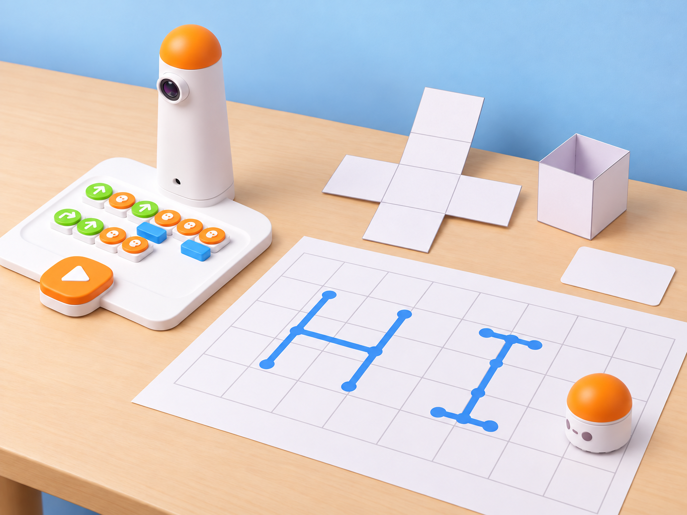
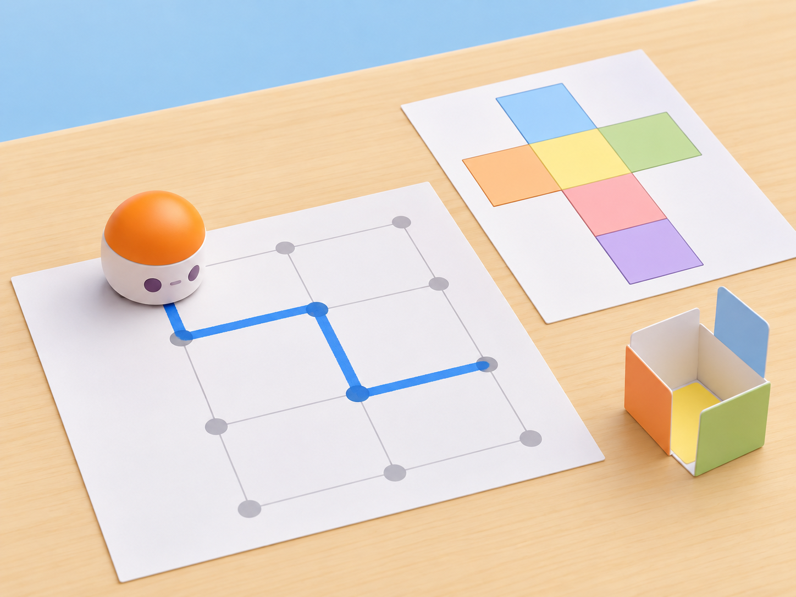

_La xarxa i les lletres són materials de paper. El robot recorre ordres de moviment; no dibuixa ni plega la cartolina._

## Situació, repte i intenció

La classe prepara una xicoteta exposició escolar sobre l’Albufera. Cada equip vol presentar una idea amb una maqueta geomètrica i una paraula clau, com ara **AIGUA**, escrita amb lletres de trams rectes. Primer cal decidir quines xarxes planes es poden plegar per formar un cub; després, una parella programa MatataBot perquè visite les caselles que corresponen a les cares de la xarxa. En una segona part, l’alumnat planifica en una graella el traçat ortogonal de la paraula i una persona el passa a paper.

La proposta s’alinea amb dos objectius que el resum oficial de l’Artist Add-On Curriculum identifica explícitament: en la lliçó 11, transformar un disseny 2D en una xarxa geomètrica que l’alumnat puga muntar com una forma 3D; en la lliçó 12, crear i mostrar paraules amb MatataBot. El resum oficial no conté els passos complets d’aquestes lliçons. Per això, aquesta fitxa desenvolupa activitats pròpies a partir d’aquests objectius i no afirma reproduir instruccions, materials o preguntes docents que no s’han pogut consultar.

El traçat directe de figures necessita l’Artist Add-On compatible. Com que la presència del complement no està confirmada, la seqüència principal usa el Coding Set base per a comprovar rutes sobre una graella i separa el recorregut del dibuix manual. Si el centre verifica l’accessori i segueix el manual del model, es pot afegir una comparació tècnica; aquesta ampliació no és necessària per a completar la situació.

**Pregunta guia:** quines evidències ens permeten saber que una xarxa es pot plegar i que la seqüència del robot visita les caselles en l’ordre acordat?

## Aprenentatges i vocabulari

- Reconéixer que una xarxa de sis cares quadrades ha de tindre una disposició que permeta plegar-les sense superposicions.
- Representar en una graella la posició de les cares i planificar una ruta amb inici, moviments, girs i parades.
- Descompondre una paraula en segments horitzontals i verticals i convertir l’ordre dels segments en instruccions verificables.
- Comparar predicció i execució, trobar la primera divergència i canviar una sola instrucció abans de tornar a provar.
- Distingir el treball geomètric i artístic de les persones de les ordres de moviment que executa MatataBot.

**Paraules clau:** xarxa, cara, aresta, vèrtex, pla, volum, plegar, graella, segment, lletra, seqüència, depuració.

## Materials i preparació

- Coding Set de la dotació: MatataBot, torre, tauler i blocs de moviment. Comproveu càrrega, connexió, orientació i la distància real entre caselles abans de la classe.
- Cartolina amb quadrats de 10 × 10 cm, pestanyes de muntatge, llapis, regle i tisores d’aula; la persona adulta prepara o supervisa els talls.
- Una graella de paper amb l’escala provada, targetes de casella i un full de registre amb **cara o lletra**, **posició**, **ordre**, **predicció**, **resultat** i **revisió**.
- Retoladors de colors, plantilles de lletres ortogonals i una llegenda visual per a representar inici, parada, avanç i gir. La paraula pot ser **AIGUA** o una altra triada pel grup.
- L’Artist Add-On només és una extensió opcional si el centre confirma físicament el complement compatible i el seu manual; no l’inclogueu entre els materials obligatoris.

Prepareu un exemple de xarxa vàlida i un de no plegable, tots dos dibuixats per l’equip docent. Marqueu la quadrícula i l’orientació inicial, i feu una prova del robot amb una seqüència curta. Les lletres es construeixen amb trams rectes i girs; si s’usa una grafia diferent, accepteu-la mentre la ruta quede especificada i provable.

## Seqüència didàctica

### Sessió 1 · Sis cares que poden plegar-se (45 min)

#### Fase 1 · Activem i prediem

Mostreu un cub de paper i una xarxa plana. Demaneu que l’alumnat prediga quantes cares té la forma i quines peces de la xarxa es convertiran en cares, sense plegar-la encara. Compareu dos dissenys i marqueu una possible superposició o un espai buit.

#### Fase 2 · Explorem i construïm

En equips, retalleu una xarxa de sis quadrats iguals amb pestanyes menudes en les vores necessàries. Plegueu-la seguint les arestes i fixeu-la amb cinta. Després, proveu una segona disposició i observeu si les cares es tanquen sense solapar-se; no és necessari usar el robot per a decidir si el model físic tanca.

#### Fase 3 · Expliquem i registrem

Numereu o acoloriu les sis cares en una còpia de paper i anoteu l’ordre en què es troben en la xarxa. Expliqueu quina cara queda al centre del muntatge, quines s’alcen al voltant i quina tapa la part superior. Registreu una predicció abans de plegar i el resultat observat.

#### Fase 4 · Apliquem i millorem

Intercanvieu una xarxa amb una altra parella, que ha de decidir si la pot plegar abans de tallar-la. Si la previsió falla, marqueu la primera aresta que impedeix el tancament, canvieu la disposició de dos quadrats i torneu a provar amb una còpia nova.

#### Fase 5 · Comprovem i reflexionem

**Evidència:** dues xarxes anotades, una maqueta muntada i una justificació basada en el plegat. **Pregunta:** quina observació ens permet distingir una xarxa viable d’una que se superposa?

### Sessió 2 · La ruta recorre les cares (45 min)

#### Fase 1 · Activem i prediem

Poseu en una graella de paper els mateixos sis quadrats de la xarxa plana. Trieu una cara com a inici i assenyaleu les altres cinc en ordre. Abans de moure cap fitxa, cada parella prediu quants avanços i girs necessita MatataBot per a arribar a cadascuna.

#### Fase 2 · Explorem i construïm

Dibuixeu una ruta entre caselles contigües. Una persona llig les ordres i una altra mou una fitxa que representa el robot; comproveu l’orientació després de cada gir. Si la ruta torna a una casella ja visitada, marqueu-ho: repetir una casella és vàlid si l’equip pot explicar per què la necessita.

#### Fase 3 · Expliquem i registrem

Traduïu la ruta a blocs físics del Coding Set i associeu cada parada a una cara acolorida. Una parella revisora comprova el programa sobre el paper abans de l’execució. Registreu el moviment previst, la cara de destinació i quines caselles es visiten més d’una vegada.

#### Fase 4 · Apliquem i millorem

Executeu el programa amb la xarxa plana ben fixada i l’espai lliure. El robot només recorre la graella: no llig nombres, no reconeix cares i no plega paper. Si la posició observada divergeix, localitzeu la primera ordre incorrecta, canvieu-ne una i repetiu la prova des del mateix inici.

_La ruta és una representació de paper; MatataBot no dibuixa les línies ni munta la forma 3D._

#### Fase 5 · Comprovem i reflexionem

**Evidència:** seqüència provada, registre de les sis parades i comparació entre predicció i execució. **Pregunta:** si la ruta visita totes les cares però una es repeteix, com podem demostrar que no n’hem omés cap?

### Sessió 3 · Una paraula es descompon en segments (45 min)

#### Fase 1 · Activem i prediem

Trieu **AIGUA** com a paraula de l’exposició o acordeu-ne una altra. Mostreu lletres de pal i demaneu que l’alumnat identifique quins segments són horitzontals, quins verticals i on cal canviar de direcció. La grafia és una convenció del repte, no una única manera correcta d’escriure.

#### Fase 2 · Explorem i construïm

Prepareu una plantilla en què cada lletra ocupe una àrea separada de la graella. Marqueu inici i final de cada segment, i decidiu si MatataBot farà una execució curta per lletra o una ruta contínua. Per a la lletra A, useu una forma ortogonal amb dos pals i una barra central; expliqueu que és una versió geomètrica simplificada.

#### Fase 3 · Expliquem i registrem

Convertiu cada grafia en una seqüència de moviments i girs. Un equip dicta la ruta i un altre la simula amb una fitxa; anoteu orientació inicial, nombre de caselles i punts en què el traçat canvia de direcció. Si la ruta exigeix una diagonal que el programa no pot fer, representeu-la com a alternativa manual i no l’atribuïu al robot.

#### Fase 4 · Apliquem i millorem

Executeu una lletra en una graella fixa. Després, una persona dibuixa manualment la lletra a partir del recorregut anotat. Compareu el resultat amb la plantilla: si hi ha una diferència, corregiu el programa o la convenció de la grafia, però no canvieu totes dues coses alhora.

#### Fase 5 · Comprovem i reflexionem

**Evidència:** una lletra en paper, la seua seqüència de blocs i un registre de la prova. **Pregunta:** quines decisions depenen del codi i quines de la convenció gràfica que ha triat l’equip?

### Sessió 4 · Exposem forma, paraula i evidències (45 min)

#### Fase 1 · Activem i prediem

Prepareu una taula d’exposició amb la xarxa plana, la forma plegada, la paraula i el mapa de la ruta. Cada equip prediu quines instruccions necessitarà una parella visitant per a comprovar tant la maqueta com el programa.

#### Fase 2 · Explorem i construïm

Acabeu una maqueta de cartolina que represente una parada d’exposició sobre l’Albufera. En cada cara, dibuixeu un símbol original i una llegenda breu. Afegiu al costat, no damunt de MatataBot, la paraula triada i la seqüència que porta per la graella.

#### Fase 3 · Expliquem i registrem

Intercanvieu els materials amb una altra parella. L’equip visitant comprova si pot reconstruir l’ordre de les cares, plegar la xarxa de paper i executar o simular la ruta de la paraula sense instruccions orals de l’autoria. Registreu per separat els resultats de geometria, programació i lectura de la llegenda.

#### Fase 4 · Apliquem i millorem

Reviseu una instrucció, una cara o una llegenda a partir de l’evidència de la prova. Si canvieu la xarxa, torneu a plegar-la; si canvieu la ruta, torneu a executar-la des del mateix inici. Marqueu quina versió és la final i què ha canviat.

#### Fase 5 · Comprovem i reflexionem

**Evidència:** maqueta desplegable, paraula en paper, programa provat i retorn d’una altra parella. **Tancament:** «Hem comprovat que…; el robot ha fet…; nosaltres hem construït…».

## Evidències i avaluació

Recolliu els esbossos de xarxa, les prediccions abans de plegar, la maqueta final, el mapa de cares, el programa de ruta, la plantilla de lletres i el retorn extern. Observeu si l’alumnat (1) justifica el plegat a partir de les cares i les arestes, (2) marca inici i orientació, (3) tradueix segments a ordres de moviment, (4) corregeix la primera divergència amb una prova repetida i (5) distingeix què executa el robot del que construeix o dibuixa la persona.

Autoavaluació: «he comprovat la xarxa abans d’exposar-la», «sé explicar un canvi de direcció en el codi» i «puc indicar què hem dibuixat a mà». Coavaluació: la parella visitant deixa una marca en cada comprovació que ha pogut repetir i formula una pregunta sobre la llegenda.

## Participació, accessibilitat i seguretat

Oferiu xarxes ja retallades, línies de plegat en relleu, graelles ampliades, lletres en targetes manipulables i instruccions visuals d’alt contrast. Es pot participar predient, ordenant cares, moure una fitxa, programar, plegar amb ajuda, dibuixar o registrar. La prova de ruta té una alternativa amb fitxa de paper i conserva els mateixos objectius de predicció i depuració. Useu tisores amb supervisió, cartolina sense vores tallants i peces de mida que no puguen entrar en el robot. No calen dades personals ni enregistraments de veu.

## Referents i adaptació

- Matatalab, [*Artist Add-On Curriculum* — resum oficial del quadern docent](https://matatalab.com/cdn/ff/2HgegdEsgGGg2k9OhY4VH1UCq-RXiPAr0YQxIO0n3KQ/1596512886/public/2020-08/The%C2%A0Teacher%C2%A0Resource%C2%A0Guide.pdf): el resum descriu les lliçons 1–5 com a formes simples, les lliçons 6–10 com a dissenys complexos, la lliçó 11 com a transformació d’un disseny 2D en una xarxa geomètrica que l’alumnat munta en 3D, i la lliçó 12 com a creació i presentació de paraules. Aquesta proposta desenvolupa localment els objectius de 11–12, però el text complet de les consignes, materials i preguntes d’aquestes dues lliçons no ha sigut consultable; no es declara una adaptació literal ni cobertura de les altres deu.
- Matatalab, [Artist Add-On: guia autoguiada oficial](https://www.matatastudio.com/Self-Guided.html): la lliçó tècnica 2.5 descriu l’ús dels blocs d’angle amb moviment, els deu valors d’angle, els tres llapis i les sis mostres de les targetes d’escalfament; especifica que el robot traça l’angle suplementari i que els blocs d’angle s’usen amb girs esquerra/dreta. S’utilitza com a referència tècnica separada, no com a guió de les lliçons 11–12.
- Matatalab, [*Hello Matatalab Robots!*](https://matatalab.com/en/node/88): referència complementària per a comprovar el moviment tangible del Coding Set. La seqüència de paper no atribueix dibuix directe ni muntatge 3D al robot base.

Les imatges IA pròpies mostren el MatataBot i la torre reals de la dotació, la xarxa i la ruta com a maquetes de paper. Les formes i paraules s’elaboren manualment; no s’hi representa un llapis acoblat ni un accessori Artist no confirmat.
