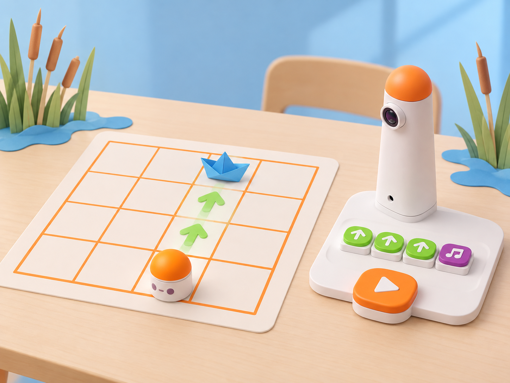

_Il·lustració IA pròpia basada en el model real del Coding Set. La barqueta és una joguina de paper; MatataBot no la reconeix ni l’arreplega, només executa el recorregut i la música programats._

## Situació, repte i intenció

La classe rep una barqueta de paper que arriba a una maqueta de l’Albufera. MatataBot i la joguina es col·loquen en una mateixa fila o columna d’una graella, amb un passadís clar entre totes dues. L’equip programa el robot perquè avance fins a la barqueta i, després del moviment, faça sonar una melodia breu de benvinguda.

La proposta adapta la targeta oficial **A-1 · Nice to Meet You** de les *Coding Activity Cards*. La imatge de la mostra especifica dos passos: col·locar MatataBot i una joguina en el mapa mantenint-los en la mateixa línia; programar el robot perquè es trobe amb la joguina i reproduïsca música. El context de barqueta, el mapa, els criteris de prova, la seqüència de sessions i les imatges són propis. “Trobar-se” significa arribar a la casella acordada: el robot no identifica la joguina ni té un sensor o una pinça per arreplegar-la.

**Pregunta guia:** quines ordres necessitem per arribar a la joguina en línia recta i com comprovem que la melodia s’executa després del moviment?

## Aprenentatges i vocabulari

- Situar inici i destinació en una mateixa fila o columna de la quadrícula.
- Relacionar distància en caselles amb els blocs de moviment disponibles.
- Mantenir la mateixa orientació inicial en planificar, programar i provar.
- Ordenar el bloc musical després dels moviments i observar el resultat.
- Distingir una arribada programada de la detecció o recollida automàtica d’un objecte.

**Vocabulari clau:** fila, columna, mateixa línia, casella, inici, destinació, avançar, orientació, seqüència, melodia, prova.

## Materials i preparació

- Coding Set real: MatataBot, torre de control, tauler, blocs de moviment i bloc de música disponibles al kit del centre.
- Graella de 4 × 4 caselles o mapa del kit, amb un punt d’inici i una destinació en la mateixa fila o columna.
- Barquetes de paper grans i lleugeres o una altra joguina segura, sense peces menudes ni arestes punxants.
- Fitxa de robot de paper, targetes de fletxes i full de registre amb **fila/columna**, **posició inicial**, **orientació**, **blocs de moviment**, **ordre de la música** i **resultat observat**.
- Rúbrica curta de parella: «mateixa línia», «arriba a la casella prevista», «música després del moviment».

Carregueu torre i MatataBot i comproveu que la torre reconeix els blocs que usareu. Col·loqueu robot i joguina en la mateixa fila o columna i deixeu lliure la ruta. La casella d’arribada ha de deixar espai perquè el robot no quede encastat contra la joguina; la trobada pot ser en la casella adjacent si l’escala del mapa ho demana. Ajusteu la distància a la superfície real i no forceu el robot contra la peça.

## Seqüència didàctica

### Sessió 1 · Posem el mapa en línia (45 min)

#### Fase 1 · Activem i prediem

Presenteu la maqueta de la llacuna i la barqueta de paper. Mostreu dues disposicions: en una, robot i joguina comparteixen fila; en l’altra, estan desplaçats en diagonal. L’alumnat assenyala quina disposició compleix la consigna de la targeta i explica com ho sap.

#### Fase 2 · Explorem i construïm

En parelles, marqueu la posició inicial de MatataBot i poseu la joguina en una altra casella de la mateixa fila o columna. La persona que planifica indica cap a on mira el robot i compta les caselles fins a la destinació; l’altra prepara la ruta amb fitxes de fletxes, sense blocs encara.

#### Fase 3 · Expliquem i registrem

Dibuixeu la fila o columna triada i anoteu inici, orientació i destinació. Una parella visitant verifica que no hi ha cap desviació de fila/columna i que la distància és clara. Si la joguina tapa la línia o queda massa prop del robot, canvieu la col·locació abans d’escriure el programa.

#### Fase 4 · Apliquem i millorem

Intercanvieu una disposició amb una altra parella. La parella visitant ha de reproduir la posició a partir del mapa, sense instruccions orals de qui l’ha dibuixat. Si situa una peça en una altra casella, milloreu la llegenda i torneu a provar la lectura.

#### Fase 5 · Comprovem i reflexionem

**Evidència:** mapa amb robot i joguina en la mateixa línia, punt inicial i orientació. **Pregunta:** què canviaria si les dues peces estigueren en diagonal?

### Sessió 2 · Programem l’arribada (45 min)

#### Fase 1 · Activem i prediem

Recupereu una disposició validada i predigueu en quina casella acabarà MatataBot després de les ordres triades. Cada persona marca el final de la ruta abans de col·locar els blocs.

#### Fase 2 · Explorem i construïm

Traduïu la distància a blocs de moviment disponibles. Si el kit permet un bloc de nombre amb avançar, useu-lo només en la combinació acceptada pel model; altrament, representeu els passos amb blocs d’avanç consecutius. Simuleu la seqüència amb una fitxa de paper i comproveu que l’orientació no canvia.

#### Fase 3 · Expliquem i registrem

Una persona llig el programa i l’altra assenyala la casella de cada moviment. Anoteu nombre de caselles previst i punt d’arribada. Confirmeu que la ruta no necessita detectar la barqueta: és la col·locació sobre la graella la que dona la destinació.

#### Fase 4 · Apliquem i millorem

Executeu el programa en la mateixa superfície i des del mateix punt. Si MatataBot no arriba a la casella prevista, mesureu la diferència, reviseu una sola instrucció i torneu a provar. No empenyeu el robot contra la barqueta ni canvieu alhora el mapa i els blocs.

#### Fase 5 · Comprovem i reflexionem

**Evidència:** programa de moviment, predicció de casella i resultat observat. **Pregunta:** quina dada del mapa ens ha permés triar el nombre d’ordres d’avanç?

### Sessió 3 · La música dona la benvinguda (45 min)

#### Fase 1 · Activem i prediem

Compareu dues seqüències idèntiques de moviment: una acaba després d’arribar i l’altra afegeix música abans dels moviments. Predigueu quin ordre comunica millor que la benvinguda musical arriba després de la trobada.

#### Fase 2 · Explorem i construïm

Afegiu el bloc de música després dels blocs de moviment al tauler, segons la disposició acceptada pel kit del centre. Si el bloc no és present o la versió no el reconeix, substituïu la celebració per una targeta visual i anoteu que la prova de música no s’ha executat físicament.

#### Fase 3 · Expliquem i registrem

Escriviu la seqüència com **moviments → arribada prevista → música**. Una altra parella llig el programa i assenyala quin bloc és responsable del desplaçament i quin de l’eixida sonora. Anoteu volum i durada percebuts sense puntuar la qualitat musical.

#### Fase 4 · Apliquem i millorem

Executeu la seqüència completa. La parella observadora comprova que el robot arriba a la casella prevista i que la música sona després de l’execució dels moviments. Si l’ordre és diferent, corregiu la posició dels blocs i repetiu des de la mateixa casella inicial.

#### Fase 5 · Comprovem i reflexionem

**Evidència final:** mapa, programa complet i registre de l’arribada i la música. Tanqueu amb: «La barqueta està en la mateixa línia perquè…» i «La música ha sonat després de…».

## Evidències i avaluació

Recolliu el mapa, la seqüència tangible o dibuixada i una taula amb predicció i resultat. Observeu si l’alumnat:

- comprova que inici i joguina comparteixen fila o columna;
- marca orientació i distància abans d’executar;
- associa els blocs a moviments observables;
- situa la música després de la seqüència de moviment;
- diferencia arribada, detecció i recollida.

No avalueu la rapidesa ni que el programa funcione al primer intent.

## Participació, accessibilitat i seguretat

Feu servir mapa ampli, caselles d’alt contrast, fletxes en relleu i joguina prou gran perquè es veja des de qualsevol lloc. Permeteu participar assenyalant, llegint, col·locant blocs o registrant la prova. Oferiu alternativa sense so amb una targeta de benvinguda. Manteniu mans fora de la ruta quan el robot està actiu; si cal reposicionar la joguina, atureu primer el dispositiu. La barqueta és un model de paper, no una embarcació real ni un objecte que el robot transporta.

## Referents i adaptació

- Matatalab, [*Coding Activity Cards*, targeta A-1 · *Nice to Meet You* (PDF oficial)](https://matatalab.com/cdn/ff/IhHZwon10hgweb9Aqf4zXOcRD2XjU0s9E0F2sWyqps4/1637739725/public/2021-11/Coding%20Activity%20Cards.pdf): col·loca MatataBot i una joguina en una mateixa línia del mapa i programa el robot perquè arribe a la joguina i reproduïsca música. La mostra consultada presenta la mateixa columna, una ruta recta i el bloc musical després dels moviments.
- Matatalab, [*Hello Matatalab Robots!*](https://matatalab.com/en/node/88): consulta per verificar els moviments direccionals i l’orientació del robot en el Coding Set.

La proposta conserva els dos requisits visuals de la targeta A-1 —mateixa línia i música en arribar— i els transforma en una benvinguda local amb barqueta de paper. El kit executa ordres; les persones situen les peces, defineixen la destinació i comproven el resultat.
