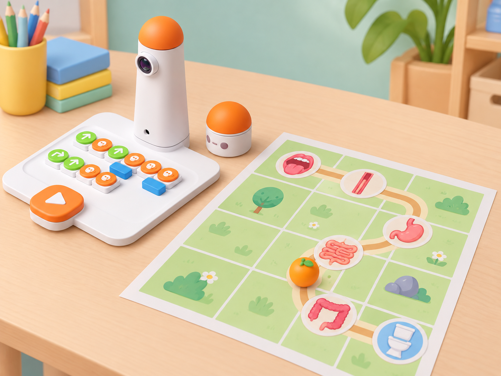
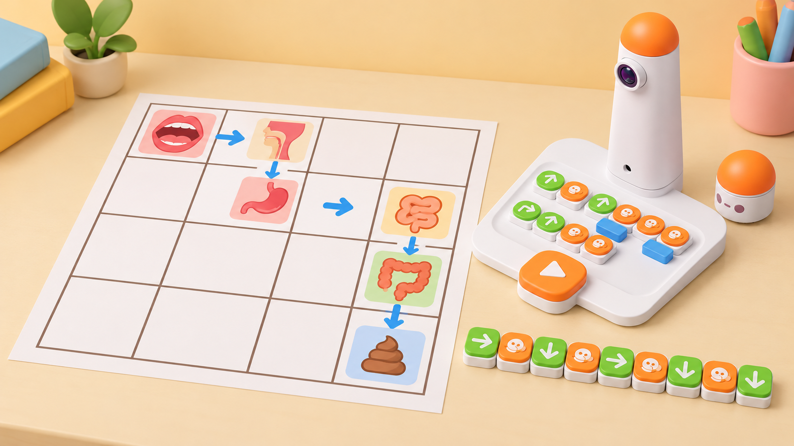
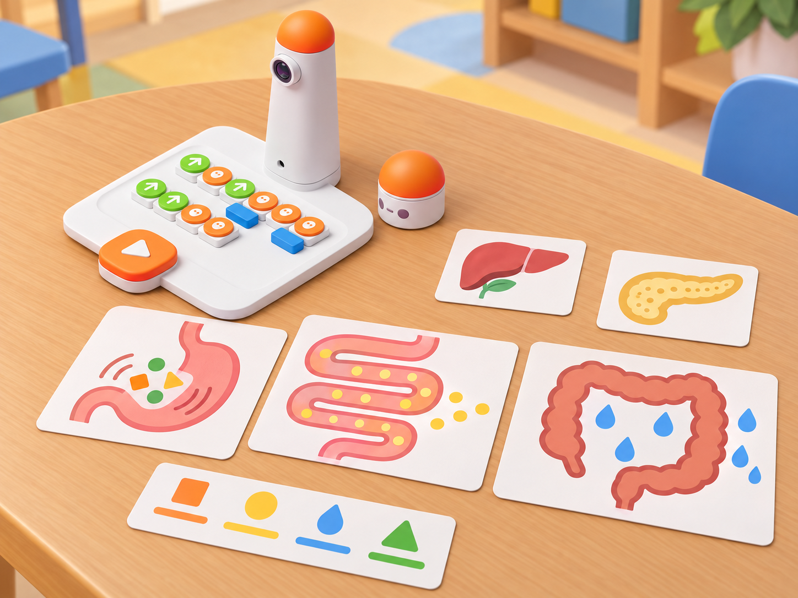

_El mapa és un model didàctic de paper: el robot només executa moviments programats. No interpreta òrgans ni simula el procés biològic._

## Situació, repte i intenció

Una cooperativa escolar prepara una exposició sobre fruites de l'horta i vol explicar què ocorre després de menjar. L'equip crea un mapa de caselles amb estacions que representen la boca, l'esòfag, l'estómac, l'intestí prim, l'intestí gros i l'eixida del tub digestiu. Una fitxa de fruita recorre el mapa mentre MatataBot segueix una seqüència de moviments. La classe ha de distingir entre el recorregut simplificat del model i el procés real, que és més complex.

La situació adapta i trasllada a la dotació disponible l'activitat pública *Food Digestion*: conserva l'explicació inicial, el recorregut per estacions, la pràctica per parelles i la conversa final. La font està dissenyada per a Matatalab Lite i usa el seu mode de control manual; ací el substituïm per blocs tangibles i una ruta ortogonal del Coding Set. No es presenta aquesta substitució com una funció del Lite ni com una còpia exacta del seu procediment.

**Pregunta guia:** quina seqüència permet passar per totes les estacions en ordre i quines parts del mapa són només una representació?

## Aprenentatges i vocabulari

- Ordenar boca, esòfag, estómac, intestí prim i intestí gros com a parts del tub digestiu que recorre l'aliment.
- Explicar amb un model senzill que masteguem a la boca, que els moviments musculars impulsen el contingut per l'esòfag, que l'estómac el barreja i que els intestins continuen el procés; l'intestí prim absorbeix la major part dels nutrients i el gros absorbeix aigua.
- Descompondre una ruta en trams, girs i punts de parada, i traduir-la a una seqüència de blocs.
- Comparar predicció i resultat, localitzar la primera diferència i corregir una instrucció cada vegada.
- Distingir el trajecte de l'aliment de les funcions d'òrgans auxiliars com el fetge i el pàncrees, que participen en la digestió però no són caselles del trajecte.

**Vocabulari clau:** tub digestiu, boca, esòfag, estómac, intestí prim, intestí gros, nutrients, absorció, peristaltisme, seqüència, gir, depuració, model.

## Materials i preparació

- Coding Set complet: MatataBot, torre de control, tauler i blocs tangibles de moviment disponibles al centre.
- Mapa original de 4 × 4 caselles de **10 × 10 cm** per a la prova física, amb inici, orientació i una ruta ortogonal marcada; el robot no fa recorreguts corbs ni llig els pictogrames.
- Sis pictogrames de paper amb les estacions digestives, una fitxa plana de fruita, fletxes de direcció i targetes d'ordre; no cal menjar real.
- Full de registre amb les columnes **estació**, **casella**, **ordre prevista**, **ordre executada**, **observació** i **revisió**.
- Fonts de consulta docent: [NIDDK, funcionament del sistema digestiu](https://www.niddk.nih.gov/health-information/digestive-diseases/digestive-system-how-it-works) i [activitat Matatalab *Food Digestion*](https://matatalab.com/en/node/90).

Abans de la classe, comproveu càrrega, connexió de torre i robot, orientació inicial i mida de les caselles. Proveu una seqüència curta sobre el mateix mapa i anoteu si cada avanç correspon a una casella. Prepareu una ruta accessible amb inici al marge i girs fàcils de llegir; no canvieu la mida oficial de la graella per compensar desviacions.

Useu pictogrames científicament revisats i no dibuixeu el cos d'un infant. La fruita és una fitxa que representa qualsevol aliment; no demaneu a l'alumnat què menja, si té al·lèrgies, ni que compartisca informació de salut o hàbits familiars. Eviteu classificar aliments o cossos com a bons, dolents, nets o bruts.

## Seqüència didàctica

### 1. Ordenem les estacions (50 min)

#### Fase 1 · Activem i prediem

Presenteu el repte amb sis pictogrames sense ordre i una fitxa de fruita. En parelles, ordeneu-los segons què penseu que ocorre després d'empassar. Recolliu les idees inicials sense corregir-les d'immediat; marqueu amb un signe d'interrogació les parts que caldrà contrastar amb la font científica.

#### Fase 2 · Explorem i construïm

Amb una explicació docent breu i la pàgina de NIDDK, reviseu la seqüència boca → esòfag → estómac → intestí prim → intestí gros → recte i anus. Per a aquesta primera representació, agrupeu recte i anus en una estació final titulada «eixida» si el mapa no té prou caselles. Situeu fetge i pàncrees en una vora com a òrgans que ajuden al procés però que no són part del trajecte seguit per la fitxa.

#### Fase 3 · Expliquem i registrem

Cada parella prepara una targeta per estació amb una frase clara: mastegar; avançar per l'esòfag; barrejar a l'estómac; absorbir la major part dels nutrients a l'intestí prim; absorbir aigua a l'intestí gros; i arribar a l'eixida. No cal memoritzar noms més específics ni representar reaccions químiques. Registreu una idea inicial que hàgeu corregit amb la font.

#### Fase 4 · Apliquem i millorem

Intercanvieu els pictogrames amb una altra parella sense mostrar l'ordre. L'equip visitant els col·loca i justifica la seqüència. Si hi ha desacord, cerqueu la dada en la font abans de canviar la targeta. El professorat comprova que la ruta no suggerisca que fetge o pàncrees són trams pels quals passa l'aliment.

#### Fase 5 · Comprovem i reflexionem

**Evidència:** seqüència de pictogrames amb una frase per estació i una correcció justificada. **Pregunta de tancament:** quin òrgan participa en la digestió però no forma part del tub pel qual passa l'aliment?

### 2. Del mapa a les ordres (50 min)

#### Fase 1 · Activem i prediem

Mostreu el mapa de 4 × 4 i marqueu inici, orientació i final. Feu que una persona camine la ruta amb una fitxa de robot mentre la parella diu les instruccions. Abans d'escriure el programa, prediu quants avanços i girs calen i en quina estació podria ser més fàcil equivocar-se.

#### Fase 2 · Explorem i construïm

Ubiqueu les estacions en una ruta ortogonal possible. Convertiu cada tram en avanços i cada canvi d'orientació en un gir de 90° amb els blocs disponibles. Les parades són marques del mapa, no ordres que MatataBot detecte. Si una ruta no cap en la quadrícula, canvieu la disposició dels pictogrames o declareu un nou inici; no afegiu sensors ni moviment corb al kit base.

#### Fase 3 · Expliquem i registrem

Abans d'executar, una persona llig la seqüència en veu alta i l'altra assenyala sobre el mapa què farà el robot. Registreu la casella i l'orientació després de cada ordre. Si un tram requereix moltes peces iguals, compareu-lo amb una repetició verbal; només useu un bloc de bucle si forma part del kit real i la seqüència resultant s'ha comprovat.

#### Fase 4 · Apliquem i millorem

Programeu i executeu una vegada. L'observador marca la primera casella on la posició real se separa de la prevista. Depureu primer la interpretació de gir i avanç; després, si cal, reviseu l'alineació física. Canvieu una instrucció cada vegada i repetiu la prova des del mateix punt inicial.

_Les fletxes i pictogrames representen un mapa preparat per l'alumnat; el robot només executa les ordres físiques._

#### Fase 5 · Comprovem i reflexionem

**Evidència:** seqüència de blocs, predicció casella a casella i registre del resultat de la primera execució. **Pregunta de tancament:** quin canvi d'orientació ha sigut més important per a no eixir de la ruta?

### 3. Seguim el procés sense simplificar-lo de més (50 min)

#### Fase 1 · Activem i prediem

Recupereu la ruta programada i pregunteu què representa cada parada. Mostreu una targeta d'estómac i una d'intestí prim: predigueu si fan la mateixa funció o si el model necessita distingir-les. Recordeu que la fitxa només representa el recorregut, no els canvis que pateix l'aliment.

#### Fase 2 · Explorem i construïm

Afegiu al mapa targetes d'esdeveniment per a «mastegar», «moviment muscular», «barreja», «absorció de nutrients» i «absorció d'aigua». Associeu-les amb la parada corresponent i contrasteu-les amb la font. El peristaltisme és un moviment muscular que impulsa el contingut; no és una ordre conscient del robot ni un moviment de la fitxa que puga reproduir exactament el cos.

#### Fase 3 · Expliquem i registrem

Cada parella crea una llegenda de dos nivells: **què fa MatataBot** (avança, gira, s'atura perquè una persona el para) i **què explica la ciència** (funció aproximada de cada òrgan). Marqueu amb una vora discontínua les idees que el mapa no representa, com la digestió química, els sucs digestius i l'absorció a través de les parets intestinals.

_Les icones són un recurs per a conversar sobre funcions; no descriuen tots els processos digestius ni són un mapa de sensors._

#### Fase 4 · Apliquem i millorem

Afegiu una casella de desviament fictícia i demaneu a una altra parella que detecte l'error en una seqüència escrita. La classe decideix si l'error és de ruta o de coneixement científic: corregir un gir no canvia la funció d'un òrgan, i corregir una dada científica no exigeix moure el robot. Registreu les dues revisions per separat.

#### Fase 5 · Comprovem i reflexionem

**Evidència:** llegenda que separa model i procés real, amb almenys dues limitacions explícites. **Pregunta de tancament:** què no podem concloure observant només el moviment del robot?

### 4. Revisem i compartim el mapa (50 min)

#### Fase 1 · Activem i prediem

Prepareu una ruta nova a partir d'una disposició diferent de les targetes. Cada equip prediu si pot arribar a l'eixida sense retrocedir i anota un pla alternatiu. La fruita continua sent una peça fictícia: no cal portar aliments reals ni parlar d'hàbits personals.

#### Fase 2 · Explorem i construïm

Dissenyeu i intercanvieu mapes entre equips. Cada mapa ha d'incloure inici, orientació, ordre de les estacions i una ruta executable amb la graella. El grup que rep el mapa ha de poder entendre'l sense que l'equip autor explique les instruccions oralment; milloreu símbols o llegenda si no és així.

#### Fase 3 · Expliquem i registrem

L'equip visitant fa una predicció completa i escriu el programa. La parella autora comprova que les ordres coincidisquen amb el mapa, però no dona la solució. Registreu una pregunta que ha ajudat a aclarir el repte i una dada científica que s'ha verificat.

#### Fase 4 · Apliquem i millorem

Executeu i compareu programa, ruta i pictogrames. Si hi ha una errada, indiqueu-ne la primera causa observada, proposeu una modificació i torneu a provar només el fragment necessari des d'un punt segur. No puntueu el temps: valoreu que una altra parella puga seguir i explicar la ruta.

#### Fase 5 · Comprovem i reflexionem

Cada equip presenta el mapa, una prova de depuració i una limitació del model. **Evidència final:** mapa amb llegenda, seqüència, predicció, registre d'execució i explicació científica revisada. **Pregunta de tancament:** quina part de l'exposició canviaries perquè ningú confonga una ruta programada amb un cos real?

## Evidències i avaluació

Recolliu quatre productes: seqüència científica de la sessió 1, programa i registre de la sessió 2, llegenda de límits del model en la sessió 3, i mapa revisat amb explicació en la sessió 4. Observeu si l'equip: ordena les parts principals del tub digestiu; diferencia el recorregut de les funcions auxiliars del fetge i el pàncrees; tradueix una ruta ortogonal a blocs; prediu girs i avanços; localitza la primera diferència durant la prova; i comunica què no simula el robot. No avalueu coneixements mèdics personals ni demaneu relats de salut.

## Participació, accessibilitat i seguretat

Useu pictogrames grans, text de lectura fàcil, relleu o formes diferenciades a més del color. Marqueu l'inici amb una textura o una osca i oferiu una ruta curta amb menys girs. Es pot participar com a responsable de pictogrames, programador/a, predictor/a, observador/a del robot, verificador/a científic/a o relator/a. Doneu l'ordre de les estacions en targetes manipulables a qui necessite suport de memòria; accepteu una predicció oral, assenyalada o escrita. Manteniu mans i materials fora del pas del robot; no hi ha ingestió, contacte amb aliments ni representació corporal real.

## Referents i adaptació

- Matatalab, [Food Digestion](https://matatalab.com/en/node/90): activitat de Matatalab Lite amb presentació del procés digestiu, representació de la ruta en paper de gran format, control per parelles, pràctica guiada i retorn. La proposta conserva el recorregut i la conversa, però canvia el control manual del Lite per blocs tangibles del Coding Set, usa un mapa de graella i distribueix el treball en quatre sessions pròpies.
- National Institute of Diabetes and Digestive and Kidney Diseases, [Your Digestive System & How it Works](https://www.niddk.nih.gov/health-information/digestive-diseases/digestive-system-how-it-works): ordre del tub digestiu, moviment per peristaltisme i funcions generals de l'estómac i els intestins. La situació en fa una síntesi educativa i no una explicació mèdica exhaustiva.

Els pictogrames, el mapa, les preguntes, el registre i la il·lustració són originals. La imatge mostra el MatataBot i la torre reals de la dotació; els símbols d'òrgans són icones planes i no parts del robot. La font de Matatalab Lite és un referent pedagògic, no una afirmació de compatibilitat del seu mode manual amb el Coding Set.
