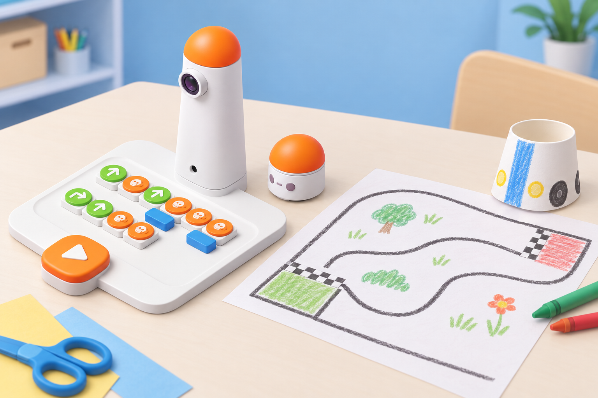
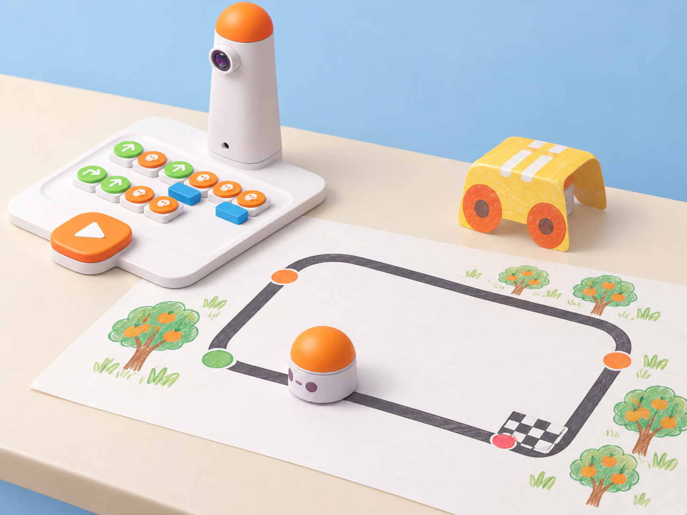

_Il·lustració IA basada en el Coding Set real de la dotació. MatataBot i la torre es mostren intactes; el cotxe de paper és una maqueta separada, no una modificació del robot._

## Situació, repte i intenció

El centre organitza una fira de circuits inspirats en camins de l'horta. En equips de quatre, l'alumnat dissenya una carcassa lleugera per al MatataBot i un circuit de paper amb eixida, arribada i girs; després programa el robot perquè complete una volta. La carcassa és una peça de manualitat independent: no s'enganxa al robot, no tapa l'ull lector i es retira si el moviment o la lectura de blocs se'n veuen afectats.

Aquesta fitxa adapta les lliçons 3 i 4 del currículum extracurricular de Matatalab. La lliçó 3 introdueix el disseny del vehicle i del recorregut, i explora blocs d'angle i altres blocs avançats; la lliçó 4 programa una volta o diverses, prova paràmetres, bucles i funcions, depura i presenta el resultat. La situació conserva el disseny col·laboratiu, els esbossos, la prova dels girs, la volta completa, el diari i les preguntes de reflexió. El circuit, la fira i les targetes de planificació són propis.

**Pregunta guia:** com transformem el mapa d'un circuit en una seqüència que el robot puga executar i revisar?

## Aprenentatges i vocabulari

- Representar un circuit amb inici, final, trams, girs i una volta completa.
- Combinar blocs de moviment amb paràmetres i, si la dotació els inclou, blocs d'angle.
- Reconéixer una seqüència reutilitzable com a funció i repetir-la amb blocs de bucle.
- Provar el programa, localitzar una desviació i modificar una instrucció cada vegada.
- Repartir rols, documentar decisions i presentar un disseny amb evidències de prova.

**Vocabulari clau:** mapa, graella, algoritme, seqüència, angle, grau, paràmetre, funció, bucle, inici, meta, volta, prova i depuració.

## Materials i preparació

- Un Coding Set complet per equip: MatataBot, torre de control, tauler de control i blocs de direcció/moviment, nombre/paràmetre, bucle i funció que estiguen disponibles al centre.
- Blocs d'angle **només si formen part de la dotació**; no es pressuposa l'Artist Add-On. Sense aquests blocs, adapteu el circuit a girs de 90° sobre quadrícula i manteniu els objectius de seqüència, repetició i funció.
- Gots de paper o recipients lleugers nets per a una carcassa desmuntable, cartolina, retoladors, tisores d'aula, cinta i cola només per a la maqueta separada; paper gran per al circuit i quadern de registre.
- Targeta de planificació amb dibuix, inici/meta, ordre dels girs, programa provat, incidència i canvi aplicat.

Abans de la classe, carregueu MatataBot i la torre. Proveu els blocs i el circuit en una superfície plana, sense carcassa. Si es construeix una carcassa, comproveu que descansa sense pressió sobre el cos i no toca cap element lector ni bloqueja les rodes. El fabricant especifica que la carcassa de cursa ha d'ajustar-se al robot sense enganxar-s'hi. Manteniu les tisores sota supervisió i no feu competicions de velocitat.

## Seqüència didàctica

### Sessió 1 · Dissenyem el cotxe i el circuit (60 min)

#### Fase 1 · Activem i prediem

**Activació (10 min):** mostreu un mapa senzill d'un camí de l'horta i pregunteu quina informació necessita una persona per seguir-ne la ruta. Relacioneu el traçat amb les ordres de MatataBot: avançar, retrocedir i girar. Compareu un gir recte amb un d'obert i anticipeu què pot passar si l'angle del mapa i el del programa no coincideixen. Presenteu el repte: crear una carcassa que puga retirar-se i un circuit amb inici i meta.

#### Fase 2 · Explorem i construïm

**Esbossos i prova (20 min):** en grups de quatre, assigneu rols rotatius de disseny, lectura de mapa, programació i registre. Dibuixeu el cotxe i el circuit al quadern abans d'usar els materials. Feu una carcassa amb un got o cartolina que puga posar-se i llevar-se sense cola; si no encaixa sense forçar ni cobrir l'ull lector, deixeu-la com a maqueta al costat del robot. Sobre paper gran, traceu un circuit que torne al punt d'eixida. Podeu incloure girs oberts només si disposeu dels blocs d'angle reals; si no, useu una graella amb girs de 90°.

#### Fase 3 · Expliquem i registrem

**Angles i seqüències (10 min):** marqueu cada tram i gir de la ruta. Si hi ha blocs d'angle, proveu-los primer en un tros curt i anoteu que el valor representa el gir codificat segons el bloc, no necessàriament l'angle interior que dibuixa la cantonada. Si no n'hi ha, representeu els girs rectes sobre la quadrícula. Compareu la seqüència dibuixada amb l'ordre físic dels blocs al tauler.

#### Fase 4 · Apliquem i millorem

**Primera volta (15 min):** executeu una ruta curta del circuit sense la carcassa. Si el robot se'n desvia, marqueu al mapa on ocorre i canvieu una sola instrucció: nombre de moviments, ordre o gir. Després de comprovar una volta, col·loqueu la carcassa només si l'ajust i la lectura continuen sent fiables; repetiu el mateix tram per comprovar si la maqueta altera el moviment.

#### Fase 5 · Comprovem i reflexionem

**Tancament (5 min):** cada equip dibuixa la ruta que ha provat i encercla el gir més difícil. Responeu al quadern: què és un angle?, per què és important en una ruta?, i quina prova ha ajudat a decidir si el programa funcionava? **Evidència:** esbós del vehicle i del mapa, seqüència inicial i anotació d'una prova.

_La imatge és una proposta visual de planificació, no una instrucció de muntatge. Comproveu el tauler, els blocs i la lectura real de la torre amb el kit del centre._

### Sessió 2 · Programem una volta i depurem (60 min)

#### Fase 1 · Activem i prediem

**Recordem els blocs (10 min):** recupereu el mapa i els blocs avançats. Expliqueu amb exemples físics que el paràmetre indica quantes vegades s'aplica un moviment, que el bucle repeteix un grup d'instruccions i que una funció dona un nom a una seqüència que es pot reutilitzar. No presenteu una disposició exacta de blocs si no l'heu comprovat amb la versió concreta del tauler.

#### Fase 2 · Explorem i construïm

**Preparem el programa (15 min):** els equips planifiquen una volta completa o una ruta amb diversos trams. Marqueu quines ordres es repeteixen i quina seqüència podria agrupar-se en una funció. Amb els blocs presents al set, munteu primer una versió curta al tauler; una altra persona llig les peces d'esquerra a dreta i de dalt a baix, segons l'ordre que reconeix el kit.

#### Fase 3 · Expliquem i registrem

**Predicció i casos de prova (10 min):** abans d'executar, recorreu el mapa amb el dit i anoteu on hauria d'acabar el robot després de cada seqüència. Afegiu un segon cas: repetir el mateix tram dues vegades o reduir el nombre de repeticions. Registreu què canvia en usar un paràmetre, una funció o un bucle i quina part del codi es manté igual.

#### Fase 4 · Apliquem i millorem

**Completem i depurem la cursa (20 min):** executeu la volta a baixa velocitat d'acord amb el moviment normal del kit. Si no arriba a la meta, compareu posició prevista i real, localitzeu la primera ordre divergent i canvieu-ne una. Repetiu després d'una modificació. Quan complete la volta, proveu una segona volta amb un bucle o una funció reutilitzada, sempre que els blocs estiguen disponibles. Cada grup presenta el cotxe de paper al costat del robot —sense enganxar-lo—, el mapa i la seqüència provada.

#### Fase 5 · Comprovem i reflexionem

**Diari i retorn (5 min):** responeu: quins blocs avançats hem utilitzat?, quin ens ha ajudat més a completar la ruta i per què?, què canviaríem per fer el disseny més fiable? Una altra parella aporta una observació concreta i una pregunta. **Evidència final:** programa físic registrat o fotografiat pel centre, mapa amb volta, incidència detectada, canvi provat i explicació del paper dels paràmetres, bucles i funcions.

## Evidències i avaluació

Recolliu els esbossos, el mapa, la seqüència de blocs, el diari de depuració i la presentació. Observeu si l'alumnat identifica inici i meta; manté el circuit consistent amb les ordres; explica quan una instrucció es repeteix; usa una seqüència reutilitzable quan el bloc de funció està disponible; i argumenta una modificació a partir del punt on s'ha desviat el robot. La carcassa estètica, el temps i la rapidesa no són criteris d'avaluació.

## Participació, accessibilitat i seguretat

Oferiu un mapa d'alt contrast, una ruta curta o una quadrícula tàctil; assigneu rols de disseny, lectura, programació, observació i registre perquè cada persona puga participar sense manipular el robot. L'alumnat pot explicar la ruta oralment, amb fletxes o amb una seqüència de targetes. Useu només carcasses lleugeres i desmuntables, supervisió amb tisores i superfícies planes. No pegueu cap peça al robot ni tapeu l'ull lector; retireu la carcassa si afecta el moviment.

## Referents i adaptació

- Matatalab, [Extracurricular Curriculum · lliçons 3 i 4, *Sequences of Coding* (PDF oficial)](https://matatalab.com/cdn/ff/CrQPo-NarPZLUtZnP3JKbo4oDvbv3Nr4L9nQ_5l4kdc/1653550757/public/2022-05/Extracurricular%20Curriculum.pdf): dues sessions de 60 minuts. La lliçó 3 crea una carcassa de cursa que encaixe sense enganxar-se al robot i un circuit, introdueix els blocs d'angle i prova seqüències; la lliçó 4 programa una o diverses voltes amb paràmetres, bucles, funcions i blocs d'angle, depura i presenta el resultat. També inclou diari, reflexió, extensió a altres vehicles i connexions amb mapes i seqüències quotidianes.
- Matatalab, [guia autoguiada de Coding Set](https://www.matatastudio.com/Self-Guided.html): referència de consulta per a la lectura i funció dels blocs de moviment, nombre, bucle i funció. Els blocs d'angle i el suport de retolador depenen de l'Artist Add-On.

La fira de l'horta, el mapa, els criteris d'avaluació i les imatges IA són originals. Aquesta fitxa adapta **les lliçons 3 i 4**, no les dotze lliçons del currículum extracurricular complet. L'ús de blocs d'angle i de carcassa està condicionat a la dotació real; la versió base amb quadrícula conserva seqüències, nombres, bucles i funcions sense atribuir complements inexistents.
