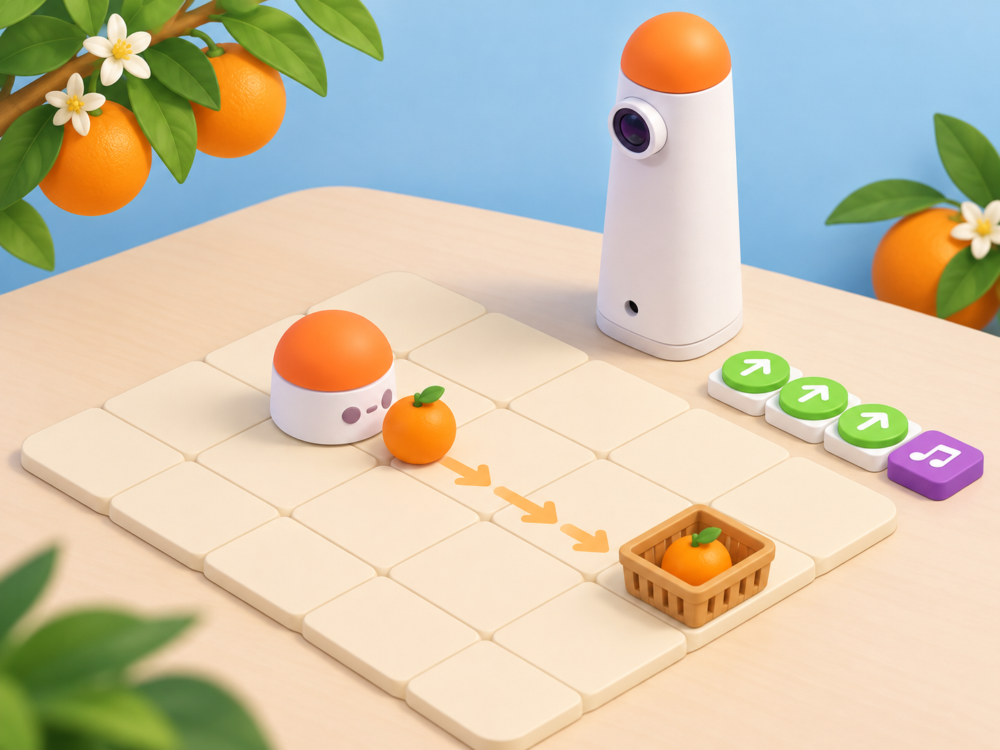

_Il·lustració IA pròpia basada en el model real del Coding Set. La fruita és una peça lleugera de maqueta que el robot empeny; una persona la col·loca a la cistella. El robot no té pinça ni recull objectes de manera autònoma._

## Situació, repte i intenció

La cooperativa escolar prepara una parada de productes de temporada. En un mapa de quadrícula hi ha una o més taronges de paper i una cistella marcada com a punt de recollida. Els equips planifiquen una ruta perquè MatataBot arribe a cada peça, l’empenya amb cura fins a una zona acordada i tanque el programa amb música. Després, una persona recull cada peça i la posa manualment a la cistella.

La proposta adapta dues targetes oficials de les *Coding Activity Cards*: **A-2 · Fruit Picking**, amb una peça i música de celebració, i **A-3 · MatataBot Loves Candy**, que amplia la tasca a dues peces i després a tres o més en un únic programa. El material oficial representa una ruta en quadrícula i, en A-2, un bloc musical al final. La versió local transforma la “recollida” en una acció observable i segura: el robot empeny testimonis lleugers, sense pinça ni mecanisme inventat; l’alumnat completa manualment el pas de posar-los a la cistella. El context de cítrics, el mapa, la seqüència didàctica, el registre i les imatges són propis.

**Pregunta guia:** quines ordres necessitem perquè el robot arribe a la fruita, la desplace sense eixir del camí i faça sonar la melodia només després de completar la ruta?

## Aprenentatges i vocabulari

- Llegir una ruta en quadrícula tenint en compte la posició i l’orientació inicials.
- Traduir una ruta a blocs de moviment del Coding Set i predir-ne el resultat.
- Comprovar com canvia la posició d’un objecte quan el robot hi arriba i l’empeny.
- Col·locar el bloc de música després dels moviments i verificar l’ordre de la seqüència.
- Distingir les accions programades del robot de la recollida manual de la fruita.
- Descompondre una ruta amb diversos testimonis i visitar-los tots amb un únic programa.

**Vocabulari clau:** inici, orientació, casella, ruta, avançar, girar, empényer, destinació, seqüència, prova, melodia.

## Materials i preparació

- Coding Set real: MatataBot, torre de control, tauler i blocs de moviment i música presents al kit del centre.
- Mapa propi de 4 × 4 caselles amb inici, zona de fruita i cistella; useu la quadrícula del kit si el centre en disposa i confirmeu-ne les dimensions abans de fer prediccions.
- Una o dues fruites de paper gruixut o escuma lleugera, amb vores arrodonides; una cistella ampla i baixa fora del recorregut del robot.
- Full de registre amb **posició inicial**, **orientació**, **ordres**, **posició final**, **fruit desplaçat sí/no**, **música al final sí/no** i **canvi per a la prova següent**.
- Cinta de pintor per immobilitzar el mapa, targetes grans amb les instruccions i una fitxa de MatataBot de paper per simular abans d’encendre el robot.

Carregueu la torre i el robot. En una superfície plana, comproveu que la torre reconeix els blocs que fareu servir i que el bloc musical sona a volum moderat. Proveu la peça lleugera abans de la classe: si es queda atrapada sota el robot, es desvia de la ruta o bloqueja les rodes, substituïu-la per una targeta plana que puga lliscar. Manteniu mans i dits fora del recorregut mentre el robot es mou. No useu fruita real ni aliments.

## Seqüència didàctica

### Sessió 1 · Del mapa a la primera ruta (45 min)

#### Fase 1 · Activem i prediem

Presenteu la parada fictícia de la cooperativa i mostreu el mapa amb inici, fruita i cistella. Demaneu que l’alumnat descriga el trajecte amb paraules espacials. Aclariu que MatataBot pot seguir ordres i reproduir música, però no sap què és una taronja ni decideix quan s’ha collit.

#### Fase 2 · Explorem i construïm

Poseu una sola fruita lleugera en una casella que es puga assolir des de l’inici. En parelles, col·loqueu una fitxa de robot de paper sobre la graella, marqueu cap on mira i assageu el camí fins al testimoni. Prepareu una seqüència de blocs de moviment; deixeu el bloc musical separat, encara sense afegir-lo.

#### Fase 3 · Expliquem i registrem

Una persona llig les ordres i l’altra ressegueix la ruta amb el dit. Anoteu cada casella prevista i el punt on el robot hauria de tocar la fruita. Abans de provar, una parella visitant ha de poder reconstruir el trajecte a partir del mapa i les ordres, sense explicacions addicionals.

#### Fase 4 · Apliquem i millorem

Executeu només la ruta fins a la fruita. Observeu si el robot hi arriba amb l’orientació prevista i si la peça es desplaça de manera controlada. Si la fruita és massa lleugera o bloqueja el robot, atureu-lo, canvieu la peça i repetiu la mateixa seqüència; no canvieu alhora el programa i el material.

#### Fase 5 · Comprovem i reflexionem

**Evidència:** mapa amb ruta prevista, seqüència de blocs i registre de la primera prova. **Pregunta:** quina diferència hi ha entre arribar a la fruita i posar-la dins de la cistella?

### Sessió 2 · Provem l’empenta i depurem (45 min)

#### Fase 1 · Activem i prediem

Recupereu el registre anterior. Cada equip anticipa si la fruita acabarà dins de la zona de recollida o si caldrà que una persona la col·loque manualment. Marqueu el lloc d’inici i l’orientació abans de moure cap bloc.

#### Fase 2 · Explorem i construïm

Manteniu la mateixa fruita i el mateix mapa. Executeu la ruta completa fins al contacte i observeu cap a on es desplaça el testimoni. Si l’empeny fora de la zona marcada, localitzeu la primera casella on la predicció i el resultat divergeixen; reviseu una sola instrucció o la posició inicial. No poseu les mans davant del robot en moviment.

#### Fase 3 · Expliquem i registrem

Anoteu la seqüència provada, la casella final del robot i la posició final de la fruita. Distingiu tres resultats: **el robot ha arribat**, **ha empés la peça** i **la peça ha quedat dins de la zona**. Una marca en el full no compta com a resultat observat si no s’ha fet la prova física.

#### Fase 4 · Apliquem i millorem

Canvieu una sola variable: el punt inicial, l’orientació, una instrucció o la forma de la peça. Repetiu el programa i compareu els dos registres. Quan la fruita quede en una zona accessible i segura, una persona la posa manualment dins de la cistella i l’equip marca aquesta acció com a manual.

#### Fase 5 · Comprovem i reflexionem

**Evidència:** dos registres comparables i una explicació del canvi que ha ajudat. **Pregunta:** quina part del resultat ha causat el programa i quina part ha completat una persona?

### Sessió 3 · Afegim la música i compartim la solució (45 min)

#### Fase 1 · Activem i prediem

Mostreu la seqüència ja depurada i pregunteu quan té sentit fer sonar la celebració. Cada equip prediu què passaria si el bloc musical apareguera abans que el robot arribara al testimoni.

#### Fase 2 · Explorem i construïm

Afegiu el bloc de música després dels moviments de la ruta, seguint la disposició que admeta el tauler del vostre model. Comproveu visualment que queda al final de la seqüència. Si el centre té més d’un MatataBot, feu les proves en torns o abaixeu el volum per a evitar que els sons se superposen.

#### Fase 3 · Expliquem i registrem

Escriviu o dibuixeu la seqüència completa i separeu en el registre **moviment**, **contacte amb la fruita**, **acció manual** i **música**. Prepareu una explicació breu perquè una altra parella puga repetir la ruta i identificar què no fa el robot.

#### Fase 4 · Apliquem i millorem

La parella visitant prepara el mapa i programa la seqüència sense rebre la resposta. Comprova si MatataBot arriba a la fruita, si l’empeny cap a la zona, si la música sona després del recorregut i si la cistella s’ompli amb l’acció manual acordada. L’equip autor revisa una instrucció ambigua i repetix la prova.

#### Fase 5 · Comprovem i reflexionem

**Evidència final:** mapa, seqüència amb el bloc musical, dos registres de prova i una targeta que diferencia accions del robot i de les persones. Tanqueu amb: «La melodia sona després de…» i «MatataBot no arreplega la fruita; nosaltres…».

### Sessió 4 · Una seqüència per a tota la collita (45 min)

#### Fase 1 · Activem i prediem

Presenteu l’ampliació de la targeta oficial **A-3 · MatataBot Loves Candy**: la targeta col·loca dues peces i demana visitar-les totes amb un programa; després proposa repetir el repte amb tres o més. Ací les llaminadures es converteixen en taronges de paper i la recollida continua sent manual. Cada equip prediu quantes ordres addicionals necessitarà per a arribar a totes les peces.

#### Fase 2 · Explorem i construïm

Col·loqueu dues fruites en caselles diferents i planifiqueu una ruta que passe per totes dues abans de la cistella. Registreu l’orientació després de cada gir i escriviu el programa complet abans d’executar-lo; no esborreu la primera destinació per a començar un programa nou. Si la seqüència és massa llarga per a una prova segura, reduïu la distància entre caselles, no el nombre de fruites.

#### Fase 3 · Expliquem i registrem

Una parella visitant comprova al mapa que la seqüència arriba a la primera i a la segona peça i que acaba en la zona prevista. Després, anoteu el resultat de la prova, l’ordre de visita i quines peces ha empés realment el robot. Diferencieu programa únic de dues seqüències executades per separat.

#### Fase 4 · Apliquem i millorem

Executeu el programa amb dues peces; atureu el robot i registreu cada contacte. Si funciona, afegiu una tercera fruita i prediu si cal afegir ordres o reordenar el recorregut. Canvieu una sola part del programa i torneu a provar. Una persona col·loca manualment a la cistella els testimonis quan el robot ha acabat i està aturat.

#### Fase 5 · Comprovem i reflexionem

**Evidència:** mapa amb dues o tres destinacions, una seqüència única provada, registres de les peces desplaçades i comprovació manual de la cistella. **Pregunta:** com sabem que hem visitat totes les fruites amb un sol programa?

## Evidències i avaluació

Recolliu el mapa, la seqüència inicial i la depurada, els registres d’observació, la targeta de comunicació i una breu explicació final. Observeu si l’alumnat:

- té en compte orientació i posició en predir el recorregut;
- relaciona una instrucció concreta amb el moviment observat;
- revisa una variable cada vegada i usa el registre per explicar el canvi;
- situa el bloc musical després del trajecte;
- diferencia arribar/empenyer d’arreplegar i posar la peça dins la cistella.

No s’avaluen la velocitat, l’encert al primer intent, la qualitat del so ni la destresa per a manipular la peça.

## Participació, accessibilitat i seguretat

Oferiu mapa en gran format, fletxes en relleu, símbols amb formes a més dels colors i una seqüència impresa perquè es puga participar sense manipular blocs menuts. Repartiu rols rotatius de planificació, lectura de blocs, observació i registre; qualsevol alumne pot triar el rol sense tocar un robot en moviment. Useu una melodia breu i volum baix, amb una alternativa visual de targeta de celebració. Atureu el robot abans de reposicionar la fruita; no poseu mans en el seu recorregut ni useu peces menudes o aliments.

## Referents i adaptació

- Matatalab, [*Coding Activity Cards*, targetes A-2 · *Fruit Picking* i A-3 · *MatataBot Loves Candy* (PDF oficial)](https://matatalab.com/cdn/ff/IhHZwon10hgweb9Aqf4zXOcRD2XjU0s9E0F2sWyqps4/1637739725/public/2021-11/Coding%20Activity%20Cards.pdf): A-2 situa MatataBot i una fruita al mapa i demana programar l’arribada/recollida i una música de celebració; A-3 passa de dues peces a tres o més i les visita amb un programa. La mostra consultada presenta una ruta en quadrícula i el bloc musical al final d’A-2; és una mostra parcial del quadern de 40 targetes, no el procediment complet de la resta.
- Matatalab, [*Hello Matatalab Robots!*](https://matatalab.com/en/node/88): referència per comprovar el moviment tangible del Coding Set, l’orientació de MatataBot i la interpretació dels blocs direccionals.

La proposta conserva el nucli observable de les dues targetes —ruta cap a una o més peces, programa únic per a diverses destinacions i música final— i concreta la interacció física amb testimonis que el MatataBot real pot empényer. La persona completa manualment la recollida. La taronja, la cistella i la narrativa de collita són materials locals; no s’hi atribueix reconeixement d’objectes ni un mecanisme de pinça.
