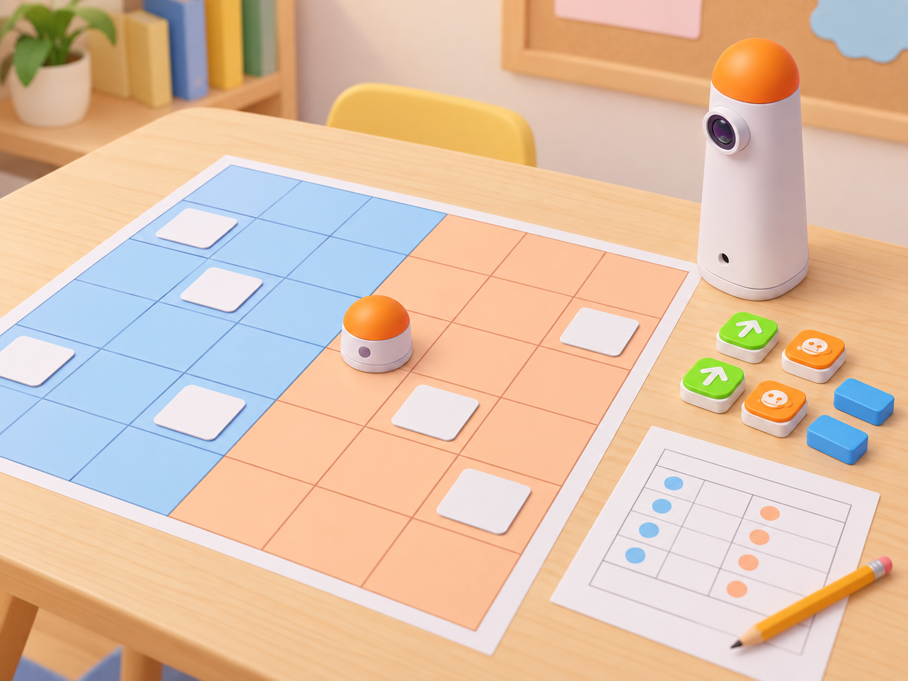
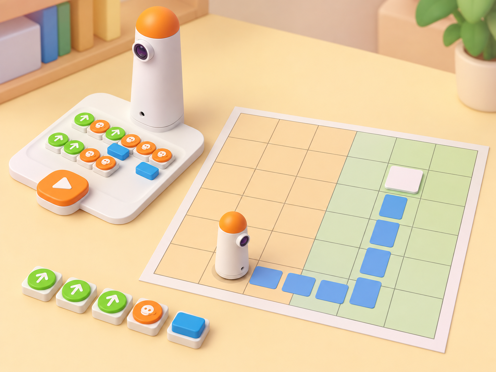

_Les targetes de la imatge són espais en blanc: el professorat hi col·loca els nombres exactes. MatataBot no llig ni tria les targetes._

## Situació, repte i intenció

La classe organitza una fira de mercat amb dues parades. Cada parada té targetes amb nombres de l'1 al 10, i cada equip tria una quantitat per ronda. Amb un únic MatataBot compartit, els grups programen per torns el trajecte fins a les targetes que han triat. Quan el robot arriba, una persona registra el nombre i retira manualment la targeta; al final de cada ronda, les dues quantitats es comparen i l'equip amb el valor major obté un punt.

La proposta trasllada a la dotació Coding Set l'activitat pública *Compare Numbers*, que està dissenyada per a Matatalab Lite i preveu dos robots, dues graelles de 6 × 6 i moviments simultanis. Ací s'utilitza una sola graella de 6 × 6 dividida en dues zones contigües i un robot que continua des de l'última posició, com indica la font. Els moviments són seqüencials; la parella d'equips tria els nombres abans de començar la ronda i s'alterna quin equip programa primer. La puntuació, els torns seqüencials i les targetes són una adaptació local, no una funció del robot.

**Pregunta guia:** com podem decidir quin nombre és major si, a més de comparar les quantitats, hem de planificar i comprovar el recorregut?

## Aprenentatges i vocabulari

- Relacionar una quantitat d'objectes amb el seu numeral de l'1 al 10.
- Comparar dos nombres amb els signes o les expressions **major que**, **menor que** i **igual a**.
- Llegir una graella, identificar la posició actual del robot, l'orientació i la targeta de destí.
- Descompondre un trajecte en avanços i girs tangibles i executar-lo amb el Coding Set.
- Registrar els nombres utilitzats, predir la ruta i revisar una instrucció a partir del resultat observat.

**Vocabulari clau:** quantitat, numeral, major, menor, igual, fila, columna, casella, punt de partida, destí, ruta, orientació, avanç, gir, seqüència i depuració.

## Materials i preparació

- Coding Set: MatataBot, torre de control, tauler i blocs de moviment reals disponibles al centre.
- Graella de **6 × 6** caselles de 10 × 10 cm. Dividiu-la en dues zones contigües de 3 × 6 i reserveu una casella compartida d'inici a la vora central.
- Vint targetes planes: dos jocs dels numerals 1–10, una còpia per parada. Cada valor s'escriu una sola vegada en cada zona; deixeu les altres caselles lliures.
- Fitxes de quantitat amb objectes dibuixats o punts per a representar el numeral; les quantitats les comprova l'alumnat, no el robot.
- Full de registre amb **ronda**, **equip que comença**, **nombre triat**, **posició i orientació**, **seqüència prevista**, **resultat**, **comparació** i **punt**.
- [Activitat oficial *Compare Numbers*](https://matatalab.com/en/node/92), el [PDF oficial de targetes numèriques](https://fast.matatalab.com/cdn/ff/8lLszxkXCVu7f45VhjRXlhDQT9c_-vL28HkD7_JeU78/1595380448/public/2020-07/Number%20Cards.pdf) i [suport de Matatalab](https://matatalab.com/en/product-support) per a comprovar les caselles físiques.

Abans de la primera prova, comproveu que cada zona conté els numerals 1–10 una sola vegada i que les fitxes de punts corresponen a cada numeral. Situeu el robot a la casella compartida i marqueu l'orientació. Feu una prova curta per assegurar que cada casella de la graella correspon a un avanç del MatataBot; registreu desviacions en lloc de redimensionar el mapa.

## Seqüència didàctica

### 1. De la quantitat al numeral (50 min)

#### Fase 1 · Activem i prediem

Mostreu cinc peces de joc i la targeta amb el numeral 5, com fa la demostració oficial. Pregunteu quina correspondència hi ha entre les peces i el nombre escrit. Després presenteu dos grups d'objectes amb quantitats diferents i demaneu prediccions: quin grup en té més?, quin en té menys?, i què caldria comprovar si semblen iguals?

#### Fase 2 · Explorem i construïm

En parelles, repartiu targetes de l'1 al 10 i una col·lecció de fitxes. Construïu les quantitats corresponents i col·loqueu cada numeral al costat del seu conjunt. A continuació, compareu dos valors: primer aparellant objectes un a un i després observant quin conjunt en deixa més sense parella.

#### Fase 3 · Expliquem i registrem

Completeu una línia de registre amb numeral, quantitat i comparació. Introduïu oralment els tres casos: **major que**, **menor que** i **igual a**; associeu-los als signes `>`, `<` i `=` només després d'haver explicat el seu sentit. Una persona diu la comparació amb paraules i una altra comprova els objectes.

#### Fase 4 · Apliquem i millorem

Intercanvieu dues targetes entre parelles i repetiu la comparació sense mirar el registre de l'altre equip. Si hi ha desacord, compteu de nou o aparelleu les peces una a una; no decidiu pel color, la mida de la il·lustració o la posició de les targetes.

#### Fase 5 · Comprovem i reflexionem

**Evidència:** tres exemples de correspondència numeral-quantitat i una comparació raonada. **Pregunta de tancament:** quina prova t'ha ajudat més a saber que un nombre era major?

### 2. Llegim el mapa i preparem el trajecte (50 min)

#### Fase 1 · Activem i prediem

Mostreu la graella de 6 × 6 amb dues parades de mercat, una blava i una taronja. Identifiqueu les files, les columnes, la casella comuna d'inici i l'orientació del MatataBot. Trieu un numeral de cada parada i predigueu quantes caselles i girs caldran per arribar-hi.

#### Fase 2 · Explorem i construïm

Situeu dos jocs dels numerals 1–10, un per zona, i manteniu les altres caselles lliures. El robot comença a la vora entre les parades. Cada equip assenyala la seua targeta triada i planifica el trajecte des de la posició real actual. Traduïu els avanços i girs als blocs físics; els nombres són destinacions triades per l'alumnat, no codis que la torre o el robot lligen.

#### Fase 3 · Expliquem i registrem

Abans d'executar, la persona programadora llig la seqüència i l'observadora recorre-la amb el dit. Anoteu la posició i orientació inicials, el nombre de caselles i cada gir. Comproveu també si el programa continua des de l'última destinació o si algú ha tornat el robot a l'inici per error.

_La ruta de caselles és una representació per a planificar les ordres; una persona selecciona el destí i comprova quan s'hi arriba._

#### Fase 4 · Apliquem i millorem

Feu una prova breu entre dues caselles abans d'iniciar la partida. Si el moviment real no coincideix amb la casella prevista, comproveu alineació, punt de partida i gir, i canvieu una sola variable. No inicieu la ronda fins que l'equip puga explicar la seqüència amb el mapa.

#### Fase 5 · Comprovem i reflexionem

**Evidència:** mapa amb les dues zones, inici/orientació i una seqüència prevista anotada. **Pregunta de tancament:** per què és important planificar des d'on s'ha quedat el robot?

### 3. Juguem cinc rondes amb un robot compartit (50 min)

#### Fase 1 · Activem i prediem

Organitzeu dos equips cooperatius i trieu qui comença primer en la ronda 1. Cada equip selecciona en secret un numeral encara disponible de la seua zona. Abans de moure el robot, les dues persones registradores anoten la predicció de major, menor o igual; així la ruta no revela la resposta abans de comparar-la.

#### Fase 2 · Explorem i construïm

L'equip que comença programa MatataBot des de la posició actual fins a la targeta triada. En arribar-hi, una persona comprova el numeral i retira la targeta manualment. El robot es queda a la casella de destí. A continuació, l'altre equip programa des d'aquesta nova posició fins al seu propi numeral; també es queda allí i retira la targeta només després de verificar l'arribada. En la ronda següent, comença l'altre equip.

#### Fase 3 · Expliquem i registrem

Compareu els dos numerals amb les targetes de quantitat i escriviu `>`, `<` o `=` amb la lectura verbal corresponent. L'equip amb el valor major obté un punt; si els valors són iguals, marqueu l'empat i cap equip suma. Aquesta regla d'empat és pròpia de la versió local. Anoteu també si les dues rutes han arribat al destí previst.

#### Fase 4 · Apliquem i millorem

Completeu fins a cinc rondes o fins que s'acabe el temps. Si el robot no arriba a una destinació, conserveu la targeta, registreu la primera diferència i feu una única correcció guiada abans de tancar el torn; el nombre no es compara fins que la posició quede verificada. Si es corregeix el programa, manteniu tant la primera predicció com la versió revisada.

#### Fase 5 · Comprovem i reflexionem

**Evidència:** cinc comparacions possibles amb les targetes triades, punts, empats i posicions verificades. **Pregunta de tancament:** heu canviat alguna predicció matemàtica després de comprovar la quantitat, o l'error era només en la ruta?

### 4. Revisem estratègies i ampliem el repte (50 min)

#### Fase 1 · Activem i prediem

Reviseu els fulls de les rondes i identifiqueu en quines el canvi de posició del robot ha fet més llarga la ruta següent. Predigueu si limitar el nombre de peces de moviment podria ajudar a planificar millor, tal com suggereix l'extensió oficial.

#### Fase 2 · Explorem i construïm

Trieu una ruta nova amb un límit acordat de peces, per exemple sis blocs de moviment més els girs disponibles. L'equip pot canviar el numeral triat abans de codificar, però no moure la targeta després de començar. Si no existeix una ruta dins del límit, augmenteu-lo i registreu quina restricció impedia arribar-hi.

#### Fase 3 · Expliquem i registrem

Compareu una seqüència inicial i una altra amb límit de peces: nombre d'avanços, girs i blocs totals. Distancieu la decisió matemàtica de la de programació: el nombre major no depén de quants moviments calen per arribar a ell.

#### Fase 4 · Apliquem i millorem

Cada equip proposa un canvi en la disposició de targetes que mantinga els dos conjunts d'1 a 10, però oferisca una ruta diferent des de l'última posició. L'altre equip comprova que tots els nombres continuen apareixent una vegada per zona i resol una ronda de prova; corregiu llegenda o caselles si el mapa no permet interpretar el repte.

#### Fase 5 · Comprovem i reflexionem

**Evidència final:** mapa revisat, seqüència sotmesa a una restricció, comparació numèrica i registre de depuració. **Pregunta de tancament:** quina part de la ronda depén de les matemàtiques i quina de la programació?

## Evidències i avaluació

Recolliu la correspondència de quantitats i numerals, els mapes, els programes, el registre de cinc rondes i la revisió de la ruta limitada. Observeu si l'alumnat: identifica nombres de l'1 al 10; usa major/menor/igual amb justificació; marca la posició inicial i orientació actuals; executa moviments i girs disponibles; verifica manualment l'arribada abans de comparar; i separa un error de ruta d'un error de comparació. El marcador només estructura el joc; la rapidesa no és un criteri d'avaluació.

## Participació, accessibilitat i seguretat

Oferiu targetes amb numerals grans, contrast i quantitats dibuixades, a més d'una graella tàctil o de paper per a la simulació. Prepareu una ruta més curta o un mapa sense girs addicionals, sense canviar la pregunta matemàtica. L'alumnat pot triar rols de programador/a, verificador/a de targetes, predictor/a, lector/a de quantitats o registrador/a. Permeteu resposta oral, assenyalada o escrita. No calen aliments reals: les targetes són fictícies i no impliquen consum; manteniu mans i fitxes fora del recorregut del robot.

## Referents i adaptació

- Matatalab, [Compare Numbers](https://matatalab.com/en/node/92): activitat oficial per a Matatalab Lite amb dos mapes de 6 × 6, dos robots en mode de codificació, nombres de l'1 al 10, selecció d'un valor per grup, una puntuació per al nombre major, retirada de targetes utilitzades i robots que romanen a la destinació entre torns. La font descriu 10 minuts d'introducció, 25 de joc i 10 de retorn/extensió, i suggereix limitar les peces de moviment.
- Matatalab, [Number Cards](https://fast.matatalab.com/cdn/ff/8lLszxkXCVu7f45VhjRXlhDQT9c_-vL28HkD7_JeU78/1595380448/public/2020-07/Number%20Cards.pdf) i [suport oficial](https://matatalab.com/en/product-support): recursos per a les targetes i dimensions del mapa.

La proposta converteix els dos mapes en una graella compartida amb dues zones, alterna quin equip programa primer, usa un sol robot i fa els moviments seqüencials. Manté la selecció única per zona, la comparació de nombres, la retirada manual després de verificar l'arribada i el fet de continuar des de l'última posició; les regles d'empat, registre i correcció són pròpies. Les targetes de nombre, el mapa de mercat, les preguntes i les imatges IA són originals.
