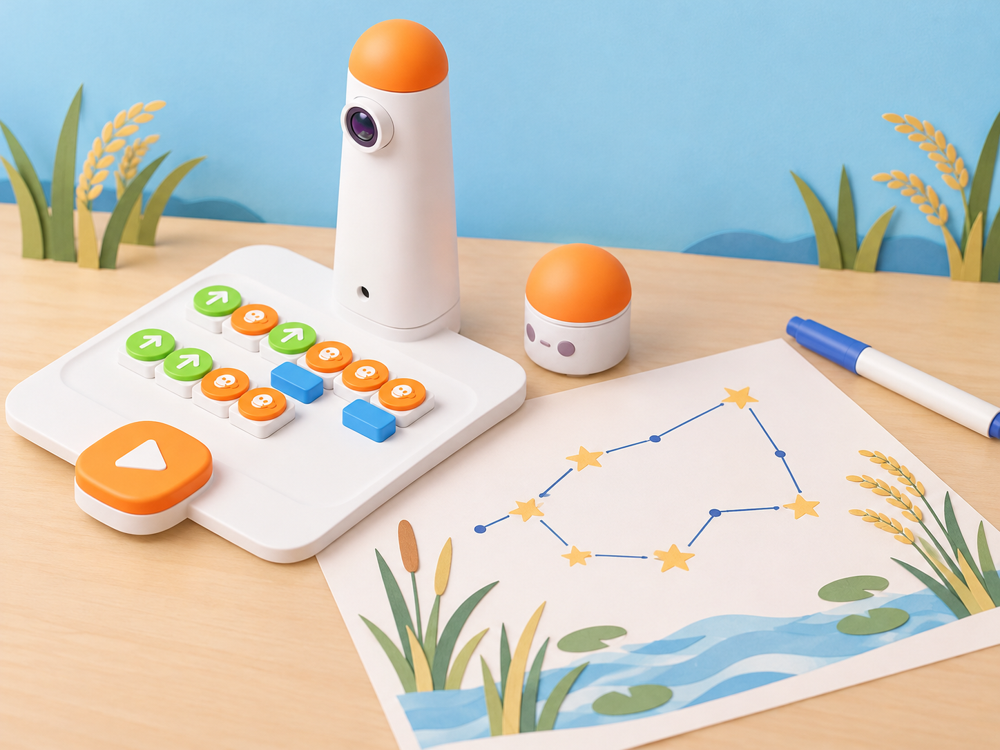

_Il·lustració IA pròpia basada en el model real del Coding Set. La constel·lació és una representació artística inventada per a l’aula, no un mapa astronòmic ni una funció de reconeixement del robot._

## Situació, repte i intenció

La classe prepara una mostra de constel·lacions imaginades a partir de formes de la marjal: una boga, una llavor d’arròs, una barca o un ocell. Cada equip tria punts, decideix en quin ordre els connecta i presenta la seua forma com una creació artística. El repte és fer que una altra parella puga seguir el mateix recorregut a partir d’una representació clara.

La proposta adapta la targeta oficial **A-1 · Zodiac Constellations** del paquet *Artist Add-on Activity Cards*. En la mostra consultada, el fabricant proposa presentar els blocs de nombre i angle, explicar que els blocs d’angle van sota els girs esquerra/dreta, dibuixar una constel·lació amb blocs de moviment, nombre i angle, crear vectors propis en paper gran i decorar-los amb retoladors de colors. La mostra disponible detalla aquesta targeta, però no les altres nou del paquet. Ací canviem els signes zodiacals per una constel·lació local inventada i afegim planificació, proves entre parelles i una alternativa completa amb el kit base.

**Pregunta guia:** quina informació necessitem per a reconstruir el recorregut d’una constel·lació i com comprovem si les ordres coincideixen amb el nostre disseny?

## Aprenentatges i vocabulari

- Distingir una constel·lació artística creada a classe d’un mapa astronòmic o d’una observació científica.
- Representar punts i vectors en un ordre acordat i comunicar-ne l’orientació.
- Identificar els blocs de moviment, nombre i angle que hi ha realment al kit.
- Provar una ruta amb els blocs disponibles i comparar el resultat amb la predicció.
- Explicar quines parts ha executat MatataBot i quines s’han dibuixat o decorat manualment.

**Vocabulari clau:** punt, vector, recorregut, orientació, moviment, gir, angle, predicció, prova, constel·lació imaginada.

## Materials i preparació

- Coding Set: torre de comandament, tauler, MatataBot i blocs de moviment.
- Si el centre disposa de l’Artist Add-On compatible: blocs de nombre i d’angle, suport de llapis i retoladors. Inventarieu les peces abans de preparar el programa; no pressuposeu que l’accessori forma part del kit base.
- Paper gran, llapis, regle, retoladors, targetes amb punts numerats i full de registre amb columnes **punt**, **ordre**, **gir previst**, **prova** i **revisió**.
- Per a la via sense accessori: quadrícula de paper o de 10 × 10 cm si es farà un recorregut físic, fitxes per a marcar els punts i retoladors per a dibuixar la figura a mà.

Abans de la sessió, carregueu el robot i la torre, comproveu que el tauler llig els blocs disponibles i feu una prova breu en una superfície plana. En el muntatge amb Artist, el manual del complement indica que els blocs d’angle només es col·loquen sota els blocs de gir esquerra/dreta; consulteu les instruccions del model abans de fer la prova. Si el centre no té l’accessori, el robot pot recórrer una ruta amb els blocs base, però no dibuixa amb tinta: l’alumnat crea la constel·lació sobre paper.

## Seqüència didàctica

### Sessió 1 · Imaginem una constel·lació de la marjal (50 min)

#### Fase 1 · Activem i prediem

Mostreu una imatge o una il·lustració del paisatge de la marjal i la targeta de constel·lació oficial com a exemple d’una figura formada per punts connectats. Aclariu que l’equip crearà una figura artística pròpia; no identificarà estrelles reals ni afirmarà que les formes representen animals o plantes observats al cel. Pregunteu què fa que un conjunt de punts es puga llegir com una figura.

#### Fase 2 · Explorem i construïm

En equips de tres o quatre, proposeu quatre inspiracions locals —boga, llavor d’arròs, barca i ocell— i deixeu que cada grup en trie una o en propose una altra. Dibuixeu entre cinc i huit punts grans en un full; numereu-los i decidiu un punt d’inici. Encara no connecteu els punts: cada persona prediu quin ordre farà més recognoscible la forma.

#### Fase 3 · Expliquem i registrem

Connecteu els punts amb segments rectes en l’ordre triat. Afegiu fletxes per a indicar el sentit del recorregut i una llegenda que identifique inici i final. Registreu la idea inicial amb un nom propi i una frase que diga que és una constel·lació imaginada.

#### Fase 4 · Apliquem i millorem

Intercanvieu els fulls. La parella visitant ha de reconstruir la seqüència dels punts sense que l’equip autor li explique l’ordre. Si hi ha més d’una lectura possible, afegiu una fletxa, un número o un punt d’inici més visible; no canvieu la figura fins que la instrucció siga comprensible.

#### Fase 5 · Comprovem i reflexionem

**Evidència:** primer disseny amb punts numerats, fletxes i una nota sobre què ha hagut d’aclarir la parella visitant. **Pregunta docent:** una persona que no ha vist el dibuix pot saber on començar i en quin sentit unir els punts?

### Sessió 2 · Provem els blocs d’angle disponibles (50 min)

#### Fase 1 · Activem i prediem

Recupereu el disseny i localitzeu-ne dos canvis de direcció. Compareu el gir que faria una persona seguint el traçat amb el bloc que podria necessitar el robot. Cada parella marca una predicció sobre el paper abans de tocar les peces.

#### Fase 2 · Explorem i construïm

Inventarieu els blocs de moviment, nombre i angle presents. Si hi ha Artist Add-On, recordeu que el bloc d’angle se situa sota un gir esquerra/dreta i feu una prova curta en paper gran abans de programar tota la figura. Trieu un vèrtex i proveu un únic canvi de direcció. Si falta l’accessori, representeu el gir amb una fletxa en una quadrícula i anoteu que es tracta d’una simulació en paper.

#### Fase 3 · Expliquem i registrem

Traduïu una secció del dibuix en una llista ordenada de blocs. En el registre, separeu **gir que volem representar**, **bloc disponible** i **resultat observat**. No deduïu un valor que el kit no mostre ni forceu blocs que no encaixen; si el manual o la versió local no permet confirmar una combinació, deixeu-la com a pregunta per a verificar.

#### Fase 4 · Apliquem i millorem

Amb l’Artist Add-On compatible, col·loqueu el suport i el llapis segons el manual, programeu només els punts necessaris per a una part de la constel·lació i executeu-la sobre paper subjectat. Compareu el traçat amb la predicció i canvieu una sola instrucció cada vegada. Sense el complement, executeu la ruta sobre una quadrícula amb MatataBot i dibuixeu manualment la línia equivalent al paper; manteniu les dues evidències diferenciades.

#### Fase 5 · Comprovem i reflexionem

**Evidència:** seqüència física o simulada, predicció del gir i registre del resultat. **Pregunta docent:** quina part del programa ha determinat el canvi de direcció i quina part de la figura hem completat manualment?

### Sessió 3 · Creem i presentem vectors propis (50 min)

#### Fase 1 · Activem i prediem

Cada equip revisa el disseny i tria quins punts pot provar amb el robot segons el kit disponible. Predigueu quina part es podrà executar i quina part requerirà una representació de paper o decoració manual.

#### Fase 2 · Explorem i construïm

Prepareu una versió final en paper gran amb punts, segments, fletxes, nom i llegenda. Si hi ha l’accessori, proveu el traçat del robot per trams, deixant espai entre línies; sense ell, useu el robot per a recórrer els punts de la quadrícula i dibuixeu els segments al paper. Decoreu la constel·lació amb colors o textures després de la prova, de manera que la decoració no tape els punts de pas.

#### Fase 3 · Expliquem i registrem

Escriviu una instrucció breu perquè una altra parella puga reproduir la ruta: punt inicial, ordre dels punts, blocs de moviment utilitzats i girs que s’han provat. Marqueu de manera visible qualsevol segment que siga una extensió dibuixada a mà.

#### Fase 4 · Apliquem i millorem

Feu una mostra entre equips. La parella visitant segueix la seqüència o la simula amb targetes i anota una observació concreta. L’equip autor revisa una instrucció amb retorn de la parella i torna a provar el tram modificat.

#### Fase 5 · Comprovem i reflexionem

**Evidència final:** constel·lació local imaginada, targeta d’instruccions, registre d’una prova i una explicació de les funcions que depenien de l’Artist Add-On. Tanqueu amb la frase «La nostra figura és una creació artística perquè…» i «El robot ha pogut comprovar…».

## Evidències i avaluació

Recolliu l’esbós inicial, la seqüència ordenada, la prova de lectura entre parelles, el registre de girs i la composició final. Observeu si l’alumnat:

- ordena i comunica els punts sense dependre d’explicacions orals de l’equip autor;
- prediu un canvi de direcció i comprova què ha executat el robot;
- identifica si la prova s’ha fet amb l’Artist Add-On, amb el kit base o només sobre paper;
- diferencia la representació artística d’una afirmació d’observació astronòmica.

No s’avaluen l’habilitat per a dibuixar, la rapidesa del robot ni la coincidència amb una constel·lació zodiacal concreta.

## Participació, accessibilitat i seguretat

Oferiu punts grans en relleu, fletxes tàctils, plantilles d’alt contrast i rols diversos: disseny, ordre de blocs, lectura de la llegenda, registre i presentació. L’alumnat pot participar sense manipular el llapis ni executar el robot. Subjecteu el paper, manteniu mans i retoladors fora del recorregut mentre el robot es mou i superviseu l’ús de tisores si cal retallar la composició.

## Referents i adaptació

- Matatalab, [Artist Add-on Activity Cards](https://matatalab.com/cdn/ff/8WH9-onMKYze-IoBs5maVP6sFW3Yq0SrSJWVzSehBjs/1637739616/public/2021-11/Artist%20Add-on%20Activity%20Cards.pdf), targeta 1 *Zodiac Constellations*: presenta blocs de nombre i angle, indica que els blocs d’angle es col·loquen sota girs esquerra/dreta, proposa traçar una constel·lació amb blocs de moviment/angle/nombre i demana crear vectors propis en paper gran i decorar-los amb retoladors. El PDF oficial consultat és una mostra de sis pàgines: conté l’índex del paquet de deu targetes i el desenvolupament complet visible de les targetes 1 i 2; aquesta fitxa adapta només la targeta 1.
- Matatalab, [Artist Add-On](https://matatalab.com/en/node/64): guia tècnica per a comprovar els blocs d’angle i les combinacions disponibles al kit del centre.

La temàtica, els punts de partida, les constel·lacions de la marjal, les targetes de registre i la seqüència de tres sessions són propis. L’ús del llapis i el dibuix automatitzat només s’afirma quan s’ha comprovat que el centre disposa de l’Artist Add-On compatible.
