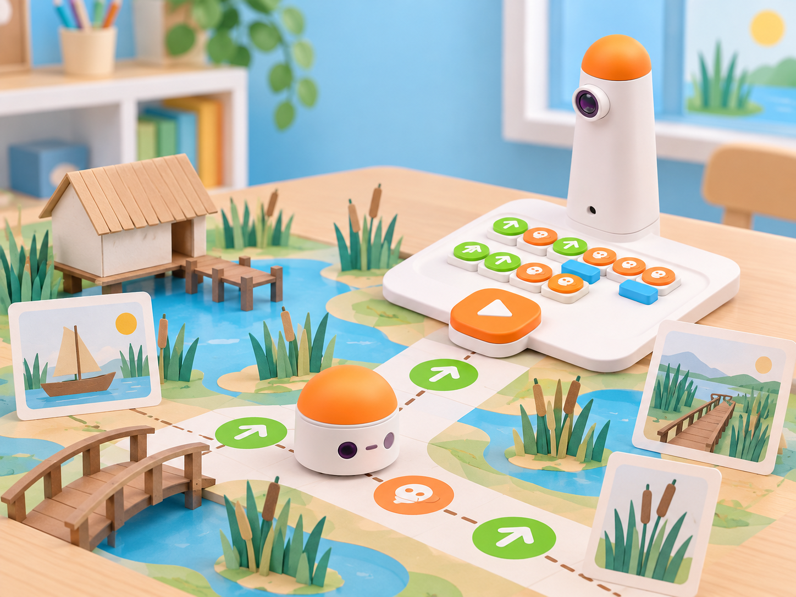

_La maqueta, les escenes i les targetes són materials narratius propis. MatataBot no reconeix els paisatges ni interpreta la història: només executa les ordres programades._

## Situació, repte i intenció

Una classe crea un conte col·lectiu sobre un viatge imaginari pel marjal: MatataBot ix d’un embarcador de maqueta, passa per un observatori, una séquia i un ullal, i arriba a una barraca de paper. Cada parada aporta una escena que l’alumnat descriu amb una frase, un so vocal o una targeta de vocabulari. Després, un altre equip rep el mapa i el programa, però no el relat; ha d’executar la ruta i reconstruir la història a partir de les escenes on arriba.

La proposta adapta *MatataBot’s Adventure*, activitat oficial de Matatalab Lite. El pla oficial presenta el mode de control, les ordres de moviment i la música, demana crear en grup una història d’exploració, decorar-ne l’escena i representar-la controlant el robot, i tanca amb una presentació i preguntes de reflexió. Ací el context del bosc es transforma en un paisatge local de maqueta i el control del producte Lite es tradueix a una seqüència tangible del Coding Set. Aquesta equivalència és una adaptació didàctica: el tauler del Coding Set no és el comandament de control de Matatalab Lite. La decoració es col·loca en l’escena, mai damunt del robot ni de la torre.

**Pregunta guia:** quina informació necessita un altre equip per a executar la ruta i contar una història coherent sense conéixer la nostra intenció?

## Aprenentatges i vocabulari

- Descompondre un relat en escenes ordenades i associar cada escena a una parada concreta del mapa.
- Transformar una ruta dibuixada en una seqüència de moviments i girs del Coding Set.
- Predir el recorregut a partir dels blocs, provar-lo i corregir la primera divergència observable.
- Explicar una història oralment, amb pictogrames, gestos o frases breus, i interpretar la d’un altre equip a partir d’evidències.
- Diferenciar les accions humanes de les funcions del robot: l’alumnat crea, narra i interpreta; MatataBot no veu ni comprén les escenes.

**Paraules clau:** escena, relat, seqüència, mapa, casella, orientació, programa, predicció, prova, depuració.

## Materials i preparació

- Coding Set de la dotació: MatataBot, torre, tauler i blocs de moviment. Comproveu càrrega, connexió i lectura d’una seqüència curta segons el model del centre.
- Graella pròpia de 5 × 5 caselles, amb punt d’inici, orientació marcada i quatre parades separades per camins transitables. Ajusteu la mida de les caselles al pas real del robot i fixeu el paper perquè no llisque.
- Quatre escenes planes de cartó o paper —embarcador, observatori, séquia i ullal—, targetes amb pictogrames i fulls grans per al relat. Les escenes han d’estar al costat de la graella, sense obstruir-la.
- Full de registre amb **escena**, **frase o pictograma**, **ordre de visita**, **seqüència prevista**, **resultat** i **canvi provat**; targetes de fletxes per a planificar abans de col·locar blocs.
- Opcional: un instrument senzill per a crear un efecte vocal en directe. No es necessita cap accessori de música, sensor, càmera ni aplicació.

Abans de començar, proveu cada casella i els girs sobre la mateixa superfície de l’activitat. Marqueu la posició i l’orientació inicials; trieu parades que es puguen visitar en més d’un ordre perquè hi haja decisions narratives i de ruta. No poseu peces menudes ni elements solts davant del robot. Si no es pot usar el robot, la mateixa seqüència es pot representar amb una fitxa de paper i una persona que llig les ordres.

## Seqüència didàctica

### Sessió 1 · Un paisatge es converteix en escenes (45 min)

#### Fase 1 · Activem i prediem

Presenteu quatre imatges o pictogrames del marjal sense donar-los encara un ordre. En grups, inventeu una situació inicial i una destinació: per exemple, una barqueta de paper que porta un missatge a l’observatori. Pregunteu quines escenes fan falta perquè el relat s’entenga i com podríem mostrar-les sense escriure un text llarg.

#### Fase 2 · Explorem i construïm

Col·loqueu les quatre escenes al voltant d’una graella plana i deixeu un corredor lliure per a MatataBot. Amb una fitxa de paper, assageu trajectes possibles des de l’embarcador. Identifiqueu caselles, girs i punts on la història podria canviar; distingiu el mapa de la seqüència d’ordres que el robot pot executar.

#### Fase 3 · Expliquem i registrem

Cada equip tria un ordre de visita i crea una frase, un pictograma o un gest per a cada parada. Anoteu l’escena i la pista narrativa en quatre targetes separades. Una altra persona del grup comprova si les pistes permeten entendre què passa abans i després, sense haver d’endevinar dades que no apareixen.

#### Fase 4 · Apliquem i millorem

Canvieu de lloc dues escenes i reviseu si el relat continua sent coherent. Si no, reescriviu una pista o canvieu l’ordre narratiu; manteniu el mapa i el programa en blanc fins que la seqüència de la història estiga clara.

#### Fase 5 · Comprovem i reflexionem

**Evidència:** quatre escenes ordenades amb una pista comprensible per a cada una i un mapa amb inici i destinació. **Pregunta:** quina pista ajuda més a entendre la relació entre dues escenes consecutives?

### Sessió 2 · Escrivim una ruta que es puga llegir (45 min)

#### Fase 1 · Activem i prediem

Recupereu el mapa i les targetes narratives. Abans de moure el robot, cada parella assenyala la ruta amb el dit i prediu quants moviments i girs necessitarà. Marqueu on espera arribar després de tres ordres concretes.

#### Fase 2 · Explorem i construïm

Convertiu la ruta en una tira de blocs físics. Llegiu-la en veu alta d’esquerra a dreta i comproveu que cada gir canvia l’orientació sense desplaçar el robot lateralment. Feu una passada de paper: una persona llig cada ordre i l’altra mou una fitxa per la graella. Canvieu de rol i reviseu qualsevol casella amb més d’una interpretació.

#### Fase 3 · Expliquem i registrem

Registreu la correspondència entre cada tram i l’escena a què porta. Una parella revisora ha de poder seguir el programa sense que l’equip autor li indique amb el dit quin és el camí correcte. Afegiu al full les ordres de moviment, els girs i el text o pictograma que es llegirà en cada parada.

#### Fase 4 · Apliquem i millorem

Executeu primer una ruta de dues escenes. Si MatataBot no arriba on s’esperava, localitzeu la primera divergència, comproveu orientació i recompte, canvieu una sola ordre i torneu a provar. Després, completeu la seqüència sencera des del mateix punt inicial.

#### Fase 5 · Comprovem i reflexionem

**Evidència:** tira de blocs llegible per una altra parella i registre de predicció/resultat per a cada parada. **Pregunta:** com podem saber si el problema és una ordre mal col·locada o una casella mal representada al mapa?

### Sessió 3 · Representem el conte amb el robot (45 min)

#### Fase 1 · Activem i prediem

Repartiu els rols de programació, narració, observació i registre. Cada equip llig el seu conte mentre una altra persona recorre el mapa amb el dit. Abans de prémer *Play*, l’equip observador prediu en quina escena arribarà MatataBot després de cada gir.

#### Fase 2 · Explorem i construïm

Carregueu els blocs al tauler, comproveu de nou l’orientació i executeu la ruta a baixa velocitat d’aula i amb l’espai lliure. En cada parada, l’alumnat llig la frase, mostra el pictograma o fa el gest acordat; el robot no activa ni reconeix cap senyal. Si una ordre falla, atureu l’activitat, anoteu la posició observada i reviseu la seqüència abans d’una nova execució.

#### Fase 3 · Expliquem i registrem

Registreu la ruta real i contrasteu-la amb la prevista. Graveu només si el centre ja disposa d’un mitjà autoritzat i hi ha consentiment; com a opció ordinària, feu la narració en directe o useu targetes impreses. Les evidències poden ser el mapa anotat i les frases, sense enregistrar veus ni imatges de l’alumnat.

#### Fase 4 · Apliquem i millorem

Intercanvieu les històries entre equips. La parella visitant rep les escenes i els blocs, però no l’explicació de l’autoria. Primer reconstrueix el relat a partir de l’ordre de parades i les pistes; després executa el programa i comprova si la seqüència arriba a totes les escenes. Qui ha creat el conte pot aclarir les regles, però no revelar la narració final abans de la prova.

#### Fase 5 · Comprovem i reflexionem

**Evidència:** programa executat, quatre parades registrades i una reconstrucció del relat feta per un altre equip. **Pregunta:** quina informació ha sigut suficient perquè la parella visitant reconstruïra la història?

### Sessió 4 · Publica un conte que una altra classe puga jugar (45 min)

#### Fase 1 · Activem i prediem

Cada equip selecciona un conte que es puga completar en una ruta curta. Predigueu quines instruccions necessita una classe que no ha vist la planificació: inici, orientació, ordre de visita, significat de les pistes i condició d’arribada.

#### Fase 2 · Explorem i construïm

Prepareu un paquet reutilitzable: mapa amb llegenda, seqüència de blocs dibuixada, targetes d’escena i instruccions breus. Afegiu una alternativa desconnectada en què una persona fa de robot i només pot moure’s quan escolta una ordre vàlida. No poseu adorns damunt del robot ni presenteu les escenes com a sensors o peces del kit.

#### Fase 3 · Expliquem i registrem

Una altra parella prova el paquet sense ajuda oral de l’autoria. Registreu quines instruccions ha entés, on s’ha aturat, quines pistes ha interpretat i si ha pogut arribar al final. Si el mapa no és accessible, accepteu que la parella descriga, assenyale o ordene targetes en lloc d’escriure.

#### Fase 4 · Apliquem i millorem

Repareu una ambigüitat cada vegada i torneu a provar amb una tercera persona. Manteniu el mateix programa mentre reviseu el text; si modifiqueu blocs, anoteu la nova versió i compareu-ne el recorregut amb la prova anterior.

#### Fase 5 · Comprovem i reflexionem

**Evidència:** conte jugable per un altre equip, registre de la prova externa i una revisió justificada. **Tancament:** «La instrucció que hem fet més clara és…; ho sabem perquè…».

## Evidències i avaluació

Recolliu el mapa anotat, les quatre escenes i pistes, el programa en blocs, les prediccions abans de cada prova, el registre de divergències i la interpretació de la parella visitant. Observeu si l’alumnat (1) ordena les escenes amb sentit, (2) tradueix la ruta a moviments i girs compatibles amb la graella, (3) comprova el programa i localitza la primera diferència, (4) interpreta les pistes amb evidència i (5) millora instruccions després d’una prova externa. Valoreu la claredat, la revisió i la cooperació; no la velocitat ni la capacitat d’improvisar oralment.

Autoavaluació: «He predit la ruta abans d’executar-la», «he distingit el relat de les ordres del robot» i «he fet una revisió a partir d’una prova». Coavaluació: la parella visitant marca les instruccions que ha pogut seguir i assenyala una escena que necessita una pista més clara.

## Participació, accessibilitat i seguretat

Oferiu targetes grans d’alt contrast, pictogrames amb forma i textura, frases model, suport oral o gestual i una graella ampliada. Permeteu que cada alumne trie entre narrar, programar, moure la fitxa, comprovar el mapa o registrar les proves. L’alternativa desconnectada conserva el mateix repte i no és una activitat de menor valor. Manteniu el robot en una superfície plana, fora de la vora de la taula, i deixeu lliure el recorregut; les maquetes no han de tindre peces menudes ni vores que puguen enganxar-se. No calen dades, veus ni imatges personals.

## Referents i adaptació

- Matatalab, [*MatataBot’s Adventure*](https://matatalab.com/en/node/89): l’activitat oficial introdueix el mode de control de Matatalab Lite, les ordres endavant/enrere/esquerra/dreta i música, proposa que grups creen una història d’exploració, decoren l’escena, representen el relat amb el robot i el presenten. El tancament oficial inclou preguntes sobre el procés creatiu i les dificultats amb el comandament. La proposta conserva la creació narrativa, l’escena, la representació i la presentació; trasllada la temàtica del bosc al marjal i les ordres del mode Lite a una programació tangible del Coding Set. No afirma que el tauler del Coding Set funcione com el comandament de Lite.
- Matatalab, [*Hello Matatalab Robots!*](https://matatalab.com/en/node/88): font complementària per a verificar la connexió MatataBot–torre–tauler i les ordres tangibles d’avanç, retrocés i gir. Les escenes, el conte, el mapa, els registres i les proves entre parelles són materials originals.

La imatge IA pròpia mostra el MatataBot i la torre basats en la dotació real, amb un paisatge de maqueta de paper. El paisatge no és un mapa real ni una capacitat de percepció del robot.
