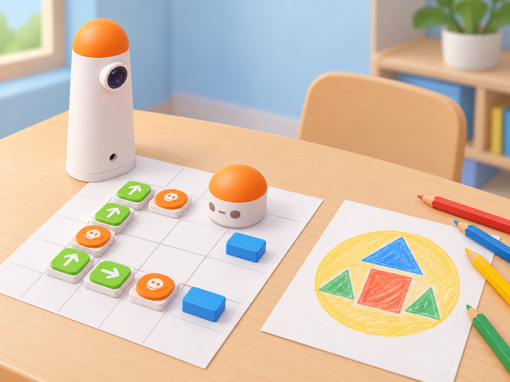

_El robot recorre una seqüència de caselles i les persones traslladen el recorregut al distintiu de paper. No hi ha un llapis ni un accessori de dibuix instal·lat._

## Situació, repte i intenció

La classe prepara una exposició escolar sobre l’Albufera i es divideix en equips d’investigació: observació de l’aigua, plantes del marjal, patrimoni de la barca i cura de la maqueta. Cada equip necessita un distintiu visual que explique la seua missió. El distintiu combina formes geomètriques, un símbol triat pel grup i una breu explicació; no representa una insígnia oficial ni acredita coneixements sobre el parc.

La proposta adapta *Team Badge Design*, una activitat de Matatalab que demana conéixer exemples d’insígnies, conversar en equip, fer un esborrany, dibuixar les formes principals amb Matatalab, decorar-les i presentar-ne el concepte en un mural compartit. El fabricant indica que el dibuix programat depén del Coding Set amb Artist Add-On, del Pro Set o de l’Animation Add-On. Com que la disponibilitat d’aquests complements no està confirmada en la dotació, aquesta versió usa només el Coding Set base: l’equip codifica una ruta per una graella de formes, una altra parella la comprova i una persona dibuixa manualment el distintiu en paper. El robot no traça línies, selecciona símbols ni identifica equips.

**Pregunta guia:** com podem representar una missió d’equip amb formes que siguen comprensibles i convertir-ne l’ordre en una seqüència de moviment comprovable?

## Aprenentatges i vocabulari

- Identificar figures geomètriques i combinar-les en una composició visual amb una intenció comunicativa.
- Descompondre un distintiu en formes i ordenar-les per construir un esborrany coherent.
- Convertir una ruta entre caselles en blocs de moviment del Coding Set i revisar l’orientació en cada gir.
- Comprovar la seqüència amb una altra parella, localitzar la primera divergència i corregir una ordre cada vegada.
- Distingir el recorregut que executa el robot del dibuix manual i del significat que l’equip atribueix al distintiu.

**Paraules clau:** distintiu, símbol, forma, composició, seqüència, orientació, casella, codi, depuració, presentació.

## Materials i preparació

- Coding Set de la dotació: MatataBot, torre, tauler i blocs de moviment. Comproveu càrrega, connexió, orientació i una seqüència curta abans de començar.
- Graella pròpia de 5 × 5 caselles ajustada al pas real del robot, amb inici marcat i quatre formes de paper en caselles diferents. Manteniu el corredor de moviment lliure.
- Paper A3 o cartolina, llapis, retoladors i plantilles de cercle, triangle, quadrat i rectangle; targetes amb missions escolars fictícies i full de planificació del distintiu.
- Full de registre amb **missió**, **forma**, **casella**, **ordre**, **predicció**, **resultat** i **revisió**; targetes de fletxes per a provar el recorregut sense robot.
- Opcional, només si el centre confirma que en disposa i les instruccions del model ho permeten: Artist Add-On o Animation Add-On. La seqüència principal no els necessita i la fitxa no n’atribueix cap funció al kit base.

Prepareu targetes de missió que no depenguen de dades ambientals reals, per exemple: «explicar la maqueta», «ordenar imatges de plantes» o «presentar una barca de paper». Situeu les formes en caselles assolibles des del mateix inici. Si useu l’accessori de dibuix, feu una prova prèvia i manteniu l’activitat de paper com a alternativa equivalent per a participar; no barregeu les instruccions de complements amb les del robot base.

## Seqüència didàctica

### Sessió 1 · Què conta un distintiu? (45 min)

#### Fase 1 · Activem i prediem

Mostreu distintius de classe inventats i exemples geomètrics sense logotips comercials. Pregunteu quines formes es reconeixen de lluny i quina informació no es pot deduir només mirant-les. Cada alumne tria una missió fictícia de l’exposició i anticipa dues formes que podrien representar-la.

#### Fase 2 · Explorem i construïm

En equips, compareu cercle, triangle, quadrat i rectangle amb plantilles. Distingiu forma, mida i orientació, i feu tres esbossos ràpids. Afegiu una llegenda oral o escrita que explique el significat que l’equip dona a cada forma; eviteu presentar un símbol com si tinguera un significat universal.

#### Fase 3 · Expliquem i registrem

Cada equip explica un esbós a una parella veïna sense dir el nom de la missió. La parella assenyala quina part ha pogut interpretar i quina pregunta li falta. Registreu una decisió gràfica que es mantindrà i una que caldrà revisar.

#### Fase 4 · Apliquem i millorem

Canvieu una forma o la seua disposició i torneu a mostrar el distintiu. Comproveu si la parella pot distingir els elements sense que el grup autor li assenyale cada detall. La claredat es prova amb explicacions, no amb votacions sobre quina missió és «millor».

#### Fase 5 · Comprovem i reflexionem

**Evidència:** tres esbossos, una missió triada i una nota de retorn d’una altra parella. **Pregunta:** quina decisió del disseny ha canviat la manera com s’entén el distintiu?

### Sessió 2 · De les formes a una ruta programable (45 min)

#### Fase 1 · Activem i prediem

Poseu les quatre formes en caselles diferents de la graella. Trieu un ordre de visita que represente el distintiu i traceu-lo amb el dit des de l’inici. Predigueu els blocs d’avanç i gir abans de muntar el programa.

#### Fase 2 · Explorem i construïm

Col·loqueu targetes de fletxa sobre el mapa per descriure la ruta. Recordeu que un gir canvia l’orientació i no trasllada MatataBot a una altra casella. Una persona llig les ordres mentre una altra mou una fitxa de paper; després canvieu els rols i reviseu les caselles ambigües.

#### Fase 3 · Expliquem i registrem

Anoteu la seqüència i la forma que hi ha en cada parada. Una parella revisora ha de poder reconstruir l’ordre del distintiu només amb el mapa, la llegenda i les fletxes. Separeu els moviments, els girs i la interpretació artística en tres columnes.

#### Fase 4 · Apliquem i millorem

Canvieu l’ordre de dues formes i comproveu com varia la ruta. Si la ruta no és assolible, canvieu una posició o una instrucció —no totes alhora— i torneu a simular-la amb la fitxa de paper.

#### Fase 5 · Comprovem i reflexionem

**Evidència:** mapa amb inici i orientació, seqüència anotada i registre d’una revisió. **Pregunta:** què ha de saber una altra parella per a distingir un gir d’un avanç?

### Sessió 3 · Programem i traslladem el recorregut al paper (45 min)

#### Fase 1 · Activem i prediem

Abans d’executar, cada equip marca en una còpia del mapa on espera que estiga el robot després de les tres primeres ordres. L’equip observador prediu quines formes visitarà i en quin ordre.

#### Fase 2 · Explorem i construïm

Poseu els blocs de moviment al tauler i executeu la ruta en una superfície plana i lliure. Atureu-vos si el robot ix de la graella o s’acosta a la vora. Compareu cada parada amb la predicció; el recorregut del robot només indica posicions, no dibuixa ni llig les figures.

#### Fase 3 · Expliquem i registrem

Traslladeu manualment l’ordre verificat a una composició en paper: dibuixeu les formes amb plantilles, poseu-les en la mateixa seqüència que s’ha provat i afegiu-hi el símbol propi de l’equip. Anoteu que el paper és una creació humana separada de l’acció del robot.

#### Fase 4 · Apliquem i millorem

Intercanvieu el mapa, el programa dibuixat i el distintiu amb una altra parella. L’equip visitant executa o simula la ruta i comprova si l’ordre de les formes coincideix amb el paper. Si no coincideix, localitzeu la primera parada divergent i corregiu una instrucció o una etiqueta.

#### Fase 5 · Comprovem i reflexionem

**Evidència:** seqüència executada, distintiu de paper i comprovació creuada. **Pregunta:** quina part del resultat prové del robot i quina depén de les decisions de l’equip?

### Sessió 4 · Presentem i revisem la galeria d’equips (45 min)

#### Fase 1 · Activem i prediem

Prepareu una exposició de distintius amb les missions fictícies i les llegendes. Cada equip prediu si un visitant podrà relacionar el disseny amb la missió sense ajuda oral inicial.

#### Fase 2 · Explorem i construïm

Poseu cada distintiu en una fitxa A4 i afegiu el mapa de la ruta com a material de procés. Els equips preparen una presentació breu que explique formes, seqüència i una decisió revisada. Eviteu noms personals, emblemes institucionals o afirmacions que facen passar el distintiu per una acreditació oficial.

#### Fase 3 · Expliquem i registrem

Els grups visitants llegeixen les llegendes, recorren una ruta triada amb MatataBot o amb la fitxa de paper i deixen un comentari sobre la claredat de les instruccions. Registren una forma observada, una ordre que han seguit i una pregunta que els ha quedat.

#### Fase 4 · Apliquem i millorem

Reviseu una llegenda o una instrucció a partir del retorn rebut i feu que una persona que no ha participat en la revisió torne a comprovar-la. Manteniu el programa fix si només esteu millorant la comunicació; si canvieu la seqüència, registreu una nova versió.

#### Fase 5 · Comprovem i reflexionem

**Evidència:** distintiu final, ruta provada, llegenda i revisió posterior a una prova externa. **Tancament:** «La forma que millor comunica la nostra missió és… perquè…; MatataBot ha ajudat a comprovar…».

## Evidències i avaluació

Recolliu els esbossos inicials, la missió triada, el mapa i la seqüència, les prediccions, el resultat de la prova, el distintiu manual i els comentaris de la parella visitant. Observeu si l’alumnat (1) combina formes amb una intenció explicada, (2) transforma l’ordre gràfic en una ruta executable, (3) comprova orientació i moviments, (4) separa la traça del robot del dibuix final i (5) modifica el disseny a partir d’una prova realitzada per una altra persona.

Autoavaluació: «puc explicar el significat que hem acordat», «he comprovat la ruta abans de presentar-la» i «sé quina part hem fet a mà». Coavaluació: la parella visitant marca quines instruccions ha pogut seguir sense ajuda i quina llegenda necessitava aclariment. No s’avalua la qualitat artística del dibuix ni la rapidesa del recorregut.

## Participació, accessibilitat i seguretat

Proporcioneu formes de cartó grans, plantilles amb relleu, una llegenda en pictogrames i una còpia ampliada del mapa. Es pot participar triant la missió, ordenant les formes, movent la fitxa, programant, dibuixant, explicant o registrant; no cal parlar davant de tot el grup. Permeteu dictar o assenyalar les instruccions. Fixeu el tauler, deixeu espai lliure al voltant del robot i no col·loqueu peces menudes en la ruta. Useu només missions fictícies i distintius que no identifiquen ni classifiquen l’alumnat.

## Referents i adaptació

- Matatalab, [*Team Badge Design*](https://matatalab.com/en/node/82): planteja mostrar exemples de distintius, conversar en grup, fer un esborrany, dibuixar les formes principals amb Matatalab, decorar-les, presentar-ne el concepte i exposar-les juntes. La font indica que la part de dibuix requereix Coding Set amb Artist Add-On, Pro Set o Animation Add-On. Aquesta proposta conserva el disseny col·laboratiu, l’esborrany, la decoració, la presentació i la galeria, però substitueix el traçat robòtic per una ruta de comprovació amb el Coding Set base i un dibuix manual. Per tant, no és una adaptació de la funció d’Artist/Animation ni atribueix aquesta capacitat al kit base.
- Matatalab, [*Hello Matatalab Robots!*](https://matatalab.com/en/node/88): referència complementària per a verificar les ordres tangibles de moviment de MatataBot, la lectura de la seqüència i l’arribada a una destinació.

La il·lustració IA pròpia representa la torre i MatataBot reals del Coding Set, amb el recorregut en una graella i el distintiu dibuixat a mà en un full separat. No mostra un llapis acoblat al robot ni un complement no confirmat.
