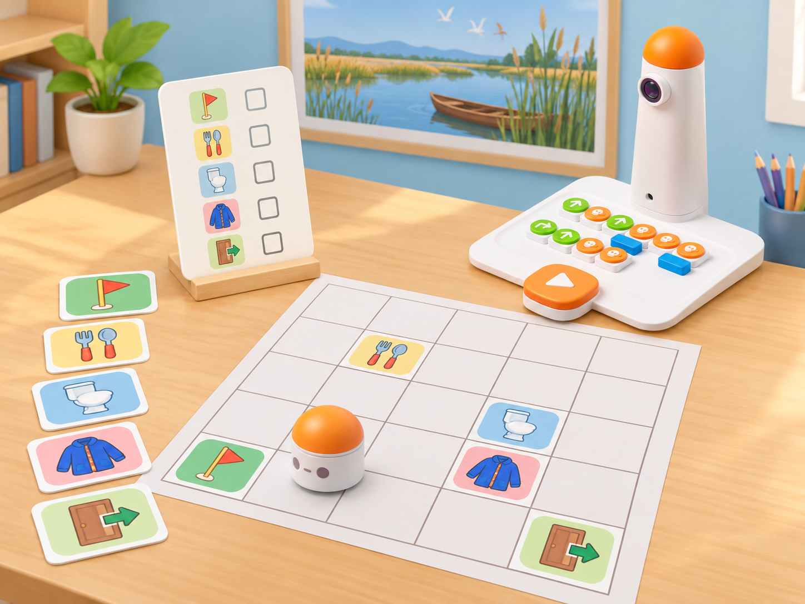
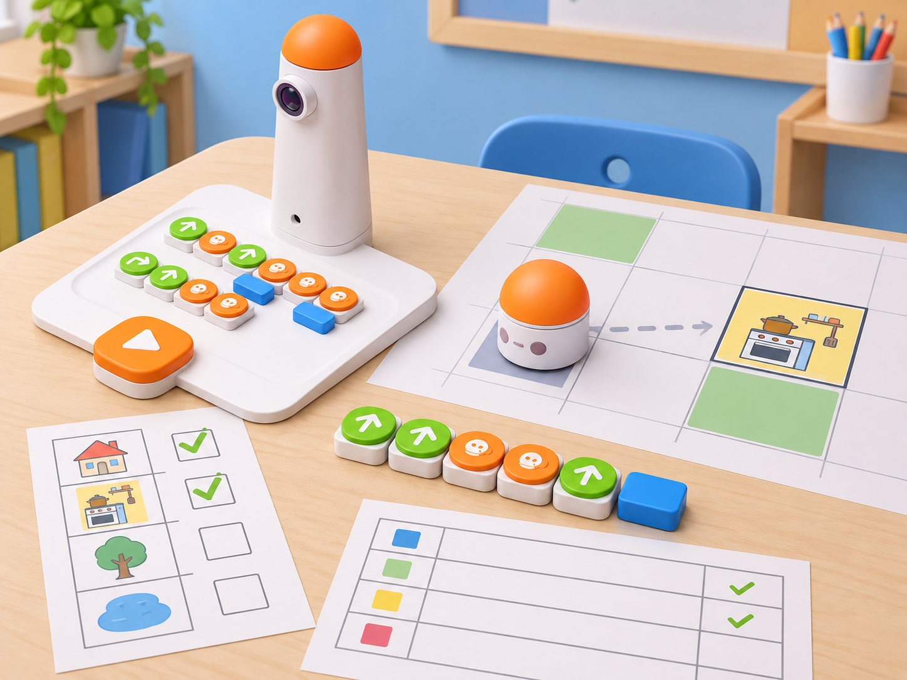

_El mapa, les parades i la llista són materials propis. MatataBot només executa les ordres de moviment: no identifica els pictogrames ni sap si un encàrrec s’ha completat._

## Situació, repte i intenció

La classe prepara una eixida escolar a l’Albufera. Abans d’arribar a la porta, el grup ha de completar tres encàrrecs en una casa representada com una graella: passar pel lavabo, vestir-se i preparar i menjar l’esmorzar. La cuina s’ha de visitar en dos moments diferents: primer per preparar l’esmorzar i, després d’haver eixit d’aquesta estança per completar almenys un altre encàrrec, per menjar-lo. El lavabo i el vestidor es poden visitar en qualsevol ordre.

La situació adapta el repte oficial *Hurry up!* de planificar una ruta que completa tres tasques, respecta l’única dependència indicada —preparar l’esmorzar abans de menjar-lo—, provar el programa, depurar-lo i intentar simplificar-lo. Canvia la història de partida per una preparació col·lectiva d’una excursió local i transforma la tasca en programació tangible amb Coding Set. MatataBot segueix ordres; les targetes representen les accions i no són sensors ni accessoris del robot.

**Pregunta guia:** quines condicions ha de complir una ruta perquè siga vàlida, i com podem comparar-ne dues sense confondre «més curta» amb «més ràpida»?

## Aprenentatges i vocabulari

- Descompondre un repte en encàrrecs, llocs i condicions que han de complir-se.
- Representar en una graella una ruta amb un inici, una destinació i parades que poden repetir-se.
- Escriure una seqüència amb moviments i girs del Coding Set, predir-la i executar-la amb seguretat.
- Detectar la primera diferència entre una ruta prevista i el recorregut observat, corregir-la i tornar a provar.
- Comparar la longitud de dues solucions vàlides comptant ordres de moviment; explicar que el recompte de blocs no equival necessàriament al temps real d’execució.

**Vocabulari clau:** encàrrec, seqüència, condició, abans/després, visita, casella, orientació, gir, depurar, simplificar, evidència.

## Materials i preparació

- Coding Set de la dotació: MatataBot, torre de control, tauler i blocs de moviment disponibles. Carregueu els dispositius i comproveu que la torre llig i envia una seqüència curta.
- Graella pròpia de 5 × 5 caselles de 10 × 10 cm, amb inici, cuina, lavabo, vestidor i porta de sortida. Marqueu l’orientació inicial del robot i deixeu lliures les interseccions.
- Targetes grans pròpies amb pictogrames per a cada estança i per als encàrrecs «preparar esmorzar» i «menjar esmorzar»; no cal que el robot les llija.
- Full de registre amb les columnes **ordre**, **casella**, **encàrrec**, **orientació prevista**, **resultat** i **revisió**; targetes de fletxes per planificar sense robot.
- Cinta de paper per fixar la graella, llapis i una còpia del mapa per a cada parella. No es necessiten accessoris Artist, Musician, sensors ni una aplicació.

Prepareu un mapa on les parades siguen assolibles per més d’una ruta i on es puga tornar a la cuina. Abans de la sessió, comproveu la mida física de les caselles i feu una prova de moviment en la mateixa superfície. En aquesta adaptació, «ruta més curta» significa menys ordres de moviment endavant/enrere; els girs es compten a banda. No cronometreu els equips: la velocitat no és el criteri d’èxit.

## Seqüència didàctica

### Els encàrrecs i les seues condicions (45 min)

#### Fase 1 · Activem i prediem

Presenteu la invitació a l’excursió i les cinc parades del mapa. En parelles, l’alumnat separa els encàrrecs dels llocs: el lavabo i vestir-se són tasques independents; preparar i menjar l’esmorzar tenen una relació d’ordre. Demaneu que cadascú prediga quina informació necessitaria per donar instruccions a una altra persona.

#### Fase 2 · Explorem i construïm

Col·loqueu les targetes d’encàrrec a la seua estança. Cada parella ordena físicament les targetes i explica per què no pot menjar l’esmorzar abans de preparar-lo. Afegiu la regla pròpia d’aquesta versió: per comptar dues visites a la cuina, MatataBot ha d’eixir-ne i arribar a completar com a mínim un altre encàrrec abans de tornar-hi. Marqueu aquesta interpretació com a regla del repte local.

#### Fase 3 · Expliquem i registrem

Construïu una llista de comprovació comuna: començar en el punt indicat, completar lavabo i vestidor, preparar esmorzar, eixir de la cuina, completar almenys un altre encàrrec, tornar a la cuina per menjar i acabar a la porta. L’alumnat pot canviar l’ordre del lavabo i del vestidor sempre que es complisquen totes les condicions.

#### Fase 4 · Apliquem i millorem

Canvieu una targeta de lloc en la maqueta i pregunteu si canvia la validesa de la ruta o només la distància. Les parelles identifiquen quines condicions són obligatòries i quines decisions encara poden prendre lliurement.

#### Fase 5 · Comprovem i reflexionem

**Evidència:** llista de comprovació amb les dependències i una ruta de targetes sense blocs encara. **Pregunta docent:** quina part de la ruta pot canviar sense incomplir l’encàrrec?

### Del mapa a la seqüència tangible (45 min)

#### Fase 1 · Activem i prediem

Recordeu que el robot parteix orientat cap a una direcció concreta. Cada parella ressegueix amb el dit un camí del punt inicial a la porta i marca en paper cada gir, cada encàrrec i la tornada a la cuina. Abans de posar blocs, prediu si l’itinerari compleix la llista de la sessió anterior.

#### Fase 2 · Explorem i construïm

Traduïu el recorregut a blocs físics del Coding Set: un bloc de gir fa girar el robot sobre el lloc; no el desplaça lateralment. Llegiu la seqüència al tauler de control d’esquerra a dreta i comproveu que cada moviment correspon a una casella de la graella. Assageu primer els girs amb una fitxa de robot de paper.

#### Fase 3 · Expliquem i registrem

Una persona llig la seqüència en veu alta i l’altra assenyala la ruta al mapa. Anoteu el nombre d’ordres de moviment i de gir per separat. Abans d’executar-la, un equip visitant comprova que la preparació precedeix el menjar i que hi ha una eixida de la cuina entre les dues visites.

#### Fase 4 · Apliquem i millorem

Executeu una primera part curta des del punt d’inici. Si l’orientació o la posició no coincideix amb la predicció, atureu-vos, identifiqueu la primera ordre diferent i reviseu només eixe tram. Esborreu la seqüència anterior segons el procediment del kit abans de començar una nova prova.

#### Fase 5 · Comprovem i reflexionem

**Evidència:** seqüència tangible fotografiada o dibuixada, ruta marcada i recompte separat de moviments/girs. **Criteri:** una altra parella pot llegir les ordres i seguir el mapa sense que l’autoria li done instruccions addicionals.

### Prova, depuració i comparació de rutes (45 min)

#### Fase 1 · Activem i prediem

Abans de prémer inici, cada equip assenyala on espera que estiga MatataBot després de tres ordres concretes. Identifiqueu el punt en què haurà de deixar la cuina i el punt en què tornarà per menjar l’esmorzar.

#### Fase 2 · Explorem i construïm

Executeu la ruta completa en una superfície plana i amb l’espai lliure. Una persona controla el tauler i l’altra registra les posicions després de cada encàrrec; després intercanvieu els rols. Si el robot se n’ix de la graella, anoteu la primera casella divergent, reviseu el recompte de moviments i l’orientació, i torneu a provar des del punt inicial.

_La imatge acompanya el registre d’una prova: la ruta i les caselles són una maqueta de l’aula, no un mapa oficial ni una lectura automàtica del robot._

#### Fase 3 · Expliquem i registrem

Una altra parella valida la ruta amb la llista de comprovació, no amb la rapidesa de l’equip. Registreu tasques completades, ordre entre preparar i menjar, eixida i retorn a la cuina, punt final i nombre de blocs de moviment. Distingiu l’error de programació d’un desplaçament físic causat per una graella mal fixada.

#### Fase 4 · Apliquem i millorem

Dissenyeu una segona ruta vàlida canviant l’ordre del lavabo i el vestidor o triant un altre camí. Compareu els moviments de les dues versions. Si el grup proposa un programa més curt, l’ha de provar des del mateix inici i demostrar que manté tots els encàrrecs i la dependència de l’esmorzar.

#### Fase 5 · Comprovem i reflexionem

**Evidència:** dos registres de prova amb nombre de moviments, nombre de girs i comprovació de les condicions. **Pregunta docent:** una ruta amb menys moviments és sempre vàlida? Quina evidència ho demostra?

### Creem un repte que es puga verificar (45 min)

#### Fase 1 · Activem i prediem

Cada parella rep una nova targeta de destinatari —per exemple, preparar el material de camp abans d’eixir cap a una observació de l’Albufera— i proposa tres encàrrecs, una condició d’ordre i una destinació. No afegiu cap funció automàtica al robot: totes les tasques són parades representades al mapa.

#### Fase 2 · Explorem i construïm

Dibuixeu el mapa i escriviu les regles en frases curtes que es puguen comprovar. Intercanvieu el repte amb una altra parella, que primer el simula amb una fitxa de paper i després prepara blocs de moviment. El grup autor respon només preguntes de claredat; no revela la ruta.

#### Fase 3 · Expliquem i registrem

La parella visitant presenta la ruta, el recompte i una prova de cada condició. Qui ha creat el repte comprova si les regles permeten més d’una solució vàlida i marca qualsevol instrucció ambigua.

#### Fase 4 · Apliquem i millorem

Reviseu una regla o una casella del mapa i torneu a passar el repte a un tercer equip. Si cap programa pot completar-lo, localitzeu si el problema és una ruta bloquejada, una condició incompatible o una instrucció que no especifica l’orientació inicial.

#### Fase 5 · Comprovem i reflexionem

**Evidència:** mapa propi, regles verificables, programa provat per una altra parella i una revisió justificada. **Tancament:** «La regla que ha fet més fàcil comprovar el repte és… perquè…».

## Evidències i avaluació

Recolliu la llista de condicions, el mapa, les dues seqüències, el registre d’execució, la comprovació entre parelles i el repte final revisat. Valoreu si l’alumnat (1) distingeix tasques de llocs; (2) identifica l’única dependència entre preparar i menjar; (3) tradueix el recorregut a ordres físiques d’acord amb l’orientació; (4) localitza i corregeix la primera divergència; i (5) compara solucions vàlides amb un recompte reproduïble. La rapidesa, l’encert al primer intent i el nombre total de blocs sense explicar no són criteris d’èxit.

Autoavaluació: «He comprovat totes les condicions», «sé explicar què significa girar i què significa avançar» i «he revisat la ruta amb una prova». Coavaluació: la parella visitant marca les condicions que ha pogut verificar i assenyala una instrucció que es podria aclarir.

## Participació, accessibilitat i seguretat

Oferiu el mapa en gran format i alt contrast, pictogrames amb formes a més de colors, una fitxa gran de MatataBot i una tira impresa amb les ordres. Es pot participar planificant, col·locant targetes, llegint el programa, comprovant condicions o registrant resultats. Permeteu assenyalar o dictar la seqüència en lloc d’escriure-la; el repte no depén de llegir paraules menudes. Feu proves en taula o al terra només amb espai lliure, manteniu les mans fora del recorregut i no poseu cap persona ni objecte delicat com a obstacle. Tots els encàrrecs són ficticis: no es registren rutines personals, aliments, noms ni necessitats de l’alumnat.

## Referents i adaptació

- Matatalab, [*Hurry up!*](https://matatalab.com/en/node/93): presenta un problema de ruta amb tres tasques, l’única condició que preparar l’esmorzar precedisca menjar-lo i una visita repetida a la cuina. El pla oficial demana planificar, crear i provar el programa, depurar si cal, simplificar i compartir una solució; també aporta preguntes de tancament i materials com plastilina, paper i llapis. Aquesta proposta conserva eixa estructura i la dependència, i crea un context, mapa, targetes, criteris i seqüència didàctica propis.
- Matatalab, [*Hello Matatalab Robots!*](https://matatalab.com/en/node/88): documenta per al Coding Set la connexió entre MatataBot, torre i tauler, les ordres d’avanç/retrocés i gir de 90°, el recorregut fins a una bandera i la possibilitat de provar rutes diferents per arribar-hi. S’utilitza per verificar el maquinari i la programació tangible de la versió local; no s’atribueixen a MatataBot detecció de targetes ni comprovació dels encàrrecs.

La proposta amplia una activitat oficial breu a quatre sessions per fer visibles les condicions, el registre, la depuració, la comparació de rutes i la transferència entre equips. L’Albufera és el context de l’excursió; el mapa de casa i les seues estances són una maqueta fictícia, no una representació geogràfica ni una instrucció sobre rutines reals.
