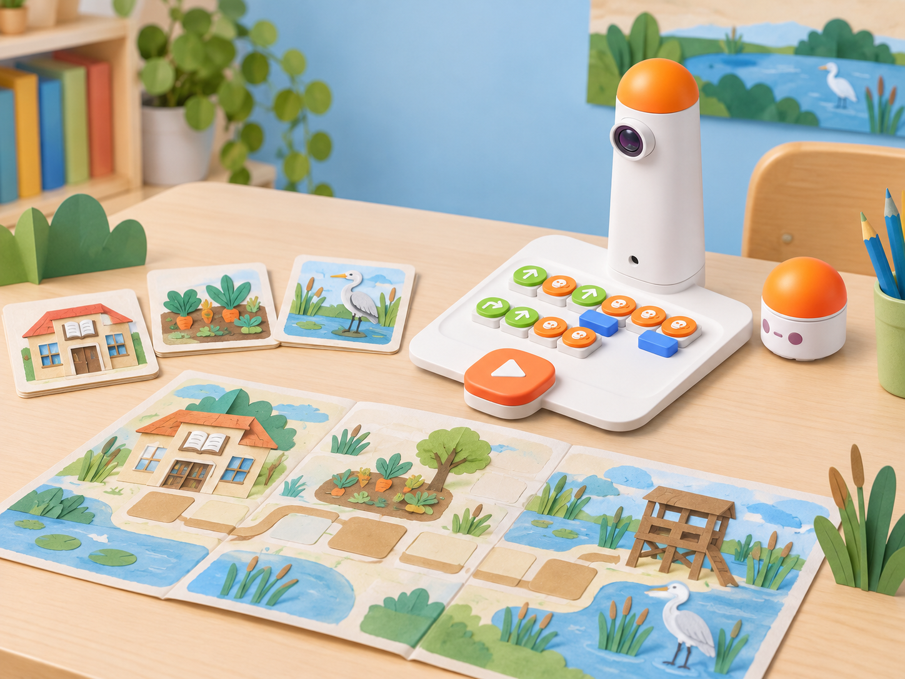
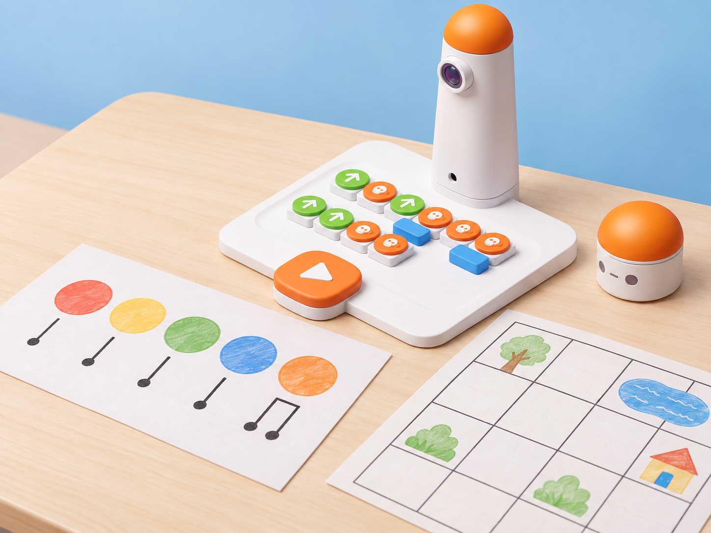
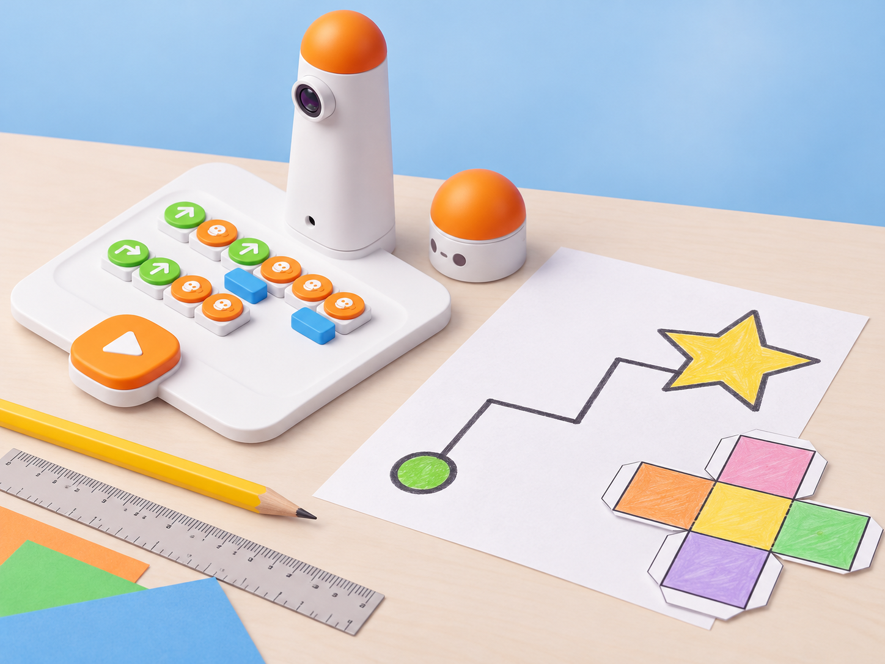

_El mapa, les targetes i el joc són materials creats a mà; el robot executa les ordres tangibles i no interpreta imatges ni construeix els materials._

## Situació, repte i intenció

El centre prepara una jornada de descobertes sobre la marjal. En dotze sessions, els equips aprenen a planificar i comprovar moviments, crear una seqüència musical si hi ha el complement compatible, contar una història amb un mapa, dissenyar una peça visual i convertir el que han aprés en un joc i un projecte triat pel grup.

La situació parteix del resum oficial del currículum *Matatalab Extracurricular*: 12 lliçons; les lliçons 1–4 treballen seqüències i moviments direccionals amb Coding Set, les 5–6 combinen blocs musicals amb Coding Set, les 7–8 creen històries amb mapes, les 9–10 usen blocs avançats i Artist Add-On per a creacions artístiques, i les dues últimes proposen un joc de taula original i un projecte d’interés. La pàgina oficial indica que les sessions són de 60 minuts i que cada lliçó segueix una estructura d’introducció, activitat Matatalab, tancament, extensions i connexions amb el món real.

El manual complet i els materials annexos no s’han pogut contrastar. Per això, les dotze sessions d’aquesta fitxa són desenvolupaments locals alineats amb els blocs d’objectius públics, no una reproducció ni una adaptació integral dels passos, preguntes o materials originals. Els títols i els reptes concrets són propis. Les guies tècniques de Matatalab s’usen per validar el funcionament del robot i dels complements, no com a substitut dels guions docents que falten.

El currículum oficial inclou Musician i Artist Add-On. La dotació local no confirma que aquests accessoris estiguen disponibles. Les sessions 5–6 i 9–10 ofereixen una alternativa completa amb paper, ritme oral i dibuix manual; no s’hi atribueixen les funcions dels complements al Coding Set base. Si el centre comprova que té l’accessori compatible, pot fer la variant robòtica descrita, seguint el seu manual i registrant el material exacte.

**Pregunta guia:** quines proves necessitem perquè una altra classe puga entendre, jugar i millorar una creació nostra?

## Aprenentatges i vocabulari

- Construir, llegir i depurar seqüències de moviment amb inici, orientació, destí i una prova repetible.
- Comparar una seqüència musical o artística planificada amb el resultat, distingint què depén del robot, del complement i de les persones.
- Representar un espai en una graella, ordenar escenes i explicar una ruta amb referents comprensibles.
- Dissenyar regles de joc provables, detectar ambigüitats i revisar-les a partir del joc d’un altre equip.
- Gestionar un projecte breu des de la pregunta d’interés fins a la presentació d’evidències i una proposta de millora.

**Vocabulari clau:** seqüència, ordre, orientació, repetició, patró, compàs, mapa, graella, escena, regla, prototip, prova, revisió.

## Materials i preparació

- Coding Set de la dotació: MatataBot, torre de control, tauler i blocs físics disponibles. Comproveu càrrega, connexió, reconeixement i l’estat de les peces abans de cada sessió.
- Graelles físiques de 10 × 10 cm quan el robot les recórrega, cartolina, cinta de pintor, targetes, retoladors, llapis, regle, fitxes de joc i fulls de registre.
- Materials locals sobre la marjal: mapa esquemàtic sense adreces particulars, targetes dibuixades de séquia, ullal, hort, observatori i camins. No useu fotografies identificables d’infants ni dades de localització personal.
- Els complements Musician i Artist són opcionals. No els inclogueu com a materials necessaris fins que el centre n’haja verificat model, peces i instruccions.
- Organitzeu equips de quatre amb rols rotatius: programació, inspecció de seqüència, registre de proves i portaveu/materials. Amb un sol robot, feu torns curts i manteniu la simulació en paper per a la resta.

Abans de la primera sessió, proveu una ordre i un gir en una casella de 10 cm sobre una superfície plana. Prepareu una fitxa de predicció/resultat i un exemple de mapa en paper. En les sessions creatives, marqueu clarament qualsevol seqüència que siga simulada, dibuixada o interpretada per persones.

## Seqüència didàctica

### Sessió 1 · El missatge arriba al robot (60 min)

**Objectiu local:** entendre el camí d’una ordre tangible des de la torre fins al MatataBot i acordar una prova bàsica.

**Temps de referència local:** 8 + 12 + 12 + 18 + 10 minuts (60 min). La font oficial indica 60 minuts per lliçó; aquest repartiment és una proposta d’aula.

**Preparació docent:** Carregueu i connecteu el kit; deixeu una seqüència curta visible per a observar el flux de missatges.

**Materials de la sessió:** Coding Set, blocs bàsics, targetes de vocabulari i full de registre.

**Vocabulari clau:** robot, torre, ordre, missatge, executar.

#### Fase 1 · Activem i prediem

Presenteu l’encàrrec de la jornada del marjal. L’alumnat observa el kit sense executar-lo i dibuixa qui creu que envia, rep i fa cada acció. Recolliu les prediccions sobre què passa quan es canvia l’ordre d’una peça.

#### Fase 2 · Explorem i construïm

En equips, identifiqueu torre, tauler, robot i blocs que realment hi ha al kit. Una parella posa una ordre curta; la persona inspectora la llig en veu alta i anticipa el moviment. Executeu-la només després de comprovar que el tauler està ben orientat.

#### Fase 3 · Expliquem i registrem

Dibuixeu el flux «bloc col·locat → torre el llig → robot es mou». Anoteu l’ordre, la predicció i el resultat observat. Distingiu la lectura de blocs de la interpretació humana del mapa.

#### Fase 4 · Apliquem i millorem

Intercanvieu el programa amb un altre equip perquè el llija abans d’executar-lo. Si la predicció falla, localitzeu la primera diferència i canvieu una sola peça.

#### Fase 5 · Comprovem i reflexionem

**Evidència:** dibuix del flux i registre d’una ordre provada. **Pregunta:** quina part del sistema ha rebut la seqüència i quina part ha fet el moviment?

**Extensió:** Afegiu una ordre nova i demaneu a un altre equip que explique quin missatge rebrà el robot.

**Connexió amb el món real:** Relacioneu el sistema d’ordres amb una instrucció clara que done una persona en una activitat quotidiana.

### Sessió 2 · Girs i orientació en una ruta (60 min)

**Objectiu local:** planificar des d’una orientació inicial i justificar els girs en relació amb el robot.

**Temps de referència local:** 8 + 12 + 12 + 18 + 10 minuts (60 min). La font oficial indica 60 minuts per lliçó; aquest repartiment és una proposta d’aula.

**Preparació docent:** Marqueu inici i orientació en una graella de 10 cm i prepareu una ruta amb dos girs.

**Materials de la sessió:** Coding Set, graella de 10 cm, fitxa de robot, fletxes i retoladors.

**Vocabulari clau:** orientació, gir, davant, dreta, esquerra.

#### Fase 1 · Activem i prediem

Poseu una fitxa de MatataBot en una graella i assenyaleu l’orientació inicial. Abans de col·locar cap bloc, cada equip marca una ruta cap a una fita del marjal i dibuixa on espera que quede el robot després de cada gir.

#### Fase 2 · Explorem i construïm

Traduïu la ruta a blocs físics disponibles. Una persona segueix les ordres amb el dit sobre el mapa; una altra gira físicament una fitxa de paper per no confondre el gir del robot amb un canvi de direcció del mapa.

#### Fase 3 · Expliquem i registrem

Registreu posició inicial, orientació, blocs i posició final prevista. Compareu rutes diferents que arriben al mateix punt i compteu moviments i girs sense valorar-ne la rapidesa.

#### Fase 4 · Apliquem i millorem

Executeu una ruta en el tauler adequat. Si el resultat no coincideix, identifiqueu si l’error és de lectura, orientació, col·locació o execució; torneu a provar des del mateix inici.

#### Fase 5 · Comprovem i reflexionem

**Evidència:** dues rutes anotades i una comprovació física o simulada. **Pregunta:** com podem explicar un gir a algú que mira el mapa des d’un altre costat?

**Extensió:** Proveu una ruta equivalent amb un inici diferent i torneu a justificar l’orientació.

**Connexió amb el món real:** Compareu les instruccions de la graella amb les indicacions que caldria donar a una visita del centre.

### Sessió 3 · Una seqüència que podem llegir (60 min)

**Objectiu local:** fer programes llegibles i provar estratègies de depuració pas a pas.

**Temps de referència local:** 8 + 12 + 12 + 18 + 10 minuts (60 min). La font oficial indica 60 minuts per lliçó; aquest repartiment és una proposta d’aula.

**Preparació docent:** Prepareu dues seqüències equivalents, una d’elles amb una ordre incorrecta identificable.

**Materials de la sessió:** Blocs disponibles, mapa curt, fitxes, full de predicció i registre.

**Vocabulari clau:** seqüència, depurar, ordre, predicció, divergència.

#### Fase 1 · Activem i prediem

Mostreu dues seqüències diferents per arribar a una mateixa fita. L’alumnat prediu quin programa serà més fàcil de revisar i justifica la tria amb el nombre de moviments, els girs i la disposició visual dels blocs.

#### Fase 2 · Explorem i construïm

Cada grup crea una ruta amb inici, fita i un punt on cal canviar de direcció. La seqüència només pot usar peces existents en el kit. Marqueu amb una fitxa el punt de partida i eviteu obstacles que no siguen necessaris per a la prova.

#### Fase 3 · Expliquem i registrem

Una persona llig cada bloc i una altra anota el moviment esperat. Feu una simulació amb fitxa abans de connectar la torre; guardeu el primer programa i la seua predicció.

#### Fase 4 · Apliquem i millorem

Executeu, compareu i marqueu la primera ordre que no coincideix amb el resultat. Modifiqueu només eixa ordre, repetiu la mateixa ruta i anoteu si la correcció ha resolt la divergència.

#### Fase 5 · Comprovem i reflexionem

**Evidència:** versió inicial i revisada, amb resultat de les dues proves. **Pregunta:** per què convé canviar una sola instrucció cada vegada?

**Extensió:** Introduïu una segona errada en una còpia i compareu estratègies per a trobar la primera divergència.

**Connexió amb el món real:** Useu el mateix protocol de prova–observació–correcció quan una instrucció de treball no s’entén.

### Sessió 4 · El recorregut de les quatre fites (60 min)

**Objectiu local:** combinar diverses instruccions direccionals en una missió de principi a final.

**Temps de referència local:** 8 + 12 + 12 + 18 + 10 minuts (60 min). La font oficial indica 60 minuts per lliçó; aquest repartiment és una proposta d’aula.

**Preparació docent:** Col·loqueu quatre fites de paper i comproveu que la ruta física cap en la superfície de treball.

**Materials de la sessió:** Coding Set, mapa de 10 cm, quatre fites i llegenda de símbols.

**Vocabulari clau:** inici, fita, destí, llegenda, ruta.

#### Fase 1 · Activem i prediem

Presenteu quatre fites de paper —biblioteca, séquia, hort i observatori— al voltant d’una ruta curta. Els equips trien una destinació i expliquen quines fites han de passar i quines no formen part de la missió.

#### Fase 2 · Explorem i construïm

Dissenyeu una ruta en una graella física amb la mida adequada. Si falten peces, representeu-les amb targetes pròpies en la simulació i no les poseu en el tauler com si foren blocs reconeguts.

#### Fase 3 · Expliquem i registrem

Escriviu el programa amb llegenda dels símbols, orientació inicial i destí. Un equip revisor ha de poder predir el final sense escoltar l’explicació oral de qui l’ha dissenyat.

#### Fase 4 · Apliquem i millorem

Executeu o simuleu l’itinerari. Si la parella revisora no pot seguir-lo, aclarim la llegenda; si el robot acaba en una altra casella, depurem la seqüència a partir de la primera divergència.

#### Fase 5 · Comprovem i reflexionem

**Evidència:** ruta provada i llegenda comprensible per a un altre grup. **Pregunta:** quina informació del programa ha de quedar escrita perquè una altra persona puga repetir-lo?

**Extensió:** Afegiu una fita opcional i comproveu si canvia el programa o només la llegenda.

**Connexió amb el món real:** Relacioneu la ruta amb un itinerari accessible del centre o d’un espai comunitari, sense publicar localitzacions personals.

### Sessió 5 · Un ritme per a la marjal (60 min)

**Objectiu local:** relacionar una seqüència de sons i moviments amb un patró rítmic, distingint la variant amb Musician Add-On.

**Temps de referència local:** 8 + 12 + 12 + 18 + 10 minuts (60 min). La font oficial indica 60 minuts per lliçó; aquest repartiment és una proposta d’aula.

**Preparació docent:** Comproveu si hi ha Musician Add-On i prepareu en paral·lel una partitura manual de quatre pulsacions.

**Materials de la sessió:** Targetes de ritme, paper, instruments d’aula i Musician només si està verificat.

**Vocabulari clau:** pulsació, ritme, compàs, seqüència, interpretació.

#### Fase 1 · Activem i prediem

Escolteu o llegiu un patró de quatre pulsacions fet amb palmes i targetes. Cada grup prediu com el podria representar amb símbols i quina repetició hi reconeix.

#### Fase 2 · Explorem i construïm

Sense Musician, creeu una partitura de paper amb símbols i interpreteu-la amb veu, palmes o instruments d’aula, sense atribuir el so al MatataBot. Si l’accessori compatible està confirmat, exploreu les peces musicals disponibles amb el seu manual i construïu una seqüència curta.

#### Fase 3 · Expliquem i registrem

Representeu el patró en una graella de pulsacions. Anoteu què és una instrucció del robot, què és una peça de l’accessori i què és una acció humana; si hi ha complement, registreu les peces exactes que s’han provat.

#### Fase 4 · Apliquem i millorem

Intercanvieu les partitures. El grup que les rep les interpreta sense explicació addicional. Canvieu una pulsació o una repetició i compareu si el nou patró continua sent llegible.

#### Fase 5 · Comprovem i reflexionem

**Evidència:** partitura i interpretació o seqüència de l’accessori verificada. **Pregunta:** quina diferència hi ha entre un so interpretat per una persona i un so que realment reprodueix el kit?

**Extensió:** Canvieu l’ordre de dues pulsacions i interpreteu de nou la partitura; no presenteu la interpretació humana com a eixida del robot.

**Connexió amb el món real:** Busqueu patrons rítmics en una activitat musical o una cançó de domini públic coneguda per la classe.

_La partitura és de paper; només s’usa Musician Add-On si el centre en confirma el model i la disponibilitat._

### Sessió 6 · Compondre i revisar una seqüència (60 min)

**Objectiu local:** crear una composició curta i aplicar una revisió basada en evidències.

**Temps de referència local:** 8 + 12 + 12 + 18 + 10 minuts (60 min). La font oficial indica 60 minuts per lliçó; aquest repartiment és una proposta d’aula.

**Preparació docent:** Prepareu un patró regular i una variació; si hi ha Musician, reviseu el manual i les peces abans de la classe.

**Materials de la sessió:** Partitura de 8–12 pulsacions, full comparatiu i accessori només si està confirmat.

**Vocabulari clau:** patró, durada, repetició, variació, versió.

#### Fase 1 · Activem i prediem

Compareu dos patrons de ritme: un amb repetició regular i un amb una variació final. Predigueu quina part recordarà millor l’oient i quina peça es pot canviar per a comprovar-ho.

#### Fase 2 · Explorem i construïm

Dissenyeu una composició pròpia de 8 a 12 pulsacions amb inici, desenvolupament i final. Amb Musician confirmat, programeu només les notes i funcions que apareixen al complement disponible; sense ell, feu la interpretació amb paper i instruments d’aula.

#### Fase 3 · Expliquem i registrem

Marqueu els blocs o símbols en ordre i anoteu qui interpreta cada part. Una altra parella llig la partitura i assenyala si hi ha instruccions amb més d’una interpretació.

#### Fase 4 · Apliquem i millorem

Interpreteu o executeu la composició i canvieu una sola variable —durada, ordre o repetició— per comparar les versions. Deseu la primera i la segona partitura amb el mateix sistema de registre.

#### Fase 5 · Comprovem i reflexionem

**Evidència:** dues versions i una justificació del canvi. **Pregunta:** quina prova ens ajuda a saber si la variació que hem introduït és la que ha canviat el resultat?

**Extensió:** Presenteu les dues versions a un grup diferent i demaneu-li que descriga la variació sense saber quina s’ha canviat.

**Connexió amb el món real:** Connecteu l’estructura inici–desenvolupament–final amb una composició o una rutina del dia a dia.

### Sessió 7 · Un mapa que conta una història (60 min)

**Objectiu local:** representar un entorn pròxim i ordenar escenes en una ruta comprensible.

**Temps de referència local:** 8 + 12 + 12 + 18 + 10 minuts (60 min). La font oficial indica 60 minuts per lliçó; aquest repartiment és una proposta d’aula.

**Preparació docent:** Prepareu targetes locals de tema i un mapa sense dades privades; seleccioneu una història de tres o quatre escenes.

**Materials de la sessió:** Graella, targetes d’escena, llapis, blocs i full per a ordenar la narració.

**Vocabulari clau:** escena, mapa, graella, narració, ordre.

#### Fase 1 · Activem i prediem

Trieu un tema de marjal —l’aigua, els cultius, les aus o els camins— i acordeu quines tres o quatre escenes necessita una història breu. Predigueu quina informació ha de mostrar el mapa perquè una altra parella la puga seguir.

#### Fase 2 · Explorem i construïm

Dibuixeu un mapa esquemàtic en una graella i col·loqueu targetes d’escena en caselles diferents. Les targetes són contingut creat per l’alumnat: el robot no les llig ni en reconeix el tema.

#### Fase 3 · Expliquem i registrem

Escriviu l’ordre narratiu i traceu un recorregut que visite les escenes en eixe ordre. Una altra parella verifica la ruta amb una fitxa abans de programar-la.

#### Fase 4 · Apliquem i millorem

Programeu MatataBot amb els blocs disponibles, sense atribuir-li comprensió de la història. En una ruta física, manteniu la quadrícula a escala adequada; si no, declareu la prova com a simulació sobre paper.

#### Fase 5 · Comprovem i reflexionem

**Evidència:** mapa, targetes ordenades, ruta i narració breu. **Pregunta:** quines parts de la història depenen de les persones i quina part és una seqüència de moviment?

**Extensió:** Afegiu una escena que canvie el sentit del relat i comproveu si cal alterar també la ruta.

**Connexió amb el món real:** Relacioneu les targetes amb observacions documentades de l’entorn; distingiu informació consultada de ficció.

### Sessió 8 · Una història que una altra parella puga recórrer (60 min)

**Objectiu local:** validar un mapa narratiu amb una persona que no ha participat en el disseny.

**Temps de referència local:** 8 + 12 + 12 + 18 + 10 minuts (60 min). La font oficial indica 60 minuts per lliçó; aquest repartiment és una proposta d’aula.

**Preparació docent:** Prepareu dos mapes per a intercanviar i una pauta de revisió amb inici, llegenda, ordre i destí.

**Materials de la sessió:** Mapes de la sessió 7, fitxa de revisió, fitxes de robot i blocs disponibles.

**Vocabulari clau:** revisió, llegenda, ambigüitat, prova, millora.

#### Fase 1 · Activem i prediem

Cada equip intercanvia el mapa sense explicar-lo. Qui el rep prediu el punt d’inici, l’ordre de les escenes i el destí final a partir de la llegenda disponible.

#### Fase 2 · Explorem i construïm

La parella revisora recorre el mapa amb una fitxa. Marca una casella amb més d’una lectura, una transició que falta o una escena fora d’ordre; no canvia el material de l’altre equip.

#### Fase 3 · Expliquem i registrem

Retorneu el mapa amb comentaris concrets: «he interpretat aquesta fletxa com…» o «no he trobat…». L’equip autor classifica el retorn com a problema de llegenda, de seqüència o de ruta.

#### Fase 4 · Apliquem i millorem

Reviseu una part del mapa i torneu a fer la prova en les mateixes condicions. Si el canvi afecta la ruta, actualitzeu també el programa del MatataBot o la simulació.

#### Fase 5 · Comprovem i reflexionem

**Evidència:** mapa abans/després i registre del retorn extern. **Pregunta:** com sabem que una millora ha ajudat una persona que no coneixia la nostra idea?

**Extensió:** Demaneu a una tercera parella que use la nova versió i compareu el nombre d’aclariments necessaris.

**Connexió amb el món real:** Apliqueu el mateix cicle de retorn a un cartell o una instrucció de l’escola.

### Sessió 9 · Una figura geomètrica amb blocs i paper (60 min)

**Objectiu local:** explorar una creació geomètrica, separant traçat amb Artist Add-On de la planificació manual.

**Temps de referència local:** 8 + 12 + 12 + 18 + 10 minuts (60 min). La font oficial indica 60 minuts per lliçó; aquest repartiment és una proposta d’aula.

**Preparació docent:** Comproveu la disponibilitat d’Artist Add-On; deixeu una plantilla de paper equivalent i no munteu llapis no verificats.

**Materials de la sessió:** Paper, regle, llapis, plantilla geomètrica; Artist només si està confirmat.

**Vocabulari clau:** segment, vèrtex, angle, traçat, complement.

#### Fase 1 · Activem i prediem

Observeu una estrella o una roseta dibuixada en paper. Identifiqueu segments, girs i repeticions possibles; no pressuposarem que el robot puga dibuixar només perquè el disseny sembla una ruta.

#### Fase 2 · Explorem i construïm

Sense Artist Add-On, traceu la figura amb regle i llapis i planifiqueu al costat una ruta que visite els seus vèrtexs. Amb el complement compatible confirmat, reviseu les peces i limitacions del manual abans de programar un traçat curt.

#### Fase 3 · Expliquem i registrem

Anoteu quina part és dibuix manual, quina és recorregut i quines peces s’han emprat. Si s’utilitza Artist, registreu angle, moviment i llapis segons la instrucció del fabricant; no infereixis funcions per analogia amb els blocs base.

#### Fase 4 · Apliquem i millorem

Proveu una figura i compareu la predicció amb el paper final o amb la ruta observada. Modifiqueu una instrucció o una mesura, repetiu una vegada i guardeu les dues versions.

#### Fase 5 · Comprovem i reflexionem

**Evidència:** disseny, programa o ruta i registre de prova. **Pregunta:** quines accions ha fet el robot i quines ha fet la persona?

**Extensió:** Compareu la figura dibuixada amb una altra mida i calculeu quines proporcions es mantenen.

**Connexió amb el món real:** Observeu formes geomètriques en rajoles o elements de l’arquitectura local sense atribuir-ne l’autoria si no es coneix.

_Sense Artist Add-On, la figura es dibuixa a mà; el Coding Set base no porta llapis ni traça formes._

### Sessió 10 · Repeticions que creen una obra (60 min)

**Objectiu local:** transformar una idea artística en una repetició comprovable i compartir-ne les decisions.

**Temps de referència local:** 8 + 12 + 12 + 18 + 10 minuts (60 min). La font oficial indica 60 minuts per lliçó; aquest repartiment és una proposta d’aula.

**Preparació docent:** Prepareu dues unitats gràfiques repetibles i un exemple de registre de les repeticions.

**Materials de la sessió:** Cartolina, plantilles, retoladors, graella i blocs compatibles verificats.

**Vocabulari clau:** unitat, repetició, patró, bucle, regla.

#### Fase 1 · Activem i prediem

Mostreu una composició de paper feta amb una unitat que es repeteix. L’alumnat marca la unitat mínima i prediu què canviarà si se n’altera el nombre de repeticions o l’angle.

#### Fase 2 · Explorem i construïm

Construïu la composició amb peces de paper i descriviu la unitat repetida. Si Artist està confirmat, feu una prova tècnica breu amb el manual i les peces pròpies del complement; si no, convertiu la repetició en un patró dibuixat i en una ruta de caselles independents.

#### Fase 3 · Expliquem i registrem

Anoteu la unitat, les repeticions, les instruccions i el resultat esperat. Distingiu la idea matemàtica de repetir del bucle físic que el kit puga executar només si els blocs corresponents estan disponibles.

#### Fase 4 · Apliquem i millorem

Intercanvieu el patró amb una altra parella perquè el reconstruïsca. Reviseu una instrucció ambigua i comproveu si la segona versió es pot seguir sense ajuda oral.

#### Fase 5 · Comprovem i reflexionem

**Evidència:** patró inicial i revisat, amb el registre de la prova. **Pregunta:** què cal repetir perquè l’obra conserve la mateixa regla?

**Extensió:** Canvieu només el nombre de repeticions i compareu dues composicions resultants.

**Connexió amb el món real:** Busqueu patrons en mosaics, teixits o elements naturals i representeu-ne una unitat.

### Sessió 11 · Inventem un joc de taula (60 min)

**Objectiu local:** crear regles, torns i una condició de final que es puguen comprovar.

**Temps de referència local:** 8 + 12 + 12 + 18 + 10 minuts (60 min). La font oficial indica 60 minuts per lliçó; aquest repartiment és una proposta d’aula.

**Preparació docent:** Prepareu una plantilla de regles i un prototip en blanc; comproveu que el recorregut i el final siguen jugables.

**Materials de la sessió:** Cartó, fitxes grans, regles, mapa, llegenda i robot opcional.

**Vocabulari clau:** torn, regla, obstacle, condició de final, prototip.

#### Fase 1 · Activem i prediem

Compareu un joc amb regles clares i un amb una regla ambigua. Cada equip prediu què preguntaria una persona que no coneix el joc abans de començar.

#### Fase 2 · Explorem i construïm

Dissenyeu un joc de recorregut sobre un tema local: cuidar una séquia, preparar una visita o connectar espais de la marjal. Definiu objectiu, inici, torn, moviments vàlids, obstacles, condició de final i materials; el robot és una fitxa programable opcional, no l’àrbitre del joc.

#### Fase 3 · Expliquem i registrem

Escriviu les regles en passos curts i proveu un torn amb una fitxa. Si hi ha robot, convertiu únicament els moviments compatibles en blocs; les decisions de joc continuen a càrrec de les persones.

#### Fase 4 · Apliquem i millorem

Una altra parella juga un torn amb les regles sense que els autors les expliquen. Registreu les preguntes, els casos sense resposta i si el final es pot determinar; reviseu una regla i repetiu la prova.

#### Fase 5 · Comprovem i reflexionem

**Evidència:** prototip, regles i acta d’una prova externa. **Pregunta:** quin cas inesperat ha obligat a precisar una regla?

**Extensió:** Afegiu una regla opcional i proveu si crea una situació sense resposta o un final impossible.

**Connexió amb el món real:** Relacioneu les regles del joc amb normes de convivència que necessiten ser comprensibles per a tothom.

### Sessió 12 · Un projecte d’interés per a la comunitat (60 min)

**Objectiu local:** integrar una pregunta pròpia, una seqüència provada i una presentació amb evidències.

**Temps de referència local:** 8 + 12 + 12 + 18 + 10 minuts (60 min). La font oficial indica 60 minuts per lliçó; aquest repartiment és una proposta d’aula.

**Preparació docent:** Prepareu un llenç de projecte amb pregunta, producte, prova i evidència; acordeu opcions de presentació.

**Materials de la sessió:** Materials triats per l’equip, full de planificació, registre i kit o alternativa desconnectada.

**Vocabulari clau:** pregunta, prototip, evidència, iteració, transferència.

#### Fase 1 · Activem i prediem

Cada equip tria un tema que li interesse del seu entorn: aigua, lectura, accessibilitat, biodiversitat o convivència. Formula una pregunta concreta i prediu quin producte podrà compartir al final de la sessió.

#### Fase 2 · Explorem i construïm

Prepareu un prototip de mapa, joc, història, ritme o figura que responga a la pregunta. Trieu explícitament si la prova serà amb Coding Set base, amb un complement verificat o desconnectada; no barregeu les capacitats dels tres casos.

#### Fase 3 · Expliquem i registrem

Anoteu la pregunta, els materials, els passos, una predicció i un criteri observable d’èxit. Feu una prova curta amb una parella externa i registreu el resultat sense substituir-lo per una opinió general.

#### Fase 4 · Apliquem i millorem

Feu una iteració a partir de l’evidència. Prepareu una explicació de dos minuts que conte què s’ha construït, què s’ha provat, què ha fet el robot i què s’ha fet manualment.

#### Fase 5 · Comprovem i reflexionem

**Evidència:** pregunta, prototip, programa o simulació, registre de prova i canvi final. **Tancament:** «La nostra pregunta era…; hem comprovat…; el robot ha…; nosaltres hem…; la següent millora seria…».

**Extensió:** Planifiqueu una segona iteració amb un usuari diferent i una prova més específica.

**Connexió amb el món real:** Proposeu un pas següent que puga millorar l’experiència d’una comunitat real del centre.

## Evidències i avaluació

Recolliu els registres de predicció i execució de les sessions 1–4, les partitures i interpretacions de les sessions 5–6, els mapes i les rutes de les sessions 7–8, els patrons de les sessions 9–10, les regles del joc de la sessió 11 i el diari breu de projecte de la sessió 12.

Valoreu si l’alumnat pot (1) llegir una seqüència abans de provar-la, (2) indicar l’orientació inicial i localitzar la primera divergència, (3) explicar què depén del robot, del complement i de les persones, (4) fer que una altra parella entenga el mapa o les regles, i (5) revisar una decisió amb una evidència concreta. Admeteu resposta oral, dibuix, manipulació o text breu com a formes equivalents de mostrar comprensió.

## Participació, accessibilitat i seguretat

Oferiu graelles ampliades i d’alt contrast, ordres amb símbol i paraula, torns previsibles, peces de paper grans, plantilles amb inici marcat i possibilitat de respondre assenyalant o dictant. Roteu els rols de manera que cap alumne quede fixat en una única tasca. Les sessions creatives tenen una alternativa desconnectada amb els mateixos objectius de seqüenciació, representació i revisió.

Manteniu el robot sobre una superfície plana i lliure d’obstacles no previstos; retireu peces menudes que puguen interferir amb les rodes. Les persones manipulen tisores i materials de tall amb supervisió. No publiqueu dades personals ni ubicacions privades en els mapes.

## Referents i adaptació

- Matatalab, [*Lesson 2.8: Extracurricular Curriculum*](https://matatalab.com/zh-hans/node/67): identifica un currículum de 12 lliçons, productes i preparació; indica 60 minuts per lliçó i descriu l’estructura, materials docents, treball cooperatiu i connexions amb el món real. El resum agrupa els objectius en els trams 1–4 (seqüència i moviments), 5–6 (Musician), 7–8 (mapes i històries), 9–10 (Artist) i 11–12 (joc i projecte d’interés). El guió docent complet i les fitxes annexes no s’han pogut consultar. Aquesta situació és una proposta pròpia informada per eixe resum; no afirma correspondència literal ni cobertura integral dels seus passos.
- Matatalab, [pàgina oficial de currículums](https://matatalab.com/en/curriculum) i [mostra *Extracurricular Curriculum* en la pàgina de descàrregues](https://www.matatastudio.com/download.html): el fabricant publica una mostra docent actualitzada; no s’ha pogut obtindre el contingut complet per a verificar lliçó a lliçó.
- Les guies tècniques i l’inventari local del [Coding Set](../../robot/index.html?id=coding-set) s’han de consultar per confirmar els blocs i complements concrets abans d’executar les variants de Musician o Artist.

Les tres il·lustracions IA pròpies mostren el MatataBot i la torre reals de la dotació. El mapa, la partitura, la figura i el joc són prototips de paper; les imatges no representen accessoris no confirmats ni funcions automàtiques de lectura o interpretació.
