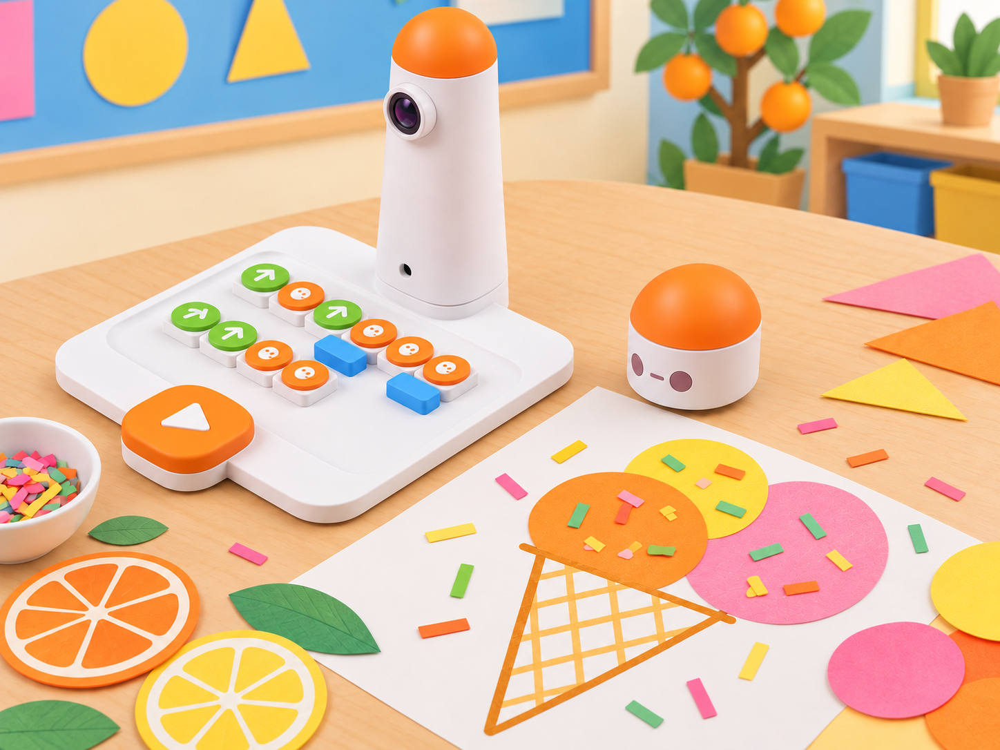
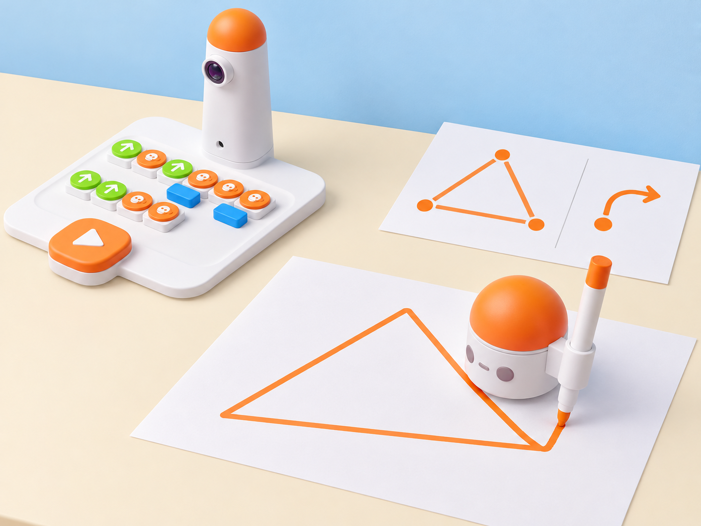

_MatataBot programa el recorregut; les boles, les decoracions i el muntatge del gelat són peces manuals. La imatge no mostra cap accessori de dibuix instal·lat._

## Situació, repte i intenció

La classe prepara una parada de formes per a una fira de sabors de l’horta. Cada equip dissenya un gelat de paper amb un con triangular, una o dues boles circulars i decoracions creades amb formes geomètriques. Abans de muntar-lo, planifica i prova la seqüència que genera el triangle; després, explica quina modificació ha canviat la mida i com es pot repetir el disseny.

La situació adapta dues fonts oficials diferents: la lliçó curricular 2 de l’Artist Add-On, que amplia i decora un triangle com a con, i la targeta 2 *Matatalab Ice Cream Shop*, que proposa simplificar el programa del triangle amb blocs de bucle i nombre. La mostra curricular documenta el traçat, les boles de gelat i el diari; la targeta aporta la simplificació del programa. El context, les targetes de sabors, les formes, la partitura de prova i les imatges són propis. Si el centre no té l’Artist Add-On, l’alumnat programa el trajecte del robot en una quadrícula i dibuixa el triangle sobre paper; no s’afirma que el kit base deixe tinta.

**Pregunta guia:** què hem de canviar en el programa perquè el triangle siga més gran i continue tancant-se correctament?

## Aprenentatges i vocabulari

- Identificar vèrtexs i costats d’un triangle i predir el recorregut del robot.
- Relacionar l’angle interior de 60° amb el gir exterior de 120° en el triangle equilàter.
- Planificar, programar i comprovar un triangle xicotet i un de més gran, mantenint els tres costats coherents.
- Comparar un programa de costats repetits amb una versió agrupada amb blocs de bucle i nombre.
- Combinar el traçat amb una composició manual i descriure què ha fet el robot i què ha fet l’alumnat.
- Revisar la creació a partir de la prova d’una altra parella.

**Vocabulari clau:** triangle, costat, vèrtex, angle interior, gir exterior, escala, programa, traçat, composició.

## Materials i preparació

- Coding Set complet: MatataBot, torre de control, tauler i blocs de moviment i gir.
- Si el centre en disposa: Artist Add-On compatible, retolador i paper blanc. Comproveu el suport i les instruccions abans de muntar el llapis. El complement inclou blocs d’angle; el fabricant especifica que representen l’angle suplementari del gir i que s’utilitzen amb gir esquerra/dreta.
- Paper o cartolina (la mostra oficial preveu 2–3 cartolines per alumne), targetes originals amb tres a cinc sabors ficticis, cercles i decoracions, regle, llapis, cola i tisores d’aula. La mostra també proposa retoladors i decoració brillant; ací es poden substituir per retalls i textures de paper reutilitzat. No cal portar ni tastar menjar; això evita al·lèrgens i fa que totes les creacions siguen accessibles.
- Full de registre amb **predicció**, **blocs**, **costats observats**, **resultat** i **canvi provat**. Prepareu també una quadrícula amb punt d’inici i orientació marcats.

Feu una prova breu del desplaçament sobre la superfície de treball. Si el centre usa una graella física, cada casella ha de mesurar 10 × 10 cm. Manteniu la mateixa superfície, orientació inicial i posició per comparar les proves.

## Seqüència didàctica

### Del triangle al con (45 min)

#### Fase 1 · Activem i prediem

Mostreu una creació pròpia de paper amb un triangle, una bola circular i decoracions. Demaneu que identifiquen costats i vèrtexs i que prediuen quins moviments i girs necessita MatataBot per recórrer el contorn.

#### Fase 2 · Explorem i construïm

Recupereu una targeta d’escalfament o feu un triangle sobre quadrícula. Planifiqueu una seqüència de tres costats i tres girs; dibuixeu-la amb els blocs o amb fletxes i marqueu el punt inicial i l’orientació del robot.

Quan la seqüència bàsica estiga clara, compareu-la amb la targeta oficial Artist 2 *Matatalab Ice Cream Shop*: agrupeu els trams repetits amb un bloc de bucle i el bloc de nombre que indique les repeticions, i poseu la versió simplificada al tauler. Comproveu que la repetició conserva els tres costats i els tres girs del triangle; si els blocs o la versió del vostre set no coincideixen amb el full, registreu-ho i feu la comparació amb targetes de paper. Aquesta targeta forma part del paquet Artist i s’utilitza junt amb les targetes del Coding Set.

#### Fase 3 · Expliquem i registrem

Compareu l’angle interior del triangle amb el gir que ha de fer el robot per seguir el contorn. Per al triangle equilàter, anoteu 60° a l’interior i 120° com a gir exterior. Separeu la figura geomètrica de la instrucció que permet recórrer-la.

#### Fase 4 · Apliquem i millorem

Una parella llig el programa de l’altra i assenyala on espera cada vèrtex. Executeu o simuleu la ruta i reviseu una sola instrucció si el robot no torna a la zona d’inici.

#### Fase 5 · Comprovem i reflexionem

**Evidència:** pla del triangle amb tres costats, girs i punt d’inici; registre de la predicció i el resultat. **Pregunta docent:** com sabem que hem recorregut un triangle tancat?

_La il·lustració representa una prova amb l’Artist Add-On. Sense el suport de retolador, el robot només recorre la ruta._

### Fem el con més gran (45 min)

#### Fase 1 · Activem i prediem

Compareu dos triangles de paper de mides diferents. Cada equip prediu quina part del programa ha de canviar perquè el con augmente de mida. En la lliçó oficial, l’alumnat parteix de la targeta *Draw 2 Warm-Up* i afegeix un bloc de moviment cap avant per fer més gran el triangle. Reproduïu primer aquesta modificació tal com està plantejada; després, com a comprovació matemàtica pròpia, mesureu si els tres costats continuen sent iguals.

#### Fase 2 · Explorem i construïm

Amb l’Artist Add-On, col·loqueu el llapis i feu primer el triangle xicotet amb la targeta d’escalfament. Afegiu el bloc cap avant indicat en la mostra i observeu què passa amb el traçat; mesureu els tres costats i registreu el resultat literal d’aquesta prova. Si el repte de l’aula és conservar un triangle equilàter més gran, feu després una segona versió en què el canvi s’aplique de manera coherent a cada costat. Aquesta segona versió és una extensió local, no el procediment que atribuïm a la mostra oficial. Sense complement, compareu dues rutes sobre quadrícula i traslladeu-les a paper manualment.

#### Fase 3 · Expliquem i registrem

Poseu els dos programes en paral·lel i marqueu el bloc o els blocs que han canviat. Compareu la llargària dels costats i expliqueu per què una figura amb un únic costat més llarg no és el triangle equilàter previst.

#### Fase 4 · Apliquem i millorem

Intercanvieu els programes amb una altra parella. L’equip visitant prediu la mida, comprova el traçat o la simulació i informa si pot reconstruir-lo sense ajuda oral. Ajusteu la llegenda o la instrucció que haja resultat ambigua.

#### Fase 5 · Comprovem i reflexionem

**Evidència:** dues versions del programa, mesures dels tres costats i una justificació de com s’ha ampliat el con. **Criteri:** la modificació s’ha comprovat i el grup descriu qualsevol límit del muntatge.

### Una bola o dues, sabors de paper (45 min)

#### Fase 1 · Activem i prediem

Prepareu tres a cinc targetes de sabors ficticis inspirats en productes que l’aula haja documentat en fonts locals. Cada alumne pot votar amb una targeta o assenyalar una opció; agrupeu les preferències per sabor i compteu-les sense registrar noms. La tria i el recompte recuperen la conversa de preferències de la lliçó oficial, però les opcions locals i el registre anònim són propis.

#### Fase 2 · Explorem i construïm

Amb el triangle provat, dibuixeu una o dues boles circulars sobre retalls de paper. Afegiu decoracions amb formes menudes i colors o textures contrastades; les figures s’enganxen a mà, no les dibuixa el robot si no s’ha fet la prova física amb el complement.

#### Fase 3 · Expliquem i registrem

Escriviu en una llegenda quin sabor fictici representa cada forma o textura. Compareu el recompte anònim de preferències amb les creacions, sense presentar-lo com una enquesta representativa de tota la comunitat.

#### Fase 4 · Apliquem i millorem

Munteu el con i una o dues boles amb paper, cola o cinta d’aula. Una parella revisa que la figura es manté unida i que la llegenda es pot llegir; si una decoració tapa el triangle, moveu-la o canvieu-ne la mida.

#### Fase 5 · Comprovem i reflexionem

**Evidència:** peça de paper acabada, llegenda i recompte sense dades personals. **Pregunta docent:** quina part ha dibuixat MatataBot i quina part hem construït nosaltres?

### La fira de formes i la revisió final (45 min)

#### Fase 1 · Activem i prediem

Cada equip prepara una targeta de repte perquè un altre grup cree un con amb una mida o una quantitat de boles determinada. Incloeu la ruta o els blocs acordats, però no doneu les instruccions oralment.

#### Fase 2 · Explorem i construïm

El grup visitant interpreta la targeta i programa o simula el triangle. L’equip autor observa sense avançar la solució i registra el primer punt on la interpretació s’allunya de la seua predicció.

#### Fase 3 · Expliquem i registrem

Compareu el programa, la mida final i la llegenda. Cada grup identifica una decisió geomètrica, un canvi de programa i una part manual del producte.

#### Fase 4 · Apliquem i millorem

Reviseu la targeta i torneu-la a provar amb una tercera parella. Com a extensió original, dissenyeu un altre dolç geomètric amb triangle, quadrat o cercle i planifiqueu quines figures es poden programar amb el kit real.

#### Fase 5 · Comprovem i reflexionem

**Evidència:** targeta de repte revisada, dos registres d’interpretació i entrada de diari amb el canvi aplicat. Cada alumne completa: «He canviat…», «la prova ha mostrat…» i «el robot no ha fet…».

## Evidències i avaluació

Recolliu el pla dels blocs, les mesures dels triangles, la creació de paper, la llegenda, la targeta revisada i les entrades de diari. Valoreu si l’alumnat prediu i prova un gir, diferencia 60° interior i 120° exterior, amplia la figura mantenint els costats coherents, comunica la seqüència i reconeix el límit de l’accessori. La destresa amb tisores, el gust alimentari i la rapidesa no són criteris d’èxit.

## Participació, accessibilitat i seguretat

Oferiu triangles impresos per resseguir, blocs grans o targetes de moviment, punt inicial en relleu i papers amb línies d’alt contrast. L’alumnat pot ser programador/a, mesurador/a, relator/a, dissenyador/a de targetes o responsable de comprovar el model; no cal manipular tisores ni escoltar instruccions orals per participar. Useu tisores d’aula amb supervisió i materials no alimentaris; no feu degustacions ni porteu productes amb al·lèrgens.

## Referents i adaptació

- Matatalab, [Artist Add-On Set Curriculum · mostra de la lliçó 2, *Ice Cream Cone* (PDF oficial)](https://matatalab.com/cdn/ff/2q_dQv1osUKaw0BMsYzU0OrcYKrDurepGWE2ilUKZF4/1637830742/public/2021-11/Artist%20Add-On%20Set%20Curriculum.pdf): lliçó original de 60 minuts amb targeta *Draw 2 Warm-Up*, ampliació del triangle afegint un bloc cap avant, tria de sabors, traçat amb Coding Set i Artist Add-On, una o dues boles, decoració, muntatge, reflexió en diari i extensió de dissenyar un altre dolç. Aquesta adaptació distribueix el repte en quatre sessions pròpies de 45 minuts per donar temps a planificar, provar, construir i revisar; la comprovació d’igualtat dels costats i la segona versió corregida són ampliacions locals. La mostra consultable cobreix aquesta lliçó, no les onze restants.
- Matatalab, [Artist Add-On](https://matatalab.com/en/node/64): confirma que els blocs d’angle expressen el gir suplementari i es combinen amb blocs de moviment/gir i bucle per dibuixar formes.
- Matatalab, [Artist Add-on Activity Cards · mostra oficial](https://matatalab.com/cdn/ff/8WH9-onMKYze-IoBs5maVP6sFW3Yq0SrSJWVzSehBjs/1637739616/public/2021-11/Artist%20Add-on%20Activity%20Cards.pdf): targeta 2 *Matatalab Ice Cream Shop*, que simplifica el programa del triangle amb bucle i nombre i després decora el traçat com un gelat. Aquesta targeta és un recurs diferent de la lliçó curricular *Ice Cream Cone*; la situació adapta els dos procediments i identifica quin element prové de cadascun. La mostra només conté dues de les deu targetes del paquet.

Aquesta adaptació conserva el repte geomètric, la simplificació amb bucle i nombre de la targeta 2, la planificació, la prova del bloc addicional, el traçat amb accessori, la composició, la reflexió i l’extensió curricular. Canvia el context, els sabors, les imatges i els materials per una proposta local pròpia; ofereix una alternativa de paper completa quan falta l’accessori. No s’hi atribueix el dibuix amb tinta al Coding Set base ni es declara cobert el currículum Artist de dotze lliçons.
