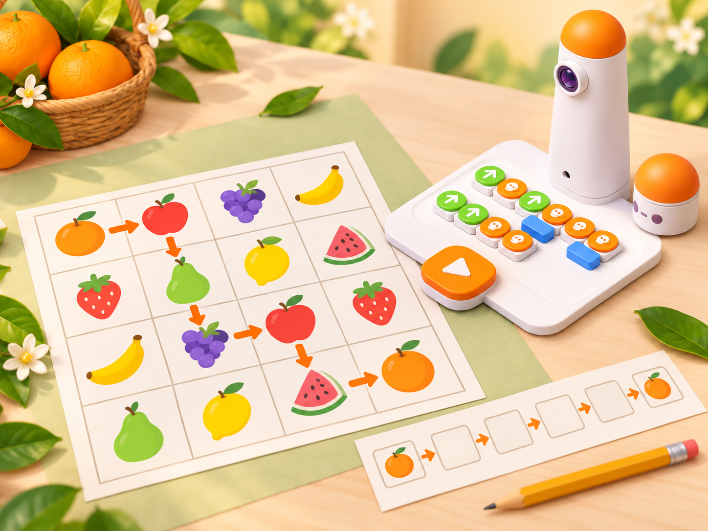
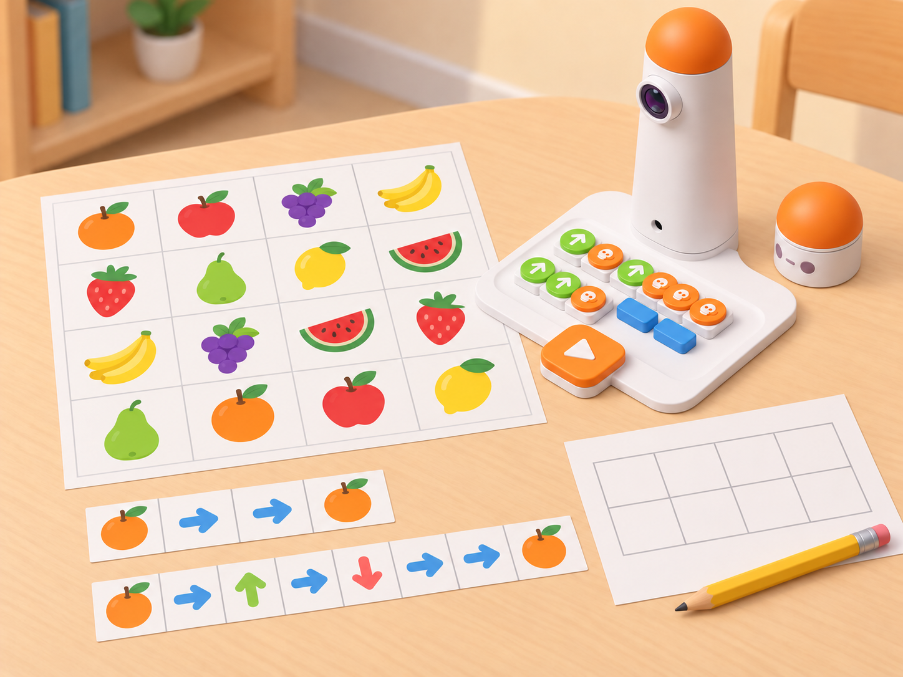

_Les parelles es veuen en les targetes i les interpreta l'alumnat. MatataBot només recorre la seqüència programada: no reconeix ni tria fruites._

## Situació, repte i intenció

La classe prepara un joc de rutes per a una parada de mercat escolar. En un mapa de 4 × 4 hi ha setze targetes de fruita, organitzades en huit parelles iguals. Cada equip tria dues targetes idèntiques, situa MatataBot sobre una i programa el camí fins a l'altra. Després compara recorreguts possibles i explica amb quina prova sap que el destí coincideix amb l'origen.

La situació adapta *Matatalab Fruit Match-up Game*, una activitat oficial per a Matatalab Lite. Conserva les setze caselles, les huit parelles, la cerca d'una fruita igual i el càlcul d'una ruta curta; tradueix el repte de programació al Coding Set de la dotació. La font proposa una competició per temps; aquesta versió la substitueix per una comparació cooperativa de longituds i estratègies, perquè l'evidència d'aprenentatge siga la ruta verificable i no la rapidesa.

**Pregunta guia:** com podem arribar a una targeta igual amb el menor nombre d'ordres de moviment sense confondre el que veu l'equip amb el que fa el robot?

## Aprenentatges i vocabulari

- Reconéixer parelles idèntiques i descriure el criteri de correspondència sense dependre només del color.
- Llegir una graella de 4 × 4, identificar posicions i orientació inicial i planificar un camí.
- Traduir una ruta a una seqüència de blocs de moviment i gir, i executar-la amb el MatataBot.
- Comparar dues rutes vàlides comptant caselles recorregudes i ordres; explicar què significa «més curta» dins del mapa utilitzat.
- Depurar una seqüència identificant la primera instrucció que separa el resultat de la predicció.

**Vocabulari clau:** parella, igual, diferent, fila, columna, casella, inici, destí, ruta, orientació, avanç, gir, programa, depuració.

## Materials i preparació

- Coding Set: MatataBot, torre, tauler i blocs físics de moviment disponibles al centre.
- Graella de 4 × 4 caselles de **10 × 10 cm** per a cada prova física, amb setze targetes planes: huit fruites diferents, dues còpies de cada pictograma.
- Mapa de planificació en paper, fletxes de direcció i targetes de fruita amb nom escrit per a l'extensió de lectura.
- Full de registre amb les columnes **fruit triada**, **inici**, **destí**, **ruta prevista**, **nombre de caselles**, **ordres**, **resultat** i **revisió**.
- [Activitat oficial *Matatalab Fruit Match-up Game*](https://matatalab.com/en/node/91) per a preparar el repte i [suport de Matatalab](https://matatalab.com/en/product-support) per a comprovar les dimensions recomanades del mapa.

Prepareu pictogrames d'alt contrast que es distingisquen també per forma, textura impresa o nom; no feu que la classificació depenga només del color. Podeu triar fruites presents al mercat local en l'època de l'activitat, sense afirmar que totes les fruites del joc siguen de producció valenciana. Situeu les dues còpies de cada fruita en caselles diferents i feu una comprovació visual de les huit parelles abans de començar.

Comproveu càrrega, connexió, sentit inicial i alineació del robot amb una ordre breu. En una prova física, useu la mida de casella recomanada de 10 × 10 cm i registreu qualsevol desviació; en mapes reduïts, declareu que són simulacions de paper. Les targetes són marcadors humans, no objectes que MatataBot detecte o arreplegue.

## Seqüència didàctica

### 1. Preparem la parada de parelles (50 min)

#### Fase 1 · Activem i prediem

Mostreu un mapa parcial del mercat i targetes de fruita sense explicar encara la regla. Cada parella diu com decidiria si dues targetes formen parella i marca una possible ruta entre dues targetes iguals. Demaneu que justifiquen la tria amb una característica observable —silueta, nombre de llavors dibuixades o nom— i no amb una impressió subjectiva.

#### Fase 2 · Explorem i construïm

Presenteu el joc: en la graella hi ha setze targetes, una per casella, amb huit parelles; qui juga tria una fruita i localitza les dues còpies. Situeu MatataBot en una d'elles i planifiqueu el camí fins a la mateixa fruita. El docent modela una ruta breu i mostra com els girs canvien l'orientació sense desplaçar el robot.

#### Fase 3 · Expliquem i registrem

Cada parella crea una llegenda per al mapa i escriu una regla de validació: «el pictograma d'inici i el pictograma de destí han de representar la mateixa fruita». Afegiu una notació simple de fila/columna per a localitzar caselles; aquesta notació ajuda les persones, però no és una entrada que el robot puga llegir.

#### Fase 4 · Apliquem i millorem

Intercanvieu els mapes amb una altra parella i demaneu que trobe una parella d'iguals i assenyale dos camins possibles. Si una icona és ambigua, substituïu-la o afegiu-ne una llegenda abans de programar. La meta és que totes les persones interpreten les targetes amb el mateix criteri.

#### Fase 5 · Comprovem i reflexionem

**Evidència:** mapa amb huit parelles verificades, llegenda i una ruta prevista. **Pregunta de tancament:** quina informació necessites per a saber que les dues targetes són iguals?

### 2. Programem una ruta entre iguals (50 min)

#### Fase 1 · Activem i prediem

Trieu una de les huit parelles del mapa i marqueu la casella d'inici, la casella de destí i l'orientació de MatataBot. Abans de col·locar blocs, assenyaleu el trajecte amb el dit i anoteu cada avanç i cada gir. Una altra persona comprova que les dues targetes siguen iguals.

#### Fase 2 · Explorem i construïm

Convertiu el camí en blocs del Coding Set. Compteu per separat els avanços en caselles i els girs; no useu nombres en girs si el conjunt del centre no ho permet. Si la seqüència passa per damunt d'altres targetes, continueu la ruta: el robot no les llig ni les activa, i el repte acaba només quan una persona comprova el pictograma de destí.

#### Fase 3 · Expliquem i registrem

Abans de prémer executar, una persona llig el programa i una altra segueix cada ordre amb una fitxa sobre el mapa. Registreu el nombre de caselles, els girs i la posició final prevista. Si les dues persones obtenen posicions diferents en la simulació, aclariu la llegenda o el sentit inicial abans d'usar el robot.

#### Fase 4 · Apliquem i millorem

Executeu el programa i compareu la posició final amb la predicció. Si hi ha diferència, anoteu la primera ordre en què divergeixen. Corregiu només eixa ordre, torneu a provar des del mateix inici i manteniu el primer resultat en el registre; no esborreu les dades d'una prova que no ha funcionat.

#### Fase 5 · Comprovem i reflexionem

**Evidència:** seqüència de blocs i registre de la prova real amb les dues caselles iguals assenyalades. **Pregunta de tancament:** la diferència provenia del mapa, de l'orientació inicial o d'una ordre?

### 3. Comparem camins, no velocitats (50 min)

#### Fase 1 · Activem i prediem

Recupereu una parella del mapa i busqueu dos camins possibles entre les fruites. Predigueu quin necessita menys avanços. Acordeu que una ruta «més curta» en aquesta sessió vol dir menys caselles recorregudes; el nombre de girs i la quantitat total de blocs es registren com a mesures separades.

#### Fase 2 · Explorem i construïm

En equips de quatre, repartiu els rols de planificador/a, constructor/a de blocs, observador/a i registrador/a. El primer equip prepara un camí i el segon n'intenta trobar un d'almenys igual de curt, sense moure les targetes. Si ambdós recorreguts tenen la mateixa longitud, compareu si un necessita menys girs o menys peces, sense declarar una única «millor» ruta sense criteri acordat.

#### Fase 3 · Expliquem i registrem

Completeu una taula amb longitud en caselles, girs i blocs de cada solució. Expliqueu què heu mantingut igual per fer una comparació justa: mateix inici, mateix destí, mateixa orientació i mateixa escala del mapa. Un pla calculat en paper es marca com a simulat fins que es prova al robot.

_Les rutes en paper serveixen per comparar distàncies; cap fruita està detectada pel robot._

#### Fase 4 · Apliquem i millorem

Proveu les dues rutes i reviseu si el resultat observat concorda amb la longitud calculada. Si hi ha desviació física, separeu-la de la comparació matemàtica: registreu la ruta de graella que s'havia previst i anoteu que l'alineació del robot ha afectat l'execució. No repetiu una ruta ràpidament per obtenir una puntuació; repetiu-la per comprovar una predicció.

#### Fase 5 · Comprovem i reflexionem

**Evidència:** taula de dues rutes amb criteri de comparació declarat i una prova observada. **Pregunta de tancament:** quin criteri fa que una ruta siga millor per a aquest repte: menys caselles, menys girs o menys blocs?

### 4. Creem i intercanviem una ronda (50 min)

#### Fase 1 · Activem i prediem

Cada equip tria quatre parelles de fruita del seu mapa i crea una nova ronda amb inici i destí clars. Comproveu que cada pictograma tinga una única interpretació i que hi haja una ruta possible sobre la graella abans de lliurar el repte a un altre equip.

#### Fase 2 · Explorem i construïm

Intercanvieu mapes i proveu una partida completa, una parella cada vegada. Com a extensió, substituïu algunes targetes per noms escrits de fruita: la persona llig el nom i el relaciona amb el pictograma; MatataBot continua sense llegir paraules. Una altra extensió és variar la quantitat de fruites, però anoteu sempre el nou nombre de targetes i parelles.

#### Fase 3 · Expliquem i registrem

L'equip que resol el repte justifica la parella triada, descriu la ruta i mostra el recompte de caselles. L'equip autor només pot respondre preguntes sobre llegenda i inici; no pot indicar la seqüència de blocs. Registreu si el mapa es podia interpretar sense explicació oral addicional.

#### Fase 4 · Apliquem i millorem

Reviseu una única part del mapa a partir de l'observació de l'equip visitant: símbol ambigu, inici poc visible, orientació absent o ruta impossible. Torneu a provar la versió millorada i compareu quina informació heu afegit perquè una altra parella puga resoldre el repte de manera autònoma.

#### Fase 5 · Comprovem i reflexionem

**Evidència final:** mapa revisat, quatre parelles resoltes, almenys una seqüència executada i registre de longituds. **Pregunta de tancament:** quina part del joc fa l'equip i quina part fa MatataBot?

## Evidències i avaluació

Recolliu el mapa amb setze targetes i huit parelles, els programes, els registres de predicció/execució i la comparació de rutes. Observeu si l'alumnat: identifica parelles amb un criteri explícit; marca inici, destí i orientació; descompon la ruta en avanços i girs; calcula i compara longituds amb el criteri acordat; identifica una diferència entre predicció i execució; i pot explicar que el robot no reconeix ni selecciona fruita. La rapidesa i el nombre de parelles trobades no són criteris d'avaluació.

## Participació, accessibilitat i seguretat

Oferiu pictogrames amb contrast, textura i paraula impresa; marqueu inici i destí amb formes diferents a més del color. Prepareu una ruta curta amb menys girs, una graella tàctil o una versió de paper que es puga recórrer amb una fitxa. Es pot participar com a lector/a de pictogrames, predictor/a, programador/a, observador/a o registrador/a. Permeteu que l'alumnat trie el rol i que demostre el raonament assenyalant o explicant oralment. No cal dur ni consumir aliments reals; manteniu les mans fora del recorregut del robot i no feu servir targetes amb dades personals.

## Referents i adaptació

- Matatalab, [Matatalab Fruit Match-up Game](https://matatalab.com/en/node/91): activitat oficial de Matatalab Lite amb mode de codificació, mapa 4 × 4, setze targetes de fruita (vuit parelles), programació entre dos pictogrames iguals, pràctica per torns i extensió amb targetes de paraula. El document proposa també una competició per temps, que aquesta adaptació reemplaça per comparació de longitud de ruta i justificació.
- Matatalab, [suport oficial](https://matatalab.com/en/product-support): referència per a la mida de les caselles quan es fa una prova física amb el robot.

El mapa, les targetes, les preguntes i la il·lustració són propis. Aquesta proposta trasllada l'objectiu de l'activitat Lite al Coding Set disponible i identifica el límit entre el reconeixement visual de les persones i l'execució de moviments del robot.
