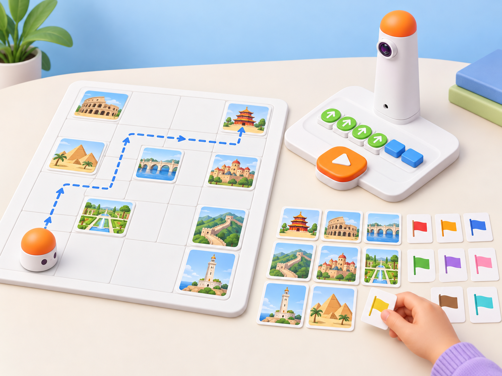

_Il·lustració IA pròpia basada en el kit de la dotació. Les targetes i la ruta són esquemàtiques; persones relacionen país i lloc amb fonts, i MatataBot només executa ordres de moviment._

## Situació, repte i intenció

Una mostra escolar presenta llocs patrimonials de València i d’altres parts del món. En una graella hi ha nou targetes il·lustrades de llocs i, al costat, nou targetes de país que s’han associat prèviament amb una font fiable. Cada equip tria una targeta de país, localitza el lloc corresponent i programa MatataBot perquè hi arribe sense tocar les altres targetes. En una segona ronda, ha de visitar dos llocs amb un únic programa.

La situació adapta la targeta oficial **C-1 · Culture Differences** de les *Coding Activity Cards*: preparar targetes de banderes de països i nou targetes de monuments corresponents, triar inici i bandera, programar MatataBot fins al monument d’eixe país sense tocar les altres targetes, i puntuar cada destinació correcta; l’ampliació demana programar dues destinacions amb un únic programa. Ací substituïm la puntuació individual per una missió cooperativa: la classe completa una ruta de patrimoni i justifica les associacions amb fonts. La Llotja de la Seda de València dona un punt de partida local; les altres parelles de targetes es preparen amb informació verificada, no amb estereotips ni per l’aparença d’un edifici.

MatataBot no reconeix banderes ni monuments i no detecta targetes. Les persones llegeixen la font, identifiquen la destinació, planifiquen el recorregut i comproven si el robot hi arriba sense contacte.

**Pregunta guia:** quina font confirma la relació entre la targeta de país i el lloc patrimonial, i quines instruccions permeten arribar-hi sense tocar altres imatges?

## Aprenentatges i vocabulari

- Buscar i verificar una relació geogràfica entre un país i un lloc patrimonial.
- Distingir una dada amb font d’una associació feta només per aparença o familiaritat.
- Llegir una graella i planificar una ruta amb inici, orientació i destinació.
- Programar una ruta que evite targetes no seleccionades i corregir-la després d’una prova.
- Ampliar el recorregut a dues destinacions amb un únic programa.
- Explicar que el reconeixement de targetes i la selecció del lloc són accions humanes.

**Vocabulari clau:** patrimoni, país, font, targeta, graella, ruta, destinació, orientació, seqüència, contacte, verificació.

## Materials i preparació

- Coding Set de la dotació: MatataBot, torre de control, tauler i blocs direccionals disponibles.
- Mapa pla en quadrícula amb nou caselles de destinació i espai per a la ruta; useu la graella física del kit si el centre en disposa i comproveu-ne l’escala.
- Nou targetes grans amb imatges de llocs patrimonials i nou targetes separades de país. Incloeu La Llotja de la Seda de València i seleccioneu les altres huit destinacions des de fonts fiables; una persona adulta revisa les correspondències i apunta l’URL o la referència al revers.
- Fitxa de registre amb **país triat**, **lloc seleccionat**, **font consultada**, **inici/orientació**, **ruta**, **targetes evitades**, **resultat** i **revisió**.
- Fitxa de robot i fletxes per a simular; targetes de suport amb noms de llocs i països en lletra gran, lectura fàcil i transcripció oral.

Useu la [Llista del Patrimoni Mundial de la UNESCO](https://whc.unesco.org/en/list/) per a verificar denominació i país de cada lloc; contrasteu també la fitxa individual del lloc abans de crear cada parella. Per al punt local, la pàgina oficial de [La Llotja de la Seda de València](https://whc.unesco.org/en/list/782/) identifica el lloc i els materials oficials en descriuen l’ús històric com a centre de comerç de la seda. No copieu mapes, fotografies o logos protegits a les targetes sense comprovar-ne la llicència; feu il·lustracions esquemàtiques pròpies o useu materials amb llicència adequada.

Carregueu i proveu la torre i el robot. Fixeu les targetes de destinació al centre de les caselles, deixeu passadissos prou amplis i comproveu una ruta de prova que passe entre dues targetes sense tocar-les. La selecció del país i la identificació del lloc es fan abans de programar; no useu la càmera de la torre com si llegira les imatges del mapa.

## Seqüència didàctica

### Sessió 1 · Verifiquem les parelles de targetes (45 min)

#### Fase 1 · Activem i prediem

Mostreu la Llotja de la Seda i pregunteu què podem afirmar sobre el lloc i què necessitem comprovar. Compareu una targeta amb una imatge sense nom i una fitxa de font amb país i denominació oficial. Acordeu que l’aspecte d’un edifici no és evidència suficient per a identificar-ne el país.

#### Fase 2 · Explorem i construïm

En equips, reviseu les nou parelles de país i lloc preparades per la docent. Busqueu el nom del lloc en la Llista del Patrimoni Mundial o en la seua fitxa i anoteu la font al revers. Si la targeta és ambigua o la font no confirma la correspondència, poseu-la en una pila pendent i substituïu-la per una parella verificable.

#### Fase 3 · Expliquem i registrem

Creeu un inventari amb tres columnes: **país de la targeta**, **nom del lloc** i **font**. Cada equip explica una relació amb una dada consultada, evitant generalitzacions sobre les persones o la cultura d’un país. L’equip que escolta comprova que la targeta no confon el lloc, l’estat o una regió.

#### Fase 4 · Apliquem i millorem

Barregeu les targetes i intercanvieu-les amb un altre equip. La parella visitant intenta reconstruir les nou associacions a partir de les fonts del revers. Si no pot verificar-ne una, l’equip autor revisa l’etiqueta o l’enllaç; no es tracta com un error de memòria de l’alumnat.

#### Fase 5 · Comprovem i reflexionem

**Evidència:** nou parelles revisades amb font i una targeta corregida o substituïda si cal. **Pregunta:** quina evidència hem consultat abans de dir que aquest lloc correspon a aquest país?

### Sessió 2 · Programem una destinació sense tocar les altres (45 min)

#### Fase 1 · Activem i prediem

Col·loqueu MatataBot en una casella inicial i trieu una targeta de país. La parella localitza el lloc corresponent i marca una ruta que no passe per damunt de les altres targetes. Predigueu cada casella abans d’usar els blocs.

#### Fase 2 · Explorem i construïm

Traduïu la ruta a blocs direccionals, tenint en compte l’orientació del robot i el fet que girar no equival a avançar de costat. Simuleu-la amb una fitxa de paper; si la ruta toca una altra targeta, trieu un passadís alternatiu abans de programar.

#### Fase 3 · Expliquem i registrem

Anoteu el país triat, el nom del lloc, la font, l’inici, l’orientació i la seqüència. Una persona llig les ordres i l’altra assenyala la trajectòria. L’observadora marca quines targetes no seleccionades cal evitar.

#### Fase 4 · Apliquem i millorem

Executeu la ruta. Comproveu si el robot arriba a la casella correcta i si ha mantingut distància de les altres targetes. Si toca una imatge, atureu-lo i registreu el punt de contacte; reviseu una sola instrucció i repetiu des del mateix inici. No retireu ni mogueu targetes durant l’execució.

#### Fase 5 · Comprovem i reflexionem

**Evidència:** associació amb font, programa i registre d’arribada/contactes. **Pregunta:** com sabem que l’encert prové de la ruta i de la font, no d’una lectura automàtica del robot?

### Sessió 3 · Dues destinacions en un sol programa (45 min)

#### Fase 1 · Activem i prediem

Trieu dues targetes de país i localitzeu-ne els dos llocs amb les fonts. Predigueu quin ordre visitarà MatataBot i com tornarà a orientar-se entre les destinacions sense tocar altres targetes.

#### Fase 2 · Explorem i construïm

Prepareu un programa únic que passe primer per una destinació i després per l’altra. Simuleu tota la seqüència en paper i marqueu un punt d’aturada segur després de la segona arribada; no dividiu el repte en dos programes executats per separat.

#### Fase 3 · Expliquem i registrem

Una parella visitant revisa la ruta i comprova que les dues destinacions s’ajusten a les fonts consultades i que cap altre lloc queda en la trajectòria. Escriviu **país 1 → lloc 1 → país 2 → lloc 2** al registre i anoteu l’ordre exacte dels blocs.

#### Fase 4 · Apliquem i millorem

Executeu el programa complet amb les dues destinacions. Registreu si MatataBot arriba a cadascuna i si toca alguna targeta no seleccionada. Si la ruta no funciona, localitzeu l’última casella correcta, reviseu el tram següent i torneu a executar des de l’inici.

#### Fase 5 · Comprovem i reflexionem

**Evidència final:** dues fonts verificades, un programa únic, dos llocs visitats i una nota sobre una revisió. Tanqueu amb: «La font confirma…» i «MatataBot només ha executat…».

## Evidències i avaluació

Recolliu l’inventari de nou parelles, fonts consultades, dos mapes de ruta, programes i registres de prova. Observeu si l’alumnat:

- comprova la correspondència abans de programar;
- marca orientació i ruta completa abans d’executar;
- evita targetes no seleccionades en una o dues destinacions;
- fa servir una sola seqüència quan programa dues arribades;
- identifica si una font és insuficient i demana verificar-la;
- distingeix associació humana i moviment programat.

No hi ha rànquing ni puntuació individual. No avalueu coneixements previs sobre països, velocitat o nombre d’encerts al primer intent.

## Participació, accessibilitat i seguretat

Oferiu versions amb noms grans, descripció oral, relleu o pictogrames i mapes d’alt contrast. Les fonts es poden llegir en veu alta, consultar en grup o preparar prèviament; ningú ha de compartir experiències familiars ni representar una cultura. Roteu rols de consulta, verificació, programació i observació. Fixeu les targetes i manteniu les mans fora del recorregut; atureu el robot abans de reposicionar qualsevol material. Tracteu cada lloc amb respecte, sense caricatures ni associacions basades només en color, vestimenta o arquitectura.

## Referents i adaptació

- Matatalab, [*Coding Activity Cards*, targeta C-1 · *Culture Differences* (PDF oficial)](https://matatalab.com/cdn/ff/IhHZwon10hgweb9Aqf4zXOcRD2XjU0s9E0F2sWyqps4/1637739725/public/2021-11/Coding%20Activity%20Cards.pdf): prepara targetes de banderes i nou targetes de llocs corresponents; demana triar inici i bandera, trobar el monument sense tocar les altres targetes, puntuar cada encert i ampliar el repte a dues destinacions amb un únic programa. La mostra és parcial, però aquesta targeta inclou les instruccions llegibles.
- UNESCO World Heritage Centre, [Llista del Patrimoni Mundial](https://whc.unesco.org/en/list/): consulta primària per a verificar denominació i país dels llocs seleccionats.
- UNESCO World Heritage Centre, [La Llotja de la Seda de València](https://whc.unesco.org/en/list/782/) i [fitxa del Taj Mahal](https://whc.unesco.org/en/list/252/): exemples de referències oficials per a construir parelles locals i internacionals.

La proposta conserva la mecànica de relacionar una bandera amb un lloc, evitar altres targetes i visitar dos llocs amb una sola seqüència. Canvia la competició per una missió cooperativa, incorpora verificació de fonts, inclou patrimoni valencià i evita atribuir al MatataBot lectura d’imatges, interpretació cultural o detecció d’obstacles.
