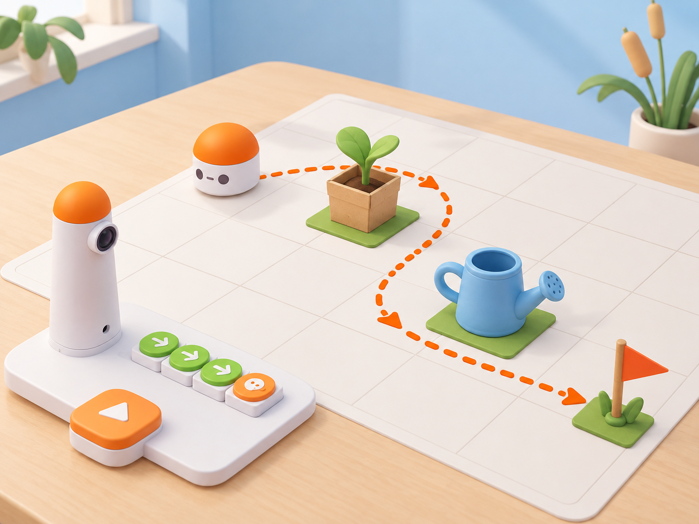

_Il·lustració IA pròpia basada en el kit real del Coding Set. Els objectes són marques fixes que les persones col·loquen i el robot evita amb una ruta prèviament programada; no hi ha sensor que els detecte._

## Situació, repte i intenció

El grup prepara una maqueta de viver amb un planter, una regadora i una bandera que marca l’espai on es deixaran les eines. MatataBot ha de fer una ronda al voltant dels objectes sense tocar-los i acabar a la bandera. Els objectes són materials estàtics, no obstacles que el robot puga reconéixer: l’equip observa el mapa, planifica i programa tota la ruta abans de començar.

La proposta adapta la targeta oficial **A-4 · MatataBot Guard** de les *Coding Activity Cards*. La targeta situa MatataBot i una joguina sobre una superfície plana, demana programar-lo perquè es moga al voltant de l’objecte i proposa com a ampliació repetir la ruta amb més d’una joguina en un programa. Ací el viver, els marcadors, el mapa, l’objectiu de bandera, el registre i les imatges són propis. La ruta és intencional i fixa: MatataBot no busca, detecta ni esquiva res automàticament.

**Pregunta guia:** quines instruccions ens permeten passar al voltant de cada objecte i arribar a la bandera sense dependre que el robot detecte el que hi ha al mapa?

## Aprenentatges i vocabulari

- Representar objectes i destinacions en una graella amb inici i orientació marcats.
- Dissenyar una ruta que passe al voltant d’un marcador sense tocar-lo.
- Ampliar una seqüència perquè passe al voltant de més d’un objecte en un sol programa.
- Predir, executar i registrar el moviment real, i revisar el primer punt de divergència.
- Distingir una ruta programada d’una esquiva automàtica amb sensors.

**Vocabulari clau:** marcador, obstacle representat, ruta, voltant, inici, orientació, gir, seqüència, bandera, prova, depuració.

## Materials i preparació

- Coding Set real: MatataBot, torre de control, tauler i blocs direccionals disponibles.
- Graella plana pròpia de 4 × 4 caselles; si s’utilitza una quadrícula física del kit, comproveu-ne escala i dimensions abans de fer prediccions.
- Un planter de maqueta de base àmplia, una regadora de paper o escuma i una bandera gran; han de ser objectes lleugers, estables, no punxants i més alts que les rodes.
- Fitxa de robot de paper per a planificar; mapa amb les caselles lliures, els objectes, la meta i la posició inicial del robot.
- Full de registre amb **objectes**, **inici/orientació**, **seqüència**, **caselles de pas**, **contacte sí/no**, **arribada a la bandera sí/no** i **canvi provat**.

Carregueu MatataBot i la torre, fixeu la graella i proveu una seqüència curta sobre la mateixa superfície. Situeu els objectes al centre de caselles marcades i deixeu espai de pas superior a l’amplària del robot. No useu aigua real ni plantes vives. Durant la prova, retireu les mans de la graella; atureu el robot abans de moure qualsevol marcador.

## Seqüència didàctica

### Sessió 1 · Fem una ronda al voltant d’un objecte (45 min)

#### Fase 1 · Activem i prediem

Presenteu el viver de maqueta, el planter i la bandera. Demaneu com podria passar el robot al voltant del planter sense tocar-lo. Compareu una ruta que passa per davant amb una que fa un recorregut per dos costats; el grup assenyala inici, orientació i final abans de programar.

#### Fase 2 · Explorem i construïm

Col·loqueu un únic objecte en una casella central i marqueu la bandera en una altra. En parelles, assageu una ruta amb la fitxa de paper i col·loqueu una fletxa en cada canvi d’orientació. Traduïu després el recorregut als blocs físics del Coding Set, tenint present que un bloc de gir fa girar el robot sobre el lloc.

#### Fase 3 · Expliquem i registrem

Una persona llig la seqüència i l’altra ressegueix la ruta. Marqueu les caselles per on passarà MatataBot i comproveu que la línia no travessa la casella ocupada per l’objecte. Escriviu una predicció observable: «el robot passarà per aquestes caselles i no tocarà el planter».

#### Fase 4 · Apliquem i millorem

Executeu la seqüència des del mateix inici. Observeu si el robot passa pels punts previstos i manté separació del marcador. Si el toca o se n’ix de la ruta, registreu la primera diferència entre mapa i moviment real, canvieu una sola ordre i repetiu la prova amb la mateixa disposició.

#### Fase 5 · Comprovem i reflexionem

**Evidència:** mapa anotat, programa d’una ronda i registre del resultat. **Pregunta:** com sabem que el robot ha passat al voltant de l’objecte i no simplement per davant?

### Sessió 2 · Una ruta per al planter i la regadora (45 min)

#### Fase 1 · Activem i prediem

Afegiu una regadora de maqueta al mapa. Cada equip prediu com canviarà la ruta perquè passe al voltant dels dos objectes i arribe a la bandera en una sola seqüència. Determineu quina casella serà el punt de gir més exigent.

#### Fase 2 · Explorem i construïm

Torneu a planificar la ruta amb una fitxa de paper, en aquest ordre: iniciar, passar al voltant del planter, allunyar-se’n, passar al voltant de la regadora i acabar a la bandera. Escriviu tota la seqüència abans d’executar-la; no dividiu el repte en dos programes independents.

#### Fase 3 · Expliquem i registrem

Una altra parella verifica al mapa que hi ha un tram lliure al voltant de cada objecte i que la ruta arriba a la bandera. Registreu les caselles de pas i feu que qui ha programat explique quina instrucció inicia cada desviació al voltant dels marcadors.

#### Fase 4 · Apliquem i millorem

Executeu el programa complet. Si MatataBot toca un objecte, no el retireu per fer passar el robot: atureu-lo, anoteu el contacte i reviseu la ruta. Podeu moure un marcador i repetir, però tracteu-ho com una prova nova i actualitzeu el mapa abans de canviar el codi.

#### Fase 5 · Comprovem i reflexionem

**Evidència:** ruta única amb dos objectes, caselles previstes i observades, i registre de cada contacte. **Pregunta:** quina instrucció ha permés envoltar cada objecte en un mateix programa?

### Sessió 3 · Revisem la ronda d’un altre equip (45 min)

#### Fase 1 · Activem i prediem

Els equips intercanvien els mapes sense mostrar els programes. La parella visitant prediu una ruta possible i assenyala un lloc on un gir imprecís podria acostar el robot massa al planter o a la regadora.

#### Fase 2 · Explorem i construïm

La parella autora entrega la seqüència i la visitant la reconstrueix amb blocs o fletxes. Si les caselles del mapa no permeten una interpretació clara, afegiu orientació inicial, llegenda o coordenada; no interpreteu el moviment del robot com a una decisió autònoma.

#### Fase 3 · Expliquem i registrem

Executeu la seqüència amb els dos objectes en les posicions indicades. La parella visitant marca cada pas observat i confirma per separat **ha passat pels dos costats de cada marcador**, **no hi ha hagut contacte** i **ha arribat a la bandera**.

#### Fase 4 · Apliquem i millorem

Retorneu una observació concreta a l’equip autor: una instrucció clara i un punt que convé revisar. L’equip aplica un canvi i torna a provar el programa complet. Si les dades mostren que el robot es desplaça lleugerament, ajusteu el marge de la ruta al mapa i documenteu el canvi.

#### Fase 5 · Comprovem i reflexionem

**Evidència final:** mapa i programa revisats, comprovació per una altra parella i explicació del límit del kit. Tanqueu amb: «La ruta estava planificada perquè…» i «MatataBot no ha detectat els objectes; l’equip…».

## Evidències i avaluació

Recolliu els mapes de les dues rondes, les seqüències, la comparació entre predicció i resultat, i la revisió feta després de la prova externa. Observeu si l’alumnat:

- representa posició i orientació inicials;
- traça una ruta que passa al voltant de l’objecte sense travessar-ne la casella;
- incorpora dos marcadors a un únic programa;
- localitza i corregeix una divergència a partir d’una observació concreta;
- explica que els objectes no són detectats automàticament pel robot.

No avalueu la rapidesa, l’absència d’errors al primer intent ni l’habilitat motriu per a manipular els objectes.

## Participació, accessibilitat i seguretat

Proporcioneu mapes grans, fletxes tàctils, codis de forma a més del color i seqüències impreses. Es pot participar dibuixant la ruta, llegint blocs, observant el moviment o registrant dades. Useu només objectes lleugers i estables; deixeu les mans fora del recorregut mentre MatataBot està actiu i pareu-lo abans de canviar un marcador. No plantegeu el robot com un sistema de vigilància o seguretat del viver: és una seqüència programada dins d’una maqueta escolar.

## Referents i adaptació

- Matatalab, [*Coding Activity Cards*, targeta A-4 · *MatataBot Guard* (PDF oficial)](https://matatalab.com/cdn/ff/IhHZwon10hgweb9Aqf4zXOcRD2XjU0s9E0F2sWyqps4/1637739725/public/2021-11/Coding%20Activity%20Cards.pdf): demana situar MatataBot i una joguina sobre una superfície plana, programar el robot perquè es moga al voltant de l’objecte i proposa com a extensió incloure més d’una joguina en un programa. La mostra és parcial; la proposta local concreta aquesta mecànica amb dos marcadors estàtics i una meta.
- Matatalab, [*Hello Matatalab Robots!*](https://matatalab.com/en/node/88): referència per verificar blocs direccionals, girs i orientació en la programació tangible del Coding Set.

L’adaptació conserva la seqüència oficial d’una joguina i l’ampliació a més d’un objecte en un programa. El viver i els seus elements són una maqueta de l’entorn local; cap objecte és detectat ni esquivat automàticament, i la ruta s’ha de planificar abans d’iniciar el robot.
