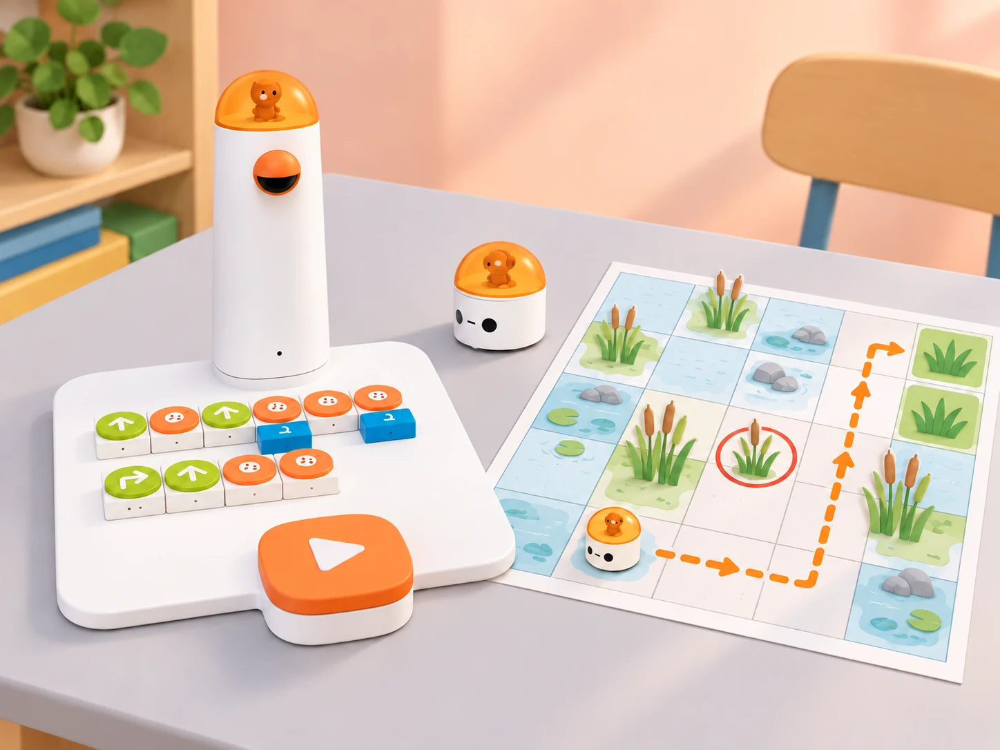

_Il·lustració IA basada en la fotografia del Coding Set del centre. La quadrícula, la ruta i la targeta d’obstacle són materials didàctics; MatataBot no detecta ni esquiva obstacles per si mateix._

## 🌱 Situació, repte i intenció

La classe prepara un mapa perquè una altra parella puga portar una granota de paper des d’un punt d’aigua fins a una zona de vegetació sense travessar un espai marcat com a protegit. El repte no consisteix a fer que el robot “veja” l’obstacle: l’alumnat el representa al mapa, calcula un itinerari segur i programa el MatataBot perquè el recórrega.

Aquesta proposta adapta la lliçó oficial de Matatalab **“The Wolf is Coming!”** (lliçó 3), que introdueix el concepte d’obstacle, la planificació d’una ruta prèvia, la codificació d’un camí amb blocs direccionals, el treball en dos equips que intercanvien tasques i un repte final de permutacions. El context de la marjal, els personatges, els mapes i els casos de prova són propis. La lliçó oficial proposa una exploració de 40 minuts; ací es distribueix en tres sessions de 45 minuts per a permetre predicció, rotació de rols, depuració i comunicació a una altra parella. No es reprodueixen les pàgines ni les il·lustracions del material oficial.

**Pregunta guia:** quina informació necessitem per triar una ruta que evite una zona protegida, i com comprovem que les ordres porten el robot al punt correcte?

## 🎯 Aprenentatges i vocabulari

- Identificar inici, destinació, orientació, obstacle representat i ruta possible en una graella.
- Planificar el recorregut abans de col·locar blocs, anticipant la posició i l’orientació després de cada ordre.
- Traduir una ruta a blocs direccionals del Coding Set, executar-la i comparar el resultat amb la predicció.
- Depurar una seqüència canviant una instrucció cada vegada i registrar què ha canviat.
- Repartir i intercanviar els rols de disseny del mapa, programació, comprovació i portaveu.
- Explicar per què una ruta és segura dins del mapa i distingir aquesta decisió humana de les capacitats del robot.

**Vocabulari clau:** casella, fila, columna, inici, destinació, orientació, obstacle, ruta, instrucció, seqüència, predicció, prova i depuració.

## 🧰 Materials i preparació

- Coding Set del centre: MatataBot, torre de control, tauler de programació i blocs direccionals disponibles. Carregueu els dispositius, comproveu la connexió i executeu una instrucció senzilla abans de la sessió.
- Dues graelles pròpies de 5 × 5 caselles. Per a moure físicament el robot, marqueu caselles de **10 × 10 cm** i confirmeu el desplaçament amb una prova del vostre model; una graella de paper més menuda només serveix per a planificar o simular.
- Targetes de paper amb una granota, dos punts d’aigua, dues zones de vegetació i una zona protegida. L’obstacle és una marca del mapa: el robot no el reconeix ni l’evita automàticament. Manteniu lliure el recorregut físic i no col·loqueu barreres que puguen fer caure o bloquejar el robot.
- Full de registre amb quatre columnes: **pas**, **posició i orientació previstes**, **resultat observat**, **canvi provat**. Afegiu-hi targetes amb les ordres que tinga realment el kit.

Formeu equips de quatre. En cada parella, una persona prepara el mapa i l’altra programa; les dues persones revisen conjuntament la ruta. Després de la primera missió, intercanvien la funció de disseny i programació amb l’altra parella. Ajusteu els blocs a l’inventari del centre: si el model no té algun moviment, representeu-lo en paper i no el presenteu com una prova física.

## 📅 Seqüència didàctica · tres sessions de 45 minuts

### **Sessió 1 · Llegim el mapa i planifiquem sense travessar la zona protegida (45 min).**

#### Fase 1 · Activem i prediem

Mostreu una graella amb inici, destinació i una zona protegida marcada. Pregunteu si hi ha més d’un camí possible i demaneu que assenyalen quines caselles no pot travessar la ruta acordada. Recolliu prediccions sense encendre encara el robot.

#### Fase 2 · Explorem i construïm

En equips de quatre, assigneu rols de cartògraf/a, planificador/a, verificador/a i portaveu. La parella planificadora traça amb llapis una ruta casella a casella; la parella verificadora recorre el mapa amb una fitxa i comprova que no passa per la zona protegida ni ix de la graella. Si una ruta no és viable, marqueu la primera casella que causa el problema.

#### Fase 3 · Expliquem i registrem

Anoteu cada canvi de direcció en una seqüència de fletxes i indiqueu la direcció inicial de MatataBot. Compteu els moviments entre caselles i distingiu-los dels girs: un gir canvia l’orientació, però no trasllada el robot a una casella veïna.

#### Fase 4 · Apliquem i millorem

Intercanvieu la ruta amb un altre equip sense explicar-la oralment. L’equip receptor ha de poder reconstruir el recorregut només amb la graella, el punt d’inici, l’orientació i la seqüència. Afegiu al mapa la informació que falte.

#### Fase 5 · Comprovem i reflexionem

**Evidència:** mapa amb llegenda, ruta contínua i registre de posició després de cada ordre. Expliqueu quina dada del mapa ha evitat confondre un gir amb un desplaçament.

### **Sessió 2 · Convertim dues rutes en programes i canviem els rols (45 min).**

#### Fase 1 · Activem i prediem

Presenteu dos reptes amb el mateix inici però destinacions diferents. Cada parella tria una ruta segura i escriu la predicció abans de tocar els blocs. Repasseu la col·locació inicial i l’orientació del robot.

#### Fase 2 · Explorem i construïm

La primera parella construeix el programa al tauler i el llig en veu alta; la segona comprova bloc per bloc que correspon a la ruta del mapa. Executeu el programa només quan les dues parelles l’hagen validat. Després, canvieu els rols i resoleu la segona destinació amb un altre mapa.

#### Fase 3 · Expliquem i registrem

Després de cada prova, anoteu l’última posició correcta i la primera discrepància. Si el robot no arriba, compareu la seqüència amb el mapa i canvieu una sola instrucció abans de repetir. Torneu MatataBot a la mateixa casella i orientació inicial abans de cada execució.

#### Fase 4 · Apliquem i millorem

Feu que cada parella reba el programa de l’altra sense veure la ruta dibuixada. Ha d’anticipar el destí, provar-lo i després comparar la predicció amb el resultat. Si hi ha una diferència, expliqueu si prové del mapa, de l’orientació inicial, de la lectura dels blocs o de l’execució.

#### Fase 5 · Comprovem i reflexionem

**Evidència:** dos programes amb les seues rutes anotades, una comprovació entre parelles i, si ha calgut, un canvi justificat. El repte es considera resolt quan el recorregut observat arriba a la destinació sense entrar a les caselles prohibides.

### **Sessió 3 · Depurem i resolguem un repte de permutacions (45 min).**

#### Fase 1 · Activem i prediem

Col·loqueu quatre targetes d’hàbitat en quatre caselles identificades. Expliqueu que, en el repte final, dues targetes canviaran de lloc i que caldrà decidir quines configuracions són possibles sense repetir cap casella. Distingiu aquest problema de classificació del moviment del robot.

#### Fase 2 · Explorem i construïm

Cada equip rep una configuració inicial i dues targetes intercanviables. Proposeu quatre configuracions candidates; l’alumnat les prova físicament amb les targetes i descarta les que deixen una casella duplicada o buida quan el repte exigeix una targeta per casella. Després, trieu una configuració vàlida i planifiqueu una ruta que visite les destinacions en l’ordre acordat.

#### Fase 3 · Expliquem i registrem

Programeu una ruta curta cap a les destinacions triades. La persona observadora registra l’ordre de visita i el resultat. Si la seqüència falla, depureu-la pas a pas; no canvieu alhora la disposició de targetes i el programa.

#### Fase 4 · Apliquem i millorem

Presenteu el mapa i una ruta a una parella visitant. Aquesta ha d’explicar quina configuració ha triat, reconstruir les instruccions i verificar la destinació. Incorporeu una millora només si resol una confusió observada durant aquesta prova.

#### Fase 5 · Comprovem i reflexionem

**Evidència final:** mapa amb llegenda, una configuració de targetes justificada, programa comprovat i explicació breu d’una depuració. Tanqueu amb la pregunta: quina part de la decisió sobre la zona protegida ha fet l’alumnat i quina part ha fet el robot?

## ♿ Accessibilitat, seguretat i límits

- Oferiu graelles amb contrast alt, pictogrames, peces més grans i una versió de recorregut corporal o amb fitxa per a qui no puga manipular els blocs menuts.
- Permeteu anticipar la seqüència oralment, amb fletxes, amb una plantilla de posicions o amb suport d’una parella; els rols es poden adaptar sense perdre la rotació de responsabilitats.
- Manteniu mans i materials fora del trajecte durant l’execució. No poseu el robot sobre vores, superfícies inclinades ni obstacles físics; atureu la prova si queda bloquejat.
- La zona protegida és una convenció del mapa. El Coding Set base no disposa de detecció automàtica d’obstacles en aquesta activitat; cap moviment del robot demostra percepció ambiental.
- No feu servir ubicacions identificables de l’alumnat ni fotografies amb dades personals. Els llocs i animals del mapa són representacions educatives.

## ✅ Avaluació i evidències

- **Planificació:** el mapa inclou inici, orientació, destinació, zona protegida i una ruta contínua.
- **Programació:** la seqüència de blocs correspon a la ruta que l’equip ha anunciat.
- **Depuració:** l’alumnat localitza la primera discrepància i prova un canvi controlat.
- **Comunicació:** una altra parella pot reconstruir el recorregut sense instruccions addicionals.
- **Comprensió del robot:** l’explicació separa les decisions humanes sobre el mapa de les ordres que MatataBot executa.

## 🔗 Fonts oficials i decisions d’adaptació

- [Matatalab, lliçó 3: “The Wolf is Coming!” (PDF oficial)](https://matatalab.com/cdn/ff/3ihe_ldu0qGpw6-JNLtdn8UaZVTFje4pO0eRFPIgtcY/1600223266/public/2020-09/%E7%AC%AC3%E8%AF%BE%20%20%E7%8B%BC%E6%9D%A5%E4%BA%86%EF%BC%81.pdf): treballa obstacles, planificació prèvia, seqüències direccionals, cooperació en parelles amb intercanvi de tasques i una activitat final de permutacions. La proposta conserva aquesta progressió didàctica, però crea un context de marjal, mapes, consignes i proves propis.
- La font descriu l’ús del Matatalab Coding Set. Les dimensions de 10 × 10 cm i la resposta als blocs s’han de validar amb el kit i la superfície concrets del centre abans de fer l’activitat física.
- La duració de tres sessions de 45 minuts, els indicadors d’avaluació i els materials de paper són decisions pròpies d’aquesta adaptació, no dades atribuïdes al fabricant.
