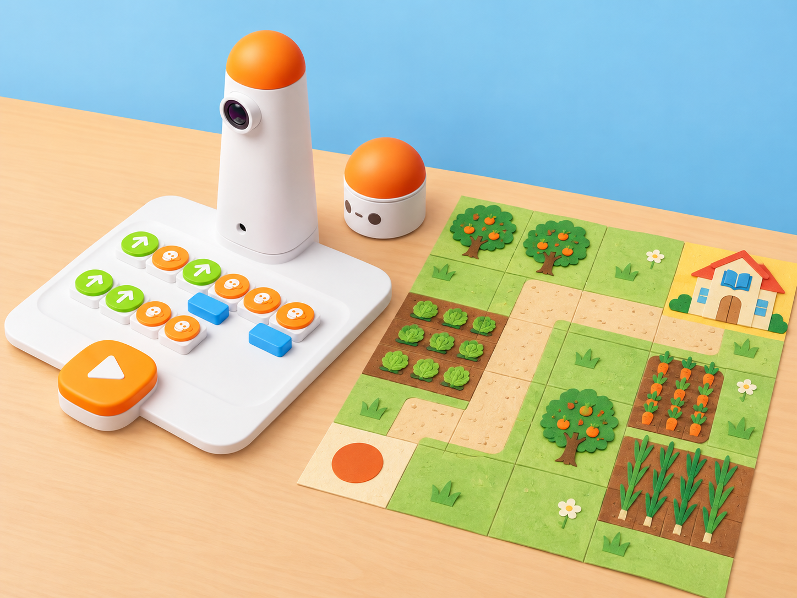
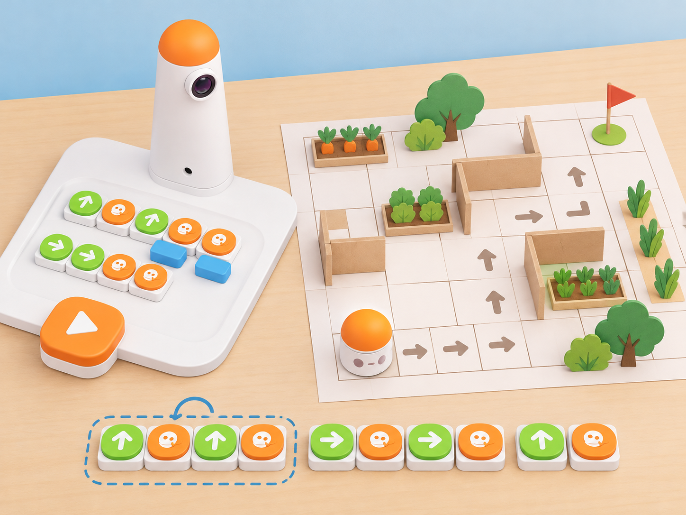

_Il·lustració IA basada en el Coding Set de la dotació. El mapa és una maqueta pròpia: cal dibuixar-lo a escala de 10 cm per casella si s’hi vol provar el moviment físic._

## 🌱 Situació, repte i intenció

La classe prepara una ruta d’orientació entre una plantació, el mercat i la biblioteca del centre. Abans de moure MatataBot, l’alumnat haurà d’explicar com la torre llig els blocs, què vol dir enviar i rebre instruccions i com es pot representar una ruta amb ordres físiques. En una segona sessió, resoldrà un laberint de paper i comprovarà com els paràmetres, els bucles i les funcions permeten expressar recorreguts més llargs amb menys peces.

La proposta adapta dues lliçons del manual extracurricular de Coding Set: la primera introdueix els components, la comunicació Bluetooth i les ordres direccionals; la segona treballa laberints, paràmetres, bucles i funcions amb mapes i reptes del *Challenge Booklet*. El context valencià, els mapes i els casos de prova són originals. No es reprodueixen les pàgines del quadern de reptes.

**Pregunta guia:** què ha de saber qui programa i qui executa una ruta perquè el robot arribe al lloc previst, i com podem escurçar el programa sense canviar el recorregut?

## 🎯 Aprenentatges i vocabulari

- Reconéixer la torre de comandament, el tauler de control, els blocs i MatataBot i explicar quin paper té cadascun.
- Distingir qui envia una instrucció de qui la rep i descriure la comunicació entre torre i robot.
- Planificar, executar i depurar seqüències amb avançar, retrocedir i girar.
- Usar el bloc numèric per repetir una instrucció i els blocs de bucle per repetir una seqüència.
- Definir una seqüència amb el bloc de funció i invocar-la des de la segona línia, segons el funcionament descrit en el manual.
- Registrar la posició inicial i final, comparar la predicció amb el resultat i corregir una instrucció cada vegada.

**Vocabulari clau:** torre, tauler, bloc, enviar, rebre, Bluetooth, seqüència, orientació, laberint, obstacle, bandera, paràmetre, bucle, funció, coordenada i depuració.

## 🧰 Materials i preparació

- Un Coding Set per equip: torre, tauler, MatataBot i blocs de moviment; per a la segona sessió, també blocs numèrics, de bucle i de funció, obstacles i banderes, si formen part del kit disponible.
- Fulls amb targetes de fletxes, paper quadriculat, llapis, quadern d’equip i una graella pròpia amb caselles de **10 × 10 cm** per a les proves físiques.
- Mapes propis amb inici, destinació i obstacles de paper; marcadors de biblioteca, plantació, séquia i mercat. Aquests elements són representacions manuals, no són detectats pel robot.

Abans de començar, carregueu i aparelleu torre i MatataBot segons el manual del kit. Proveu l’orientació dels blocs, el tauler, el botó d’inici i una ruta curta sobre una superfície plana. Comproveu que la torre llig la disposició real dels blocs i que no hi haja objectes ni mans al recorregut. Si no disposeu d’algun bloc avançat o de la bandera, representeu-lo amb targetes i expliqueu el programa sobre paper; no presenteu la simulació com una execució física.

Organitzeu equips de tres o quatre amb rols rotatius: lector/a del mapa, constructor/a del programa, operador/a del robot i observador/a que anota la predicció i el resultat. Ajusteu la ruta i el nombre de blocs a les possibilitats del grup.

## 📅 Seqüència didàctica · dues sessions de 60 minuts

### **Sessió 1 · La torre envia, MatataBot rep (60 min · lliçó extracurricular 1).**

#### Fase 1 · Activem i prediem

**Movem-nos amb instruccions (10 min):** parleu de per a què serveixen els intermitents d’un vehicle i quins moviments indiquen. En una zona sense obstacles, l’alumnat forma una fila amb distància de seguretat i segueix una seqüència corporal: avançar un pas, girar a la dreta, retrocedir un pas i girar a l’esquerra. Repetiu-la una vegada i pregunteu què passa quan algú canvia l’ordre. No es corre ni s’imiten maniobres amb vehicles reals.

#### Fase 2 · Explorem i construïm

**Identifiquem el sistema (15 min):** mostreu la torre, el tauler, els blocs i MatataBot. Amb el kit del centre, ensenyeu com s’engeguen i s’aparellen els dos dispositius, com es col·loquen els blocs amb la marca d’orientació cap avall i com s’inicia el programa. Expliqueu que la torre captura la disposició dels blocs i envia les instruccions per Bluetooth; MatataBot les rep i les executa. La càmera de la torre llig els blocs: el mapa de paper no és un sensor ni una ordre.

#### Fase 3 · Expliquem i registrem

**De la targeta al programa (10 min):** cada equip ordena targetes amb avançar, retrocedir i girar per arribar a una destinació. Una persona llig la seqüència; la resta la representa amb el cos o sobre la graella, sense robot. Anoteu quina peça representa cada instrucció i qui envia i qui rep el missatge.

_Laberint i marques creats per a aquesta proposta. Els símbols del mapa els interpreta l’alumnat; MatataBot només executa els blocs que la torre ha llegit._

#### Fase 4 · Apliquem i millorem

**Provem una ruta curta (20 min):** dibuixeu una graella de 10 cm per casella. Amb una primera prova, poseu MatataBot en una casella inicial orientat cap a una destinació adjacent i trieu un bloc d’avanç. Predigueu el moviment, executeu-lo i registreu la posició final. Després afegiu un gir i una segona instrucció. Si el resultat no coincideix, comproveu l’orientació inicial, la col·locació dels blocs i l’ordre abans de canviar res; canvieu una sola instrucció i repetiu la prova. Retireu els blocs abans de preparar un repte nou.

#### Fase 5 · Comprovem i reflexionem

**Tanquem amb evidències (5 min):** responeu en el quadern: per a què serveixen les marques dels blocs?, què envia la torre i què rep MatataBot?, què ha canviat quan hem alterat l’ordre? Dibuixeu la seqüència utilitzada i marqueu inici i final. **Evidència:** mapa curt, predicció, programa amb blocs i resultat observat. Com a ampliació desconnectada, creeu un cartell il·lustrat dels blocs direccionals o un joc de transmissió de missatges entre equips.

### **Sessió 2 · Resolem un laberint amb blocs avançats (60 min · lliçó extracurricular 2).**

#### Fase 1 · Activem i prediem

**Llegim un laberint (10 min):** cada alumne traça amb llapis una ruta pròpia des de l’inici fins al final d’un laberint de paper, sense alçar el llapis ni esborrar els errors. Compareu les rutes: on calia retrocedir, girar o replantejar una instrucció? El docent mostra una solució possible i recorda que una ruta correcta pot tindre més d’un programa.

#### Fase 2 · Explorem i construïm

**Coneixem paràmetre, bucle i funció (15 min):** presenteu els blocs nous disponibles al kit. El bloc numèric només acompanya avançar o retrocedir, no els girs. Els blocs `Loop Begin` i `Loop End` s’usen en parella per repetir les instruccions que queden dins; quan s’empra un nombre, el manual tècnic indica que va sota `Loop Begin`. Per a una funció, distingiu el bloc de definir-la del bloc que la crida: la guia tècnica oficial actual indica que la crida va en una línia i la definició en la línia de baix; la definició es pot cridar diverses vegades, però una funció no es combina amb un bloc numèric. Aquesta disposició no coincideix del tot amb la manera com la còpia del manual de la lliçó explica l’ordre de definició i crida; contrasteu el diagrama del kit concret abans de la classe i feu que l’alumnat prove la seua lectura. No confongueu els blocs `Function` amb els blocs `Fun`, que seleccionen moviments, música o danses predefinides. El bloc musical apareix a la llista de materials del manual, però no és necessari per a resoldre aquest repte.

#### Fase 3 · Expliquem i registrem

**Planifiquem la ruta de l’horta (10 min):** sobre una graella local amb inici, destinació i obstacles, cada equip dibuixa una ruta i escriu la seqüència de fletxes. Marqueu una secció repetida i compareu tres representacions: moviments desplegats, un paràmetre numèric i un bucle. Si hi ha bloc de funció, trieu una seqüència que es repetisca en dos punts. Registreu també la casella final com a coordenada de fila i columna; no cal desenvolupar tot el concepte de pla cartesià.

#### Fase 4 · Apliquem i millorem

**Programem, provem i depurem (20 min):** primer executeu una ruta que evite un obstacle; després, resoleu un trajecte més llarg amb un bucle i proveu una crida de funció en una línia separada. Si el codi falla, localitzeu la primera instrucció en què la ruta prevista i la real divergeixen i canvieu només eixa part. Feu almenys dues proves, inclosa una amb un destí diferent, i expliqueu per què el paràmetre, el bucle o la funció redueix peces sense canviar el resultat. La bandera és un marcador col·locat per l’equip; no la detecta MatataBot. Si el centre no disposa d’un bloc o el muntatge no es comporta com el descrit, completeu eixa comparació amb targetes i deixeu constància de la limitació.

#### Fase 5 · Comprovem i reflexionem

**Compartim i revisem (5 min):** cada equip presenta un mapa, la ruta i una comparació entre codi desplegat i codi abreujat. Responeu: com s’assembla el laberint a un mapa?, quin error hem trobat?, quina evidència mostra que la correcció ha funcionat? **Evidència final:** mapa amb coordenada, programa o targetes, taula de dues proves i explicació d’una depuració. Com a ampliació, creeu un laberint original amb inici i final i intercanvieu-lo amb un altre equip; l’alumnat prova de resoldre’l sense modificar el disseny de qui l’ha creat.

## 📊 Evidències i avaluació

Recolliu la seqüència corporal o amb targetes, els mapes, la predicció, els programes i la taula de proves. Observeu si cada alumne:

- identifica la funció dels components i diferencia enviar de rebre;
- representa l’orientació i ordena instruccions direccionals;
- explica què canvia quan incorpora un nombre, un bucle o una funció;
- localitza el punt de divergència entre ruta prevista i ruta observada;
- justifica una correcció amb una prova repetida.

Valoreu la claredat del raonament, la col·laboració i l’ús d’evidències. No avalueu la rapidesa del robot ni una única solució al laberint.

## ♿ Participació, accessibilitat i seguretat

Oferiu mapes d’alt contrast, caselles grans, fletxes tàctils i la possibilitat d’anticipar la ruta oralment o amb targetes. Els rols es roten i l’operació física pot quedar en mans d’una parella mentre altres persones fan prediccions i comprovacions. Manteniu la taula plana i el recorregut lliure; no poseu les mans davant del robot mentre s’executa. La persona adulta gestiona càrrega, aparellament i incidències de connexió.

## 🔗 Referents i adaptació

- MatataStudio, [Lesson 2.8: Extracurricular Curriculum](https://matatalab.com/en/node/67): confirma que el currículum té 12 lliçons de 60 minuts, recomana equips de quatre amb rols de programació i inspecció, i descriu l’estructura general d’introducció, activitat, tancament, extensió i connexions amb el món real. La pàgina no publica el procediment detallat de les lliçons 5–12.
- MatataStudio, [Teaching Materials](https://www.matatastudio.com/teaching-materials.html): la pàgina oficial llista el recurs *MatataStudio Extracurricular Lesson TG-Sample* i n’ofereix la descàrrega. El PDF oficial consultable és una mostra de les lliçons 3 i 4, no el currículum complet.
- [Còpia llegible de mostra del manual extracurricular](https://infotastic.academy/wp-content/uploads/2024/12/MatataStudio-Extracurricular-Lesson-TG-Sample.pdf), consultada per contrastar les lliçons 1 i 2 (components, missatges, moviments, laberint, blocs avançats, preguntes de tancament i extensions). La còpia està titulada *Extracurricular Manual for Coding Set Pro* i allotjada per un tercer, no en el servidor oficial; per això es conserva l’enllaç de l’editorial com a referència principal i es comproven els blocs disponibles abans de transferir el procediment al kit del centre.
- MatataStudio, [suport de Coding Set](https://matatalab.com/en/product-support): referència tècnica per a les peces, el tauler i l’escala de la graella.
- MatataStudio, [curs autoguiat Coding Set](https://www.matatastudio.com/Self-Guided.html): confirma els usos i límits del bloc numèric, l’estructura dels bucles i la disposició separada de definició i crida de les funcions.

La situació adapta **les lliçons 1 i 2** del manual extracurricular. La proposta local substitueix el mapa i els reptes del quadern per una graella pròpia de l’horta i de l’escola; no afirma que els materials del *Challenge Booklet* estiguen inclosos ni accessibles. Les lliçons 3 i 4 del mateix manual tenen una adaptació separada en [Un circuit de l’horta per a un cotxe de paper](../../situacio/index.html?id=cs-circuit-cursa-horta); no es declara cobert el currículum extracurricular complet de dotze lliçons.
