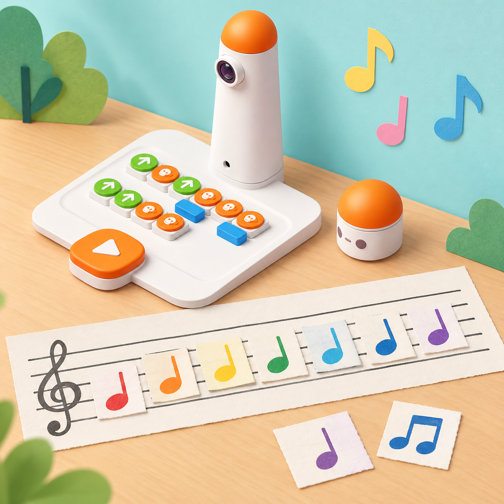

_Les targetes i la partitura són materials de paper creats per a la proposta. El Musician Add-On és opcional i només amb aquest accessori el MatataBot reprodueix les notes programades._

## Situació, repte i intenció

La classe vol crear una peça breu que una altra classe puga llegir i escoltar. El paisatge de la marjal inspira el tema, però no assignarem una nota a cada animal ni afirmarem que el robot imita sons de la natura. Investigarem una propietat musical concreta: en el pentagrama, les notes situades més amunt representen sons més aguts que les situades més avall. Després, farem servir els blocs de nota i de melodia del Musician Add-On si el centre en disposa; sense aquest accessori, completarem les mateixes activitats de representació i composició amb veu, percussió corporal i peces de paper, identificant aquesta via com a desconnectada.

La proposta combina dos referents diferents, sense confondre'ls: la lliçó de mostra *Staff Notes and Pitches* aporta la lectura del pentagrama, i les targetes oficials *Music Teacher* i *Music Player I* aporten, respectivament, el joc de reconeixement de notes i la interpretació d'una partitura programada. En lloc de reproduir la cançó protegida de la targeta, la classe crea una melodia pròpia. Aquesta adaptació cobreix aquests materials concrets; no declara adaptades les altres onze lliçons del currículum Musician ni les altres huit targetes del complement.

**Pregunta guia:** com podem deixar escrit un patró de sons perquè una altra parella puga reconstruir-lo i explicar què ha canviat?

## Aprenentatges i vocabulari

- Identificar les cinc línies i els quatre espais del pentagrama i numerar-los de baix cap amunt.
- Relacionar la posició vertical d’una nota amb l’altura greu o aguda, sense confondre altura amb volum.
- Escoltar i comparar els blocs de nota 3 i 5 i ordenar una sèrie de notes de menor a major altura.
- Diferenciar visualment les peces de clau d'alt i de sol, i relacionar els selectors numerats de l'1 al 7 amb Do–Re–Mi–Fa–Sol–La–Ti.
- Seguir una notació numèrica en una execució ordenada i reconstruir una melodia original en equip.
- Representar una peça breu amb una llegenda clara, provar-la i explicar una revisió.
- Distingir una nota seleccionada amb un bloc de nota d’una melodia predefinida del bloc *Melody*.

**Paraules clau:** pentagrama, línia, espai, nota, altura, greu, agut, seqüència, pols, compàs, llegenda.

## Materials i preparació

- Coding Set: MatataBot, torre de control, tauler i cable/càrrega segons el model del centre.
- Si la dotació en disposa: Musician Add-On compatible, blocs de nota amb selectors, blocs *Melody* i blocs numèrics. L’inventari oficial del complement inclou blocs de notes en clau d’alt i de sol i blocs de melodia predefinida; comproveu quines peces concretes té el centre abans d’escriure les instruccions de sessió.
- Set targetes de notes Do–Ti i targetes de notació numèrica preparades pel docent; són materials de paper propis, no peces oficials ni reconegudes automàticament pel robot.
- Cinc tires de llana o cinta de paper per a un pentagrama gran, notes de cartolina, llapis i un full de registre amb columnes **posició**, **nota/bloc**, **predicció**, **so observat** i **canvi**.
- Targetes amb fletxes amunt/avall, colors amb contrast i una versió de la partitura amb peces grans. L’audició mai no és l’única manera de participar.

Abans de l’activitat, carregueu robot i torre i feu una prova amb els blocs reals. En el complement, gireu el selector de cada bloc de nota a la posició triada i col·loqueu-lo al tauler perquè la torre el llija. Valideu amb el manual del model local la col·locació de qualsevol bloc numèric: no forceu peces ni pressuposeu una orientació si el kit difereix. Prepareu les targetes de crida i la partitura numèrica amb una equivalència estable entre 1–7 i Do–Ti. Manteniu el volum baix i oferiu una tasca visual equivalent.

## Seqüència didàctica

### Un pentagrama per a situar els sons (45 min)

#### Fase 1 · Activem i prediem

Pregunteu on escoltem música i com podríem escriure una melodia perquè algú altre la puga llegir. Mostreu cinc línies paral·leles i quatre espais. Cada equip prediu on sonarà una nota més aguda i on una de més greu; distingiu des del principi *altura* (agut/greu) de *volum* (fort/suau).

#### Fase 2 · Explorem i construïm

Amb tires de llana, cordill o paper, construïu un pentagrama gran. Numereu línies i espais de baix a dalt. Col·loqueu notes retallades en línies i espais indicats en targetes, incloent línia 1, espai 2, línia 3 i línia 5. Una persona situa les notes i una altra comprova la posició amb la llegenda; canvieu els rols.

#### Fase 3 · Expliquem i registrem

Cada parella tria dues posicions, les representa al full i indica quina espera que siga més aguda. Afegiu una fletxa amunt o avall i expliqueu la predicció amb la posició escrita, sense dependre només del color.

#### Fase 4 · Apliquem i millorem

Intercanvieu les targetes amb una altra parella. L’equip visitant ha de reconstruir les dues notes en el pentagrama i justificar l’ordre. Si interpreta una posició diferent, reviseu la numeració de la llegenda i torneu-ho a provar.

#### Fase 5 · Comprovem i reflexionem

**Evidència:** pentagrama de cinc línies amb una nota en línia i una en espai, numeració de baix cap amunt i comparació escrita greu/aguda. **Pregunta docent:** què canvia quan movem una nota a una línia més alta?

### Music Teacher: reconeixem i ordenem les notes (45 min)

#### Fase 1 · Activem i prediem

Recupereu el pentagrama i presenteu les peces de nota disponibles. Mostreu costat per costat els blocs de clau d'alt i de sol, compareu-ne la forma i comproveu com es llig el selector. Expliqueu que les posicions numerades representen Do, Re, Mi, Fa, Sol, La i Ti. Si el Musician Add-On no forma part del set, feu la mateixa classificació amb targetes de paper; no presenteu aquesta alternativa com una funció del robot.

#### Fase 2 · Explorem i construïm

Repartiu les set targetes de nota entre l'alumnat i prepareu una notació numèrica curta amb les posicions de l'1 al 7. El docent canta o reprodueix una nota cada vegada; qui té la targeta corresponent s'alça i s'agrupa amb les altres persones que han rebut la mateixa nota. Canvieu qui fa la crida i repetiu la ronda amb una ordre diferent. Amb l'accessori disponible, proveu també els selectors 1–7 d'un en un i compareu les posicions 3 i 5, tal com proposa la lliçó de mostra; sense l'accessori, aquesta comparació és vocal o instrumental.

#### Fase 3 · Expliquem i registrem

Col·loqueu les notes en una escala visual de greu a agut i contrasteu-la amb les posicions del pentagrama. Cada alumne pot respondre escoltant, assenyalant, ordenant targetes o descrivint el resultat amb suport visual. Després, amb el Musician Add-On, programeu la notació numèrica amb blocs de nota i seguiu la interpretació de MatataBot; distingiu la seqüència construïda peça a peça d'un bloc *Melody* predefinit.

#### Fase 4 · Apliquem i millorem

Una parella prepara una comparació nova amb dos selectors diferents i demana a una altra que determine quin sona més agut. Si les percepcions discrepen, repetiu la mateixa prova en condicions de volum i distància semblants; no convertiu una diferència d’audició en un error de l’alumne.

#### Fase 5 · Comprovem i reflexionem

**Evidència:** registre de les posicions 1–7, comparació específica entre 3 i 5, una ronda de crida amb agrupació correcta i una explicació de la diferència entre altura i volum. **Límit:** si no s’ha emprat el Musician Add-On, el registre és d’una activitat vocal o instrumental de l’aula, no d'una execució del robot.

### Music Player I: programem una melodia pròpia (45 min)

#### Fase 1 · Activem i prediem

Mostreu una partitura numèrica original de quatre a sis notes, sense títol ni colors identificatius. Demaneu que una parella prediga l'ordre dels sons i que explique quina informació li falta per interpretar-la. Si el grup ja coneix una melodia de domini públic o una creació pròpia, pot cantar-la abans; no cal ni es reprodueix la cançó amb lletra impresa de la targeta oficial.

#### Fase 2 · Explorem i construïm

Cada equip crea una seqüència original de quatre a sis notes sobre el pentagrama, amb una llegenda compartida. Amb el complement, col·loqueu els blocs de nota amb el selector triat en l'ordre de la partitura i feu que la torre llija el programa. Sense l'accessori, una parella interpreta la partitura amb veu, palmades o instruments d'aula mentre una altra segueix les notes. No imiteu ni distribuïu la cançó coneguda que apareix com a exemple a la targeta oficial: l'objectiu ací és transferir-ne la mecànica de llegir, programar i interpretar a una obra pròpia.

#### Fase 3 · Expliquem i registrem

Abans de reproduir o interpretar la seqüència, un altre equip la copia a partir de la partitura i anota la seua predicció d’altura. Compareu després la reconstrucció amb el programa o l’execució original i localitzeu la primera posició diferent.

#### Fase 4 · Apliquem i millorem

Partiu la peça en fins a tres trams de programa perquè un equip puga preparar cada tram i després unir-los, o dividiu-la en dues parts perquè dos grups col·laboren en una execució completa. Canvieu una sola nota —per exemple, substituïu el selector 3 pel 5— i compareu la versió original i la revisada. Registreu el canvi gràfic i el canvi sonor observat; si no hi ha complement, feu la mateixa comparació amb veu o percussió i declareu el mitjà emprat. El límit de tres programes pertany a la dinàmica descrita per la targeta; comproveu la capacitat concreta del tauler del centre abans d'interpretar-la com un límit tècnic universal.

#### Fase 5 · Comprovem i reflexionem

**Evidència:** partitura de quatre a sis notes, llegenda, registre dels trams/equips, còpia d'un equip visitant i comparació abans/després. **Pregunta docent:** quines convencions hem hagut d'acordar perquè dues parelles puguen interpretar la mateixa peça sense dependre de la persona autora?

### Composem una peça amb pols i retorn (45 min)

#### Fase 1 · Activem i prediem

Escolteu o llegiu dues seqüències pròpies amb les mateixes notes en ordre diferent. Predigueu com canviarà el resultat. Expliqueu que el fabricant descriu el bloc de nota sense modificador com un pols de referència d’un quart i que combinar-lo amb un bloc numèric pot canviar la duració; valideu sempre la disposició amb la guia del kit real.

#### Fase 2 · Explorem i construïm

Amb Musician Add-On, cada grup prepara una frase curta de notes triades i, només si les peces encaixen segons el manual, compara una nota amb el bloc numèric 1 i amb el 2. Observeu la duració relativa i anoteu-la amb símbols propis. També podeu provar un bloc *Melody*, però identifiqueu-lo com una melodia predefinida, no com una composició creada nota per nota. Sense el complement, representeu els pols amb palmades i fitxes de duració.

#### Fase 3 · Expliquem i registrem

Completeu una targeta de composició amb seqüència, duració acordada, predicció i resultat. Un equip interpreta la peça d’un altre i marca si la llegenda és suficient per repetir-la.

#### Fase 4 · Apliquem i millorem

Reviseu la peça a partir d’una pregunta concreta del grup visitant: canvieu l’ordre d’una nota o la duració d’una figura rítmica, però no dues variables alhora. Graveu o presenteu la versió final només amb autorització del centre; no inclogueu noms ni veus identificables si no són necessaris.

#### Fase 5 · Comprovem i reflexionem

**Evidència:** partitura revisada, llegenda, registre de prova i nota que identifica el mitjà real emprat (MatataBot amb Musician, veu, percussió o altre instrument). Cada equip explica una decisió musical i una limitació del seu muntatge.

## Evidències i avaluació

Observeu si cada alumne localitza línies i espais; relaciona posició alta/baixa amb altura; compara dos sons sense confondre altura i volum; transcriu una seqüència segons una llegenda comuna; i revisa una nota o una duració a partir d’una prova. Recolliu les quatre evidències de sessió i una autoavaluació breu: «ho puc llegir», «ho puc ordenar» i «ho puc explicar». Valoreu el raonament, la claredat de la notació, la cooperació i l’ús de proves, no la qualitat vocal ni l’agudesa auditiva individual.

## Participació, accessibilitat i seguretat

Oferiu pentagrames grans, notes en relleu, formes diferenciades a més del color, fletxes d’altura i prediccions visuals. Permeteu participar col·locant targetes, ordenant sons, portant el registre o descrivint una regla. L’escolta i la veu són opcions, mai requisits únics: una parella pot completar les comparacions amb pictogrames i moviments de mà. Manteniu el volum moderat, feu pauses si el so resulta molest i no connecteu auriculars sense seguir les normes del centre. No useu melodies protegides com a producte final; les composicions i els materials d’aquesta proposta són originals.

## Referents i adaptació

- Matatalab, [Musician Add-On](https://matatalab.com/en/node/65): descriu els blocs de nota d'alt i de sol, els blocs de melodia predefinida, selectors 1–7 i la relació entre blocs de nota i nombre per modificar el pols. Es consulta per validar funcions del complement, no com a pla docent complet.
- Matatalab, [Musician Add-on Activity Cards · Music Teacher i Music Player I (PDF oficial)](https://matatalab.com/cdn/ff/Ecee9VUTy4hPQNW2Vq3TPoDZ5mjzubwFIH9Hvla33oE/1637739674/public/2021-11/Musician%20Add-on%20Activity%20Cards.pdf): la primera targeta compara els blocs de clau d'alt i de sol, relaciona els selectors Do–Ti, proposa repartir targetes, cridar notes, agrupar-se i després seguir una notació numèrica reproduïda per MatataBot. La segona demana llegir/cantar una partitura i programar-la amb blocs de nota; permet dividir el programa en fins a tres execucions o col·laborar entre dos grups. Ací es conserva la seqüència didàctica i es reemplaça la cançó de mostra per una composició original.
- Matatalab, [Musician Add-On Set Curriculum, Lesson 1 · Staff Notes and Pitches (PDF oficial de mostra)](https://matatalab.com/sites/default/files/2020-07/Musician%20Add-On%20Set%20Curriculum.pdf): identifica les cinc línies/quatre espais, les set notes de la sèrie major, la comparació de les posicions 3 i 5 i la construcció d’un pentagrama amb materials quotidians. Aquesta adaptació canvia les fitxes i el context per un paisatge sonor local i crea una composició pròpia.
- MatataStudio, [guia autoguiada](https://www.matatastudio.com/Self-Guided.html): confirma que l’add-on es combina amb Coding Set i descriu l’ús de blocs de nota, blocs *Melody* i nombre per a composició.

La mostra consultada del currículum conté la lliçó 1, no les dotze lliçons completes. El PDF de targetes consultat conté deu activitats; aquesta situació adapta les mecàniques verificables de *Music Teacher* i *Music Player I* i les combina amb la lliçó de pentagrama, però no es presenta com a cobertura integral del currículum ni de les deu targetes oficials Musician.
