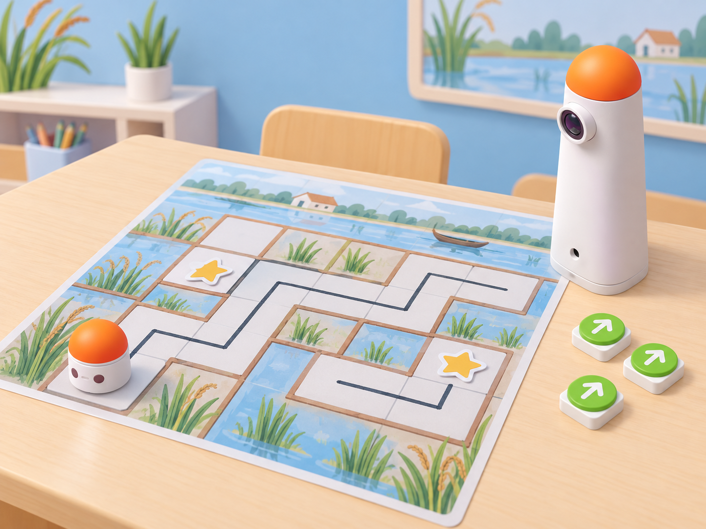

_Il·lustració IA pròpia basada en el kit real. El laberint i els tresors són materials de paper; el robot executa els blocs i no detecta, arreplega ni identifica les peces._

## Situació, repte i intenció

Una classe dissenya un mapa de séquies per a una missió fictícia de l’aiguamoll. En una quadrícula plastificada, cada equip dibuixa canals i marges que deixen un passadís continu des de l’inici fins a un tresor. MatataBot ha de recórrer el passadís i arribar a la casella del testimoni. Quan la ruta funciona amb un tresor, l’equip n’afegeix un segon i adapta el programa perquè visite tots dos abans d’acabar.

La situació adapta la targeta oficial **B-1 · Maze Adventure I** de les *Coding Activity Cards*. El procediment visible demana crear laberints amb retoladors esborrables, posar-hi tresors en punts indicats, programar MatataBot amb blocs de moviment i nombre per trobar-los i afegir un tresor més a cada mapa per provar si es poden trobar tots dos amb un programa. El mapa, el vocabulari local, els tresors de paper, les proves entre parelles i la seqüència didàctica són propis. El robot no segueix les línies ni detecta tresors: les persones planifiquen el camí i comproven la casella final.

**Pregunta guia:** com podem passar d’un laberint dibuixat a una seqüència de blocs que arribe al tresor, i què cal canviar quan n’afegim un altre?

## Aprenentatges i vocabulari

- Dissenyar un laberint amb inici, passadís accessible i una o més destinacions.
- Llegir una ruta en quadrícula i traduir trams rectes a blocs de moviment i nombre disponibles.
- Registrar la posició i l’orientació després de cada gir.
- Provar una seqüència, localitzar la primera divergència i revisar-la amb una nova prova.
- Ampliar una ruta perquè visite dos tresors amb un únic programa.
- Diferenciar la planificació humana de la detecció o recollida automàtica, que el robot no fa.

**Vocabulari clau:** laberint, passadís, marge, casella, tresor, destinació, orientació, moviment, nombre, ruta, seqüència, depuració.

## Materials i preparació

- Coding Set de la dotació: MatataBot, torre de control, tauler i blocs de moviment. Useu blocs de nombre només si el kit els inclou i la torre els reconeix.
- Mapa propi plastificat o funda esborrable amb quadrícula; retolador esborrable i drap suau. Feu una prova d’esborrat en un racó abans de la sessió.
- Fitxes de paper o cartó grans com a tresors, amb una cara d’inici i una de meta; no són codis que el robot puga llegir.
- Plantilla amb **dibuix del laberint**, **ruta prevista**, **blocs**, **orientació**, **tresor visitat**, **resultat observat** i **canvi provat**.
- Fitxa de robot de paper i targetes de fletxes per a resoldre el mapa sense activar el dispositiu.

Dibuixeu una quadrícula gran i assegureu-vos que les caselles que corresponen a un desplaçament físic tenen l’escala adequada al model i la superfície. Deixeu passadissos prou amples per a les rodes i eviteu cruïlles massa estretes. Fixeu el mapa a una taula plana, col·loqueu els tresors al centre de les caselles acordades i carregueu MatataBot i la torre. No poseu retoladors, dits ni tresors menuts al recorregut mentre el robot es mou.

## Seqüència didàctica

### Sessió 1 · Dibuixem i resolem el primer laberint (45 min)

#### Fase 1 · Activem i prediem

Mostreu un mapa en blanc amb una casella d’inici i una meta. Pregunteu quines decisions cal prendre perquè una altra parella puga trobar el tresor sense que l’autoria li explique el camí. Acordeu com es representen els passadissos, els marges i les caselles bloquejades.

#### Fase 2 · Explorem i construïm

En parelles, dibuixeu amb retolador esborrable un laberint original amb una única entrada, almenys dos girs i un passadís continu fins al tresor. Poseu el testimoni en una casella marcada. Una altra persona ressegueix el passadís amb la fitxa de paper i assenyala qualsevol bifurcació que permeta més d’una lectura.

#### Fase 3 · Expliquem i registrem

Marqueu al mapa la posició inicial i cap on mira MatataBot. Dibuixeu una ruta possible sense alçar la fitxa ni travessar els marges. Anoteu cada tram recte i cada canvi d’orientació en una taula; si hi ha dues rutes, compareu-les sense declarar-ne cap com l’única solució correcta.

#### Fase 4 · Apliquem i millorem

Intercanvieu mapes. La parella visitant ha de poder arribar al tresor amb les seues fletxes. Si no pot, l’equip autor revisa una bifurcació o fa més ample el passadís i torna a donar el mapa a una tercera parella. No modifiqueu el mapa mentre l’altre equip el resol.

#### Fase 5 · Comprovem i reflexionem

**Evidència:** laberint propi, ruta traçada i una revisió a partir de la lectura d’un altre equip. **Pregunta:** quina part del mapa ha fet que la ruta fora ambigua o impossible?

### Sessió 2 · Programem la ruta fins a un tresor (45 min)

#### Fase 1 · Activem i prediem

Trieu un mapa validat i col·loqueu-hi el robot al punt inicial. Abans de construir els blocs, cada equip prediu la casella després de tres ordres i assenyala quan MatataBot haurà de girar per seguir el passadís.

#### Fase 2 · Explorem i construïm

Traduïu els trams rectes a blocs de moviment. Si el vostre Coding Set té blocs numèrics, useu-los només amb avançar o retrocedir segons les instruccions del kit; els nombres no s’apliquen als girs. Col·loqueu els blocs en l’ordre de lectura del tauler i simuleu la seqüència amb la fitxa de robot abans d’executar-la.

#### Fase 3 · Expliquem i registrem

Registreu bloc a bloc les caselles previstes i l’orientació després de cada gir. Una parella observadora segueix el programa sobre el mapa i comprova si travessa una vora, entra en un passadís tancat o arriba a la casella del tresor.

#### Fase 4 · Apliquem i millorem

Executeu la ruta física amb el robot i observeu-ne la posició final. Si no coincideix amb la predicció, identifiqueu la primera instrucció divergent i reviseu només eixe tram. Torneu a començar des de la mateixa posició inicial; no desplaceu el tresor per fer que el resultat parega correcte.

#### Fase 5 · Comprovem i reflexionem

**Evidència:** seqüència de blocs i taula de posicions previstes i observades. **Pregunta:** quina ordre ha determinat el gir o el nombre de caselles avançades?

### Sessió 3 · Afegim un segon tresor al mateix programa (45 min)

#### Fase 1 · Activem i prediem

Afegiu un segon testimoni al mapa sense canviar l’inici. Cada equip decideix en quin ordre visitarà els tresors i prediu si el programa actual pot arribar als dos sense esborrar-se ni iniciar una segona execució.

#### Fase 2 · Explorem i construïm

Planifiqueu una única ruta que passe per la primera i la segona casella amb tresor. Afegiu els blocs necessaris i registreu cada segment. Si les dues destinacions exigeixen un gir o una seqüència llarga, compteu els moviments abans d’executar; el robot no s’aturarà en veure el primer testimoni.

#### Fase 3 · Expliquem i registrem

Una altra parella comprova que el programa complet visita les dues caselles en l’ordre acordat. Marqueu **tresor 1 visitat** i **tresor 2 visitat** només a partir del recorregut observat. Distingiu “passar per la casella” de “recollir el testimoni”: una persona el retira després que el robot s’haja aturat.

#### Fase 4 · Apliquem i millorem

Executeu el programa únic i anoteu si arriba als dos punts. Si la ruta no completa el segon tresor, localitzeu l’última casella correcta, corregiu el tram final i repetiu des de l’inici. Com a extensió, afegiu un tercer testimoni al mapa i discutiu quina informació caldria registrar per a verificar-lo sense confondre aquesta extensió amb el pas oficial de dos tresors.

#### Fase 5 · Comprovem i reflexionem

**Evidència final:** mapa revisat, un programa que visita dos tresors, resultats observats i targeta de límits del robot. Tanqueu amb: «Hem comprovat els dos tresors perquè…» i «El robot no els ha identificat ni recollit; nosaltres…».

## Evidències i avaluació

Recolliu els mapes de paper, la ruta de fletxes, la seqüència física, la taula de proves i una nota sobre la revisió feta després del primer intent. Observeu si l’alumnat:

- dibuixa un passadís continu i situacions reproduïbles;
- conserva la posició i l’orientació inicials en planificar;
- utilitza blocs de nombre només en els trams compatibles del kit;
- visita dos punts amb una sola execució del programa;
- justifica una correcció amb la primera diferència observada;
- separa arribada al tresor de la seua retirada manual.

No avalueu la rapidesa, l’estètica del laberint ni l’encert al primer intent.

## Participació, accessibilitat i seguretat

Oferiu laberints preparats amb alt contrast i pocs passadissos, quadrícula gran, parets tàctils o fletxes amples. Es pot participar dibuixant, dictant una seqüència, movent la fitxa de paper, col·locant blocs o registrant les proves. Eviteu superfícies brillants que dificulten la lectura de la torre; netegeu el retolador abans de guardar el mapa. Retireu els testimonis només amb el robot aturat i useu peces grans que no puguen entrar sota les rodes.

## Referents i adaptació

- Matatalab, [*Coding Activity Cards*, targeta B-1 · *Maze Adventure I* (PDF oficial)](https://matatalab.com/cdn/ff/IhHZwon10hgweb9Aqf4zXOcRD2XjU0s9E0F2sWyqps4/1637739725/public/2021-11/Coding%20Activity%20Cards.pdf): proposa fer laberints amb retoladors esborrables, col·locar tresors, programar MatataBot amb blocs de moviment i nombre i afegir un segon tresor per trobar-ne dos en un únic programa. La mostra consultada inclou exemples gràfics de dos mapes; aquesta proposta crea mapes locals propis i no n’assegura una correspondència geomètrica exacta.
- Matatalab, [*Hello Matatalab Robots!*](https://matatalab.com/en/node/88): font de comprovació per a la lectura dels blocs direccionals, l’orientació i els girs del Coding Set.

La proposta manté el cicle complet de la targeta: crear un laberint esborrable, posar-hi un tresor, trobar-lo amb blocs de moviment i nombre i afegir-ne un altre per resoldre dues destinacions amb un sol programa. El mapa i les peces són materials locals; la presa de decisions és humana i el MatataBot només executa la seqüència.
