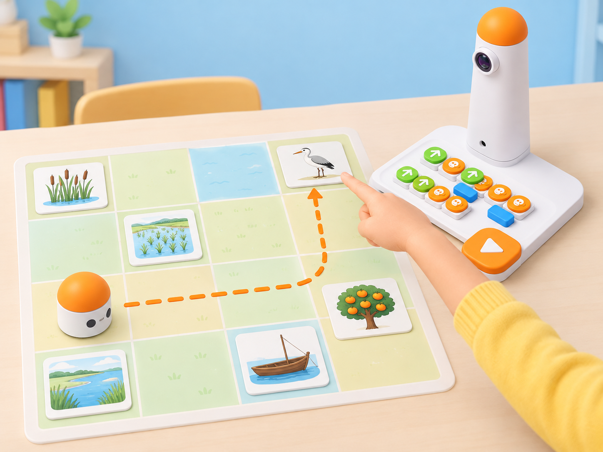

_Il·lustració IA pròpia basada en el Coding Set de la dotació. Les targetes són materials de paper i la persona tria i llig la imatge: MatataBot no reconeix dibuixos ni paraules._

## Situació, repte i intenció

Preparem un joc de vocabulari per a una visita imaginada a l’Albufera. En un mapa de quadrícula hi ha sis targetes amb il·lustracions: **boga, arrossar, llacuna, barca, ocell i taronger**. Una persona tria una targeta en secret i diu la paraula; una altra parella programa el MatataBot perquè arribe a la imatge corresponent. Si s’equivoca de casella, revisa la ruta i torna a provar. Quan arriba al lloc acordat, una persona retira manualment la targeta i es tria una paraula nova.

La situació adapta la targeta oficial **A-5 · MatataBot Learns Vocabulary** de les *Coding Activity Cards*: distribuir sis targetes de vocabulari aleatòriament, seleccionar un punt inicial, triar una imatge i programar MatataBot fins a la targeta corresponent; si la tria és correcta, es retira i es continua, i si no, es torna a programar. Ací les imatges, el vocabulari local, les regles de torn, la graella, les evidències i les il·lustracions són pròpies. L’alumnat interpreta la paraula i comprova la destinació: el robot només executa ordres de moviment.

**Pregunta guia:** quina informació compartim perquè una altra parella puga localitzar la imatge triada, i com sabem si el programa ha arribat a la casella correcta?

## Aprenentatges i vocabulari

- Relacionar una paraula oral o escrita amb una imatge seleccionada en un mapa.
- Planificar una ruta amb posició i orientació inicial conegudes.
- Llegir i executar blocs de moviment del Coding Set en l’ordre acordat.
- Comprovar l’arribada a una targeta amb evidència visual i revisar el programa si falla.
- Respectar torns i separar la decisió humana de la funció del robot.

**Vocabulari clau:** imatge, paraula, casella, destinació, inici, orientació, moviment, gir, seqüència, error, revisió.

## Materials i preparació

- Coding Set de la dotació: MatataBot, torre de control, tauler i blocs bàsics de moviment.
- Mapa de 4 × 4 caselles amb línies visibles; situeu sis targetes il·lustrades en caselles diferents i deixeu una casella buida per a l’inici. Useu la quadrícula física del kit si està disponible i comproveu-ne les dimensions.
- Sis targetes pròpies amb una imatge clara i el mot corresponent en lletra gran; prepareu també còpies només amb imatge per al joc de comprensió oral.
- Targetes de paraula extra per a ampliar el vocabulari, fitxa de MatataBot de paper i fletxes per a planificar la ruta sense activar el robot.
- Full de registre amb **paraula triada**, **casella objectiu**, **posició/orientació inicial**, **ruta prevista**, **resultat** i **revisió**.

Carregueu MatataBot i torre i proveu que la torre llig els blocs. Fixeu el mapa sobre una superfície plana; manteniu les targetes fora de les rodes i prou separades perquè es puga identificar clarament la casella d’arribada. Acordeu si el robot ha d’aturar-se a la casella o al seu costat, segons la mida real del mapa i del model. La persona conductora retira una targeta només quan el robot està completament aturat.

## Seqüència didàctica

### Sessió 1 · Coneixem les targetes i el mapa (45 min)

#### Fase 1 · Activem i prediem

Mostreu sis imatges sense llegir-ne els noms. En parelles, l’alumnat descriu què hi veu i quina paraula coneix. Presenteu el vocabulari local amb una definició breu i una font o imatge de context; no demaneu experiències personals ni confongueu una il·lustració de marjal amb una observació de fauna real.

#### Fase 2 · Explorem i construïm

Col·loqueu les sis targetes en caselles diferents, barregeu-les i fixeu un punt inicial per al robot. Una persona tria una paraula i la comunica sense assenyalar la targeta. La parella programadora localitza la imatge corresponent en el mapa abans de construir cap programa; així se separa la comprensió del vocabulari de la planificació del moviment.

#### Fase 3 · Expliquem i registrem

Dibuixeu la quadrícula i marqueu la posició inicial, l’orientació i la casella objectiu. Expliqueu en veu alta els canvis de direcció que caldran. La parella observadora comprova si la descripció de la paraula és prou clara per a distingir-la de les altres cinc imatges.

#### Fase 4 · Apliquem i millorem

Canvieu una targeta d’ubicació sense dir-ho a la parella programadora. Abans de moure el robot, aquesta parella ha de tornar a buscar la destinació a partir de la paraula triada. Si la interpretació de la imatge és ambigua, milloreu el dibuix, la definició o la llegenda; no corregiu una ambigüitat canviant el codi.

#### Fase 5 · Comprovem i reflexionem

**Evidència:** mapa amb sis targetes, ubicacions marcades i glossari il·lustrat propi. **Pregunta:** quina característica de la imatge ens ajuda a distingir la paraula triada de les altres?

### Sessió 2 · Programem i comprovem la destinació (45 min)

#### Fase 1 · Activem i prediem

Torneu a barrejar les targetes i trieu una casella inicial. La persona que selecciona la paraula la diu en veu alta; la parella que programa la repeteix i assenyala la imatge objectiu al mapa. Abans de preparar els blocs, prediu en quines caselles passarà el robot.

#### Fase 2 · Explorem i construïm

Traduïu la ruta a blocs tangibles. Recordeu que el bloc de gir canvia l’orientació al mateix lloc i que no equival a avançar lateralment. Una parella ordena els blocs; l’altra segueix la seqüència amb una fitxa de paper i comprova que acaba davant de la targeta triada.

#### Fase 3 · Expliquem i registrem

Anoteu la paraula, la targeta seleccionada, l’inici, l’orientació i la ruta prevista. Una persona llig el programa i una altra assenyala cada moviment sobre el mapa. Si la ruta travessa la casella d’una altra imatge, registreu-ho com a pas per una casella, no com a arribada a la seua destinació.

#### Fase 4 · Apliquem i millorem

Executeu el programa. Si MatataBot arriba a la casella objectiu, la persona conductora retira la targeta de manera manual i la parella guanya un torn de vocabulari. Si arriba a una altra casella, no retireu cap targeta: anoteu la primera diferència entre la ruta prevista i l’observada, esborreu o corregiu la seqüència segons el procediment del kit i torneu a programar.

#### Fase 5 · Comprovem i reflexionem

**Evidència:** seqüència provada i registre del resultat correcte o de la primera divergència. **Pregunta:** quina ordre ha fet que MatataBot s’allunyara de la targeta triada?

### Sessió 3 · Ampliem el joc i ensenyem a una altra parella (45 min)

#### Fase 1 · Activem i prediem

Afegiu dues paraules locals noves i les seues imatges. Cada equip tria una targeta i prepara una definició oral o escrita que permeta identificar-la sense dir-ne el nom. La parella visitant prediu quina informació li farà falta abans de buscar-la.

#### Fase 2 · Explorem i construïm

Reinicieu el joc amb sis targetes barrejades i una casella d’inici acordada. La persona emissora comunica una paraula o la definició; la parella receptora identifica la targeta, programa el robot i ressegueix la ruta sobre el mapa abans de prémer inici. Canvieu els rols després de cada torn.

#### Fase 3 · Expliquem i registrem

Registreu cada ronda com a **paraula comunicada**, **targeta identificada**, **ruta prevista**, **destinació observada** i **revisió**. Si la parella no interpreta una imatge igual que qui l’ha creada, anoteu què ha provocat la confusió i reviseu la targeta després de tancar el torn.

#### Fase 4 · Apliquem i millorem

La parella visitant completa una ronda amb les targetes revisades. Si falla la ruta, ha de reprogramar-la; si falla la interpretació de la paraula o la imatge, els equips milloren la definició i repeteixen el torn amb una altra targeta. No atribuïu cap encert o error al robot més enllà del recorregut que executa.

#### Fase 5 · Comprovem i reflexionem

**Evidència final:** glossari de sis o huit paraules, mapa, programes i registres de les rondes revisades. Tanqueu amb: «Hem sabut quina targeta era perquè…» i «MatataBot només ha pogut…».

## Evidències i avaluació

Recolliu el glossari il·lustrat, el mapa, una seqüència correcta i un exemple de revisió després d’una arribada incorrecta. Observeu si l’alumnat:

- identifica la imatge triada abans de programar;
- marca i manté la posició i orientació inicials;
- relaciona cada bloc amb un moviment observable;
- retira una targeta només després de comprovar la destinació;
- torna a programar si l’arribada no és correcta;
- diferencia comprensió de paraules, lectura del mapa i execució del robot.

No es puntua la rapidesa, la fluïdesa lectora, l’accent ni la quantitat de targetes encertades en un primer intent.

## Participació, accessibilitat i seguretat

Useu imatges nítides amb alt contrast, paraula escrita en lletra gran, descripció oral i símbol tàctil quan siga possible. Permeteu respondre assenyalant, dictant, amb pictogrames o llegint; no obligueu ningú a parlar en públic. Repartiu els rols d’emissor/a, planificador/a, programador/a i observador/a i feu-los rotar. Fixeu el mapa, manteniu les targetes fora de les rodes i no retireu cap peça fins que el robot estiga aturat. Les imatges representen vocabulari, no recomptes ni identificació automàtica de plantes, ocells o llocs.

## Referents i adaptació

- Matatalab, [*Coding Activity Cards*, targeta A-5 · *MatataBot Learns Vocabulary* (PDF oficial)](https://matatalab.com/cdn/ff/IhHZwon10hgweb9Aqf4zXOcRD2XjU0s9E0F2sWyqps4/1637739725/public/2021-11/Coding%20Activity%20Cards.pdf): proposa col·locar aleatòriament sis targetes de vocabulari al mapa, triar un inici, seleccionar una imatge i programar MatataBot fins a la targeta correcta; si encerta, es retira i es continua, i si no, es torna a programar. Aquesta és una de les targetes detallades en la mostra parcial del quadern de 40.
- Matatalab, [*Hello Matatalab Robots!*](https://matatalab.com/en/node/88): consulta per comprovar els blocs direccionals del Coding Set i la relació entre orientació del robot i moviment.

La proposta conserva la seqüència de localització i reprogramació de la targeta A-5, i la converteix en una activitat pròpia de vocabulari local amb torns, registre i accessibilitat multiformat. Les paraules i imatges són triades i interpretades per les persones; el MatataBot només executa la ruta programada.
