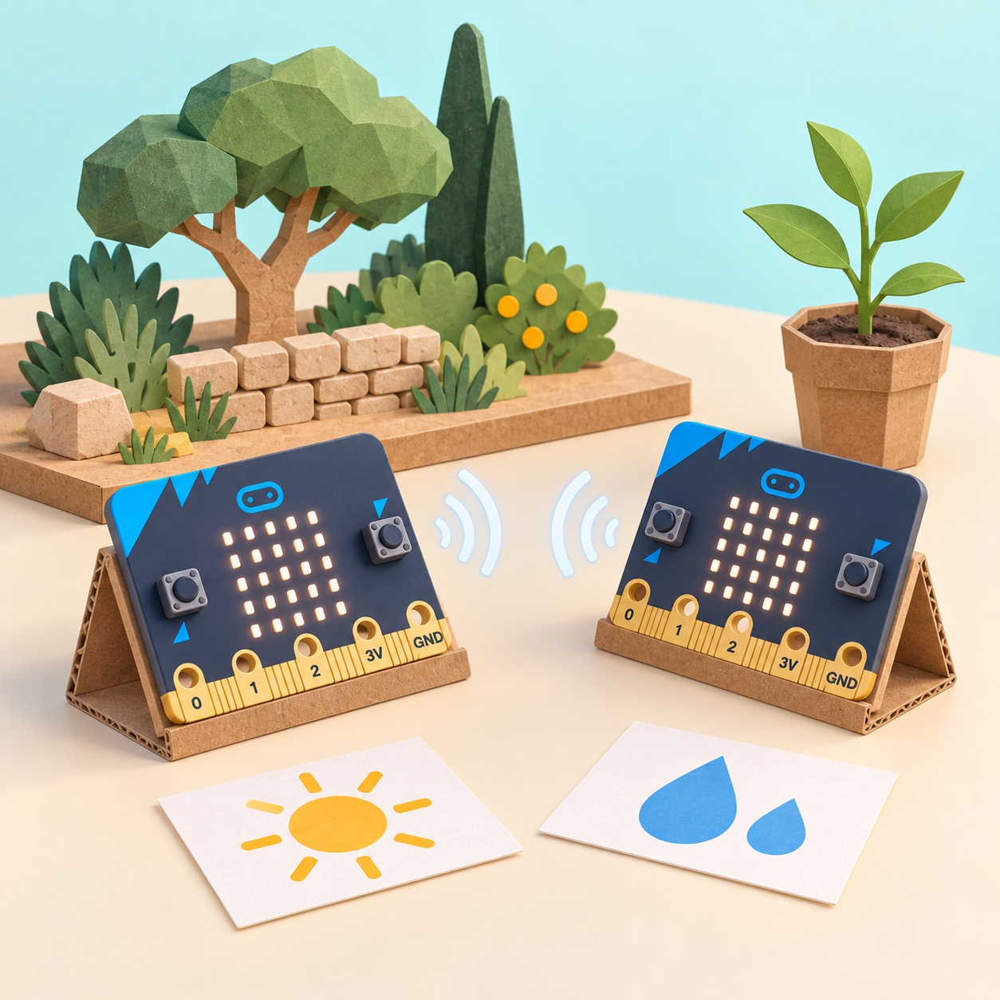
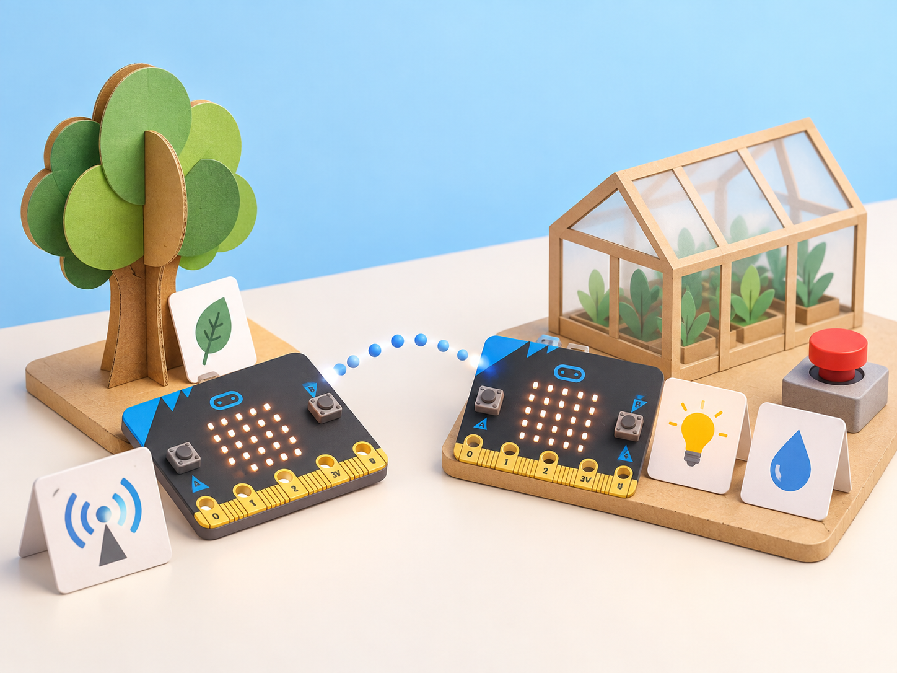

_Il·lustració IA pròpia basada en la placa micro:bit de la dotació. Les plantes i targetes són materials de maqueta; no hi ha cap sensor de sòl integrat, les plaques es mantenen seques i el muntatge no vigila boscos ni controla el reg real._

## 🌱 Situació i intenció

Una classe de tercer cicle investiga dues preguntes sobre un hort i un espai verd escolar: com podria un node avisar que cal revisar una zona de planter, i com podríem representar lectures de llum i humitat abans de decidir què fer? Els dos reptes oficials s’adapten en un prototip de comunicació i un de lectura/decisió. Les proves es fan amb maquetes i valors de laboratori: cap placa vigila un bosc, pren imatges, controla una bomba ni decideix el reg d’una planta real.

La fundació presenta les activitats per a 11–14 i 14–16 anys. Aquesta versió les escala a tercer cicle de primària: simplifica la instrumentació, modela els sensors externs i posa l’accent en el disseny, les dades, la ràdio i els límits. No es presenta com una equivalència d’edat ni com un sistema IoT desplegable.

## 🎯 Aprenentatges i vocabulari

- Convertir una necessitat de protecció o cultiu en criteris observables per a un prototip.
- Programar emissor i receptor de ràdio i comprovar recepció amb missatges ficticis i intents repetits.
- Comparar dues entrades independents —llum i humitat—, una regla per a cada eixida i una aturada manual del prototip.
- Interpretar lectures simulades o d’un sensor addicional només després de verificar el maquinari i el programa.
- Explicar que el prototip no vigila fauna, no controla un cultiu real i no ha d’exposar la placa a l’aigua o al sòl.

## 🧰 Preparació, materials i coneixements

Necessiteu una o preferiblement dues plaques micro:bit, MakeCode, ordinador o tauleta, cable USB, targetes de condició/missatge, full de dades i materials secs per a construir una maqueta. La ràdio i els botons són funcions integrades; en V1 i V2, la matriu LED també pot llegir el nivell de llum ambiental, encara que aquesta lectura depén de l’entorn i la mateixa matriu s’utilitza com a eixida. La micro:bit no té sensor d’humitat del sòl, relé ni connexió a internet integrats; per a fer la lectura amb maquinari real cal un sensor analògic i un circuit de baixa tensió compatible que el centre verifique. Si no es disposa d’aquests components, els botons A/B seleccionen valors simulats que s’identifiquen clarament com a dades de prova. No connecteu probes descobertes a terra humida ni cap càrrega a tensió de xarxa.

Abans de la sessió, proveu que les dues plaques comparteixen el mateix grup de ràdio i que poden enviar/rebre missatges; prepareu un receptor de reserva si la connexió falla. Definiu què compta com a “sec” només per a la simulació de classe. No traduïu el valor de maqueta a un llindar de reg real: els sensors, el sòl, l’espècie i l’entorn canvien la lectura.

## 📅 Seqüència didàctica · quatre sessions de 50 minuts

### **Sessió 1 · De la necessitat al criteri del protector d’arbres.**

#### Fase 1 · Activem i prediem

Llegiu una fitxa fictícia d’un viver o d’un arbre jove del pati i relacioneu-la amb la protecció de la biodiversitat i l’ODS 15.

#### Fase 2 · Explorem i construïm

En un diagrama IPO, escriviu l’entrada que inicia la prova (inclinació llegida per l’acceleròmetre o, si cal, botó de simulació), la decisió d’enviar un avís i les eixides possibles. El disseny oficial usa el sensor d’acceleració/caiguda lliure com a indici i adverteix que s’ha de provar el llindar; en aquesta aula no es deixa caure ni s’enganxa la placa a cap arbre. Afegiu una targeta de «passarel·la» entre el node local i un servei d’Internet per representar l’arquitectura IoT descrita per la font oficial. Aquesta passarel·la és un model de paper: la micro:bit només envia dades per ràdio a l’altra placa i no es connecta a Internet per si mateixa.

#### Fase 3 · Expliquem i registrem

Dibuixeu el node sensor, el missatge per ràdio, el node receptor i la persona responsable que interpreta l’avís; distingiu aquesta xarxa local de prova d’una instal·lació real amb passarel·la a internet.

#### Fase 4 · Apliquem i millorem

Acordeu cinc criteris mesurables: el node detecta una inclinació de prova o rep una entrada simulada; només envia el codi acordat amb l’identificador fictici de la maqueta; el receptor el mostra; un altre codi no es confon amb l’alerta; i el missatge no inclou coordenades ni dades personals. La font oficial modela l’entrada amb l’acceleròmetre i contempla coordenades GPS; ací l’etiqueta `HORT-01` representa una zona fictícia i no geolocalitza res.

#### Fase 5 · Comprovem i reflexionem

Anoteu una limitació o una situació en què l’avís podria ser fals. Evidència: diagrama, criteris i taula de casos previstos.

### **Sessió 2 · Construir i provar un avís de ràdio.**

#### Fase 1 · Activem i prediem

Trieu dos codis curts i inequívocs, com `REVISA` i `PROVA`, que no incloguen noms, coordenades ni informació sobre una persona. Abans d’enviar-los, cada equip escriu quin missatge espera veure al receptor i què hauria de passar si arriba un codi diferent. Llegiu les regles de ràdio acordades i comproveu que els dos dispositius comparteixen el mateix grup; amb una sola placa, feu la predicció amb targetes i marqueu-la com a simulació, no com a recepció provada.

#### Fase 2 · Explorem i construïm

En una placa, establiu grup de ràdio i envieu el missatge només quan es prema el botó seleccionat; afegiu una icona que indique que s’ha enviat. Incloeu un identificador fictici i no geolocalitzable, com `HORT-01`, perquè el receptor puga distingir quina maqueta ha generat l’avís. Aquest codi és una etiqueta de classe: la micro:bit no té GPS i no determina la ubicació d’un arbre.

#### Fase 3 · Expliquem i registrem

En l’altra placa, espereu el missatge i mostreu una icona o paraula curta quan arribe; no feu que el receptor active actuadors.

#### Fase 4 · Apliquem i millorem

Feu cinc intents a distància curta amb el mateix grup; registreu enviaments i recepcions. Repetiu amb un grup diferent per comprovar que no es barregen les proves. Després d’aquesta línia de base, trieu una millora de prototip —per exemple, que el receptor retorne `REBUT` o mostre una icona de confirmació— i repetiu els casos afectats per comprovar l’efecte. No cal allunyar plaques del docent ni provar cobertura fora de l’aula.

#### Fase 5 · Comprovem i reflexionem

Marqueu falsos avisos, missatges perduts i una millora. Amb una sola placa, una persona pot fer d’emissor i una altra de receptor amb targetes de paper, però aquesta alternativa no es compta com a transmissió de ràdio provada.

### **Sessió 3 · Llum, humitat i decisions de l’Auto-farmer.**

#### Fase 1 · Activem i prediem

Compareu dues entrades separades: llum ambiental (fosca/intermèdia/il·luminada) i humitat del sòl (seca/intermèdia/humida). Useu targetes o valors de prova per a cada variable; si es vol llegir el sensor de llum integrat, feu una comprovació inicial sense projectar llum sobre la matriu LED. Per a la humitat real cal un sensor extern: consulteu-ne les instruccions, calibreu-lo segons el centre i manteniu-lo separat de la placa.

#### Fase 2 · Explorem i construïm

Useu A/B per seleccionar una entrada cada vegada i anoteu si és simulada o mesurada. Per a la llum, proveu valors de l’escala de lectura que expose la versió de MakeCode del centre; per a la humitat, useu un conjunt de prova propi o l’entrada analògica d’un sensor extern calibrat. Mostreu l’entrada seleccionada amb un número o una barra LED i no compareu les escales entre si.

#### Fase 3 · Expliquem i registrem

Formuleu dues regles independents: «si la llum baixa del llindar de prova, representar l’eixida de llum» i «si la humitat baixa del llindar de prova, representar l’eixida de reg». Useu una icona o un missatge com a substitut del relé; no activeu cap llum ni bomba real.

#### Fase 4 · Apliquem i millorem

Per a cada variable, proveu un valor per davall, un d’igual i un per damunt del seu llindar; anoteu les dues eixides separadament. Això permet comprovar que una alerta de llum no activa per error la regla d’humitat.

#### Fase 5 · Comprovem i reflexionem

Distingiu lectura, interpretació i decisió humana. Evidència: pseudocodi, codi i taula valor/eixida.

### **Sessió 4 · Integrar els nodes i comunicar-ne els límits.**

#### Fase 1 · Activem i prediem

Representeu un planter de maqueta i decidiu quina placa fa de node de dades i quina rep el missatge.

#### Fase 2 · Explorem i construïm

Combineu les dues entrades simulades o externes amb les regles de llum i humitat; representeu els dos relés del repte oficial amb targetes o icones LED. Una eixida de maqueta no encén una làmpada ni activa el reg. Afegiu un interruptor d’aturada del prototip: mantindre premuts A+B activa un estat de parada que força les dues eixides a «OFF»; reinicieu el programa per a tornar a provar. Només si el centre té relés compatibles verificats es pot estudiar el circuit de baixa tensió segons les instruccions del fabricant; no són components integrats i no es connecten a bombes ni a la xarxa elèctrica.



_La passarel·la, les eixides, l’identificador i l’aturada són elements de maqueta o representació; les plaques no controlen relés ni identifiquen una ubicació real._

```text
aturada = fals  # en iniciar el programa
quan es premen A+B:
    aturada = cert
si aturada:
    llum = OFF
    reg = OFF
altrament:
    llum = ON si lectura_llum < llindar_llum_de_prova, si no OFF
    reg = ON si lectura_humitat < llindar_humitat_de_prova, si no OFF
    envia «HORT-01:REVISA» si cal revisió
```

_Pseudocodi propi per a la maqueta: «llum» i «reg» són eixides representades, no relés reals. En MakeCode, l’estat d’aturada es reinicia en iniciar el programa i A+B el manté actiu fins que es reinicia; la placa permet detectar la pulsació conjunta._

#### Fase 3 · Expliquem i registrem

Executeu una matriu de casos combinats: llum baixa/alta, humitat baixa/alta, una lectura exactament al llindar, grup de ràdio incorrecte, absència de missatge i aturada A+B. Comproveu que cada relé simulat respon només a la seua entrada i que, després de l’aturada, les dues eixides queden apagades. Compareu els criteris amb els resultats i registreu qualsevol fals positiu.

#### Fase 4 · Apliquem i millorem

Dibuixeu quin sensor compatible o relé de baixa tensió verificat caldria per avançar el prototip, quin risc o error s’hauria de resoldre i qui supervisaria una prova real. Trieu una millora addicional del node —confirmació de recepció, avís diferenciat o registre de dades— i repetiu els casos de prova corresponents; no activeu cap reg real.

#### Fase 5 · Comprovem i reflexionem

Presenteu diagrama, dades, prototip i límit principal a un altre equip, que deixa una pregunta. Evidència: sistema en maqueta, matriu de proves i revisió de disseny.

## 📋 Criteris d’èxit i avaluació

La proposta és satisfactòria quan l’equip (1) diferencia ràdio integrada, sensor extern, relé i passarel·la; (2) envia i rep un missatge que inclou un identificador fictici no geolocalitzable; (3) separa les lectures de llum i humitat i prova per a cadascuna els valors inferior, igual i superior al llindar; (4) mostra dues eixides simulades independents; (5) comprova que l’aturada A+B deixa totes dues eixides en «OFF»; (6) afegeix i prova una millora; i (7) explica què no permet concloure el prototip. Recolliu diagrama IPO/xarxa, fragments de codi o pseudocodi, taula dels intents, matriu d’entrada/eixida, proposta d’ampliació i reflexió. Valoreu exactitud del registre, depuració basada en evidència i justificació; no es puntua que el senyal arribe lluny ni que la maqueta regue.

## ♿ Accessibilitat, privacitat i seguretat

Oferiu missatges amb icones i paraules, opcions de resposta no oral, valors en targetes de mida gran i rols alterns de programació, observació, registre i explicació. Les transmissions són codis de laboratori, sense noms, ubicacions detallades ni dades personals. Manteniu plaques i circuits secs, useu només alimentació USB/baixa tensió dins les especificacions del fabricant i no connecteu bombes, relés de xarxa o vàlvules. Cap prototip s’instal·la en arbres, boscos, hivernacles ni espais públics.

## 🔗 Reptes oficials adaptats

[Tree protector](https://www.microbit.org/teach/lessons/helping-plants-grow-trees/) proposa usar la ràdio de micro:bit per enviar alertes des d’un sensor prototip i introduir com els nodes IoT es connecten mitjançant passarel·les; el repte destaca l’ODS 15, el producte que compleix criteris i una ampliació. La guia tècnica complementària del [sensor i l’acceleròmetre micro:bit](https://microbit.org/get-started/features/overview/) confirma les funcions integrades, mentre que l’etiqueta fictícia `HORT-01` substitueix les coordenades GPS del projecte font i no geolocalitza res. [Auto-farmer](https://microbit.org/teach/lessons/helping-plants-grow-auto-farmer/) proposa relés i sensors d’humitat casolans per detectar cultius secs, transmetre dades i estalviar aigua; la situació representa separadament llum, humitat, les dues eixides de relé i una aturada manual, sense activar actuadors. Una còpia consultable del [manual Arm School Program allotjada per Scoilnet](https://www.scoilnet.ie/uploads/resources/35898/35666.pdf) detalla el llindar de llum, els dos relés i el *kill switch*; els documents/ZIP enllaçats des de les pàgines micro:bit no s’han pogut llegir directament en aquesta sessió, així que no s’atribueixen preguntes o passos no verificats. Les pàgines oficials indiquen franges d’11–14 i 14–16 anys. El pla local per a primària és una adaptació simplificada pròpia.
