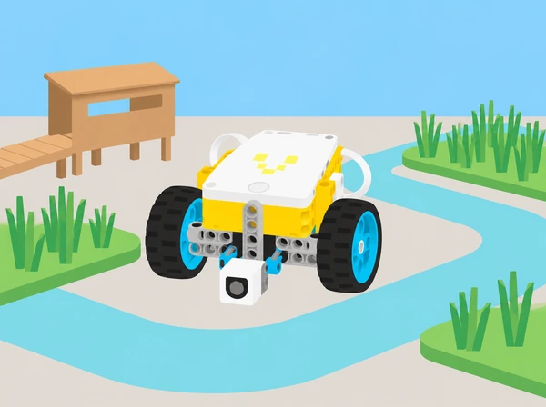
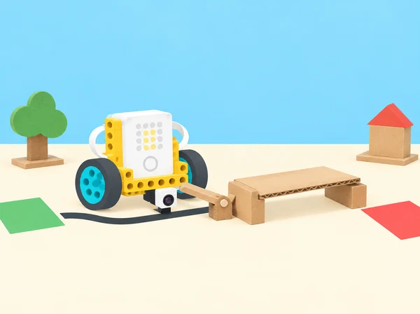
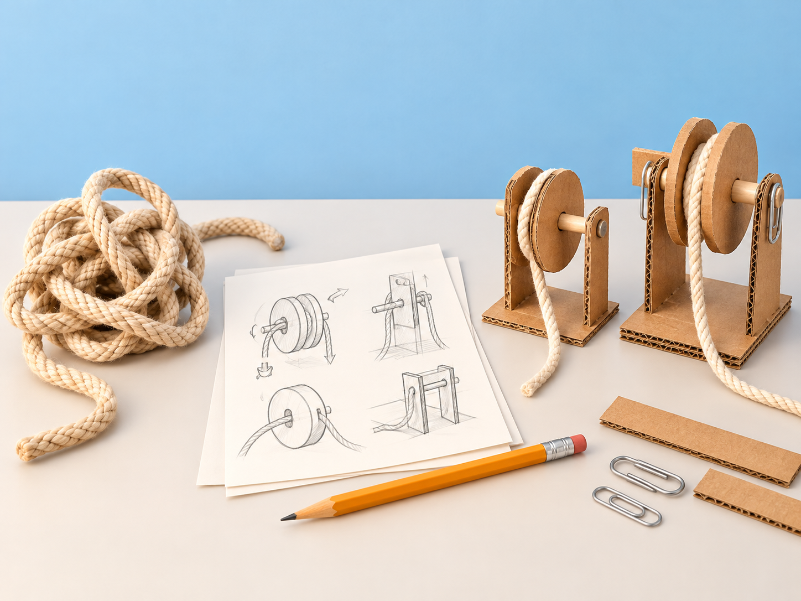

_El camp, les peces de missió i la puntuació són originals. La proposta treballa amb una maqueta escolar inspirada en la cura de l’Albufera._

## 🌱 Situació i intenció

La unitat oficial *Competition Ready* de LEGO Education introdueix la conducció autònoma, l’ús de sensors, la construcció en equip, els blocs reutilitzables i la resolució iterativa de missions. Aquesta adaptació conserva eixa progressió en un projecte de centre: una maqueta de l’Albufera on el robot transporta mostres fictícies, retira residus de maqueta i activa punts d’observació. No s’intervé en l’aiguamoll ni s’hi proven robots.

La seqüència oficial inclou en 2026–27 una missió guiada vinculada a FIRST LEGO League. La sessió 4 conserva l’estructura didàctica de preparar una ruta, alinear el robot, activar un model i valorar fiabilitat i estratègia, però usa un repte, un camp i models propis. No reprodueix ni representa la missió, el tapet o els materials oficials de la temporada.

## 🎯 Aprenentatges i vocabulari

- Construir i calibrar una base mòbil, i registrar com canvien la ruta i la precisió quan s’ajusta una variable.
- Integrar moviment, sensors de línia i mecanismes per resoldre missions de camp amb rols cooperatius.
- Comparar intents, localitzar una fallada i justificar la revisió amb dades de proves repetides.
- Comunicar què ha resolt el robot, quina decisió ha pres l’equip i quins límits conserva la maqueta ambiental.

## 📅 Seqüència didàctica · 12–15 sessions

### **S1 · Base i conducció precisa · [Training Camp 1: Driving Around](https://education.lego.com/en-us/lessons/prime-competition-ready/training-camp-1-driving-around/) (30–45 min).**

#### Fase 1 · Activem i prediem

**Pregunta:** com fem una base simple que avance, gire i es detinga de manera controlada? Predigueu què haurà de canviar per dibuixar un quadrat amb quatre girs.

#### Fase 2 · Explorem i construïm

En parelles, munteu una base de dos motors sense sensors i proveu els programes de mostra. Varieu distància, gir o velocitat d’una cosa cada vegada.

#### Fase 3 · Expliquem i registrem

Escriviu pseudocodi per al quadrat, mesureu la circumferència de la roda (π × diàmetre) i relacioneu-la amb la distància avançada. Registreu el recorregut en segons, graus i rotacions; el giroscopi és una ampliació opcional.

#### Fase 4 · Apliquem i millorem

Afegiu un recorregut entre obstacles grans. Feu tres passades amb paràmetres iguals i després canvieu un control; com a ampliació, recorreu dos metres i compareu també el sensor disponible.

#### Fase 5 · Comprovem i reflexionem

**Evidència:** diagrama, programa de moviment i taula d’error. Expliqueu quan convé cada control; el giroscopi i la base avançada no són requisits d’aquesta sessió.

### **S2 · Acostar-se, agafar i tornar · [Training Camp 2: Playing with Objects](https://education.lego.com/en-us/lessons/prime-competition-ready/training-camp-2-playing-with-objects/) (30–45 min).**

#### Fase 1 · Activem i prediem

**Pregunta:** com decideix el robot quan està prou prop d’un objecte? Predigueu quina lectura podria activar l’aturada i com sabreu que el cub ha sigut arreplegat.

#### Fase 2 · Explorem i construïm

Afegiu sensor de distància, braç lleuger, marcador i cub tou a la base. Compareu dos programes per parar davant del marcador; després programeu el braç perquè baixe, arreplegue el cub a almenys 30 cm i el retorne.

#### Fase 3 · Expliquem i registrem

Ajusteu l’alçada del braç perquè passe per damunt del cub sense interferir amb el sensor. Registreu tres intents i observeu com canvia la lectura en modificar el llindar.

#### Fase 4 · Apliquem i millorem

Feu un relleu: el robot porta un testimoni, una persona el retira i la base continua. Prioritzeu detecció fiable per damunt del temps; proveu comparacions > / < amb distància, llum reflectida o giroscopi només si estan disponibles.

#### Fase 5 · Comprovem i reflexionem

**Evidència:** esquema sensor–condició–motor i ajust justificat. Com a extensió, inventeu regles per al relleu, il·lustreu-les i convideu una altra parella.

### **S3 · Detectar i seguir línies del camp · [Training Camp 3: Reacting to Lines](https://education.lego.com/en-us/lessons/prime-competition-ready/training-camp-3-react-to-lines/) (30–45 min).**

#### Fase 1 · Activem i prediem

**Pregunta:** com pot el sensor fer autònoma una part del recorregut? Predigueu què passarà quan la base trobe una línia negra perpendicular.

#### Fase 2 · Explorem i construïm

Munteu el sensor de color i proveu una línia negra ampla sobre superfície clara. Programeu la base perquè avance i pare en detectar-la; després proveu una segona pila i descriviu la diferència.

#### Fase 3 · Expliquem i registrem

Observeu lectures en mode de color i d’intensitat reflectida sobre blanc i negre. Anoteu què llig el sensor i no confongueu el nom de color amb el valor reflectit.

#### Fase 4 · Apliquem i millorem

Per al seguiment continu, alterneu detecció de fosc i clar amb moviments ràpids. Proveu línies primes, angles rectes, cruïlles T, interrupcions i línies de color; canvieu llindar o velocitat d’un en un.

#### Fase 5 · Comprovem i reflexionem

**Evidència:** lectures, ruta anotada i explicació de la millora. L’extensió de S4 és comparar els modes de sensor; el color i la llum reflectida són lectures diferents.

### **S4 · Missió guiada: elevar el pont de mostreig · [The Guided Mission 2026–27](https://education.lego.com/en-us/lessons/prime-competition-ready/spike-prime-guided-mission-2627/) (90 min; versió breu 45 min).**

#### Fase 1 · Activem i prediem (10 min)

**Pregunta:** com equilibrem velocitat i precisió per a seguir una línia, accionar un mecanisme i acabar en una zona concreta? En un camp propi de la marjal, la base ix de l’àrea esquerra, passa al costat de dues estacions de cartó inactives, arriba al pont de mostreig i acaba a la zona dreta. Abans de construir, dibuixeu el recorregut, assenyaleu on caldrà alinear la base i definiu què vol dir «missió completada»: el pont articulat s’alça, la ruta no desplaça cap estació i el robot s’atura dins de la zona final.

#### Fase 2 · Explorem i construïm (25 min)

Munteu la base de conducció amb el sensor de color SPIKE Prime i reviseu-ne l’orientació i l’alçada respecte del camp. Feu una línia negra ampla sobre una pista clara i un model original amb una palanca de cartó articulada: una peça lleugera a la part frontal empeny la palanca perquè eleve el pont; no useu el model ni el tapet LEGO de la temporada. Proveu la palanca a mà i després amb el robot a potència baixa. Afegiu una zona d’eixida a cada costat i marqueu dos punts d’alineament propers al mecanisme. El pont ha de ser lleuger, estable i sense vores tallants.

_Il·lustració generada amb IA del prototip local; el muntatge és conceptual i no reprodueix cap model oficial de FIRST LEGO League._

#### Fase 3 · Expliquem i registrem (15 min)

Calibreu el sensor sobre la línia i el fons en el mode triat —color o intensitat de llum reflectida— i anoteu lectures repetides. Escriviu un programa propi: iniciar en la zona esquerra; seguir la línia amb girs curts a baixa potència; arribar al punt de contacte; empényer la palanca fins que el pont s’alce; continuar cap a la zona dreta i parar. Registreu la posició de partida, el llindar o color seleccionat, la velocitat, l’estat del pont i el lloc d’aturada. Si el sensor no discrimina amb estabilitat, useu una línia més ampla i torneu a mesurar abans de canviar el programa.

#### Fase 4 · Apliquem i millorem (30 min)

Feu quatre intents comparables: dos a baixa velocitat i dos a velocitat moderada, amb la mateixa col·locació inicial i el mateix camp. En cada prova, anoteu si segueix la línia, activa la palanca, passa al costat de les dues estacions sense tocar-les i arriba a la zona final; mesureu també la desviació lateral en acabar i, si és viable, el temps del mateix equip. Després canvieu una sola variable —alineament, llindar o velocitat— i repetiu dues vegades. Compareu la fiabilitat amb la rapidesa i justifiqueu quin ajust és més útil; el temps només compara les iteracions del mateix equip i no es publica ni s’utilitza per ordenar grups. Com a extensió, afegiu una segona parada pròpia després del pont i comproveu si la base pot completar les dues tasques en una mateixa ruta; o comenceu des de la zona dreta i redissenyeu el seguiment.

#### Fase 5 · Comprovem i reflexionem (10 min)

Cada membre explica una part de la missió mostrant el robot, el programa i les dades de prova. La graella docent observa quatre indicadors: seguir la línia amb un criteri mesurat; activar el pont; completar la ruta evitant les estacions; explicar una decisió de velocitat/alineament amb evidència. En l’autoavaluació individual, marqueu «hem completat una missió», «hem completat també una segona parada» o «totes les persones hem presentat programa i estratègia». Una altra parella dona un retorn constructiu amb una observació i una proposta comprovable per al següent intent. Com a extensió de llengua i orientació professional, l’equip explica quina estratègia ha reduït el temps del seu propi recorregut sense perdre precisió i relaciona el treball amb disseny d’enginyeria o programació; no es comparen ni publiquen temps entre equips.

**Evidència:** camp i palanca propis, programa anotat, taula dels sis intents (quatre inicials i dos després de revisar una variable), mesura de desviació, graella d’observació i explicació col·laborativa. La pàgina LEGO indica que la lliçó oficial prepara la Driving Base amb Color Sensor, configura un model de missió, activa el connector, practica l’eixida esquerra–arribada dreta, evita altres missions i conversa sobre la compensació entre rapidesa i precisió. Aquesta proposta adapta eixos d’aprenentatge semblants en un camp i un mecanisme locals, sense reproduir el tapet, el model ni la missió de FIRST LEGO League.

### **S5 · Una base modular construïda en equip · [Assembling an Advanced Driving Base](https://education.lego.com/en-us/lessons/prime-competition-ready/assembling-an-advanced-driving-base/) (90–120 min).**

#### Fase 1 · Activem i prediem

**Pregunta:** com unim mòduls individuals en una base robusta i fem visible la contribució de cadascú? Mireu una base de pràctica i identifiqueu quines característiques poden fer-la estable i fàcil de modificar. En un equip de quatre, repartiu les quatre instruccions de muntatge i prediu què caldrà comprovar en ajuntar les parts.

#### Fase 2 · Explorem i construïm

Cada persona construeix la part assignada en la seua instrucció; després, l’equip uneix les quatre parts, comprova les connexions de cables i els ordena perquè no freguen les rodes ni s’enganxen. La base avançada usa dos motors grans per a propulsió, dos motors mitjans per als útils i dos sensors de color, i requereix l’Expansion Set 45681 a més del 45678. Abans d’engegar, compareu les rodes amb la base de pràctica i reviseu que cada mòdul quede ferm.

#### Fase 3 · Expliquem i registrem

Executeu primer el programa inicial i després els altres programes d’exemple per observar com es mou la base. Registreu qui ha muntat cada part, quin port o cable connecta i una característica estructural que aporta al conjunt. Separeu els errors de muntatge dels errors del programa: abans de reprogramar, inspeccioneu la unió, el port i el recorregut del cable.

#### Fase 4 · Apliquem i millorem

Si no hi ha Expansion Set, feu els rols modulars sobre la base de dos motors i marqueu-la com a adaptació reduïda; no afirmeu que heu muntat la base avançada. Per adaptar la dificultat, treballeu les parts de les instruccions per parelles. Com a extensió, doneu a l’equip les instruccions d’un sol costat de l’eix i demaneu que complete l’altre per simetria; després, programeu una ruta entre obstacles grans sense colpejar-los. Cada membre ha d’explicar quina part ha construït i com contribueix a la base.

#### Fase 5 · Comprovem i reflexionem

**Evidència:** esquema de les quatre parts, registre de ports i gestió dels cables, prova del programa inicial i dels exemples, presentació on cadascú explica la seua contribució i una coavaluació amb observació i suggeriment concret. Autoavaluació individual: **blau**, he treballat amb l’equip per construir i unir la base; **groc**, també l’he provada; **violeta**, l’he presentada explicant la meua aportació. Connecteu el disseny amb ocupacions de muntatge mecànic, enginyeria o manteniment de transport. No anomeneu «base avançada» la versió reduïda.

### **S6 · El meu bloc, el nostre programa · [My Code, Our Program](https://education.lego.com/en-us/lessons/prime-competition-ready/my-code-our-program/) (90–120 min en la seqüència oficial; adaptar la durada al kit disponible).**

#### Fase 1 · Activem i prediem

**Pregunta:** com fem que totes les persones entenguen i reorganitzen el programa? Observeu una missió de maqueta i discutiu per què convé completar les tasques en un ordre acordat i tornar a una zona d’inici entre grups de missions. Predigueu quines instruccions es repetiran en una ruta quadrada, quines canvien per al cercle i el triangle, i com un bloc amb nom pot ajudar un altre membre de l’equip a entendre-les.

#### Fase 2 · Explorem i construïm

Amb la base avançada o la base de pràctica amb limitació escrita, construïu dos marcadors i proveu el programa *My Block* de mostra. Creeu un bloc propi per a una ruta quadrada i expliqueu què queda dins del bloc i què continua en el programa principal.

#### Fase 3 · Expliquem i registrem

Feu blocs separats per a cercle aproximat i triangle, decidiu la mida amb els marcadors i registreu quines ordres queden reutilitzades. Abans de programar cada figura, cada persona ha de poder predir quin bloc s’executarà i descriure què fa; així es comprova que el codi compartit és comprensible per tot l’equip.

#### Fase 4 · Apliquem i millorem

Intercanvieu programes amb una altra parella perquè els execute sense explicació oral. Reordeneu els blocs per a una missió diferent i compareu llegibilitat i facilitat de modificació. Com a ampliació matemàtica, mesureu la distància recorreguda en una rotació o un nombre de graus, calculeu la circumferència de la roda amb `π × diàmetre` i useu-la per estimar la distància; el giroscopi i un recorregut complex cronometrat són extensions opcionals, sense classificar equips.

#### Fase 5 · Comprovem i reflexionem

Cada persona presenta un programa i explica com un *My Block* ordena, simplifica o permet reordenar les instruccions. Autoavaluació individual: **blau**, he creat un *My Block*; **groc**, n’he creat dos o més; **violeta**, he preparat diversos programes i els he reordenat per canviar l’acció de la base. Una parella revisora dona una puntuació formativa i un comentari constructiu per a la pròxima prova. **Evidència:** blocs per a quadrat/cercle/triangle, registre de prova, programa reordenat i presentació individual de la contribució.

### **S7 · Dos útils i un programa amb arrays · [Time for an Upgrade](https://education.lego.com/en-us/lessons/prime-competition-ready/time-for-an-upgrade/) (90–120 min).**

#### Fase 1 · Activem i prediem

**Pregunta:** per què un robot de missió canvia d’útil i per què cal tornar els motors a una posició coneguda? Compareu la pala i el braç elevador segons precisió, força i disseny; predigueu quin convé per a cada una de quatre caixes lleugeres.

#### Fase 2 · Explorem i construïm

En la versió completa, munteu la pala i el braç elevador, fixeu-los amb els connectors rojos i connecteu-los a la base avançada; construïu quatre caixes lleugeres. Executeu el programa de prova i observeu que el braç s’alça. Abans de cada tasca, establiu com reinicialitzar la posició dels motors i comproveu que l’útil queda bloquejat i no interfereix amb el sensor.

#### Fase 3 · Expliquem i registrem

Descomponeu la tasca en acostar, elevar/baixar, empényer o alçar, alliberar i reiniciar; programeu ordres perquè cada útil puga pujar i baixar i compareu-les amb el comportament de mostra. Creeu dos arrays paral·lels: el primer guarda l’operació prevista per a cadascuna de les quatre caixes i el segon, el resultat observat. Compareu els elements del mateix índex i expliqueu què significa cada posició; si l’entorn disponible no ofereix arrays en blocs, feu aquesta part en Python o amb dues llistes de targetes i declareu la representació usada.

#### Fase 4 · Apliquem i millorem

Proveu els quatre casos i compareu precisió, força i encaix de cada útil. Canvieu una propietat cada vegada i repetiu les proves. Com a extensió, adapteu un útil per a una càrrega diferent o acosteu-vos a les caixes en angle amb un giroscopi disponible i una prova de posicionament. Sense Expansion Set, useu una base de dos motors i útils de cartó, i declareu el canvi: no replica la base motoritzada ni els seus resultats.

#### Fase 5 · Comprovem i reflexionem

Cada persona presenta com la base usa els útils i com la seua forma ajuda a completar la tasca. Autoavaluació individual: **blau**, he usat un array; **groc**, n’he creat un segon; **violeta**, he fet més d’una operació amb arrays. Una parella revisa el resultat i dona un comentari constructiu amb una prova següent. **Evidència:** diagrama dels dos útils, reinici verificat, arrays comentats, taula dels quatre índexs, resultats de les proves i presentació. L’abordatge en angle amb giroscopi és una ampliació opcional.

### **S8 · Repte de camp complet i cronometrat · [Mission Ready](https://education.lego.com/en-us/lessons/prime-competition-ready/mission-ready/) (120+ min, més d’una sessió).**

#### Fase 1 · Activem i prediem

**Pregunta:** podem combinar conducció, sensors, útils i blocs per completar una missió? Dissenyeu un camp escolar amb estació, ruta i marcadors propis; definiu fites i predigueu quines poden requerir més d’un intent.

#### Fase 2 · Explorem i construïm

Prepareu un mòdul de joc de cartó, un camí propi i dos marcadors de camp. Les cinc fites originals són: (1) empényer un actuador per alliberar el pas; (2) pressionar una palanca; (3) passar entre els marcadors sense tocar-los; (4) seguir la ruta i arreplegar quatre mostres fictícies de llavor; (5) deixar-ne almenys una en una zona segura, a 50 cm del model de niu. Useu pala i braç només amb el kit avançat; amb el set bàsic, simplifiqueu les accions i documenteu-ho.

#### Fase 3 · Expliquem i registrem

Escriviu pseudocodi abans de programar cada fita, reutilitzeu *My Blocks* i poseu noms clars a variables i blocs. L’equip guanya una marca per cada fita completada, una marca addicional si arreplega les quatre mostres, i en guanya una altra per al lliurament segur de 50 cm. Prepareu fins a sis fitxes d’incidència: cada contacte amb un marcador o cada vegada que una persona alça/recol·loca el robot consumeix una fitxa i obliga a registrar la causa abans de reprendre. Les fitxes no resten punts ni serveixen per comparar equips; el criteri és revisar el programa i completar amb seguretat. Les mostres són peces fictícies i no impliquen animals.

#### Fase 4 · Apliquem i millorem

Feu intents sense cronòmetre fins que el programa siga estable; després, si l’equip vol, mesureu el seu propi temps en una execució final. Registreu les fites completades, les fitxes d’incidència consumides, el temps propi i les fallades; canvieu una sola cosa i repetiu almenys la prova que havia fallat. El temps s’usa per explicar l’estratègia de l’equip, mai per fer una classificació.

#### Fase 5 · Comprovem i reflexionem

Cada membre presenta una part del robot, del programa o de l’estratègia. Autoavaluació individual: **blau**, he completat almenys una fita; **groc**, l’equip ha completat les cinc; **violeta**, totes les persones han presentat robot, programa i estratègia. Una altra parella dona retorn constructiu amb una observació i una millora comprovable. Com a extensió de llengua i orientació professional, prepareu una presentació de l’estratègia més eficient i relacioneu el disseny amb enginyeria o emprenedoria. **Evidència:** mapa i regles originals, pseudocodi, programa comentat, registre de les cinc fites, incidències, repetició d’una fallada i presentació amb contribucions individuals. La seqüència adapta els tipus de missió i el procés de planificació de la lliçó, però el camp, els objectes, les fitxes i les regles són propis; no copieu els models ni el camp oficials.

### **S9 · Taller desconnectat de resolució creativa · [Mission Training: Creative Problem-Solving](https://education.lego.com/en-us/lessons/prime-competition-ready/mission-training-creative-problem-solving/) (45 min, híbrida).**

La sessió trasllada al context de l’Albufera el procés de disseny d’enginyeria de la lliçó: definir criteris, idear, fer i provar un prototip, iterar i comunicar què s’ha descobert. **No calen el set SPIKE Prime, peces LEGO ni programari.** Es treballa amb materials reutilitzats i una solució manipulable de baixa complexitat; cap repte requereix construir un robot.

#### Fase 1 · Activem i prediem

Reserveu 10 minuts. Mostreu la imatge del nus que cal desfer i doneu temps perquè tothom pense abans de parlar. Acordeu una definició compartida de *resoldre creativament* i demaneu que el grup identifique el problema, propose almenys dues maneres d’abordar-lo, trie què provaria primer i anticipe què canviaria si no funciona. Tanqueu amb una definició breu d’**iteració**: repetir un procés per acostar-se al resultat desitjat, avaluant i revisant la solució quan cal.

#### Fase 2 · Explorem i construïm

Reserveu 15 minuts. Cada alumne o equip tria **un** repte i escriu primer què ha de passar perquè la solució siga vàlida. Les quatre opcions inspirades en la lliçó són: **A)** portar una mostra fictícia fins a una persona o punt de recepció; **B)** activar un dispositiu de maqueta prement-lo; **C)** rescatar una llavor de paper d’una zona delimitada, empenyent-la, estirant-la o subjectant-la; **D)** voltejar una fitxa plana, que representa una targeta de mostreig. Són tasques de manipulació sobre una taula; no s’usen líquids, animals ni objectes fràgils.

Seguiu en equip aquests cinc moviments, deixant una traça en el quadern:

1. **Identifiquem:** triem el repte i formulem el resultat observable.
2. **Ideem:** dibuixem dues solucions possibles amb els materials disponibles i n’escollim una segons els criteris acordats.
3. **Creem:** fem un primer prototip amb cartó, paper, cordill o altres materials reutilitzats.
4. **Iterem:** provem-lo, anotem què ha passat i canviem una característica; tornem a provar-lo.
5. **Comuniquem:** expliquem què ha funcionat, què hem descobert i com la prova ha guiat la millora.

El prototip no ha de funcionar a la primera. Si l’alumnat és a casa, pot treballar sobre una superfície plana i neta amb el material que tinga; si no disposa de materials, pot fer el disseny i la iteració amb dibuixos seqüenciats.

#### Fase 3 · Expliquem i registrem

Reserveu 10 minuts. Feu una ronda breu de comunicació: cada equip explica com va planificar la solució i quins criteris va definir, mostra la idea creativa, relata una descoberta feta durant les proves i identifica una millora concreta del prototip. Demaneu exemples observables —«la fitxa va caure quan…», «hem canviat l’angle i ara…»— en compte d’afirmacions generals. La resta escolta i formula una pregunta respectuosa; el retorn ha d’ajudar a comprendre el procés, no a jutjar qui ha acabat abans.

#### Fase 4 · Apliquem i millorem

Reserveu 5 minuts. Cada equip documenta el procés amb un pòster, una pàgina del quadern o un vídeo breu: problema i criteris, esbós inicial, prototip, resultat de la prova i canvi introduït. Feu una galeria de treballs. En modalitat presencial es poden visitar les taules; en línia, mostrar el prototip en una reunió o compartir-ne una fotografia; en modalitat asíncrona, publicar el dibuix, l’explicació escrita o una gravació curta perquè els companys la puguen comentar.

#### Fase 5 · Comprovem i reflexionem

Reserveu 5 minuts. Cada alumne comparteix una iteració o una solució creativa descoberta i s’autoavalua: **una mà** si encara necessita ajuda per explicar estratègies i iteracions; **dues mans** si ja les pot descriure; **mans enlaire** si pot ensenyar a una altra persona com descriure-les. Accepteu com a resposta una explicació oral, escrita, dibuixada o gravada.

**Evidències:** criteris de disseny, dues idees inicials, esbós, prototip, registre de prova i millora, explicació del descobriment i autoavaluació individual. La temporització suma 45 minuts (10 + 15 + 10 + 5 + 5); la fase de construcció pot continuar en una altra sessió sense canviar els criteris. Adaptació pròpia de la lliçó híbrida: es mantenen el cicle de disseny, els quatre tipus de repte, la prova iterativa, la comunicació, la documentació i l’autoavaluació; el context, els objectes, les instruccions i la imatge són originals.

## 🧰 Materials i preparació

Per a les sessions amb robot: set SPIKE Prime 45678, base de conducció, sensor de distància i sensor de color, cinta negra, cartó, retoladors, mostres grans i lleugeres i cinta per al camp. La base avançada oficial consta de dos motors grans per a la propulsió, dos motors mitjans per als útils i dos sensors de color; necessita l’Expansion Set 45681 a més del set 45678. Les sessions 5–8 indiquen aquesta dependència i no afirmen que la base de dos motors siga equivalent. Sense l’expansió, es pot seguir l’objectiu didàctic amb un únic motor mitjà del set base i útils alternats/passius; anoteu aquesta reducció. La sessió 9 només necessita paper, llapis i cartó.

Prepareu el camp sobre taules o al terra, amb carrils prou amples, objectes grans i zones de mans fora del moviment. La referència a l’Albufera és una contextualització educativa: useu dades i mostres fictícies i no feu proves ni recollides al medi natural.

## 🎯 Evidències i avaluació

Recolliu pseudocodi, taules de calibratge, lectures del sensor, mapa de missió, esquemes de construcció, blocs propis, comparació d’accessoris, dades de fiabilitat i prototip desconnectat. Valoreu si l’equip pot predir i explicar el comportament, aïllar una variable, justificar una revisió amb dades, documentar el codi i repartir les decisions. Una missió fallida aporta evidència útil quan queda registrada i ajuda a formular la prova següent; els punts i el temps no són l’únic criteri.

## ♿ Participació i inclusió

Abans del robot es pot resoldre cada ruta amb una maqueta i targetes de moviment. Oferiu rols rotatius de construcció, programació, pilotatge de proves i registre; faciliteu instruccions visuals, carrils d’alt contrast, marques tàctils fora de la trajectòria i temps addicional per documentar. Les missions no depenen de velocitat manual: una persona pot dictar o validar el codi mentre una altra manipula el robot. El repte desconnectat és una sessió completa, no un premi de consol ni un requisit per accedir a la resta.

## 🔗 Correspondència amb la unitat oficial

La seqüència adapta les nou lliçons de [Competition Ready · SPIKE Prime](https://education.lego.com/en-us/lessons/prime-competition-ready/): [Driving Around](https://education.lego.com/en-us/lessons/prime-competition-ready/training-camp-1-driving-around/), [Playing with Objects](https://education.lego.com/en-us/lessons/prime-competition-ready/training-camp-2-playing-with-objects/), [Reacting to Lines](https://education.lego.com/en-us/lessons/prime-competition-ready/training-camp-3-react-to-lines/), [The Guided Mission 2026–27](https://education.lego.com/en-us/lessons/prime-competition-ready/spike-prime-guided-mission-2627/), [Assembling an Advanced Driving Base](https://education.lego.com/en-us/lessons/prime-competition-ready/assembling-an-advanced-driving-base/), [My Code, Our Program](https://education.lego.com/en-us/lessons/prime-competition-ready/my-code-our-program/), [Time for an Upgrade](https://education.lego.com/en-us/lessons/prime-competition-ready/time-for-an-upgrade/), [Mission Ready](https://education.lego.com/en-us/lessons/prime-competition-ready/mission-ready/) i la lliçó híbrida [Mission Training](https://education.lego.com/en-us/lessons/prime-competition-ready/mission-training-creative-problem-solving/). El catàleg indica durades d’entre 30 i 120+ minuts; per això les activitats de construcció, projecte i missió s’estenen en més d’una classe. Els textos, el context, les missions, el camp, les regles i els materials visuals són propis. Les especificacions de components es basen en la pàgina oficial de [maquinari SPIKE Prime](https://education.lego.com/en-us/teacher-resources/lego-education-spike-prime/support-technical-info/lego-education-spike-prime-support-technical-info-product-info/); comproveu sempre la dotació física del centre.
