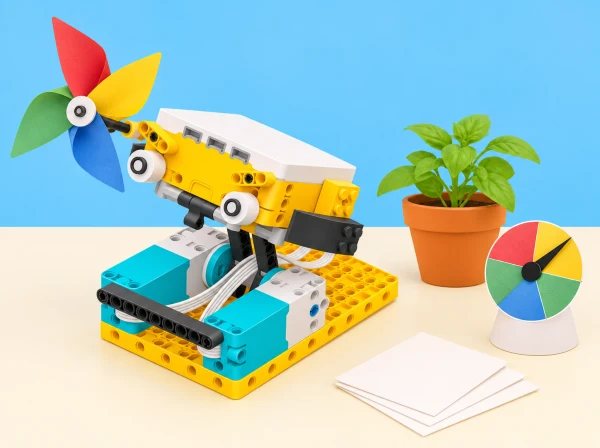
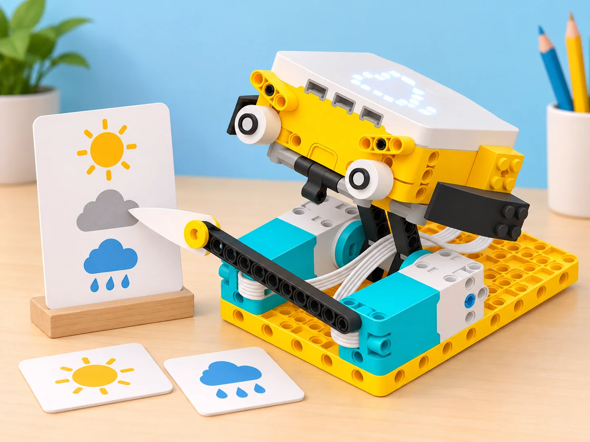
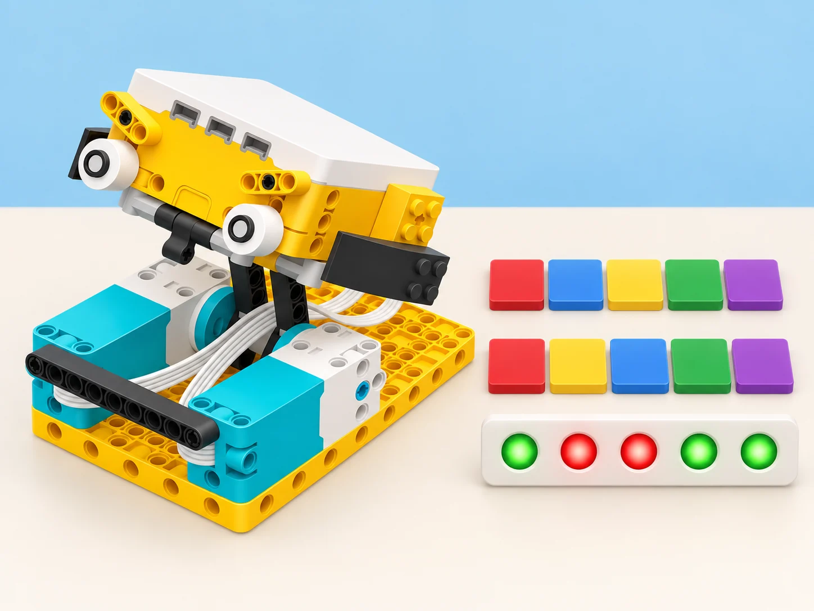

_Les dades de les targetes són registres de prova: qualsevol decisió sobre l’hort correspon al grup i al centre._

## 🌱 Situació i intenció

Adaptació de la unitat *Life Hacks* per al context d’un centre educatiu valencià. Cada sessió conserva l’objectiu oficial i el tradueix en un repte, materials i criteris propis; quan una activitat del pla és híbrida o no requereix el hub, s’indica expressament en la sessió.

## 🎯 Aprenentatges i vocabulari

- Identificar variables i distingir observacions de valors simulats o inferències.
- Planificar una recollida de dades comparable i repetir mesures mantenint constants les condicions acordades.
- Usar dades i condicions en un programa per respondre a una necessitat fictícia del festival.
- Argumentar una decisió amb gràfics i declarar la incertesa i els límits de la mostra.

## 📅 Seqüència didàctica · 8 lliçons / 10–12 sessions

La classe prepara una mostra interactiva per al pati i l’hort escolar. Cada equip passa d’una observació o necessitat a una prova amb dades, i diferencia sempre una previsió, una mesura del model i una decisió de les persones responsables. El programa no recull dades de salut ni puntua alumnes; cap control automàtic rega o modifica un espai real.

### **S1 · Un mecanisme que balla amb llum i ritme ([Break Dance](https://education.lego.com/en-us/lessons/prime-life-hacks/break-dance/), 45 min).**

#### Fase 1 · Activem i prediem

Dediqueu cinc minuts a parlar de per què convé fer pauses de moviment quan passem molta estona asseguts i de quins senyals ens les poden recordar. El recordatori és una invitació voluntària, mai una ordre ni una avaluació de la salut o l’activitat física de ningú. Predigueu com es poden sincronitzar les cames del ballarí i els píxels de la matriu del hub.

#### Fase 2 · Explorem i construïm

Durant vint minuts, construïu el ballarí en parelles amb rols de muntatge superior i inferior perquè totes dues persones participen. Executeu el programa inicial i ajusteu el moviment de les cames perquè coincidisca amb el parpelleig de la matriu. Canvieu un paràmetre cada vegada i registreu quina combinació funciona millor. No cal que l’alumnat balle: es pot centrar en el model i observar-ne la seqüència.

#### Fase 3 · Expliquem i registrem

En cinc minuts, converseu sobre què vol dir sincronitzar i afegiu moviment als braços. Compareu les cames i els braços amb els píxels de la matriu: anoteu el desfasament observat i un ajust proposat. Distingiu el temps en segons, la velocitat del motor i els graus o les rotacions; no són unitats intercanviables.

#### Fase 4 · Apliquem i millorem

Durant quinze minuts, afegiu sons o notes que encaixen amb els moviments i proveu quants elements podeu sincronitzar sense perdre el ritme. Després, programeu —si el grup ho tria— un senyal a intervals regulars, per exemple cada 30 segons, com a recordatori per a qui vulga alçar-se o moure’s; ningú no ha de seguir-lo. Com a ampliació, coordineu dues figures com una mostra del pati o, si el kit està complet i disponible, afegiu un tercer motor i el sensor d’ultrasons per a sincronitzar un altre element i la llum del sensor. Deixeu temps per a recollir.

#### Fase 5 · Comprovem i reflexionem

La rúbrica docent observa si l’alumnat comprén ritme, temps i sincronització, observa el ballarí amb precisió i corregeix el programa amb eficàcia. Autoavaluació individual: **blau**, les cames se sincronitzen amb la llum; **groc**, també hi ha braços sincronitzats; **violeta**, el ballarí es mou a intervals regulars amb ritmes sonors coordinats. Una altra parella dona feedback constructiu. **Evidència:** diagrama temporal, valors de motor (segons, velocitat, graus o rotacions), programa i explicació d’una correcció. Com a extensió, exploreu fraccions de compàs o polirítmies com 2/4 amb 3/8; no són necessàries per assolir l’objectiu bàsic. La música, les notes i el moviment corporal de l’alumnat són opcionals.

### **S2 · Repeticions i variables que expliquen el programa ([Repeat 5 Times](https://education.lego.com/en-us/lessons/prime-life-hacks/repeat-5-times/), 45 min).**

#### Fase 1 · Activem i prediem

Dediqueu cinc minuts a parlar de situacions quotidianes en què comptem esdeveniments. Presenteu el repte: programar un mecanisme per a la mostra del pati que repetisca un moviment de bandera cinc vegades i puga informar de quantes n’ha fet. Representeu una variable amb un pot i fitxes: què guarda, quan canvia i quin valor esperem al final? La variable descriu el programa, no el cos ni l’activitat de l’alumnat.

#### Fase 2 · Explorem i construïm

En quinze minuts, construïu en parelles una figura mecànica amb SPIKE Prime que puga alçar o girar una bandera de paper. Comproveu que els motors estan alineats i executeu el programa base perquè el mecanisme funcione abans d’afegir el recompte. Utilitzeu un bloc de repetició per a fer cinc moviments; no cal que l’alumnat faça cap exercici físic.

#### Fase 3 · Expliquem i registrem

En deu minuts, creeu una variable numèrica amb un nom clar, com ara `moviments`, que comence en 0 i augmente en 1 cada vegada que el mecanisme complete un moviment. Executeu el programa i comproveu que, després de cinc repeticions, la variable mostra 5. Expliqueu què representa i en quin punt del programa s’actualitza; distingiu la quantitat de moviments del temps que el motor ha estat actiu.

#### Fase 4 · Apliquem i millorem

Dins dels quinze minuts d’elaboració —que inclouen el tancament i l’autoavaluació—, afegiu una segona variable per a calcular **punts de moviment simulats** amb una regla inventada i visible, per exemple dos punts per cada moviment completat: `punts = moviments × 2`. Modifiqueu el nombre de repeticions, executeu el programa i registreu nombre de moviments i punts en una taula; representeu després la relació en un gràfic senzill. Els punts són una convenció de l’activitat, no calories, despesa energètica ni una mesura de l’esforç humà. Per a ampliar, alterneu dos moviments lents i tres ràpids, useu comptadors separats i mostreu els valors finals. Per a donar suport, torneu al pot i les fitxes o compteu cada repetició amb marques en paper.

#### Fase 5 · Comprovem i reflexionem

En els últims cinc minuts d’elaboració, observeu si l’alumnat descriu correctament una variable, la crea i l’actualitza, i la fa servir per a comptar un valor del programa. Autoavaluació individual: **blau**, he creat una variable que compta els moviments; **groc**, he afegit una segona variable de punts simulats; **violeta**, he modificat el programa per a comptar ritmes o seqüències diferents. Una altra parella dona feedback concret sobre el nom de les variables o el lloc on s’actualitzen. **Evidència:** pseudocodi, variables ben anomenades, recompte final de cinc moviments, operació de la segona variable, taula i gràfic. No es calculen calories, no s’arrepleguen dades corporals i els punts no s’interpreten com una mesura fisiològica.

### **S3 · Pronòstic qualitatiu per al pati ([Rain or Shine?](https://education.lego.com/en-us/lessons/prime-life-hacks/rain-or-shine/), 45 min).**

#### Fase 1 · Activem i prediem

Dediqueu cinc minuts a parlar de previsions meteorològiques i dades al núvol: d’on venen i com poden controlar una eixida del programa? Predigueu com podria mostrar la maqueta un dia de pluja o de sol. La proposta treballa amb ciutats públiques, mai amb ubicacions personals.

#### Fase 2 · Explorem i construïm

Durant 25 minuts, construïu en parelles el *weathercaster* i comproveu que els motors queden a la posició zero quan els braços estan abaixats. Amb connexió a internet, introduïu una ciutat pública i executeu el programa per observar les dades meteorològiques del bloc de l’app SPIKE. Afegiu una condició `IF/ELSE` perquè el model mostre si la previsió indica pluja. Els blocs meteorològics consulten previsions al núvol i només funcionen en línia; no llegeixen la pluja ni la nuvolositat del pati.



_Il·lustració pròpia del prototip indicador: la previsió ve del bloc meteorològic de l’app per internet; el model no incorpora cap sensor atmosfèric ni pronostica el temps per si mateix._

#### Fase 3 · Expliquem i registrem

En cinc minuts, converseu sobre com una dada del núvol pot controlar una eixida i què podria passar si canvieu de ciutat o país. Amplieu el programa perquè represente, si l’app les ofereix, categories com «parcialment ennuvolat», «ennuvolat», «pluja», «neu» o «boira». Feu que el motor, la matriu o un altre indicador mostre la categoria. Anoteu l’hora de consulta, la ciutat, la categoria retornada i la decisió del programa; les dades són previsions, no observacions actuals.

#### Fase 4 · Apliquem i millorem

Durant deu minuts, registreu en una taula la previsió per a almenys dues ciutats i les hores seleccionades dins de les pròximes cinc hores. Compareu-la amb les condicions observades cinc hores després, en la sessió següent o amb dades observades datades preparades prèviament; registreu font i hora i no presenteu la captura arxivada com una consulta en viu. Si es fa la comparació amb una mostra, calculeu el percentatge de coincidències només d’eixa mostra i no com una mesura universal de precisió del servei. Si el centre no té connexió, executeu la versió amb dades guardades com a simulació desconnectada: els blocs meteorològics no funcionen fora de línia. Deixeu temps per a recollir.

#### Fase 5 · Comprovem i reflexionem

Autoavaluació individual: **blau**, he programat la previsió d’una ciutat; **groc**, he comparat dues ciutats amb dades registrades; **violeta**, he justificat quin dels dos llocs triaria per a una activitat exterior del centre i he explicat els límits de la mostra. Una altra parella revisa si la condició correspon a la categoria registrada i si la taula separa previsió d’observació. **Evidència:** programa condicional, configuració de motors a zero, taula de dues ubicacions amb hora, font, previsió i observació posterior. Parleu de dades al núvol, connexió, latència i diferència entre previsió i realitat; cap resultat d’una sola sessió garanteix què passarà ni s’ha d’usar per a decisions de seguretat.

### **S4 · Un indicador de vent i escala de Beaufort ([Wind Speed](https://education.lego.com/en-us/lessons/prime-life-hacks/wind-speed/), 45–60 min).**

#### Fase 1 · Activem i prediem

Trieu una ciutat pública i predigueu la classificació del valor de vent consultat. Distingiu la calma (0–<0,5 m/s, força 0) dels quatre colors: blau 0,5–<5,5; verd 5,5–<13,8; groc 13,8–<24,4; roig ≥24,4 m/s. Els colors agrupen forces segons el resum de LEGO; la força 12 no té límit superior.

#### Fase 2 · Explorem i construïm

Construïu un indicador mecànic amb motor i una agulla sobre quatre zones pròpies, més una marca diferenciada per a la calma. Llegiu el valor quantitatiu que retorna el bloc meteorològic i programeu condicions IF/ELSE per als intervals anteriors. Valideu valors de frontera i rebutgeu entrades negatives, absents o no numèriques; una velocitat superior a 32,7 m/s continua en la banda roja.

#### Fase 3 · Expliquem i registrem

Feu visible la classificació amb el marcador i representeu la direcció amb fletxes a la matriu de llum. Compareu tres localitats públiques —per exemple, València, una població de l’interior i una de costa— i registreu velocitat, direcció, categoria i font.

#### Fase 4 · Apliquem i millorem

Proveu 0; 0,49; 0,5; 5,49; 5,5; 13,79; 13,8; 24,39; 24,4; 32,7 i 32,71 m/s, a més d’una entrada invàlida, i reviseu que cada dada vàlida tinga una sola classificació. Com a extensió, redissenyeu el marcador perquè es recalibre amb una escala diferent; sense xarxa, treballeu amb dades d’exemple datades.

#### Fase 5 · Comprovem i reflexionem

**Evidència:** programa, taula de velocitat/direcció/categoria i nota que identifica les dades com a previsió d’una font en línia. L’indicador mecànic és una visualització, no un anemòmetre real.

### **S5 · Quanta pluja podria rebre l’hort? ([Veggie Love](https://education.lego.com/en-us/lessons/prime-life-hacks/veggie-love/), 45–60 min).**

#### Fase 1 · Activem i prediem

Predigueu com es pot representar en una escala la precipitació acumulada prevista per a la pròxima setmana i quines unitats necessitarà el marcador.

#### Fase 2 · Explorem i construïm

Muntem un «pluviòmetre de paper» accionat per motor. Consulteu els blocs meteorològics per a una ciutat i transformeu el valor previst en una posició de l’agulla.

#### Fase 3 · Expliquem i registrem

Comproveu si el marcador correspon a les unitats i rang definits. Registreu la taula de conversió i contrasteu-la amb una targeta de necessitats d’aigua de tomaca i una altra hortalissa, citant la font o marcant el valor com a simulat.

#### Fase 4 · Apliquem i millorem

Proveu una escala de temperatura i expliqueu per què cal recalibrar-la. La maqueta pot mostrar «revisar el reg» com a pregunta: no activa una vàlvula ni determina la necessitat d’una planta real només amb la pluja prevista. Sense connexió, useu una previsió guardada i datada.

#### Fase 5 · Comprovem i reflexionem

**Evidència:** taula de conversió, dues calibracions i justificació de què permet concloure la previsió i què no.

### **S6 · Un joc de memòria amb dues llistes ([Brain Game](https://education.lego.com/en-us/lessons/prime-life-hacks/brain-game/), 45–90 min).**

#### Fase 1 · Activem i prediem

Presenteu un repte de memòria cooperatiu: dues persones llegiran seqüències de peces de colors i el robot indicarà en quines posicions coincideixen. Abans de construir, ordeneu tres targetes i predigueu què passa si es canvia de lloc una sola peça. Expliqueu que l’activitat practica patrons i dades; no diagnostica ni entrena cap capacitat cognitiva o de salut.

#### Fase 2 · Explorem i construïm

Durant 15 minuts, munteu en parella el cap i el cos del model *Game Master*, repartint tasques perquè totes dues persones participen. Comproveu que el sensor de color queda alineat amb la peça abans de programar. La primera persona passa una tira de cinc peces i el programa registra, en ordre, les lectures en `llista_1`; la segona passa la seua tira i ompli `llista_2`. Comenceu amb tres peces si cal i augmenteu a cinc quan les lectures siguen repetibles. Si una peça no es reconeix amb prou estabilitat, repetiu la lectura o useu una seqüència de targetes identificada com a simulació.



_Les seqüències són dades de prova pròpies; la fila d’indicadors il·lustra la comparació per posició, no una peça física del robot._

#### Fase 3 · Expliquem i registrem

En els 10 minuts d’explicació, programeu la lectura de cada seqüència en una llista i compareu els valors pel mateix índex. En cada posició, feu que la matriu LED indique si hi ha coincidència; registreu també les lectures reals per detectar una fallada del sensor abans de culpar el programa. Traceu una prova curta en paper i expliqueu per què l’ordre de les dades importa.

```text
per cada posició de les dues llistes:
  si llista_1[posició] = llista_2[posició]:
    mostra coincidència
  si no:
    mostra diferència
```

#### Fase 4 · Apliquem i millorem

Durant 15 minuts, proveu coincidència total, parcial i nul·la. Després de veure el resultat, la segona persona pot reordenar les peces per acostar-se a la primera seqüència; si trieu jugar amb un límit, feu-lo de cinc intents i mostreu clarament quants en queden. Canvieu el patró LED perquè encerts i diferències siguen fàcils de distingir, també sense dependre només del color (per exemple, afegiu una forma o un nombre de polsos). Com a ampliació, afegiu més colors només després de comprovar que el sensor els discrimina, o registreu anònimament temps i intents de cada ronda per representar dues variables en un gràfic. No guardeu noms ni utilitzeu els resultats per comparar persones.

#### Fase 5 · Comprovem i reflexionem

Una parella revisora comprova el joc amb una seqüència de prova que conega, confirma la coincidència per índex i dona una proposta concreta de millora. Autoavaluació: **blau**, puc explicar i usar una llista; **groc**, puc crear i comparar una segona llista; **violeta**, puc aplicar més d’una operació o resoldre una variant del joc. **Evidència:** model construït, dues seqüències registrades, pseudocodi o blocs de comparació, casos total/parcial/zero, una ronda de reordenació i feedback. En l’ampliació estadística, expliqueu *índex*, *probabilitat*, *mitjana* i *valor mitjà* amb les dades anònimes del joc.

### **S7 · Un entrenador per a practicar una habilitat ([The Coach](https://education.lego.com/en-us/lessons/prime-life-hacks/the-coach/), projecte de 2–3 sessions).**

#### Fase 1 · Activem i prediem

Cada equip escull una habilitat que algú vulga practicar, com seguir una seqüència rítmica, muntar una estructura o aprendre un recorregut de paper; participar és voluntari. Esbrineu què voldria millorar la persona i quina dada podria ajudar-hi.

#### Fase 2 · Explorem i construïm

Dibuixeu dues idees, prototipeu-les i proveu-les amb una pauta curta. Seleccioneu una solució i desenvolupeu-la amb peces SPIKE i un programa guia.

#### Fase 3 · Expliquem i registrem

Registreu una dada triada per la persona —pas completat, nombre d’intents o durada— en un quadern d’inventor amb textos, dibuixos, proves, decisions i canvis. La dada descriu l’eina i la pràctica consentida, no compara alumnes ni mesura salut.

#### Fase 4 · Apliquem i millorem

Proveu el coach, demaneu retorn, feu una iteració i presenteu què ajuda i què no pot fer. L’alternativa guiada ofereix un repte comú i blocs d’inici; qualsevol prova amb altres participants requereix consentiment i eliminació de les notes personals després.

#### Fase 5 · Comprovem i reflexionem

Tanqueu amb una exposició breu —pòster, web local o presentació oral— sobre objectiu, usuari, dades, prototip i límits. **Evidència:** problema i criteris, esbossos i proves de dues idees, prototip, quadern, taula sense identificadors i reflexió sobre privacitat.

### **S8 · Escriure el codi d’una coreografia ([Code Your Moves](https://education.lego.com/en-us/lessons/prime-life-hacks/code-your-moves/), 45 min, desconnectada).**

#### Fase 1 · Activem i prediem

Definiu «algorisme», «pseudocodi», «descomposició» i «error» amb una rutina o joc de palmades conegut per la classe. Predigueu quines instruccions necessitarà una altra parella per reproduir-lo.

#### Fase 2 · Explorem i construïm

Cada parella inventa un gest o seqüència rítmica breu, la divideix en passos numerats i marca repeticions, direccions i pauses amb paraules o pictogrames.

#### Fase 3 · Expliquem i registrem

Una altra parella executa les instruccions sense que l’autora les explique. Marqueu el punt ambigu i compareu què han entés amb què volia indicar el pseudocodi.

#### Fase 4 · Apliquem i millorem

Afegiu una precisió a la instrucció i torneu a provar. Si es vol, traduïu un dels passos a un bloc de moviment de Break Dance; aquesta transferència és una extensió i la tasca es completa sense kit, peces ni programari.

#### Fase 5 · Comprovem i reflexionem

**Evidència:** primera i segona versió del pseudocodi i anotació de l’error resolt. No cal ballar: una persona pot dirigir, dibuixar o moure fitxes sobre el paper.

## 🧰 Materials i preparació

Set SPIKE Prime, hub, motors, sensor de color i ordinador/tablet amb l’app que admet els blocs meteorològics. Les sessions S3–S5 necessiten connexió per consultar les previsions al núvol i accés habilitat als blocs de meteorologia; comproveu-ho abans de la classe. Sense xarxa, useu dades o captures datades i identifiqueu-les explícitament com a conjunt guardat, no com a consulta en viu. Afegiu targetes de color, fitxes, cartó per a l’indicador, taules de registre, paper i material de dibuix. Les dades es refereixen només a ciutats públiques, no a ubicacions personals.

## 🎯 Evidències i avaluació

El quadern recull el diagrama rítmic, pseudocodi i variables, taules amb font/hora/lloc per a pronòstics qualitatius i quantitatius, classificació Beaufort amb valors límit provats, escala calibrada de precipitació, joc de memòria amb les dues llistes i casos de comparació, prototip de coach i pseudocodi desconnectat. La rúbrica comprova que cada equip explique quin bloc transforma la dada en acció, distingisca previsió de realitat, justifique calibratge i unitats, detecte una limitació o error i revise el prototip després de provar-lo. No s’avalua si el pronòstic encerta ni la capacitat física o rendiment de cap persona.

## ♿ Participació i inclusió

Totes les coreografies es poden dirigir, representar amb pictogrames o fitxes i no requereixen moviment corporal. El joc de memòria pot començar en paper; combineu cada color amb una forma i una paraula. Oferiu gràfiques amb eixos marcats i taules ampliades, i accepteu una ciutat de dades ja preparada si els blocs en línia no estan disponibles. No recolliu dades personals, corporals, noms ni ubicacions de l’alumnat; en el projecte de coach, el participant tria les dades, pot no participar i pot demanar que les seues notes s’esborren.

## 🔗 Unitat oficial i traçabilitat

Les vuit sessions enllacen les lliçons oficials de LEGO Education: [Life Hacks](https://education.lego.com/en-us/lessons/prime-life-hacks/). Es conserven els objectius de sincronització de moviment/llum/so, variables i operacions, ús de dades meteorològiques qualitatives i quantitatives al núvol, escala de Beaufort, calibratge de precipitació, comparació d’arrays, el joc de memòria amb torns/reintents i extensió estadística anònima, disseny d’un entrenador amb dades, quadern d’inventor i presentació final, i escriptura desconnectada de pseudocodi. Les sessions de previsió en viu depenen de connexió i blocs meteorològics actius a l’app; la font, hora, ubicació consultada i mode en viu/guardat s’anoten per a poder repetir-les. El context del pati i l’hort, els materials, els guions, les dades de prova i la imatge són propis.
