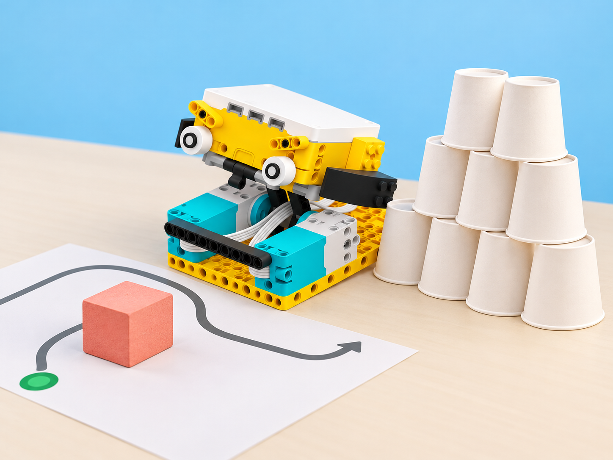

_Il·lustració conceptual generada amb IA a partir del model SPIKE Prime del centre. La torre representada és orientativa: munteu cada torre real amb cinc gots a la base, quatre al nivell central i tres al capdamunt._

## Situació, repte i intenció

La fira escolar de l'horta prepara una prova de destresa amb vehicles programables. Els equips construeixen una torre lleugera de gots de paper segons la regla **5–4–3**, delimiten una eixida i un destí, col·loquen un obstacle tou i programen el vehicle SPIKE Prime perquè el rode i arribe a la torre. El resultat es registra com a nombre de gots que cauen, però l'objectiu principal és explicar i millorar la ruta, no guanyar per rapidesa.

La proposta adapta l'activitat oficial *Knockdown the Paper Cup Tower*, creada per a Matatalab Lite. Conserva decoració i construcció de torres, punt de partida, obstacles, aproximació al blanc i comprovació final. La trasllada al vehicle SPIKE Prime de la dotació amb una espenta passiva de baixa velocitat. No es pressuposa cap sensor per detectar obstacles: l'alumnat programa una ruta coneguda, observa el resultat i ajusta el codi. La competició de velocitat del material original es converteix en una comparació cooperativa de proves.

**Pregunta guia:** quina informació necessitem per preveure la ruta, evitar l'obstacle i tocar la torre sense eixir del recorregut?

## Aprenentatges i vocabulari

- Construir i descriure una torre 5–4–3 i acordar un criteri observable per comptar els gots caiguts.
- Descompondre una ruta en trams, girs, inici, obstacle i destí; representar-la amb un diagrama o pseudocodi.
- Programar el moviment del model SPIKE disponible i distingir una ruta planificada d'una detecció automàtica.
- Repetir proves canviant una sola variable, registrar resultats i explicar quina iteració ha millorat el control.
- Cooperar amb rols rotatius i prioritzar un moviment lent, previsible i segur.

**Vocabulari clau:** torre 5–4–3, base, nivell, punt d'inici, destí, obstacle, trajecte, gir, motor, programa, predicció, prova, depuració i iteració.

## Materials i preparació

- Un vehicle SPIKE Prime de la dotació per equip o per estació, amb hub carregat i la configuració de moviment disponible al centre.
- Peces LEGO del mateix conjunt per comprovar o adaptar una **barra passiva frontal**. No afegiu un motor o sensor nou per a fer de pusher. Si el model existent no permet una barra estable, useu-lo sense modificar i feu que el destí siga una zona marcada al costat dels gots.
- Gots de paper lleugers: **12 per torre** (5 a la base, 4 al segon nivell i 3 al tercer); prepareu almenys una torre de recanvi per estació.
- Cinta de pintor per a marcar una ruta curta sobre una superfície plana, blocs d'escuma o obstacles tous, full de registre, retoladors i targetes per decorar els gots.
- Regla o cinta mètrica per a marcar trams i distàncies; cap material dur, punxant o fràgil dins del recorregut.

Abans de la sessió, proveu el model concret del centre a velocitat baixa, confirmeu quins motors mouen el vehicle i quina configuració de l'app està disponible. El pusher ha de quedar ferm, baix i sense vores punxants, cables solts ni contacte amb rodes o sensors. Marqueu una àrea d'assaig lliure de mans i persones; només una persona adulta pot recuperar el vehicle si queda bloquejat. Si no és possible verificar el muntatge o el control, feu les proves amb el robot aturat i una fitxa que represente el vehicle.

## Seqüència didàctica

### 1. Muntem la torre de la fira (50 min)

#### Fase 1 · Activem i prediem

Mostreu una torre senzilla de gots i pregunteu què la fa estable i què podria passar si el vehicle la toca de costat. Presenteu la regla 5–4–3 com **cinc gots a la base, quatre al nivell del mig i tres al capdamunt**. Cada equip dibuixa la torre i anticipa quina part caurà primer amb una espenta lleugera.

#### Fase 2 · Explorem i construïm

Decoreu els gots amb motius propis de la fira o de l'horta, sense cobrir-ne les vores. Muntem una torre completa de 12 gots i una segona, si hi ha prou material. Feu una prova manual molt suau amb un got de recanvi per observar com es transmet el moviment; no forceu les torres ni llanceu objectes.

#### Fase 3 · Expliquem i registrem

Anoteu el nombre de gots de cada nivell i dibuixeu la vista frontal. Acordeu un criteri comú: comptarem com a caigut un got que abandona la seua posició de la torre després del contacte amb el pusher; si només es mou sense caure, no suma. Registreu també qualsevol canvi de muntatge.

#### Fase 4 · Apliquem i millorem

Construïu una targeta de verificació amb les tres files de gots i reviseu la torre d'una altra parella abans de començar la fira. Si la torre cau abans de la prova, reconstruïu-la amb la mateixa regla; no modifiqueu el criteri de recompte segons l'equip.

#### Fase 5 · Comprovem i reflexionem

**Evidència:** dibuix anotat, torre de 12 gots i acord escrit sobre què compta com a caiguda. **Reflexió:** quina diferència hi ha entre una torre ben construïda i una torre difícil de tombar? La resposta ha d'esmentar una observació, no sols una preferència.

### 2. Preparem el vehicle i la ruta (50 min)

#### Fase 1 · Activem i prediem

Observeu el vehicle SPIKE Prime real disponible al centre i localitzeu el frontal, les rodes o elements de tracció, el hub i els motors que realment el mouen. Marqueu sobre una graella de terra un punt d'inici, un obstacle tou i la zona de la torre. Predigueu quants trams i girs caldran per arribar-hi.

#### Fase 2 · Explorem i construïm

Comproveu primer que el vehicle avança i gira en un espai obert. Si la configuració del centre ho permet, fixeu una biga passiva baixa al frontal amb peces del kit; l'adult comprova estabilitat, alçada i separació de rodes. No hi ha una construcció oficial universal per a aquest repte: useu el model ja validat al centre i retireu la barra si interfereix amb el moviment.

#### Fase 3 · Expliquem i registrem

Dibuixeu la ruta en quadrícula i descriviu cada ordre abans de programar-la. Useu aquest pseudocodi, ajustant els moviments a l'app i al muntatge locals:

```text
inici: orientar el vehicle cap al primer tram
avançar a velocitat baixa fins a la marca de gir
girar per vorejar l'obstacle tou
avançar fins a la zona de la torre
aturar el vehicle abans de recuperar-lo
```

La seqüència no inclou una lectura de sensor: el vehicle no sap per si mateix on és l'obstacle ni si ha arribat a la torre. La persona observadora comprova aquests esdeveniments i registra la diferència entre el recorregut previst i l'executat.

#### Fase 4 · Apliquem i millorem

Feu una primera passada **sense torre**, a velocitat baixa. Si el vehicle toca l'obstacle, ix del carril o no arriba a la marca, canvieu una sola instrucció o distància i repetiu. Després intercanvieu els rols de programació, observació i registre.

#### Fase 5 · Comprovem i reflexionem

**Evidència:** mapa de ruta amb inici, obstacle i destí, pseudocodi i una prova en buit registrada. **Reflexió:** quines parts de la decisió provenen del programa i quines de l'observació humana? Identifiqueu explícitament que evitar un obstacle conegut amb una ruta prefixada no és el mateix que detectar-lo amb un sensor.

### 3. Provem l'empenta amb cura (50 min)

#### Fase 1 · Activem i prediem

Abans d'acostar el vehicle a la torre, cada equip tria una distància inicial i prediu quants gots cauran. Recordeu les normes: velocitat baixa, una sola execució per torn, mans fora del recorregut i cap persecució del vehicle si es desvia.

#### Fase 2 · Explorem i construïm

Col·loqueu la torre en el destí marcat i l'obstacle tou en una posició acordada. Una persona executa el programa; una altra observa des de fora del carril, i una tercera anota si ha seguit la ruta. Si la primera prova no arriba al blanc, atureu el robot i recupereu-lo quan els motors s'hagen parat.

#### Fase 3 · Expliquem i registrem

Després de cada passada, compteu els gots que han caigut segons el criteri comú. Anoteu ordre provat, velocitat configurada, distància fins a la torre, contacte aconseguit, gots caiguts i incidències. No compareu temps ni convertiu els resultats en classificació d'equips.

#### Fase 4 · Apliquem i millorem

Trieu **una** variable per millorar —distància d'inici, gir o velocitat— i feu una segona prova amb la resta de condicions iguals. Si la torre o el vehicle es desplacen abans del contacte, reviseu la superfície i reinicieu amb el mateix punt d'inici. No eleveu la velocitat per obtenir més caigudes.

#### Fase 5 · Comprovem i reflexionem

**Evidència:** dues proves comparables amb predicció, resultat i una variable identificada. **Reflexió:** la segona prova s'ha acostat a la predicció? Quina dada ho mostra? Un resultat inesperat també és evidència útil si l'equip pot descriure les condicions.

### 4. Revisem la fira i compartim el que hem après (50 min)

#### Fase 1 · Activem i prediem

Recupereu el mapa i les dades de la sessió anterior. Cada equip selecciona una millora basada en les proves i n'escriu el resultat esperat abans de tocar el programa.

#### Fase 2 · Explorem i construïm

Executeu una passada final amb el mateix criteri de seguretat i recompte. Després, un altre equip llig el mapa i explica què espera que faça el vehicle; compareu aquesta predicció amb el recorregut real. Si hi ha una desviació, anoteu si prové del codi, del muntatge, de la superfície o de la posició inicial.

#### Fase 3 · Expliquem i registrem

Prepareu un cartell de fira amb el dibuix de la ruta, les instruccions principals, la taula de proves i una conclusió limitada a allò observat. Distingiu entre «el robot ha seguit aquesta ruta en dues proves» i una afirmació més ampla sobre què faria sempre.

#### Fase 4 · Apliquem i millorem

Feu una ronda de retorn entre parelles: una observació concreta, una pregunta i una proposta. Cada equip pot incorporar una millora al mapa o a l'explicació, encara que el programa no es torne a executar. Reconstruïu les torres i ordeneu gots, peces i materials.

#### Fase 5 · Comprovem i reflexionem

**Evidència final:** ruta anotada, pseudocodi o programa, registre de proves, recompte segons el criteri acordat i explicació d'una iteració. Autoavaluació: puc descriure la ruta; puc justificar un canvi amb dades; puc explicar què el robot no detecta. **Tancament:** què mantindríem constant si repetírem l'assaig demà?

## Evidències i avaluació

Recolliu el dibuix de la torre, la regla 5–4–3, mapa de ruta, pseudocodi o blocs, taula de proves i cartell final. Observeu si l'equip: construeix la torre amb la disposició acordada; assenyala inici, obstacle i destí; tradueix el recorregut a ordres coherents; prova el moviment sense obstacles abans d'afegir la torre; canvia una sola variable en iterar; i diferencia una ruta programada d'una detecció automàtica. El nombre de gots caiguts és una dada del repte, no una nota ni un indicador de rapidesa.

## Participació, accessibilitat i seguretat

Oferiu la ruta en paper o amb una fitxa mòbil quan la connexió, el codi o el vehicle no estiguen disponibles. Permeteu rols de cartògraf/a, operador/a, observador/a, comptador/a i portaveu, amb torns voluntaris en la manipulació. Useu gots grans i de colors contrastats o una torre més baixa per a facilitar-ne la lectura, mantenint visible la regla 5–4–3. Manteniu lliure el perímetre de la pista; utilitzeu només obstacles tous, atureu el vehicle abans de qualsevol intervenció manual i no useu peces pesants, líquids ni objectes fràgils.

## Referents i adaptació

- Matatalab, [Knockdown the Paper Cup Tower](https://matatalab.com/en/node/94): activitat Lite amb decoració de gots, torres 5–4–3, punt de partida, obstacles, modificació de MatataBot, control cap als blancs i recompte/retorn final. El pla oficial distribueix 15 minuts d'activació guiada, 25 d'activitat i 5 de retorn.
- LEGO Education, [Making Moves with Motors](https://education.lego.com/en-us/lessons/get-moving-with-motors/making-moves-with-motors/): referència tècnica per explorar moviment de motors, paràmetres i execució de proves amb SPIKE Prime; els ports i el programa s'han d'ajustar al model real del centre.
- LEGO Education, [especificacions tècniques de SPIKE Prime](https://education.lego.com/en-gb/product-resources/spike-prime/downloads/technical-specifications/): documentació de motors, hub i sensors del conjunt.

La transferència a SPIKE Prime, la fira local, la pauta de proves, els criteris de recompte i la seqüència de quatre sessions són creació pròpia. La imatge generada amb IA reprodueix el vehicle de la dotació a partir de la referència local; el muntatge de la barra passiva és una possibilitat que cal verificar físicament i no una construcció certificada pel fabricant. La programació concreta depén del model de vehicle i de la versió de l'app del centre.
