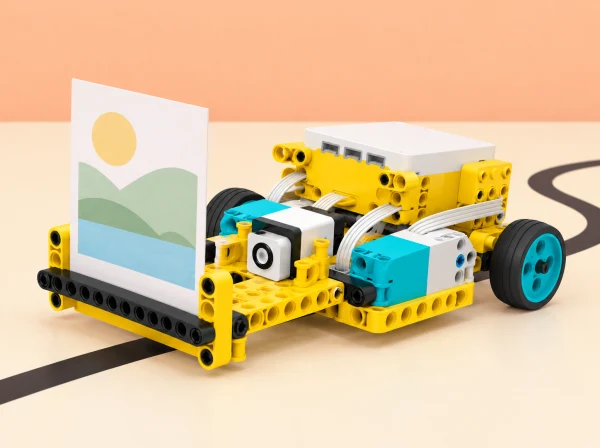
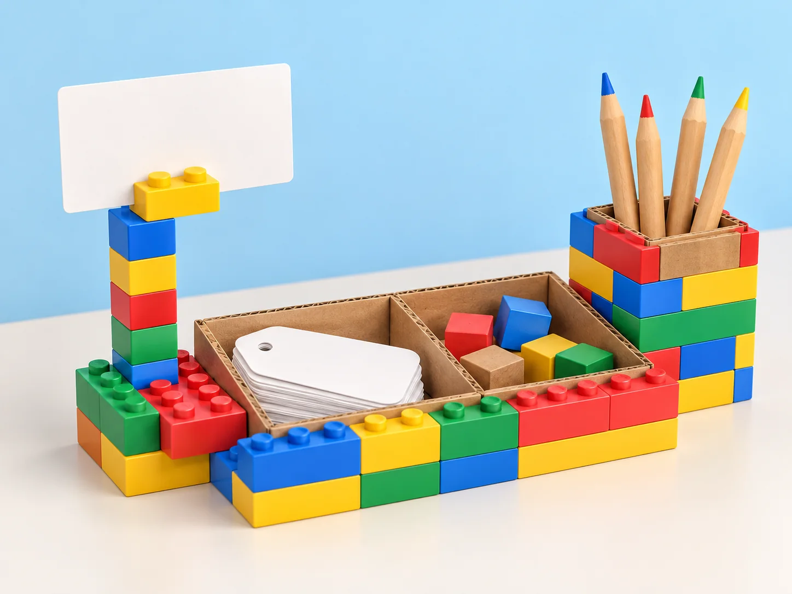

_La fira investiga necessitats sense pressuposar-les. Il·lustració conceptual generada amb IA d’un muntatge possible amb peces SPIKE Prime; no és una instrucció de construcció ni una solució d’accessibilitat validada._

## 🌱 Situació i intenció

Adaptació de la unitat *Invention Squad* per al context d’un centre educatiu valencià. Cada sessió conserva l’objectiu oficial i el tradueix en un repte, materials i criteris propis; quan una activitat del pla és híbrida o no requereix el hub, s’indica expressament en la sessió.

## 🎯 Aprenentatges i vocabulari

- Identificar barreres en una situació fictícia i convertir-les en requisits de disseny verificables.
- Construir alternatives de mecanisme i comparar-les amb una prova justa i el mateix criteri.
- Iterar un prototip a partir de les observacions de persones voluntàries, sense inferir necessitats individuals.
- Explicar què millora la solució, per a qui s’ha provat i quines barreres continuen presents.

## 📅 Seqüència didàctica · 6 reptes / 8–10 sessions

### **S1 · Interpretem tres senyals del museu ([Help!](https://education.lego.com/en-us/lessons/prime-invention-squad/help/), 60 min + neteja).**

#### Fase 1 · Activem i prediem

introduïu el repte amb una situació fictícia i recordeu separar observació de suposició.

#### Fase 2 · Explorem i construïm

en lloc d’interpretar un animal domèstic, fem servir una escultura pròpia de l’aiguamoll i una història de ficció en un espai triat (aiguamoll, museu o camí de l’horta). El sensor de color llig tres fitxes i activa primer una seqüència inicial de referència i després una història nova de tres sons, un per cada color. En un minut, cada parella anota tots els problemes possibles que podria tindre el personatge; no resol encara res. Per donar suport, restringiu l’escenari a un lloc i oferiu exemples de diferència entre fet observat i inferència; per ampliar, elimineu una interpretació evident i demaneu una descripció creativa del problema.

#### Fase 3 · Expliquem i registrem

compareu les llistes en parelles d’equips, expliqueu quins sons sustenten cada hipòtesi i redacteu un enunciat de problema. Després, els equips intercanvien «històries sonores»: creen tres sons propis perquè una altra parella definisca un problema diferent.

#### Fase 4 · Apliquem i millorem

establiu criteris i restriccions per a una solució (missatge interpretable, volum adequat, cap dada personal), trieu una necessitat definida, genereu almenys una resposta, reviseu-la segons els criteris i compartiu feedback positiu/constructiu. Deixeu temps per a guardar les peces.

#### Fase 5 · Comprovem i reflexionem

observeu si es defineix el problema amb detalls observables, si el grup separa definició del problema de la solució i si proposa criteris/restriccions pertinents. Autoavaluació privada en tres nivells: identificar un problema; afegir criteris i una idea; provar la idea contra els criteris i millorar-la. Acabeu amb conversa o presentació breu i feedback positiu i constructiu. **Evidència:** prediccions després de cada seqüència, llista inicial d’un minut, comparació de problemes, història pròpia de tres colors/sons, criteris, idea de solució i millora. Els sons no descriuen animals reals: són codis ficticis per practicar observació i definició de necessitats.

### **S2 · Dissenyem potes per a una prova de recorregut ([Hopper Race](https://education.lego.com/en-us/lessons/prime-invention-squad/hopper-race/), 30–45 min).**

#### Fase 1 · Activem i prediem

Dediqueu uns cinc minuts a parlar de prototips: què és una primera versió, per què convé comparar opcions i com podem generar idees abans de construir. Presenteu el repte central de *Hopper Race*: fer avançar un robot sense rodes. Com a criteris locals, acordem també que no es bolque i que les proves es facen en un carril lliure de persones i objectes fràgils. Cada parella dibuixa dues idees abans d’obrir el muntatge.

#### Fase 2 · Explorem i construïm

Durant uns 25 minuts, construïu el model base amb el muntatge disponible al centre i executeu el programa de partida per observar com es mou. Dissenyeu almenys dos jocs de potes que impulsen el cos cap avant; no useu rodes com a sistema de locomoció. Proveu una alternativa, torneu a la base quan calga i busqueu una segona solució encara que la primera funcione. Una persona pot comparar la longitud de les potes o gambades i una altra el programa o la velocitat del motor; després intercanvien els rols. No cal que tots els prototips funcionen per a aportar evidència.

#### Fase 3 · Expliquem i registrem

Reserveu uns cinc minuts per descriure com cada canvi ha afectat el moviment. Registreu per a cada prototip el dibuix, la longitud de pota o gambada, la velocitat configurada, la superfície i què heu observat. Distingiu les variables que heu canviat de les que heu mantingut constants; predigueu quin disseny recorrerà millor la mateixa pista i expliqueu per què.

#### Fase 4 · Apliquem i millorem

Prepareu una pista curta amb línies d’eixida i arribada. En els deu minuts finals, feu una ronda de fins a cinc minuts per provar i millorar els models i després la cursa comparativa. Useu la mateixa distància, superfície i condició d’inici; mesureu el temps o la distància i anoteu si el robot completa el recorregut sense bolcar. La cursa és una manera de comparar, no l’únic resultat: mostreu també una solució que no haja funcionat i què heu aprés. Si queda temps, afegiu caràcter amb peces lleugeres o creeu un tram desigual amb peces soltes ben fixades fora del pas de persones; tracteu-lo com un canvi de criteri i torneu a provar només si és segur. Doneu temps per a recollir.

#### Fase 5 · Comprovem i reflexionem

Useu una escala d’observació de tres nivells per valorar si l’equip explica el problema, genera diverses idees i dissenya diverses solucions, funcionen o no. Cada alumne pot triar en privat el color que millor representa el procés: blau, un joc de potes funcional; groc, dos o més; violeta, diverses modificacions que han millorat l’eficiència. Una parella d’un altre equip dona un comentari específic i una proposta per a la pròxima iteració. **Evidències:** esbossos de diverses potes, incloses les que no funcionen; taula de prova comparable; predicció i resultat; justificació de la decisió i retorn rebut. Com a ampliació matemàtica, estimeu la velocitat mitjana en cm/s i useu distància = velocitat × temps per predir el recorregut després de 8, 16 i 24 segons. Compareu predicció i mesura sense assumir que la velocitat es manté en una superfície diferent. Com a ampliació lingüística, prepareu una explicació breu de biomimètica: quina característica d’un animal inspira el prototip i en què no és equivalent. La puntuació no depén de guanyar la cursa.

### **S3 · Quin agafador serveix per a cada objecte? ([Super Cleanup](https://education.lego.com/en-us/lessons/prime-invention-squad/super-cleanup/), 30–45 min).**

#### Fase 1 · Activem i prediem

Dediqueu uns cinc minuts a la pregunta «com decidiríem quin agafador és millor?». Acordeu abans de provar dos criteris observables, com ara si subjecta l’objecte sense deixar-lo caure i si el pot alçar sense deformar-lo. Predigueu quin dels dos dissenys funcionarà millor amb un objecte menut i un de voluminós. No hi ha un agafador millor per a tots els usos.

#### Fase 2 · Explorem i construïm

Durant uns vint minuts, munteu en parella el controlador manual i els dos agafadors de prova. Repartiu la construcció —una persona fa el primer agafador; l’altra, el segon i el controlador— i després intercanvieu qui programa o manipula. El primer disseny flexible s’adapta millor a objectes lleugers; el segon, amb la boca partida, a objectes més grans. Executeu el programa de prova per entendre com s’obri i es tanca cada mecanisme abans de començar a recollir dades. Prepareu materials d’aula no fràgils i sense valor personal: per exemple, peces LEGO o boles de paper de diferents mides. Per variar el pes amb la mateixa forma, useu capsetes iguals tancades amb quantitats diferents de peces LEGO. No utilitzeu vidre, aliments ni objectes personals.

#### Fase 3 · Expliquem i registrem

Durant uns deu minuts, feu dues proves i registreu cada resultat en una taula: **Prova 1**, objectes de mides diferents i pesos semblants; **Prova 2**, objectes de pesos diferents i mides semblants. En cada prova, passeu els mateixos objectes pels dos agafadors. Manteniu constants el punt de partida, l’operador i el criteri d’èxit; anoteu també els intents necessaris. Si cal reduir la càrrega, proveu només una mostra gran i una de menuda i conserveu la comparació dels dos dissenys.

#### Fase 4 · Apliquem i millorem

Dediqueu uns deu minuts a posar en comú els resultats i discutir si les proves han sigut justes. Trieu un objecte habitual de l’aula, predigueu quin agafador convé i justifiqueu la decisió amb les dades. Com a ampliació, definiu un criteri nou o redissenyeu un agafador i repetiu la comparació; no barregeu els resultats del prototip nou amb els del disseny inicial.

#### Fase 5 · Comprovem i reflexionem

**Evidències:** predicció inicial, taula de les dues proves amb mides/pesos i resultats separats, conclusió basada en les dades i recomanació per a un ús concret. La rúbrica docent observa si l’equip defineix criteris, manté una comparació justa i comunica una conclusió. Autoavaluació individual: blau, ha provat un agafador; groc, n’ha provat dos; violeta, ha utilitzat els resultats per decidir quin és més adequat. Una altra parella dona un comentari concret i una idea de millora. Per a l’extensió matemàtica, assigneu pesos a criteris com seguretat, portabilitat, cost i facilitat d’ús fins a sumar 100%; valoreu cada disseny amb −1 o +1 per criteri i calculeu la puntuació ponderada. Comproveu si canviar els pesos altera la recomanació: representen prioritats del projecte, no una mesura universal. Com a extensió lingüística, prepareu una presentació oral o una ressenya breu amb avantatges i limitacions; no cal gravar ni publicar vídeos.

### **S4 · Quatre causes d’una traçadora que no dibuixa ([Broken](https://education.lego.com/en-us/lessons/prime-invention-squad/broken/), 45–90 min).**

#### Fase 1 · Activem i prediem

Obriu amb una conversa breu sobre què fem quan un objecte deixa de funcionar i com podem esbrinar-ne la causa abans de reparar-lo. Presenteu la traçadora CNC com una màquina que mou un llapis sobre dos eixos per dibuixar una forma. L’encàrrec local és recuperar una traçadora que ha de dibuixar una etiqueta o un plànol senzill per a l’exposició. Expliqueu que el prototip s’ha preparat expressament amb errors; no avanceu quins són ni com es resolen.

#### Fase 2 · Explorem i construïm

Dediqueu fins a 35 minuts a construir per parelles la màquina sabent que ha de quedar inicialment inoperativa. Repartiu les tasques de muntatge del bastidor superior/motors i de la base/carro del llapis; després comproveu que el paper entra per la base i que el suport manté el llapis en contacte. Abans d’activar els motors, escriviu un pseudocodi o expliqueu oralment què fa cada pas del programa. Executeu-lo una vegada a baixa velocitat, observeu la diferència entre el dibuix esperat i el real i documenteu els símptomes; a partir d’eixes observacions, proposeu causes possibles. Useu el paper pautat de prova a escala original, sense redimensionar-lo, o una graella local de mida comprovada.

#### Fase 3 · Expliquem i registrem

Reserveu uns deu minuts per a compartir les observacions. Per a cada símptoma, anoteu què no funciona, què hauria de passar, una causa possible i una prova que permeta distingir-la d’altres hipòtesis. Reviseu si el problema correspon a l’eix X, a l’alimentació del paper/eix Y, a una fixació o al programa. **Clau docent —no la faciliteu abans de la investigació:** el model oficial incorpora quatre errors: falta una roda alimentadora del paper i l’eix Y no avança bé; la part superior no està ben unida a la base; els engranatges alimentadors estan invertits i el paper avança massa de pressa; el carro del llapis no està fixat i altera l’eix X. L’objectiu és que l’alumnat localitze les causes, no donar-li la llista abans de la prova.

#### Fase 4 · Apliquem i millorem

En els 25 minuts d’ampliació, trieu una causa cada vegada, canvieu només el mecanisme o el paràmetre relacionat i repetiu la prova. Registreu si la correcció acosta el resultat a la forma prevista; compartiu les solucions i feu una iteració final. Per donar suport, oferiu una selecció de peces candidates sense assenyalar quina és la solució. Per ampliar, programeu una forma amb corbes i augmenteu gradualment un rectangle dins de l’àrea imprimible: mesureu base i altura i calculeu l’àrea, expliqueu el límit físic i proposeu com l’actualitzaríeu. Com a conversa lingüística, representeu una consulta tècnica «mans fora»: una persona descriu el símptoma i l’altra guia la comprovació sense tocar la màquina.

#### Fase 5 · Comprovem i reflexionem

**Evidències:** pseudocodi previ, dibuix esperat, taula símptoma–funció prevista–causa–prova–reparació, resultats de cada intent, dibuix final i dimensions/àrea de la forma. La rúbrica observa si l’equip descriu estructura i funció, troba causes arrel, tria reparacions que satisfan el criteri i millora el disseny després de provar-lo. Autoavaluació: blau, explique com funciona la màquina; groc, puc reparar-la perquè complisca la funció prevista; violeta, puc proposar una millora d’eficiència. Una altra parella dona feedback constructiu. Atureu el programa abans de tocar engranatges, paper o llapis; no forceu eixos i feu les proves amb velocitat baixa.

### **S5 · Dissenyem una eina per a una tasca triada ([Design for Someone](https://education.lego.com/en-us/lessons/prime-invention-squad/design-for-someone/), projecte de 120+ min en diverses sessions).**

#### Fase 1 · Activem i prediem

Dediqueu uns quinze minuts a obrir una conversa sobre disseny assistiu i funcions que les eines poden facilitar. La lliçó oficial connecta el procés amb pròtesis; ací observem exemples documentats amb fonts fiables i distingim un prototip escolar d’un producte clínic. No demaneu a ningú que imagine una discapacitat pròpia ni que parle en nom d’una persona amb discapacitat. La proposta local no simula discapacitats, no diagnostica ningú ni fabrica una pròtesi d’ús humà.

#### Fase 2 · Explorem i construïm

En la primera trobada, feu una pluja d’idees individual i en parella sobre funcions possibles d’una eina de taula. En 30 minuts, acoteu la tasca a una funció concreta —per exemple, agafar un objecte gran, subjectar una targeta o girar una maneta de maqueta— i trieu dues idees que vulgueu provar. Descriviu el context, la persona usuària de manera no identificable, els criteris d’èxit i les restriccions. La necessitat pot ser fictícia o aportada voluntàriament per una persona adulta col·laboradora, que pot modificar-la o retirar-se en qualsevol moment.

#### Fase 3 · Expliquem i registrem

Useu una segona trobada d’uns 45 minuts per construir i provar les dues solucions triades. Si és útil per a començar, oferiu un mecanisme de mostra com a punt de partida opcional, però deixeu que cada parella el modifique. Prepareu una taula pròpia amb criteri, procediment, resultat i observacions; manteniu iguals l’objecte, la càrrega i el nombre d’intents per a comparar les dues propostes. Per ampliar el projecte, convideu una persona especialista només si està disponible i d’acord; feu servir peces fabricades o tallades únicament si el centre ja en disposa.

#### Fase 4 · Apliquem i millorem

En una tercera trobada d’uns 45 minuts, presenteu els resultats a la classe amb el quadern de disseny —text, esquemes, fotografies del prototip sense persones o taules— i expliqueu com cada idea ha respost als criteris. Compareu les dades, descriviu un cas en què cada solució no funciona i rebeu preguntes i feedback constructiu. Si queda temps, trieu una millora justificada per les proves i registreu-la com a següent iteració, sense presentar-la com a solució validada.

#### Fase 5 · Comprovem i reflexionem

**Evidència:** quadern de disseny amb context i necessitat, criteris/restriccions, pluja d’idees, dues opcions triades, taula de les proves, dades, presentació i millora proposada. La seqüència de referència suma 135 minuts en tres parts (15 min de conversa, 30 min d’ideació, 45 min de construcció/prova i 45 min de presentació); es pot repartir en diverses classes i afegir temps de muntatge. Avalueu si l’alumnat identifica elements clau del problema, treballa amb autonomia/creativitat i comunica les idees amb claredat. Autoavaluació privada i feedback constructiu entre parelles. Si hi ha una col·laboradora real, només reviseu els requisits amb el seu consentiment i possibilitat de canviar-los; sense consulta, indiqueu que la necessitat no està validada. El producte és un prototip escolar per a un objecte, no una pròtesi mèdica ni un dispositiu recomanat o provat sobre persones.

### **S6 · Un ajudant per a la taula de preparació ([Design for You](https://education.lego.com/en-us/lessons/prime-invention-squad/design-for-you/), 45 min, híbrida).**

#### Fase 1 · Activem i prediem

Dediqueu deu minuts a conversar sobre d’on venen les idees d’invents i quins problemes quotidians de l’espai de treball es poden resoldre. Useu com a context la taula on preparem l’exposició del museu escolar: cal mantindre dretes les etiquetes, ordenar targetes o separar peces reutilitzables? Definiu entre tots què és un prototip i els criteris inicials d’èxit, com ara estabilitat, facilitat d’ús i que no ocupe massa espai. Cada alumne tria una necessitat de la seua pròpia taula; no cal afirmar que el prototip resoldrà la necessitat de tota la classe.

#### Fase 2 · Explorem i construïm

Dins de quinze minuts, dissenyeu individualment un ajudant d’escriptori amb paper, llapis i materials de construcció corrents o reutilitzats. No hi ha instruccions ni model final obligatori; les imatges de referència només inspiren. Feu una pluja d’idees, construïu un prototip ràpid i proveu-lo amb els criteris acordats. Si una idea no funciona, torneu al cicle de disseny una segona o tercera vegada si el temps ho permet. L’activitat híbrida no necessita SPIKE Prime, BricQ ni hub.

_Exemple visual d’un prototip obert per a la taula de preparació del museu escolar; és una inspiració, no un model que cal copiar._

#### Fase 3 · Expliquem i registrem

Dediqueu deu minuts a explicar el prototip a una parella i a donar-vos feedback respectuós. Qui presenta explica: quin problema de la seua taula ha triat, com ha generat idees i com ha provat el prototip. Qui escolta comenta un detall concret, formula una pregunta i proposa una millora; no avalua la persona. Alterneu els rols i distingiu un prototip de prova d’un producte acabat. Podeu usar frases com «M’ha ajudat…», «Voldria saber…» o «Et propose provar…».

#### Fase 4 · Apliquem i millorem

Reserveu cinc minuts per a anotar una millora a partir del feedback i explicar per què podria ajudar. Si ja coneixeu SPIKE Prime, dibuixeu com transformaríeu el prototip en un mecanisme amb el hub; és una proposta futura, no cal construir-la ni motoritzar-la.

#### Fase 5 · Comprovem i reflexionem

Dediqueu els cinc minuts finals a mostrar com el prototip podria ajudar a la taula i què heu canviat o canviaríeu després de provar-lo. Autoavaluació privada amb una fitxa de tres nivells: **roig**, amb ajuda puc definir el problema i comparar solucions; **groc**, puc explicar com definir-lo i avaluar opcions; **verd**, puc ensenyar a una altra persona a fer-ho. **Evidències:** necessitat triada, criteri d’èxit, esbós o pluja d’idees, prototip, nota de prova, feedback i millora proposada. La comunicació pot ser oral, escrita o amb un dibuix; no cal motoritzar el prototip ni publicar fotos de casa o de l’aula.

## 🧰 Materials i preparació

SPIKE Prime i els seus motors per a les cinc lliçons del set; per a S6, dues fulles de paper per alumne, llapis o retoladors, peces de construcció corrents i materials lleugers reutilitzats com cartó. Prepareu una taula estable i neta per fer prototips i proves. S6 es pot fer sense cap set de robòtica; cap part no pressuposa BricQ Motion.

## 🎯 Evidències i avaluació

Carpeta d’equip: problema definit amb observacions, criteris i restriccions; dos prototips de locomoció amb tres registres per prova; taula comparativa de pinces; registre de depuració; fitxa de disseny col·laboratiu amb retorn de la persona usuària o constància que falta validar-lo; i esbós/prova d’ús de l’ajudant d’escriptori. La rúbrica observa si l’alumnat diferencia problema i solució, compara evidències amb els criteris, documenta una iteració i comunica una limitació. No es puntua si el robot «guanya» ni s’aprova un prototip per a ús real.

## ♿ Participació i inclusió

La participació de persones amb necessitats d’accessibilitat és voluntària i informada; no simulem una discapacitat amb venda o guants. Si no hi ha una persona consultora, analitzem barreres del context amb fonts fiables i marquem la validació com a pendent. Repartim rols de disseny, programació, prova i documentació.

## 🔗 Unitat oficial i traçabilitat

La seqüència adapta les sis entrades de la unitat LEGO Education [Invention Squad](https://education.lego.com/en-us/lessons/prime-invention-squad/): *Help!*, *Hopper Race*, *Super Cleanup*, *Broken*, *Design for Someone* i [*Design for You*](https://education.lego.com/en-us/lessons/prime-invention-squad/design-for-you/). Les cinc primeres especifiquen el set SPIKE Prime; la sisena és híbrida i permet peces LEGO corrents o materials reutilitzats, sense necessitat de cap hub. El context, els guions, les dades, el camp de proves, les activitats i la imatge són propis. Els muntatges i sensors es comproven amb el set disponible al centre.
