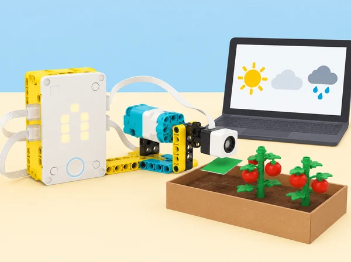
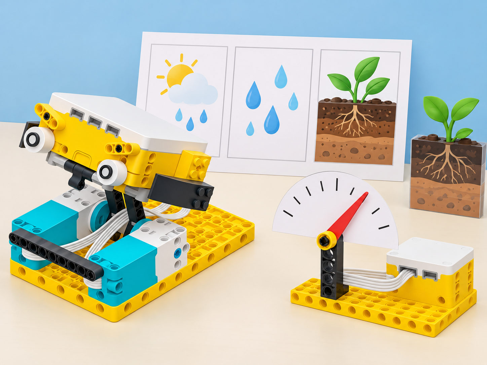
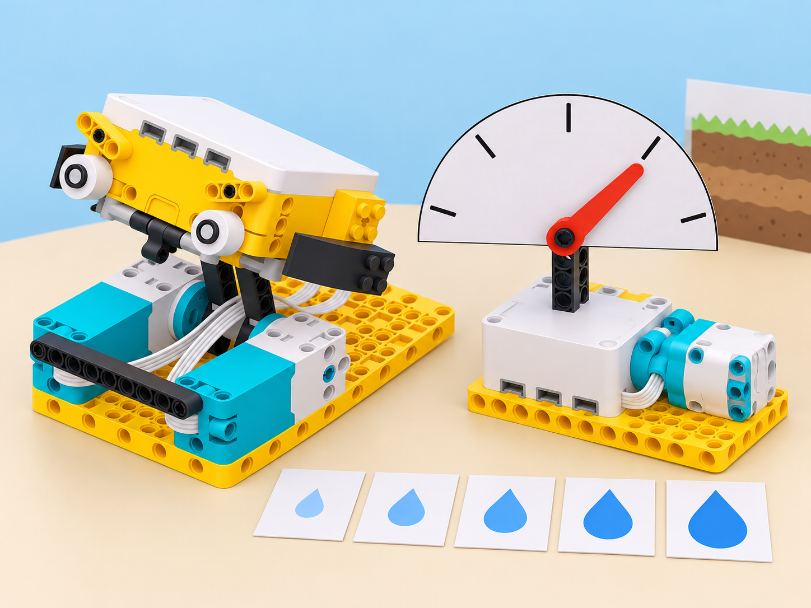
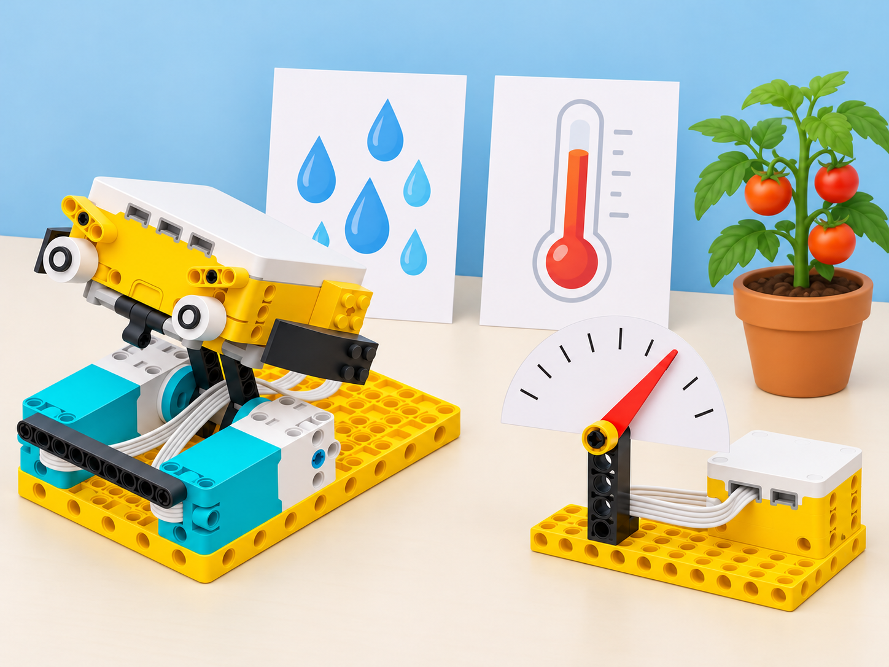

_L’indicador representa una dada de previsió; no mesura la humitat del sòl ni decideix el reg d’un hort real._

## 🌱 Repte i intenció

La classe prepara un indicador visual que ajude a parlar de les necessitats d’aigua d’un hort escolar. La situació adapta *Veggie Love* de LEGO Education: construïm un «tomato-meter», consultem dades meteorològiques quantitatives del núvol per a una ciutat i fem que una agulla represente la precipitació prevista acumulada per a la setmana. Investiguem la relació entre dada, escala i decisió sense convertir la maqueta en una recomanació agronòmica: el reg real depén també del sòl, l’espècie, el cultiu i les observacions de l’hort. La conversa inicial també contrasta per què alguns cultius o regions tenen períodes de creixement diferents; no s’assumeix que una previsió setmanal determine per si sola la necessitat d’aigua.

## 🎯 Aprenentatges i vocabulari

- Interpretar una sèrie setmanal de precipitació amb font, dates i unitats explícites.
- Calibrar una escala de maqueta i provar els valors als límits i entre intervals.
- Programar un indicador que represente les dades sense confondre previsió amb mesura del sòl.
- Argumentar una decisió per a un hort de maqueta i deixar clar que no controla un reg real.

## 📅 Seqüència didàctica · 3 sessions de 45–60 min

### **S1 · De la previsió a una pregunta investigable (45–60 min).**

#### Fase 1 · Activem i prediem

Activeu idees prèvies sobre estacions, cultius i pluja: què necessitaria saber una persona que cuida tomaqueres? Distingiu precipitació prevista, pluja observada i humitat del sòl.

#### Fase 2 · Explorem i construïm

En parelles, construïu o adapteu un indicador de paper amb agulla motoritzada. Trieu una ciutat i executeu el programa amb els blocs de dades meteorològiques disponibles a l’app SPIKE. Si no hi ha connexió o els blocs no estan disponibles, useu una captura datada o una taula docent i etiqueteu-la com a dada arxivada.

#### Fase 3 · Expliquem i registrem

Anoteu ciutat, data i hora, unitat i període de la dada. Comproveu si el bloc proporciona el total setmanal o set valors diaris; si són diaris, sumeu una sola vegada els set dies del mateix període i escriviu l’operació. No barregeu dies incomplets ni una previsió amb observacions. Dibuixeu l’esquema i indiqueu quina variable no es mesura: el model no incorpora humitat del sòl.

_El model motoritzat representa una dada triada; no mesura la pluja ni la humitat del sòl._

#### Fase 4 · Apliquem i millorem

Compareu la dada amb el que representa l’agulla i reviseu l’escala inicial si les unitats o el període no queden clars. Manteniu separats les dades en viu i les arxivades.

#### Fase 5 · Comprovem i reflexionem

Expliqueu què representa l’indicador i què no permet concloure sobre el reg. **Evidència:** diagrama de maqueta i fitxa que diferencia dada en viu, dada guardada i variable no mesurada.

### **S2 · Calibrem el tomato-meter amb la precipitació setmanal (45–60 min).**

#### Fase 1 · Activem i prediem

Llegiu el total setmanal de precipitació prevista i decidiu quina escala física el representarà. Per a una primera prova comuna, useu una escala didàctica de **0–60 mm** en **0–180°**; no és un màxim meteorològic ni una necessitat de reg. Marqueu els dos extrems i les divisions abans de moure l’agulla. Predigueu on cauran 0, 15, 30, 45 i 60 mm.

#### Fase 2 · Explorem i construïm

Programeu una resposta proporcional entre la dada `p` i l’angle del motor, després d’alinear i posar l’agulla a zero: `angle = (p / 60) × 180`. Així, 0, 15, 30, 45 i 60 mm han d’apuntar, respectivament, a 0°, 45°, 90°, 135° i 180°. Si l’entrada és absent, negativa o no numèrica, indiqueu error i no la convertiu en zero. Si `p` supera 60 mm, mostreu «fora d’escala» i decidiu si amplieu el màxim; no retalleu silenciosament la dada a 60. Com a ampliació, canvieu el rang amb una regla documentada.

#### Fase 3 · Expliquem i registrem

Proveu els cinc valors de referència (0, 15, 30, 45 i 60 mm) i anoteu valor, angle esperat, angle observat i diferència. Reinicieu la posició del motor abans de cada prova i feu dues lectures per cas. Una altra parella revisa els desajustos i n’explica una causa possible: alineament inicial, lectura de la dada, sentit de gir o relació de conversió.

_La il·lustració és una guia conceptual: l’escala impresa i el muntatge s’han de construir i validar amb el kit del centre._

#### Fase 4 · Apliquem i millorem

Canvieu una sola regla d’escala cada vegada i torneu a provar els mateixos valors de referència. Si amplieu el rang perquè la previsió el supera, actualitzeu alhora l’etiqueta de l’escala i la conversió del programa. Documenteu una iteració i comproveu si la nova conversió millora la lectura sense ocultar dades fora de rang.

#### Fase 5 · Comprovem i reflexionem

Expliqueu com la dada s’ha transformat en moviment i què significa l’error de l’escala. **Evidència:** taula de valors, posicions previstes/observades i iteració documentada.

### **S3 · Recalibrem per a una altra dada i comuniquem els límits (45–60 min).**

#### Fase 1 · Activem i prediem

Sense canviar el muntatge, predigueu per què no es pot reutilitzar directament la conversió de precipitació: pluja setmanal acumulada en mil·límetres i temperatura en graus són magnituds i unitats diferents. Identifiqueu la nova variable, la unitat que mostra l’app i un rang que incloga els valors previstos; si treballeu en °C, no pressuposeu que la temperatura mínima siga zero. Trieu també una targeta pròpia de necessitats d’aigua per a un cultiu fictici i distingiu-la de les dades meteorològiques: és una condició del repte, no una dada científica ni una ordre de reg.

#### Fase 2 · Explorem i construïm

Recalibreu l’escala per a la temperatura prevista: definiu `t_min` i `t_max`, assigneu-los als dos extrems angulars i useu `angle = ((t − t_min) / (t_max − t_min)) × 180`. En una prova didàctica de −5 a 35 °C, −5, 15 i 35 °C han de donar 0°, 90° i 180°; si el rang real de la previsió queda fora, marqueu «fora d’escala» i torneu a calibrar. Manteniu aquesta conversió separada de la precipitació. Com a ampliació, creeu targetes pròpies de necessitats d’aigua per a cultius ficticis o representeu velocitat del vent/temperatura en moments diferents, definint de nou la variable, la unitat i el rang.

_Les targetes representen entrades de dades diferents; el prototip recalibra l’escala i no mesura ni la pluja ni la temperatura._

#### Fase 3 · Expliquem i registrem

Compareu ciutats o períodes amb dades datades. Prepareu una targeta amb font, data, variable, unitats i la regla d’escala. Si és possible, contrasteu l’indicador amb una entrevista a una persona agricultora o horticultora; si no, useu una font divulgativa fiable, sense demanar ubicacions privades ni recomanacions per a un cultiu concret. Pregunteu quins instruments reals s’utilitzen i compareu-los amb el tomato-meter: quina magnitud mesuren, quines unitats donen i quina informació addicional necessitaria una decisió de reg? Les professions i els instruments són una extensió d’investigació, no una validació del prototip.

#### Fase 4 · Apliquem i millorem

Reviseu l’explicació perquè separe dada prevista, representació de l’escala i decisió pendent. Comproveu que els valors negatius de temperatura siguen possibles dins del rang i que no s’hagen interpretat com a error; només una entrada absent o incompatible es rebutja. Indiqueu què caldria comprovar abans de prendre una decisió real: la previsió no és una mesura del sòl ni una instrucció de reg.

#### Fase 5 · Comprovem i reflexionem

Presenteu les dues escales calibrades i la conclusió amb els seus límits. Cada persona tria una autoavaluació: **blau**, puc moure l’agulla segons una dada; **groc**, represente correctament el total setmanal; **violeta**, puc mostrar una temperatura en una escala recalibrada. Una parella aporta un comentari concret i una proposta de millora per a la prova següent. **Evidència:** dues escales, targeta de necessitats fictícia, fitxa explicativa amb font i data, comparació amb un instrument o una font professional i conclusió que separa observació, interpretació i decisió pendent.

## 🧰 Materials i preparació

Set SPIKE Prime, hub, motor i peces per a un indicador de paper; ordinador o tauleta amb l’app SPIKE i els blocs de previsió meteorològica activats; paper, retoladors i regla. Abans de classe, comproveu que la connexió, la ubicació seleccionable i les dades requerides funcionen en el dispositiu del centre. Prepareu una taula meteorològica datada com a alternativa equivalent per a analitzar dades quan el servei no estiga disponible. No cal sensor d’humitat: el kit SPIKE Prime no el proporciona.

## 🧪 Evidències i avaluació

Recolliu l’esbós i el muntatge, el registre de consulta, les dues regles de conversió, les taules amb valors esperats i observats, l’error d’escala, les dades fora de rang, la recalibració i la comunicació final. Valoreu si l’alumnat diferencia suma setmanal i temperatura, tria unitats i rang coherents, prova valors de referència, explica un error i recalibra sense reutilitzar una conversió incompatible. Autoavaluació: **blau**, faig moure l’agulla segons una dada; **groc**, represente el total setmanal amb una escala provada; **violeta**, recalibre per a temperatura i explique què faig amb valors negatius o fora de rang. El retorn entre parelles ha d’indicar una millora concreta i una limitació.

## ♿ Participació, privacitat i límits

Repartiu rols de consulta, programació, lectura d’escala i documentació, amb instruccions visuals i codis redundants a color. Consulteu només ciutats públiques, no ubicacions personals. L’indicador comunica una previsió i la seua transformació; no és un pluviòmetre ni un sensor de sòl, no determina si una planta necessita aigua i no substitueix l’observació de les persones responsables de l’hort.

## 🔗 Lliçó oficial adaptada

Aquesta fitxa adapta [Veggie Love](https://education.lego.com/en-us/lessons/prime-life-hacks/veggie-love/), cinquena lliçó de [Life Hacks](https://education.lego.com/en-us/lessons/prime-life-hacks/): muntatge en parelles del tomato-meter, selecció d’una ciutat, lectura de precipitació prevista, moviment proporcional de l’agulla, suma setmanal, ajuda entre parelles, extensió a la temperatura, recalibració, targetes de necessitats d’aigua i avaluació de la fiabilitat de l’escala. La proposta fa observable la proporcionalitat amb una escala d’exemple 0–60 mm → 0–180°, cinc punts de prova i detecció d’entrades fora de rang; la temperatura usa una conversió separada que admet valors negatius. Aquestes escales són eines didàctiques, no paràmetres universals ni recomanacions agronòmiques. La situació, les explicacions, els registres i la imatge són propis; les instruccions i el full d’alumnat del fabricant continuen a l’app SPIKE.
