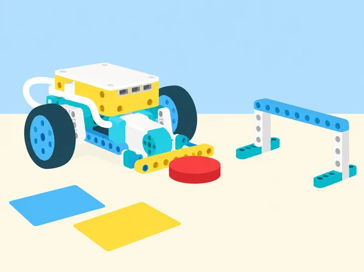

_Cinc reptes propis per practicar cooperació, ideació, programació i revisió en equip._

## 🌱 Situació i intenció

El centre prepara una jornada de prototips on cada equip haurà d’explicar una idea, construir un mecanisme i convidar altres grups a provar-lo. La classe adapta íntegrament la col·lecció suplementària oficial de SPIKE Prime: cooperació, generació d’idees, comunicació d’un objecte, control de distància i joc de taula. Les missions, targetes, regles i imatge són originals i pensades per a un taller escolar valencià.

## 🎯 Aprenentatges i vocabulari

- Participar en una ronda d’ideació i seleccionar una proposta amb criteris compartits.
- Construir i programar un mecanisme de taula que resolga un repte delimitat.
- Provar la proposta, incorporar el retorn i explicar què s’ha canviat.
- Repartir rols i documentar contribucions sense premiar només la rapidesa o el resultat final.

## 📅 Seqüència didàctica · 5 sessions

Cada lliçó oficial dura 30–45 minuts; les sessions següents reserven també temps per documentar, provar amb una altra parella i fer retorn. Les targetes de treball i els criteris són propis. Organitzeu equips de 2–3 persones, roteu qui pren decisions i qui manipula el prototip, i conserveu una llibreta de proves comuna.

### **Sessió 1 · Les mans cooperen per moure mostres · [Pass the Brick](https://education.lego.com/en-us/lessons/prime-extra-resources/pass-the-brick/).**

#### Fase 1 · Activem i prediem

**Activació (5 min):** què vol dir que tot l’equip avance cap a un objectiu compartit? Parleu de responsabilitats, torns i ajuda entre iguals. Formeu equips de 2–3 persones i anoteu una predicció: quines decisions faran que la pinça puga passar una peça amb seguretat? Trieu una persona coordinadora per a la primera ronda; el rol canviarà en cada repte.

#### Fase 2 · Explorem i construïm

**Exploració (10 min):** construïu una mà robòtica amb el motor i les peces SPIKE Prime disponibles; podeu consultar les instruccions oficials de l’app o fer un prototip propi segur. Prepareu sis maons lleugers i grans per a moure’ls, i proveu que el mecanisme obri i tanque la pinça. El control base pot usar els botons esquerre i dret del hub. La inclinació o el sensor de força són extensions, no requisits. Si el mecanisme no subjecta bé, ajusteu una sola peça i torneu a provar abans d’iniciar els reptes.

#### Fase 3 · Expliquem i registrem

**Reptes 2 i 3 (15 min):** en el primer, cada membre fa un torn per traslladar d’un en un els sis maons del punt A al punt B amb la mà robòtica; canvieu la persona coordinadora i anoteu el nombre de passades completades i les peces caigudes. Després, durant tres minuts, apileu els maons d’un en un per torns i observeu quina altura aconseguiu. Si cau la torre, la persona que acaba de jugar explica què ha observat i l’equip planifica la reconstrucció; no hi ha penalització individual. Registreu el temps i l’altura de la torre per ronda, i assegureu-vos que cada persona tinga un torn i una responsabilitat.

#### Fase 4 · Apliquem i millorem

**Repte 4 (10 min):** ajunteu dos equips i trieu una nova persona coordinadora. L’equip A passa un maó amb la pinça a una persona de l’altre equip en un punt intermedi; l’equip B el rep amb la seua pinça i el porta a la safata final. Feu torns perquè totes les persones participen. Proveu una sola variació de disseny o instrucció i repetiu el relleu en condicions comparables; anoteu què ha canviat. Com a ampliació, afegiu una regla acordada —per exemple, passar primer el maó blau— o una limitació de moviment accessible; no convertiu les rondes en una competició de velocitat.

#### Fase 5 · Comprovem i reflexionem

**Avaluació i retorn (5 min):** compareu les prediccions amb les dades de cada repte. Feu un recompte o una comparació de temps agregats per ronda; si hi ha diverses repeticions, calculeu-ne la mitjana, sense publicar classificacions d’equips ni atribuir errors a una persona. Cada alumne tria una targeta d’autoavaluació: blava (hem resolt el repte junts), groga (hem animat totes les persones a participar) o violeta (hem ajudat tothom i ens hem proposat un repte nou). Una altra parella aporta un comentari concret i una proposta de millora. Expliqueu què ha fet més fiable el relleu i recolliu les peces.

### **Sessió 2 · Idees en temps limitat · [Ideas, the LEGO way!](https://education.lego.com/en-us/lessons/prime-extra-resources/ideas-the-lego-way/).**

#### Fase 1 · Activem i prediem

**Activació (5 min):** trieu una rutina del centre que es podria millorar, com preparar el material d’una eixida o deixar el taller a punt. Què costa fer-la? Qui hi participa? Abans d’idear solucions, anoteu una predicció sobre què ajuda a generar idees diverses. No partiu de la premissa que cal automatitzar la rutina.

#### Fase 2 · Explorem i construïm

**Ideació individual (8 min):** feu servir el compte arrere del hub SPIKE o un temporitzador extern. Durant els primers 3 minuts, cada persona anota tantes idees com puga per a la necessitat triada, sense valorar-les encara. Dediqueu els 5 minuts següents a dibuixar o construir individualment una idea amb paper, llapis, tisores, cinta o peces LEGO. La maqueta pot ser esquemàtica; no s’espera que funcione.

#### Fase 3 · Expliquem i registrem

**Compartim i seleccionem (10 min):** durant 5 minuts, cada persona explica la seua idea a l’equip. Durant els 5 minuts següents, trieu-ne una amb criteris explícits: respon a una necessitat concreta, identifica qui se’n beneficiaria, es pot entendre i té una manera raonable de comprovar-la. Registreu les alternatives que no s’han triat i el motiu de la decisió; la selecció no és un judici sobre qui ha tingut la millor idea.

#### Fase 4 · Apliquem i millorem

**Prototip conceptual (15 min):** dediqueu 5 minuts a construir en equip una maqueta ràpida de la idea triada. Pot combinar maons LEGO amb cartó o paper i no necessita ser funcional: ha de comunicar el principi. En el temps restant, prepareu un vídeo breu, una presentació oral o un document visual que explique la necessitat, la idea i com es podria comprovar. Reserveu temps per recollir els materials. Si el centre ho prefereix, cada persona pot descriure també per escrit la seua idea individual.

#### Fase 5 · Comprovem i reflexionem

**Avaluació i reflexió:** comproveu si cada persona ha generat diverses idees, ha utilitzat un mitjà per expressar-ne una, ha participat en la selecció amb criteris i pot descriure la proposta a altres. Feu autoavaluació individual i demaneu a una altra parella un comentari constructiu. Per facilitar-ho, centreu-vos en una tasca concreta, treballeu com a grup-classe o substituïu el temporitzador del hub per un rellotge extern. Com a ampliació, feu una posada en comú general o repetiu l’activitat un altre dia i compareu com han canviat les idees. No puntueu la quantitat de peces ni exigiu una solució robòtica.

### **Sessió 3 · Inventem una cosa i n’expliquem l’ús · [What is this?](https://education.lego.com/en-us/lessons/prime-extra-resources/what-is-this/).**

#### Fase 1 · Activem i prediem

**Activació (3 min):** parleu de com comuniquem una idea i distingim una afirmació d’una prova: què és un argument? Quina evidència podria convéncer una altra persona? Anoteu què espereu descobrir quan observeu un mecanisme sense conéixer-ne l’ús.

#### Fase 2 · Explorem i construïm

**Exploració (12 min):** en parelles, construïu i executeu el mecanisme motoritzat que LEGO proposa: un element gira d’un costat a l’altre. Observeu-ne el moviment abans de posar-li nom o explicar-ne l’ús. Anoteu què podeu afirmar a partir de l’observació i què encara és només una hipòtesi. No cal que el prototip tinga un acabat final.

#### Fase 3 · Expliquem i registrem

**Definim i modifiquem (10 min):** inventeu un ús útil per a una persona o un espai del centre. Especifiqueu usuari, necessitat, acció, benefici i límit. Per exemple, el mecanisme podria mostrar per torn etiquetes d’una exposició escolar. Modifiqueu el model o el programa perquè responga al propòsit i dibuixeu un diagrama d’entrada–acció–propòsit. Si el model ho permet, podeu afegir un sensor de força per iniciar o parar el moviment, o un sensor de distància per detectar acostament; registreu què canvia i no presenteu aquests sensors com a obligatoris.

#### Fase 4 · Apliquem i millorem

**Fira de prototips (15 min):** cada equip presenta la seua versió i explica per què podria ser útil. Una altra parella observa una demostració d’un minut i intenta inferir-ne la funció sense pistes; després, qui ha dissenyat el model mostra quina característica sosté la seua afirmació. Recolliu una pregunta i un suggeriment concret, feu una modificació si és viable i reserveu temps per a recollir les peces. L’audiència avalua la claredat de l’explicació, no si el prototip és un producte fabricable.

#### Fase 5 · Comprovem i reflexionem

**Avaluació i reflexió:** observeu si cada equip descriu la funció, relaciona les característiques amb la necessitat d’una persona i defensa les afirmacions amb proves. Cada alumne tria una targeta: blava (puc descriure com funciona), groga (puc explicar-ne el funcionament i què resol bé) o violeta (puc convéncer amb arguments i evidències). Una altra parella dona retorn constructiu. Per facilitar la ideació, limiteu la sessió a un àmbit com el pati o una joguina i oferiu una targeta de necessitats. Com a ampliació, repetiu-la un altre dia sense reutilitzar idees, exigiu un sensor al prototip final si hi ha temps, o feu una fira escolar amb rols alterns d’equip emprenedor i equip patrocinador.

### **Sessió 4 · Estimar, calcular i parar · [Going the Distance](https://education.lego.com/en-us/lessons/prime-extra-resources/going-the-distance/).**

#### Fase 1 · Activem i prediem

**Activació (3 min):** quan apreneu a utilitzar un objecte nou, llegiu el manual, consulteu una guia ràpida o proveu fins a entendre’l? Predigueu què haureu de mesurar per a aturar una base mòbil prop d’una peça sense tocar-la.

#### Fase 2 · Explorem i construïm

**Construcció i primera prova (12 min):** munteu en parelles el model Rhino de l’app o, si no teniu accés a les instruccions, una base de conducció pròpia. Es pot dividir el muntatge en cos i cap; per a estalviar temps, utilitzeu només la base en els reptes calculats. Situeu-la a un metre d’un maó LEGO dret i programeu-la perquè avance i s’ature tan prop com puga sense tocar-lo. Mesureu la circumferència de les rodes: en el Rhino oficial, el diàmetre és 5,6 cm i cada rotació recorre 17,6 cm; si heu fet una base diferent, mesureu les seues rodes i feu els càlculs amb el valor real. Anoteu la predicció, els valors de programació, la distància final i l’error per a reutilitzar les dades.

#### Fase 3 · Expliquem i registrem

**Compare i transferència (10 min):** compareu com cada parella ha calculat el recorregut d’un metre i expliqueu quin procediment s’ajusta millor a les observacions. A partir de les dades anteriors, calculeu els valors per a desplaçar-vos 120 cm des de l’eixida. Feu **un únic intent** d’aquesta segona prova: abans d’executar, registreu el càlcul i la predicció; després, mesureu el resultat i compareu-lo amb l’esperat. Preferiu rotacions o graus a segons, perquè el temps de recorregut canvia quan varia la potència del motor.

#### Fase 4 · Apliquem i millorem

**Parada amb sensor (15 min):** afegiu el cap i el sensor de força al frontal. Programeu els motors perquè s’aturen quan el sensor contacte suaument amb una paret ampla de maons. Compareu aquesta parada per contacte amb l’aturada calculada per rotacions: què detecta cada mètode i quina incertesa conserva? No confongueu el sensor de força amb el de distància. Si no teniu disponible el sensor, registreu una activació manual com a alternativa didàctica, però no la presenteu com una prova equivalent del sensor. Recolliu les peces i manteniu les mans fora del recorregut mentre la base es mou.

#### Fase 5 · Comprovem i reflexionem

**Avaluació, extensió i retorn:** valoreu si l’equip ha usat les observacions per millorar el resultat, ha seguit un mètode sistemàtic i ha transferit el càlcul a una distància nova. Autoavaluació amb targetes: blava (he estimat), groga (he estimat i calculat) o violeta (he trobat una solució precisa i pròpia); una altra parella ofereix retorn constructiu. Com a extensió matemàtica, feu una taula de rotacions i distàncies i estimeu les voltes per a 2,5 m, 400 cm i 3500 mm. També podeu comparar una potència del 25% amb una del 75% o provar rodes més menudes, canviant una sola variable cada vegada. Expliqueu el mètode triat al grup; les dades proven el comportament d’aquesta base i aquestes condicions, no una precisió universal.

### **Sessió 5 · Creem un joc de taula cooperatiu · [Goal!](https://education.lego.com/en-us/lessons/prime-extra-resources/goal/).**

#### Fase 1 · Activem i prediem

**Activació (5 min):** acordeu una meta comuna per al joc de taula i descriviu què vol dir col·laborar. Diferencieu-ho del treball en equip dirigit per una única persona: ací totes les persones proposen i decideixen juntes. Definiu rols temporals (muntar, provar, registrar o observar la seguretat), com sereu honestos quan hi haja una errada i com rotareu perquè totes les idees puguen entrar en el repte.

#### Fase 2 · Explorem i construïm

**Construcció i exploració (10 min):** en parelles, munteu un mecanisme de taula que impulse un disc lleuger i proveu el programa abans de jugar. Delimiteu una pista curta, estable i buida al voltant; no apunteu cap mecanisme ni peça a les persones. Repartiu el control, la preparació del camp i l’observació, però preneu les decisions de disseny conjuntament.

#### Fase 3 · Expliquem i registrem

**Repte de referència (10 min):** cada equip disposa d’un minut per marcar tants gols com puga en la porteria de maqueta. Registreu el resultat i una dada de col·laboració observable: com s’han repartit els torns, quines decisions han pres juntes i com han respost a una fallada. Si compareu equips, feu-ho per millorar la regla o el prototip; no publiqueu una classificació de persones.

#### Fase 4 · Apliquem i millorem

**Dissenyem i compartim (15 min):** cada equip crea un repte propi amb regles escrites i il·lustrades: dibuixeu el camp, la porteria, el sistema de puntuació i com es reinicia la ronda. Combineu idees de totes les persones i proveu el joc amb un altre equip; després canvieu els equips o els rols, recolliu suggeriments i feu una millora. Si el kit ho permet, podeu afegir un segon disc, un obstacle de cartó, una zona de punts o un sensor de força que inicie cada colp del mecanisme. L’obstacle o la porteria poden ser una silueta de paper; no cal minifigura ni accessori no confirmat. Manteniu les peces lleugeres i el mecanisme orientat cap a la pista.

#### Fase 5 · Comprovem i reflexionem

**Avaluació, dades i reflexió:** valoreu si l’equip ha col·laborat durant tota la sessió, ha aclarit els rols i ha integrat les idees de totes les persones. Autoavaluació amb targetes: blava (hem col·laborat en el repte), groga (hem creat un repte original) o violeta (hem combinat les idees del grup en una nova regla); una altra parella dona retorn constructiu. Com a extensió matemàtica, manteniu el mateix disc i camp, proveu diferents potències i representeu la relació entre potència i distància. Registreu per separat tirs, tirs a porteria, gols i passades encertades, i resumiu les dades amb estadístiques senzilles. Expliqueu què es pot concloure d’aquestes proves i què no es pot generalitzar a altres mecanismes o camps.

## 🧰 Materials i preparació

Set SPIKE Prime amb hub, motors, sensor de força (necessari en la prova de la sessió 4, opcional com a ampliació en les sessions 1 i 5), peces per a una pinça i un mecanisme propulsor, un disc gran i lleuger, maons de LEGO, cinta de paper o cartó, regla o cinta mètrica, safates, sis fitxes lleugeres, targetes i cronòmetre (pot ser el temporitzador del hub). Per als prototips conceptuals, paper i llapis. El sensor de distància és una extensió possible a la sessió 3, no un requisit. El model Rhino no és necessari: munteu una base escolar estable que puga avançar i aturar-se. Delimiteu la pista i comproveu els mecanismes a baixa velocitat abans de començar.

## 🧪 Evidències i avaluació

Carpeta de procés: (1) registre de passades, caigudes, temps i retorn cooperatiu; (2) idees individuals, criteris de selecció i maqueta; (3) funció, diagrama i explicació amb prova de comprensió d’una altra parella; (4) càlcul de roda, valors del programa, distància d’error i comparació entre parada calculada i sensor de força; (5) regles visuals, intents, tirs a porteria, gols i passades encertades. Observeu si l’alumnat treballa cap a un objectiu comú, facilita que cada membre hi contribuïsca i aplica les dades per a millorar. En cada evidència useu tres nivells descriptius: *amb ajuda* (contribueix quan rep una pauta concreta), *autònom* (explica i aplica el procediment) i *transfereix* (ajuda a altres i justifica una millora amb dades). Doneu retorn sobre una acció observable, no sobre trets personals; reserveu autoavaluació i valoració entre iguals al final de cada sessió.

## ♿ Participació i seguretat

Els rols permeten contribuir sense manipular peces ni parlar davant del grup: es pot dibuixar, registrar dades, revisar instruccions o fer observacions. Delimiteu el camp de joc i manteniu els mecanismes a baixa velocitat; no useu projectils rígids, no apunteu a persones i no poseu mans davant d’un mecanisme en moviment.

## 🔗 Catàleg oficial adaptat

Aquesta seqüència reinterpreta les cinc lliçons compatibles amb SPIKE Prime de LEGO Education [Supplementary Lessons](https://education.lego.com/en-us/lessons/prime-extra-resources/): [*Pass the Brick*](https://education.lego.com/en-us/lessons/prime-extra-resources/pass-the-brick/), [*Ideas, the LEGO way!*](https://education.lego.com/en-us/lessons/prime-extra-resources/ideas-the-lego-way/), [*What is this?*](https://education.lego.com/en-us/lessons/prime-extra-resources/what-is-this/), [*Going the Distance*](https://education.lego.com/en-us/lessons/prime-extra-resources/going-the-distance/) i [*Goal!*](https://education.lego.com/en-us/lessons/prime-extra-resources/goal/). S’han revisat individualment els objectius, els temps, els passos públics, les extensions i els criteris d’avaluació de cada pla docent. Les adaptacions preserven les quatre rondes de cooperació de la primera lliçó; les cinc fases de temps limitat i el prototip conceptual de la segona; l’observació, definició, modificació i presentació de la tercera; els tres reptes progressius de mesura, estimació i parada sensorial de la quarta; i el minut de joc, disseny d’un repte propi i extensió de dades de la cinquena. Els contextos, les explicacions, les dades, les regles i els materials auxiliars són propis. LEGO remet les instruccions de construcció i fulls d’alumnat a l’app SPIKE; per això la cobertura ací és completa respecte dels cinc plans públics, no una reproducció de materials privats de l’app. La il·lustració és pròpia i correspon al repte de joc. La col·lecció [Prime Combined](https://education.lego.com/en-us/lessons/spike-and-bricq-motion-prime-combined/) s’audita a banda perquè les seues activitats declaren també el set BricQ Motion Prime.
