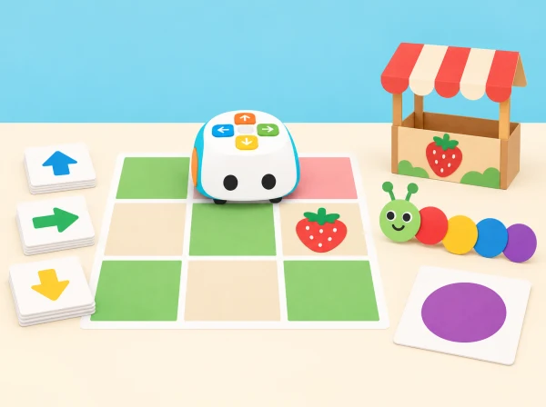
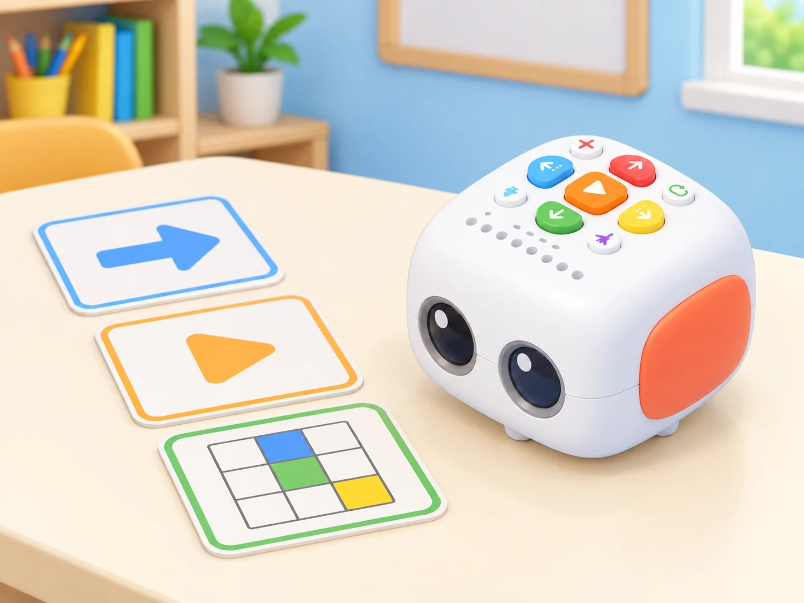
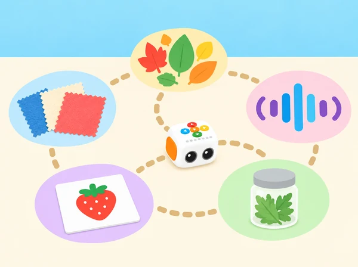
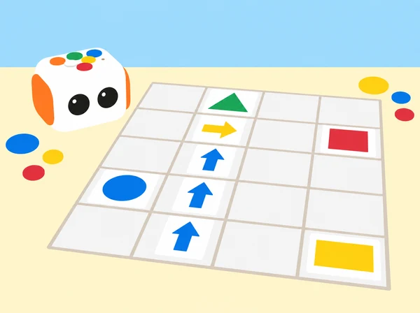
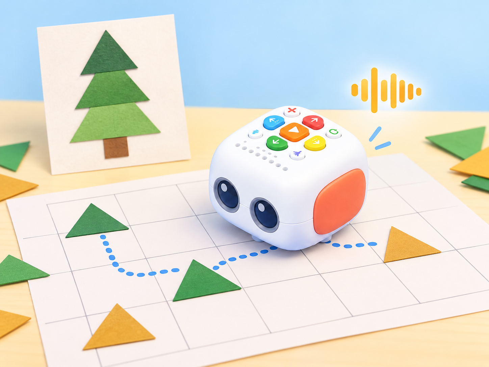

_Els set estands de la fira es construeixen amb targetes i materials senzills de l'aula._

## 🌱 Punt de partida

La classe organitza una fira de descobertes per a una altra aula. Tale-Bot visita estands de l'escola, una parada de fruita, un espai de formes i una taula d'art. En cada sessió, l'alumnat formula una pregunta, representa les ordres amb targetes, prediu el trajecte i prova el programa. El mapa, els materials, els personatges i les consignes són originals i s'adapten als llocs propers al centre.

Aquesta seqüència comença amb una sessió pròpia que adapta els objectius públics de la [primera lliçó del nivell 1](https://matatalab.com/en/node/827) —reconéixer Tale-Bot Pro i les seues parts i botons, practicar l’encesa/apagada i tractar el robot amb cura— i continua amb propostes temàtiques basades en els títols públics de les lliçons 3–9. La segona lliçó («On són els animals de la granja?») té una adaptació separada a [El rastre del corral](../../situacio/index.html?id=tb-rastre-corral). Els plans complets de les lliçons 3–9 no s’han pogut consultar; les sessions corresponents adapten els temes i la progressió pública, sense atribuir al fabricant objectius o passos que no es poden verificar.

## 🗺 Una benvinguda i set estands

### **Hola, Tale-Bot: el coneixem i el cuidem (40 min).**

#### Fase 1 · Activem i prediem (5 min)

Presenteu el Tale-Bot Pro del centre com una màquina que respon a instruccions. Compareu-lo amb una persona i amb un vehicle de joguina: quines accions pot fer cadascun, què necessiten per funcionar i quines idees són només suposicions? L’objectiu és despertar curiositat i reconéixer que el robot no té intencions humanes: el grup decideix les instruccions i comprova la resposta. Acordeu també una norma observable de cura, com ara esperar que el robot s’ature abans d’alçar-lo.

#### Fase 2 · Explorem i construïm (10 min)

Amb un Tale-Bot apagat, observeu-ne el cos, les rodes, els botons i els indicadors lluminosos. Useu una maqueta o silueta de paper pròpia per assenyalar cada part i relacionar-la amb una funció que després comprovareu. Si el kit del centre els inclou, mostreu les ales i el suport per a dibuixar o construir; són peces de caracterització o accessoris, no parts que el robot puga moure de manera autònoma. Prepareu deu gots de paper lleugers com a fites per a una ruta, no com a obstacles per colpejar, i cinta de pintor per a fixar el mapa sense deixar adhesiu al robot. La pàgina pública de la [lliçó 1](https://matatalab.com/en/node/827) enumera el robot, una maqueta de paper, ales, suports per a dibuix/construcció, deu gots i cinta entre els materials; els accessoris s’usen només si formen part de la dotació del centre.

_La silueta i els gots són recursos didàctics propis; el robot il·lustrat correspon al Tale-Bot Pro del kit._

#### Fase 3 · Expliquem i registrem (10 min)

En parelles, ordeneu targetes pròpies de «encendre», «introduir una ordre», «prémer *Play*» i «observar». Amb supervisió, cada equip encén i apaga el robot segons la guia del centre i comprova les quatre ordres de moviment bàsic —avant, arrere, esquerra i dreta— en una superfície plana. Abans de prémer *Play*, observeu els indicadors que corresponen a les ordres introduïdes; després, comproveu si el recorregut coincideix amb la predicció. Anoteu què han fet realment els botons i quina part del procés depén de les persones.

#### Fase 4 · Apliquem i millorem (10 min)

Prepareu una zona plana, neta i allunyada de vores. Col·loqueu els deu gots com a dues files de fites i creeu una destinació pròpia amb una targeta «hola»; la ruta ha de passar per un corredor ample sense tocar els gots. Una parella tria el punt d’inici, orienta el robot i prediu les ordres; l’altra observa els indicadors i comprova el trajecte. Si no coincideixen, canvieu una sola ordre o corregiu l’orientació i torneu a provar. Qui no manipule el robot pot dirigir la seqüència amb targetes, portar el registre o assenyalar l’accessori que s’està observant.

#### Fase 5 · Comprovem i reflexionem (5 min)

**Evidència:** maqueta de paper anotada, demostració d’encesa/apagada, seqüència de quatre ordres i indicadors observats, predicció/resultat de la ruta i una norma de cura explicada amb un exemple.

**Pregunta docent:** quines parts del recorregut ha decidit el programa i quines decisions continuen sent de les persones?

### **Sessió 1 · L'escola de Tale-Bot — «Matatalab School».**

#### Fase 1 · Activem i prediem

Observeu la planta simplificada de l’aula i les tres destinacions. Trieu una ruta entre dos llocs i feu una predicció amb targetes: quantes ordres cap avant necessitarà Tale-Bot si comença orientat cap a la biblioteca? Assenyaleu inici, orientació i meta abans de programar.

#### Fase 2 · Explorem i construïm

Dibuixem una planta senzilla de l'aula amb tres llocs d'interés (biblioteca, hort o pati). Per parelles, triem un destí, escrivim una seqüència d'ordres i expliquem com l'hem calculada. Una persona fa de robot en la graella de paper i després comparem la representació amb el recorregut del Tale-Bot real. Tanquem amb una instrucció per a les visites de la fira.

#### Fase 3 · Expliquem i registrem

Representeu la ruta amb una tira d’ordres i expliqueu cada pas amb «des de… avance… caselles». Registreu la casella inicial, l’orientació, la meta, la seqüència prevista i la posició final observada. Una altra parella ha de poder reconstruir el trajecte només amb el registre.

#### Fase 4 · Apliquem i millorem

Feu que una parella diferent execute la mateixa seqüència des del mateix inici i sense explicacions orals durant el moviment. Si arriba a una casella diferent, reviseu primer l’orientació i després una ordre cada vegada. Marqueu la versió inicial i la corregida i comproveu si una visita pot seguir el mapa sense ajuda.

#### Fase 5 · Comprovem i reflexionem

**Evidència:** planta amb llegenda, dues rutes amb inicis orientats, tira d’ordres inicial/final i comprovació d’una parella visitant. Expliqueu quina informació del mapa ha evitat una instrucció ambigua i què encara s’ha de dir en veu alta.

### **Sessió 2 · Un robot, moltes respostes — «Versatile Matatalab Robot».**

#### Fase 1 · Activem i prediem

Mireu tres targetes de repte: arribar a una casella, fer una dansa i dibuixar un traç. Predigueu quines accions corresponen a ordres de moviment i quines necessiten una funció o accessori. Distingiu una resposta que el robot pot executar d’una interpretació humana com ara «estar content».

#### Fase 2 · Explorem i construïm

Preparem tres microreptes en un mateix mapa: arribar a una casella, fer una pausa i continuar cap a una altra destinació. Amb el Tale-Bot Pro i els seus accessoris propis, provem moviments, una dansa i un dibuix curt amb retolador rentable; anotem què fa el robot en cada seqüència i com es pot esborrar el programa per tornar a començar. Separem les funcions integrades dels accessoris de muntatge i no atribuïm al robot cap sensor que no tinga.

#### Fase 3 · Expliquem i registrem

Completeu una taula de tres columnes: seqüència introduïda, resultat observable i material necessari. En la prova de dibuix, anoteu si el suport i el retolador estaven muntats; en la dansa, descriviu el moviment que s’ha vist, sense afirmar que el robot haja triat una emoció o entenga la música.

#### Fase 4 · Apliquem i millorem

Proveu primer cada microrepte per separat i esborreu la seqüència abans del següent. Després, combineu moviment i una acció final en un programa curt. Si el dibuix ix del full, fixeu millor el paper o canvieu el recorregut; no canvieu alhora el programa i el muntatge. La dansa i el dibuix són opcions, no requisits si el kit no porta els accessoris corresponents.

#### Fase 5 · Comprovem i reflexionem

**Evidència:** tres microprogrames separats, un programa combinat i taula d’observació. Expliqueu què canvia quan s’afegeix una ordre i quina acció depén d’un accessori; la dansa aleatòria no és una ordre coreogràfica que l’alumnat puga especificar.

### **Sessió 3 · El recorregut dels cinc sentits — «My Five Senses».**

#### Fase 1 · Activem i prediem

Trieu tres pictogrames d’estació i decidiu un ordre de visita. Abans de moure cap material, predigueu quina seqüència de moviments serà necessària i quina característica es podrà observar en cada parada. Recordeu que Tale-Bot no té sensors de gust, olfacte, tacte, oïda o visió: l’observació la fan les persones.

#### Fase 2 · Explorem i construïm

Prepareu cinc estacions amb pictogrames: colors, un so ambiental suau triat pel docent, retalls nets de tela, una imatge de fruita i un recipient tancat amb una herba culinària coneguda. No tasteu aliments ni obriu ni acosteu recipients al nas. Qualsevol infant pot passar una estació o participar mirant i assenyalant. Trieu tres parades, ordeneu-les amb targetes i traceu la ruta sobre el mapa. Tale-Bot només indica el recorregut; les persones observen i descriuen.

_Les imatges indiquen llocs d'observació, no instruccions perquè el robot perceba sabors, olors, sons o textures._

#### Fase 3 · Expliquem i registrem

En parella, repartiu els rols de programar i observar. En cada parada, registreu una característica amb pictograma o paraula i distingiu dues columnes: «què ha fet el robot» i «què hem observat nosaltres». No anoteu preferències, salut, noms ni experiències personals. Si només hi ha un robot, els altres equips planifiquen la ruta en paper mentre esperen torn.

#### Fase 4 · Apliquem i millorem

Canvieu l’ordre de dues estacions i predigueu si cal una seqüència diferent. Executeu-la des del mateix punt d’inici i compareu només el recorregut; manteniu les mateixes targetes i la mateixa orientació. Oferiu una ruta alternativa de mirar o assenyalar, sense tocar, tastar ni olorar cap material.

#### Fase 5 · Comprovem i reflexionem

**Evidència:** ruta amb tres parades, registre pictogràfic i comparació entre ordre inicial i reordenat. Expliqueu una observació feta per les persones i una acció executada pel robot, sense confondre-les.

### **Sessió 4 · La botiga de temporada — «Matata Grocery Store».**

#### Fase 1 · Activem i prediem

Llegiu una comanda de dos productes dibuixats i mireu el plànol de la parada. Predigueu quin producte visitareu primer, quantes ordres necessita el trajecte i quin serà el cost total si les fitxes indiquen preus. Els preus són dades del joc, no preus actuals del mercat.

#### Fase 2 · Explorem i construïm

Dissenyem una parada amb imatges de productes de mercat local i fitxes de preus senzills. Una targeta de comanda demana visitar dos productes; l'equip calcula la ruta i, si és adequat al nivell, suma dos preus. El robot lliura una fitxa de paper i una persona comprova que la comanda coincideix. Els aliments són dibuixats o de joguina: no es manipula ni es reparteix menjar real.

#### Fase 3 · Expliquem i registrem

Traceu el programa sobre una graella i anoteu el recompte de moviments entre cada producte. En un registre diferent, sumeu els dos preus i escriviu l’operació. La persona que rep la comanda comprova la seqüència i la suma per separat: una ruta correcta no garanteix una suma correcta.

#### Fase 4 · Apliquem i millorem

Intercanvieu la comanda amb una altra parella. Feu una primera prova de ruta, lliureu una fitxa per producte i reviseu si la llista i la suma coincideixen. Si hi ha error, indiqueu si és de moviment, ordre de visita o càlcul; canvieu-ne només un i torneu a provar des del mateix inici.

#### Fase 5 · Comprovem i reflexionem

**Evidència:** comanda marcada, programa amb inici orientat, dues fitxes lliurades i suma comprovada. Expliqueu com heu distingit el recorregut del càlcul i per què les etiquetes «horta» o «mercat» no representen dades de compra reals.

### **Sessió 5 · Quantes maduixes hi ha? — «Count Strawberries I».**

#### Fase 1 · Activem i prediem

Observeu les caselles amb grups de maduixes de paper i trieu una ruta. Predigueu el total abans de comptar i decidiu com marcareu cada casella visitada perquè cap grup es compte dues vegades ni se n’oblide cap.

#### Fase 2 · Explorem i construïm

Situem grups de maduixes de paper en diverses caselles. Abans de programar, cada equip prediu quantes trobarà en una ruta i tria com evitar comptar-ne alguna dues vegades. Després segueix el recorregut, marca cada grup visitat i compara predicció i recompte. Com a ampliació, canviem l'ordre dels estands i comprovem si el total es manté.

#### Fase 3 · Expliquem i registrem

Useu una taula amb casella, quantitat observada i subtotal acumulat. En cada parada, marqueu la casella només després de mirar-la; després, una segona persona torna a comptar els grups sense seguir el robot per comprovar el total per una via independent.

#### Fase 4 · Apliquem i millorem

Canvieu la posició d’un grup de maduixes, manteniu la resta igual i torneu a calcular el total. Compareu la predicció i el recompte abans/després. Si el total no canvia, expliqueu per què; si canvia, identifiqueu la casella modificada sense modificar també la ruta.

#### Fase 5 · Comprovem i reflexionem

**Evidència:** ruta, caselles marcades, predicció inicial, taula de subtotals i recompte independent. Expliqueu quina estratègia ha evitat duplicar una casella i recordeu que les maduixes són fitxes de joc, no una collita observada.

### **Sessió 6 · El monstre de les formes — «Shape Monster I».**

#### Fase 1 · Activem i prediem

Compareu les targetes de triangle, quadrat, cercle i rectangle. Trieu-ne una i predigueu quantes caselles o canvis de direcció caldran per visitar els punts de la seua vora en ordre, començant en una marca orientada.

#### Fase 2 · Explorem i construïm

Cada equip rep una silueta geomètrica gran i la descompon en fites de la graella. El robot visita els vèrtexs en ordre; el grup anota canvis de direcció i nombre de trams, i una persona uneix els punts en paper. Compareu triangles i quadrilàters sense exigir que Tale-Bot dibuixe: la línia es representa amb llapis després de la ruta.

#### Fase 3 · Expliquem i registrem

Registreu el nombre de trams rectes, les caselles de cada tram i els canvis de direcció observats. Una persona uneix els punts després del recorregut i identifica la forma; compareu el contorn amb la targeta sense dir que Tale-Bot dibuixa si no porta el suport i el retolador.

#### Fase 4 · Apliquem i millorem

Intercanvieu la ruta amb una parella que no coneix la forma triada. Si el contorn reconstruït no coincideix, reviseu una instrucció o un punt de gir i repetiu des del mateix inici. Compareu dues formes i determineu si el nombre de trams rectes basta per distingir-les o si també cal observar-ne la disposició.

#### Fase 5 · Comprovem i reflexionem

**Evidència:** targeta seleccionada, ruta marcada, registre de trams/girs i forma reconstruïda per una altra parella. Expliqueu quina observació permet identificar la forma i quin paper ha tingut la persona que ha unit els punts.

_La imatge mostra una ruta de caselles i targetes geomètriques; les formes les identifica l’alumnat, no el robot._

### **Sessió 7 · L'eruga artista — «Matata Artist—Caterpillar».**

#### Fase 1 · Activem i prediem

Observeu una eruga formada per cercles de paper i trieu una regla senzilla, com ara blau–groc–blau–groc o gran–menut–gran–menut. Predigueu quin segment vindrà després i en quin ordre haurà de visitar Tale-Bot les parts del patró.

#### Fase 2 · Explorem i construïm

A partir d'una eruga de cercles de paper, triem un patró de colors o formes i construïm un recorregut perquè el robot visite els segments en l'ordre desitjat. Col·loquem un retolador rentable en el suport inclòs i comprovem el traç en paper gran, amb un adult que prepare el full i retire el retolador en acabar. Els infants expliquen la regla del patró i busquen un error o un canvi possible. Si falta el retolador o el suport en la unitat del centre, resolen el mateix repte amb el mapa i les targetes de direcció.

#### Fase 3 · Expliquem i registrem

Dibuixeu la unitat que es repeteix i escriviu-la en una tira de targetes. Registreu quantes vegades apareix i assenyaleu el punt on la seqüència deixa de seguir la regla. Si utilitzeu el suport de retolador, descriviu el traç com un resultat del moviment, no com una forma que el robot reconega.

#### Fase 4 · Apliquem i millorem

Una altra parella continua el patró amb una peça tapada i programa una ruta que visite els segments en ordre. Compareu el programa amb la tira de targetes, corregiu només el primer punt on discrepen i torneu a executar. Si s’usa retolador, feu primer una prova curta en paper recuperable i fixeu el full; sense accessori, completeu la mateixa activitat amb fitxes i mapa.

#### Fase 5 · Comprovem i reflexionem

**Evidència:** unitat del patró, continuació de la seqüència, ruta de visita i una correcció justificada. Expliqueu com heu sabut què faltava i distingiu entre seguir un patró i dibuixar-lo amb un accessori.

**Ampliació inspirada en un estudi d’aula publicat per Matatalab:** prepareu una quadrícula pròpia amb triangles de paper repartits en diverses caselles. La parella programa Tale-Bot perquè visite les posicions acordades; són els infants qui recullen les fitxes i les compten, perquè el robot no les pot agafar ni reconéixer. Conteu-les en valencià i, si el grup ho tria, en una altra llengua. Amb les fitxes, construïu un avet de paper i expliqueu quina figura plana forma cada peça. Si el model del centre incorpora la targeta de micròfon, podeu enregistrar una frase fictícia breu i reproduir-la; també és vàlid narrar-la en directe o usar un pictograma. No graveu noms ni veus identificables sense autorització i esborreu els enregistraments en acabar.

_L'itinerari només guia la visita: són les persones qui compten i arrepleguen les fitxes i munten la figura._

## 🎯 Aprenentatges i criteris d’èxit

Llegir una graella, anticipar el resultat, provar una seqüència, comparar-la amb l’observació i justificar una correcció. Els criteris i les bastides per a diferents ritmes estan desenvolupats en la [guia docent complementària](../../guia/index.html?id=fira-descobertes).

## 🧰 Materials i preparació

Tale-Bot Pro de la dotació, mapes i targetes propis, fitxes reutilitzables i materials indicats en cada sessió. Comproveu els accessoris abans d’utilitzar-los; la [guia docent](../../guia/index.html?id=fira-descobertes) amplia la preparació i les alternatives.

## 🧪 Avaluació i evidències

Cada sessió demana una predicció, un registre de la prova i una explicació o canvi justificat. La graella d’observació i el diari de proves es troben en la [guia docent complementària](../../guia/index.html?id=fira-descobertes).

## ♿ Participació, accessibilitat i seguretat

Les rutes es poden anticipar en paper i les respostes es poden donar oralment, amb pictogrames o manipulant targetes. Les opcions sensorials, la privacitat i les normes dels accessoris estan detallades en la [guia docent](../../guia/index.html?id=fira-descobertes).

## 🔗 Font oficial i abast

La sessió inicial adapta els objectius públics de L1; els plans complets de L3–L9 no s’han pogut consultar i ací només s’adapten els seus temes visibles. L’ampliació dels triangles parteix d’un estudi d’aula italià publicat pel fabricant, no d’una lliçó numerada ni d’un pla docent complet. La proposta crea mapa, fitxes, seqüència i evidències pròpies, i delimita les accions humanes i l’ús opcional de veu. L’auditoria de fonts i les limitacions estan documentades en la [guia docent de la fira](../../guia/index.html?id=fira-descobertes).
