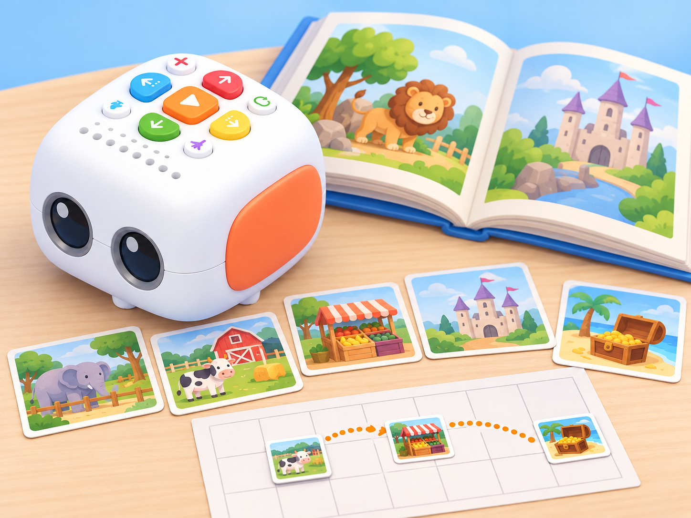

_El llibre, les targetes i la ruta són materials propis de paper; Tale-Bot executa una seqüència de comandaments i no reconeix les escenes ni tria les destinacions._

## 🌱 Punt de partida

La biblioteca del barri prepara un festival de relats itinerants. Els infants creen llocs, personatges i missatges i programen visites en un ordre triat pel grup. Els deu reptes adapten la categoria D de les Activity Cards: combina seqüències, bucles, expressió oral i orientació, però manté totes les històries obertes a diferents finals. Seguint les orientacions oficials, cada proposta es planifica per a infants de 3–5 anys, parelles i 20–30 minuts; alterneu els rols i permeteu explicar el relat amb paraules, pictogrames o una seqüència de targetes. Abans de cada repte, carregueu Tale-Bot, comproveu la versió del robot i prepareu una taula o terra nets i plans. Les històries i mapes d’aquesta adaptació són propis; useu adhesius OID o funcions de l’Activity Box només quan el centre en tinga i els haja verificat.

## 📚 Deu reptes globals

### **D-1 · El meu poble.**
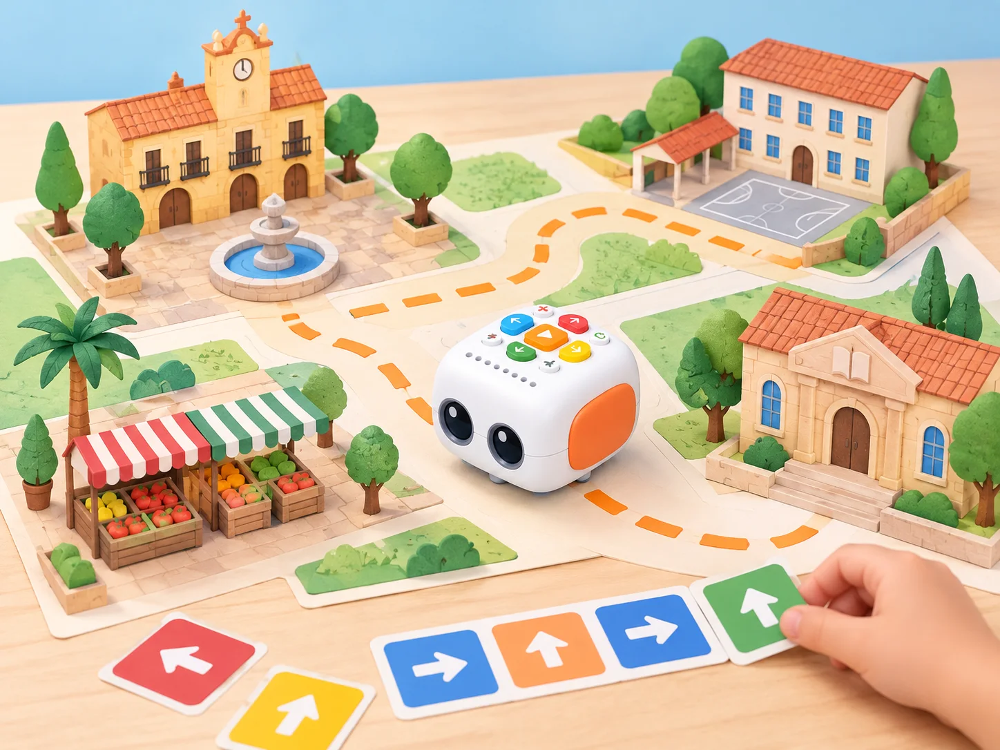

_El poble és una maqueta pròpia i les parades les tria l’alumnat; el robot no reconeix edificis ni redacta el relat._

#### Fase 1 · Activem i prediem

Trieu una plaça, una escola, un mercat i una biblioteca per al mapa. Predigueu quin ordre de visita ajudarà a contar una història del poble.

#### Fase 2 · Explorem i construïm

Col·loqueu les quatre destinacions i marqueu un inici. Prepareu targetes de direcció abans d’introduir les ordres en Tale-Bot.

#### Fase 3 · Expliquem i registrem

En cada parada, conteu una funció del lloc amb dibuix, paraula o pictograma. Registreu l’ordre de les destinacions i el missatge associat.

#### Fase 4 · Apliquem i millorem

Executeu el recorregut i comproveu les parades. Canvieu una destinació d’ordre i observeu com canvia el relat.

#### Fase 5 · Comprovem i reflexionem

**Evidència:** mapa, seqüència i relat breu. Expliqueu per què el grup ha triat eixe ordre.

### **D-2 · Visitem un parc zoològic.**
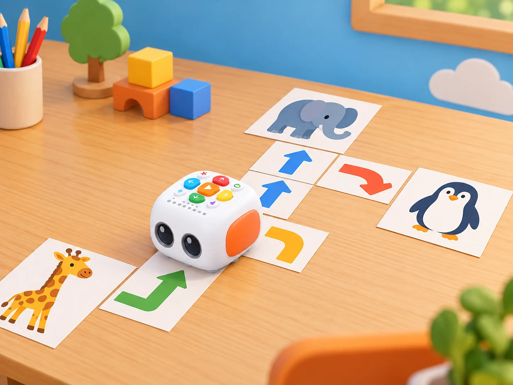

_Els animals són targetes, no hi ha fauna real; el robot no identifica animals ni els seus hàbitats._

#### Fase 1 · Activem i prediem

Escolteu una visita breu narrada per la docent i identifiqueu-ne les parades. Predigueu quines targetes d’animals apareixeran primer i al final.

#### Fase 2 · Explorem i construïm

Ordeneu les parades en el mapa propi i prepareu la seqüència amb targetes d’ordres. Si hi ha mapa interactiu oficial disponible, compareu-ne els modes d’instruccions, codi i creació.

#### Fase 3 · Expliquem i registrem

Anoteu l’ordre de les targetes i una dada o observació de cada parada. Diferencieu el que diu la història del que observeu en les imatges.

#### Fase 4 · Apliquem i millorem

Programeu Tale-Bot perquè repetisca el recorregut. Després canvieu l’ordre dels animals i inventeu una visita alternativa.

#### Fase 5 · Comprovem i reflexionem

**Evidència:** seqüència programada i relat d’una visita pròpia. L’activitat no requereix animals reals ni apropar-se a fauna.

### **D-3 · El xicotet missatger.**
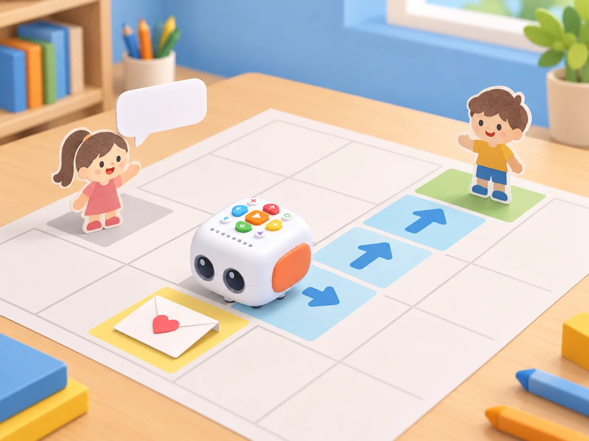

_El sobre i els personatges són materials narratius; el missatge el porta la seqüència programada o una persona, no una xarxa._

#### Fase 1 · Activem i prediem

Col·loqueu una icona de sobre i dos personatges en caselles triades a l’atzar. Predigueu quines parades necessita la missió per a portar el missatge.

#### Fase 2 · Explorem i construïm

Trieu un missatge breu inventat. Graveu-lo només si el model ho permet i hi ha consentiment; altrament, prepareu una targeta escrita o un pictograma.

#### Fase 3 · Expliquem i registrem

Marqueu l’ordre: punt d’inici, sobre i destinatari. Assageu la narració o lectura del missatge que correspon a cada parada.

#### Fase 4 · Apliquem i millorem

Programeu Tale-Bot fins al sobre i des d’allí fins al destinatari. Si el trajecte falla, localitzeu la primera ordre incorrecta i repetiu-lo.

#### Fase 5 · Comprovem i reflexionem

**Evidència:** ruta completa i missatge transmés amb gravació consentida, targeta o narració en directe.

### **D-4 · La granja I.**
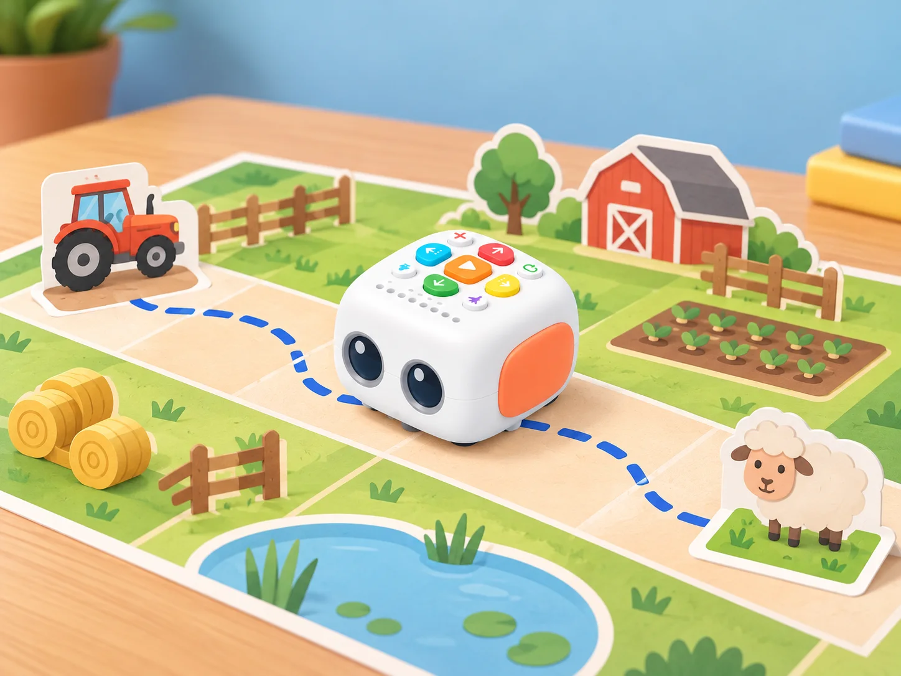

_El tractor i l’animal són targetes estàtiques; Tale-Bot no els identifica ni interactua amb animals._

#### Fase 1 · Activem i prediem

Poseu al mapa una icona de tractor i una d’animal. Predigueu quina ordre de parades permetrà visitar-les totes dues.

#### Fase 2 · Explorem i construïm

Prepareu la seqüència d’ordres fins al tractor i, després, fins a l’animal. Inventeu un missatge amable per a la segona parada.

#### Fase 3 · Expliquem i registrem

Anoteu l’ordre de les destinacions i el missatge. Si hi ha enregistrament, comproveu el seu ús i demaneu consentiment abans de gravar.

#### Fase 4 · Apliquem i millorem

Programeu el recorregut i canvieu la posició de les icones per a un segon repte. Ajusteu la ruta a la nova distribució.

#### Fase 5 · Comprovem i reflexionem

**Evidència:** dues distribucions provades i un missatge amable, gravat amb consentiment si la funció està disponible o narrat en directe.

### **D-5 · La botiga de queviures.**

#### Fase 1 · Activem i prediem

Trieu una llista de compra inventada per la docent i predigueu quantes parades cal fer abans d’arribar a la caixa.

#### Fase 2 · Explorem i construïm

Col·loqueu els aliments dibuixats i una caixa en el mapa. Prepareu un missatge «Necessite comprar…» amb una gravació consentida si la funció existeix o una targeta de narració.

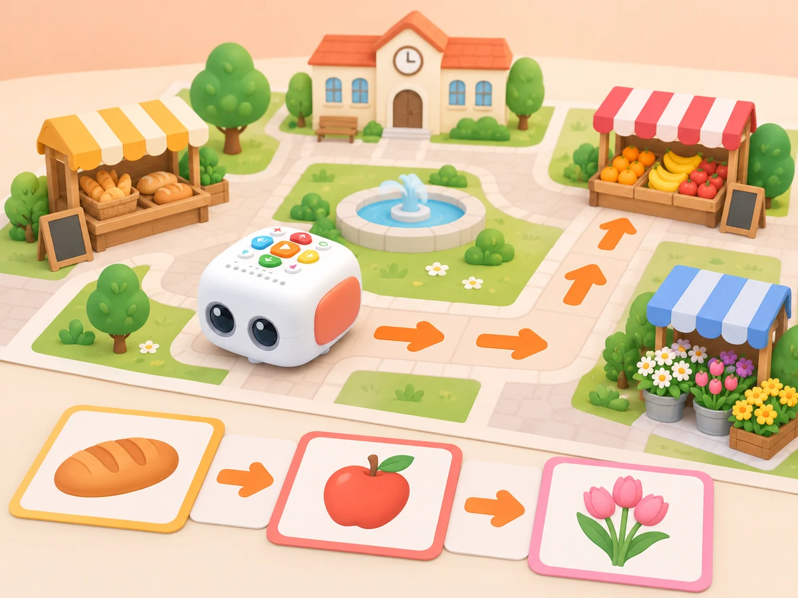

_Les parades i els productes són una maqueta narrativa creada per a l’activitat, no una representació d’un comerç concret._

#### Fase 3 · Expliquem i registrem

Ordeneu les parades segons la llista i poseu una fitxa al costat del robot en cada producte visitat. Manteniu la llista visible per comprovar què falta.

#### Fase 4 · Apliquem i millorem

Programeu una sola seqüència per visitar els productes i acabar a la caixa. Si una parada queda fora de l’ordre, reviseu el programa abans de tornar a començar.

#### Fase 5 · Comprovem i reflexionem

**Evidència:** llista completada i ruta fins a la caixa. Useu només aliments dibuixats; no demaneu informació de compres ni de dietes familiars.

### **D-6 · Ruta de patrulla com a conte.**
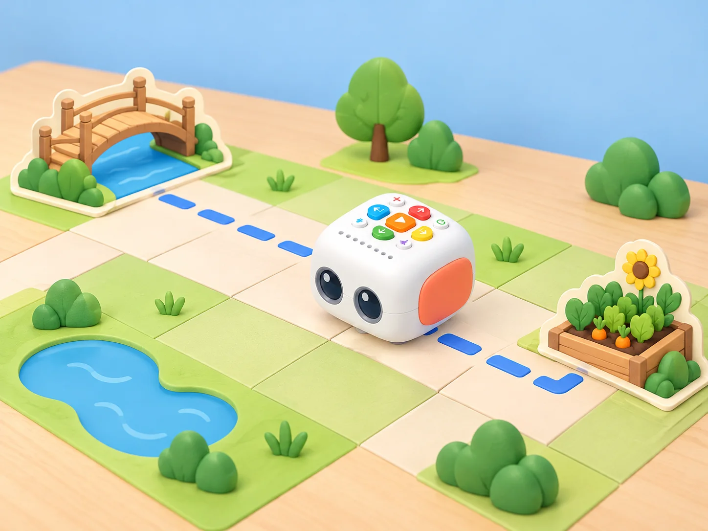

_És una història de convivència sobre el mapa, sense vigilància, detencions ni emergències reals._

#### Fase 1 · Activem i prediem

Trieu dues icones neutres d’un mapa de joc i imagineu un relat de convivència que les connecte. Predigueu quina parada convé visitar primer.

#### Fase 2 · Explorem i construïm

Marqueu una ruta que passe per les dues icones i prepareu totes les ordres en una seqüència.

#### Fase 3 · Expliquem i registrem

Anoteu què ocorre en cada parada i com es relaciona amb la següent. Comproveu que el relat té un inici, un canvi i un final inventats.

#### Fase 4 · Apliquem i millorem

Programeu Tale-Bot amb un sol programa i proveu el recorregut complet. Si una instrucció altera l’ordre, reviseu-la i torneu a narrar la història.

#### Fase 5 · Comprovem i reflexionem

**Evidència:** ruta i conte de ficció explicats. No representeu detencions, emergències ni vigilància real.

### **D-7 · La granja II.**
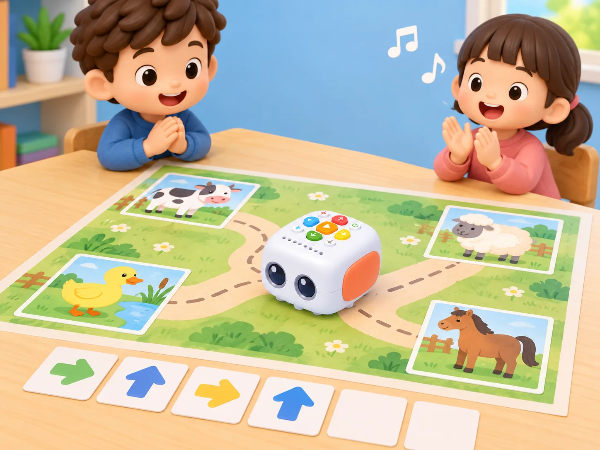

_La cançó i la seqüència les interpreta l’alumnat; el robot només executa les ordres de moviment._

#### Fase 1 · Activem i prediem

Col·loqueu icones d’animals i trieu una cançó de granja coneguda o una alternativa creada pel grup. Predigueu quin animal apareixerà primer.

#### Fase 2 · Explorem i construïm

Escolteu o interpreteu la cançó i anoteu l’ordre en què apareixen els animals. Prepareu una targeta per a cada parada.

#### Fase 3 · Expliquem i registrem

Compareu la seqüència de targetes amb l’ordre de la cançó. Marqueu quin animal apareix primer, quin al final i quins es repeteixen.

#### Fase 4 · Apliquem i millorem

Programeu Tale-Bot perquè visite les icones en l’ordre acordat. Reviseu la seqüència si una parada s’ha omés o repetit.

#### Fase 5 · Comprovem i reflexionem

**Evidència:** ruta i seqüència oral o visual. Conteu-la de nou i expliqueu com heu comprovat l’ordre.

### **D-8 · Una missió cooperativa al castell.**
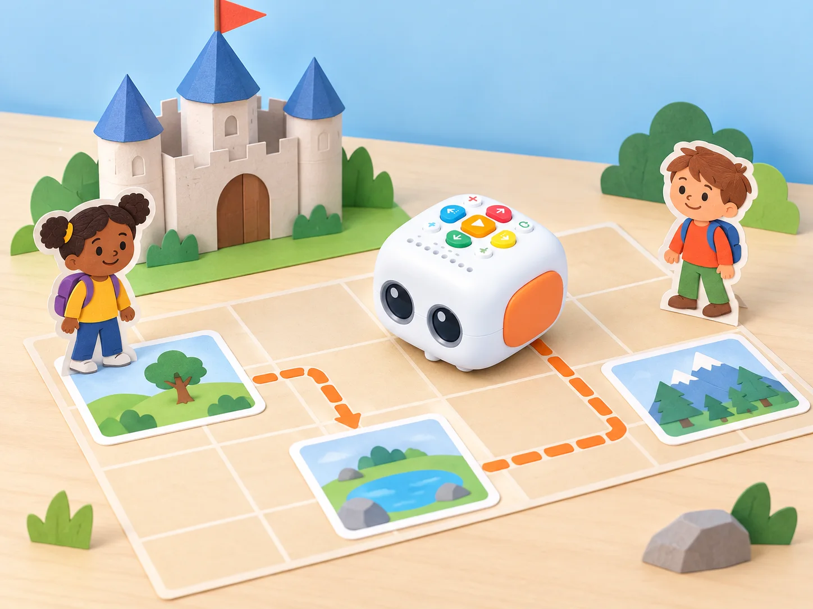

_Les figures i l’ajuda formen un conte inventat; el robot no manipula els personatges ni reconeix les escenes._

#### Fase 1 · Activem i prediem

Inventeu un conte en què un personatge troba una dificultat i rep ajuda amistosa. Predigueu quines escenes caldrà visitar perquè el relat s’entenga.

#### Fase 2 · Explorem i construïm

Repartiu les icones del relat en caselles triades a l’atzar, inclosa la persona que rep l’ajuda. Trieu una primera escena i prepareu la ruta per etapes.

#### Fase 3 · Expliquem i registrem

En cada arribada, retireu la targeta i poseu-la en fila. Registreu la seqüència perquè una altra parella puga reconstruir el conte.

#### Fase 4 · Apliquem i millorem

Continueu fins a completar el recorregut i arribar al desenllaç. Canvieu qui ajuda o el final mantenint la seqüència per etapes i proveu de nou.

#### Fase 5 · Comprovem i reflexionem

**Evidència:** ruta i relat reconstruït a partir de la fila de targetes. Expliqueu què fa que l’ajuda siga cooperativa.

### **D-9 · Cerca del tresor.**
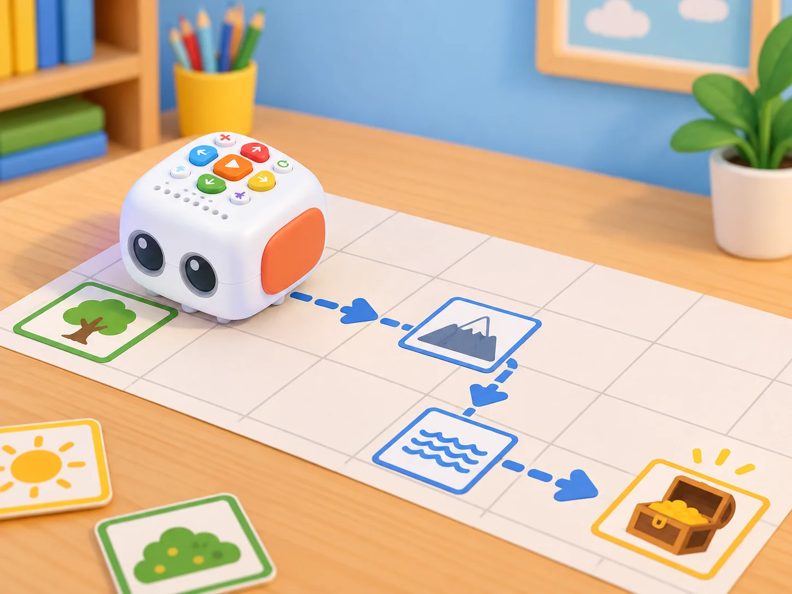

_L’alumnat ordena les pistes i programa el trajecte; Tale-Bot no les troba ni arreplega el tresor._

#### Fase 1 · Activem i prediem

Prepareu targetes pròpies de cerca i predigueu quina pista caldrà trobar primer i quina indicarà el tresor final.

#### Fase 2 · Explorem i construïm

Col·loqueu les pistes en ordre aleatori. La primera és el mapa del tresor i l’última el cofre o diamant; trieu la casella d’inici.

#### Fase 3 · Expliquem i registrem

Planifiqueu el trajecte i retireu cada targeta en arribar-hi, posant-la en fila. Manteniu visible l’ordre de les pistes recollides.

#### Fase 4 · Apliquem i millorem

Continueu fins al tresor i reconteu la història seguint les pistes. Creeu una segona distribució i reviseu el recorregut.

#### Fase 5 · Comprovem i reflexionem

**Evidència:** seqüència de pistes, ruta i relat final. L’objectiu és completar i narrar la seqüència, no trobar el camí amb menys ordres.

### **D-10 · El nostre llibre de contes preferit.**
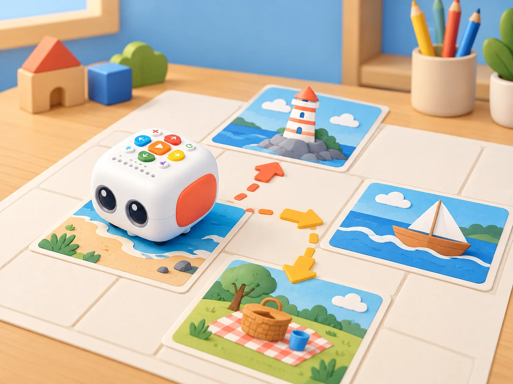

_Les targetes són originals i les crea el grup; el robot no llig el conte ni el narra._

#### Fase 1 · Activem i prediem

Escolteu un conte triat per la classe i recordeu-ne les escenes principals. Predigueu quines quatre o cinc targetes basten per a reconstruir-ne l’ordre.

#### Fase 2 · Explorem i construïm

Dibuixeu targetes originals per als moments clau sense copiar les il·lustracions del llibre. Poseu-les aleatòriament al mapa i prepareu la seqüència narrativa.

#### Fase 3 · Expliquem i registrem

Anoteu l’ordre correcte i una frase o idea que explique cada moment. Si graveu frases, demaneu consentiment i comproveu la funció del model.

#### Fase 4 · Apliquem i millorem

Programeu Tale-Bot perquè visite les targetes en ordre. En cada parada, reproduïu una frase gravada si és possible o feu que una persona narre en directe; reviseu l’ordre si el conte no s’entén.

#### Fase 5 · Comprovem i reflexionem

**Evidència:** conte reconstruït a partir de les targetes i recorregut. Compareu quines escenes heu triat i com l’ordre ajuda a entendre la història.

## 🎯 Aprenentatges i vocabulari

- Planificar una ruta amb diverses parades i un relat que es puga modificar.
- Usar ordres i bucles per representar un servei comunitari en un mapa fictici.
- Provar la seqüència, localitzar una ambigüitat i revisar les instruccions en equip.
- Comunicar la missió amb destinacions inventades, sense adreces ni dades de persones reals.

## 🧰 Materials i model real

Tale-Bot, quadrícula pròpia, icones dibuixades, targetes de personatges i cinta per fixar el mapa. L’enregistrament i el mode de missatge depenen del model Pro; si no hi són, es poden fer servir símbols i narració humana. Els mapes de l’Activity Box no són requisit.

## 🧪 Evidències i convivència

Mapa, seqüència de destinacions, programa, conte col·lectiu, prova amb un segon equip i una revisió del final. Avalueu orientació, ordre, capacitat de relatar i escolta mútua; mai la rapidesa o la interpretació personal d’un infant.

## ♿ Participació, accessibilitat i seguretat

Permeteu aportar idees per veu, dibuix, pictogrames o selecció de targetes; ningú no ha de representar una experiència personal ni parlar en públic. Les missions es resolen amb destinacions fictícies i no incorporen noms o adreces reals. Repartiu els rols de planificació, programació, observació i relat, i feu torns curts amb el robot.

## 🔗 Referent oficial adaptat

Adapta les deu targetes D —*My Town*, *Visit the Zoo*, *The Little Messenger*, *Old McDonald’s Farm I/II*, *Grocery Store*, *Patrol Car*, *Saving the Princess*, *Treasure Hunting* i *My Favorite Story Book*— de les [Activity Cards oficials](https://matatalab.com/en/lesson4.4). S’hi conserven les accions centrals de cada fitxa (visita narrada i modes del mapa; sobre i missatge; tractor i enregistrament; llista, recollida i caixa; ruta per dues icones; ordre de la cançó de granja; seqüència cooperativa d’adhesius; recorregut per pistes fins al mapa del tresor i el cofre, relat per etapes, i conte conegut reconstruït per escenes amb narració opcional en cada parada). Històries, mapes, dades i il·lustracions són originals i contextualitzats.
