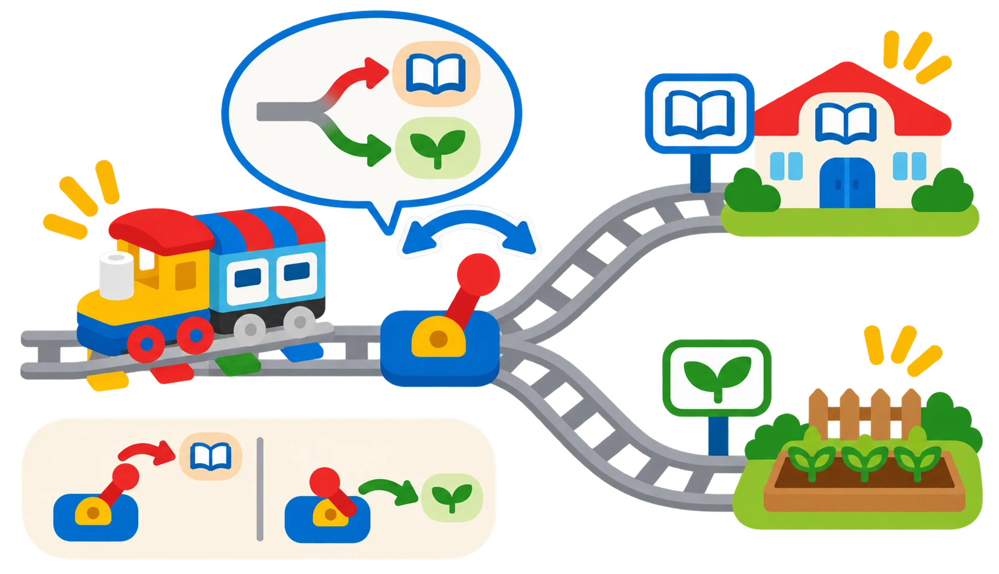

## 🎯 Què aprendrem?

Munteu una bifurcació en Y i trieu la branca movent manualment l’agulla abans de posar el tren en marxa. El retorn amb el maó verd és una prova opcional.

- Construir una via en Y estable i identificar-ne les dues branques.
- Explicar que el canvi d’agulla es mou manualment i orienta físicament el tren.
- Seleccionar una branca i comprovar el recorregut del tren.
- Com a ampliació, provar el maó verd en una configuració de retorn recomanada.

## 🧰 Materials i preparació

- Tren Coding Express i trams de via DUPLO del conjunt disponible.
- Peça de via en Y amb agulla mòbil; comproveu que es pot orientar suaument abans d’engegar el tren.
- Dues marques per identificar els extrems de la bifurcació.
- Maons d’acció del kit, especialment el roig i el verd, només si són presents i funcionen.
- Dues marques per identificar les branques de la via.

Munteu la bifurcació sobre una superfície plana i feu una prova amb el tren aturat per comprovar l’alineació de cada branca. La palanca de la via no és un sensor ni un commutador electrònic: una persona ha de seleccionar físicament el camí.

## 🧩 Funcions i controls

- Desplaçament motoritzat per una via en Y.
- Selecció manual de la branca mitjançant el canvi d’agulla.
- Ús d’un maó roig per aturar el tren, si el reconeix el kit.
- Prova del maó verd per ajudar el tren a tornar cap a una estació; el resultat depén de la disposició de la via i s’ha de comprovar.

## 👣 Pas a pas

### 1. Prepareu les destinacions i l’agulla

Marqueu els dos extrems de la Y com a A i B. Amb el tren apagat o aturat, orienteu l’agulla cap a una branca i comproveu que les peces queden alineades; repetiu-ho amb l’altra. Anoteu quina posició correspon a cada destí i canvieu l’agulla abans que el tren arribe a la bifurcació.

### 2. Proveu les dues branques

Amb el tren aturat, orienteu l’agulla cap a la branca A. Feu passar el tren i anoteu si ha seguit la branca prevista. Atureu-lo abans de moure l’agulla i repetiu la prova amb la branca B.

### 3. Ampliació opcional: investigueu una manera de tornar

Col·loqueu el maó verd només en una configuració segura recomanada per al vostre conjunt i feu una prova curta. Observeu si ajuda el tren a reprendre el trajecte cap a l’estació en aquesta disposició. No pressuposeu que la peça canvia l’agulla ni que crea un retorn automàtic: la via i el sentit del tren determinen què ocorre. Compareu el resultat amb una ruta de retorn dissenyada manualment.

## 🧪 Comprovació i resolució de problemes

Proveu les branques A i B canviant l’agulla amb el tren aturat. Si no segueix la branca seleccionada, reviseu l’alineació de l’agulla i les unions de la via abans de tornar-lo a posar en marxa.

## 🛡️ Ús i seguretat

Atureu el tren abans de moure la palanca del canvi d’agulla o tocar els rails. Comproveu que la via queda alineada i no poseu els dits entre les rodes i les vies.

## 🔗 Fonts i límits

La lliçó [Y Shaped Track de LEGO Education](https://education.lego.com/en-us/lessons/preschool-coding-express/y-shaped-track/) demana guiar el tren movent l’agulla roja i utilitza els maons d’acció per a les parades; també proposa el maó verd per ajudar el tren a tornar. La selecció de branca és manual: aquesta via no llegeix una condició ni canvia l’agulla de manera automàtica.
