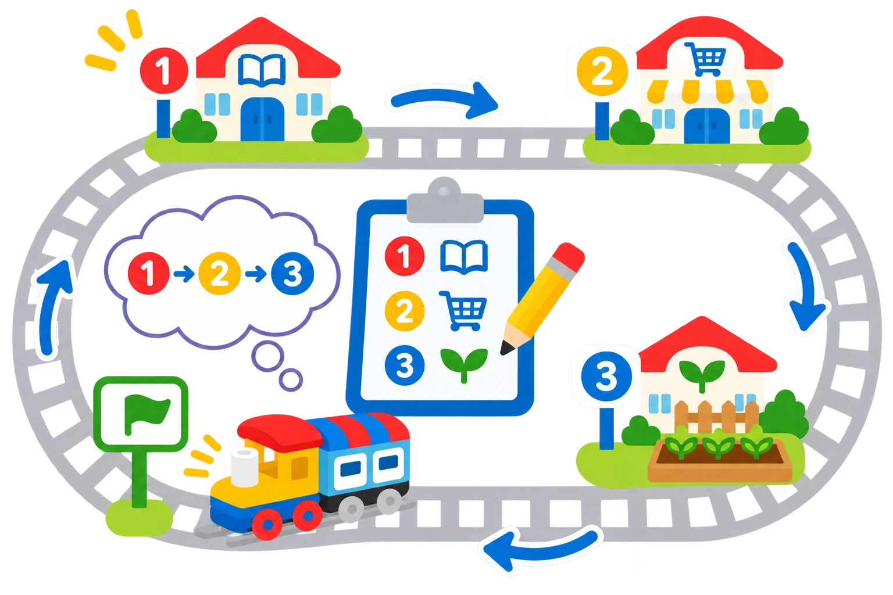

## 🎯 Què aprendrem?

Munteu una via tancada i comproveu com el tren torna al punt inicial. La repetició depén de la forma del circuit: no és un bucle de codi ni un comptador programat.

- Comprovar el retorn al punt inicial en una via tancada.
- Construir i comparar una via tancada i una via oberta.
- Registrar les voltes sense atribuir al tren un comptador que no té.

## 🧰 Materials i preparació

- Tren Coding Express i trams de via corbs i rectes per construir un circuit tancat.
- Una marca per identificar el punt inicial del circuit.
- Llapis de colors per dibuixar la ruta abans de construir-la.

Comproveu que el tren, les vies i les peces d’acció del kit funcionen. Coding Express està retirat comercialment; aquesta proposta és per als centres que ja disposen del conjunt.

## 🧩 Funcions i controls

- Motor Push & Go i recorregut sobre vies.
- Bucle com a propietat de la via tancada; el tren no executa un bucle de codi ni compta voltes per si mateix.

## 👣 Pas a pas

### 1. Planifiqueu i munteu el circuit

Munteu una via tancada i identifiqueu el sentit de circulació. Comproveu les unions i marqueu el punt de partida amb una targeta.

### 2. Poseu el tren en marxa

Doneu al tren una empenta suau i comproveu que torna a passar per la marca inicial. Deixeu-lo completar dues voltes i atureu-lo amb la mà, sense bloquejar les rodes.

### 3. Compareu amb una ruta oberta i milloreu-la

Atureu el tren i obriu un tram del circuit per convertir-lo en una via amb inici i final diferents. Feu avançar el tren i atureu-lo abans que arribe al final de la via. Compareu-la amb la via tancada: el recorregut obert no porta el tren de nou a l’inici. Amb el tren aturat, modifiqueu un tram i comproveu de nou les unions. Atureu sempre la locomotora abans de moure figures o peces.

## 🧪 Comprovació i resolució de problemes

Comproveu que el tren completa el circuit i torna a la marca inicial. Si s’atura o descarrila, atureu-lo i reviseu les unions. En obrir el circuit, atureu-lo abans que arribe al final de la via.

## 🛡️ Ús i seguretat

Munteu el circuit en una superfície estable i manteniu els dits fora del mecanisme mentre el tren es mou. Atureu la locomotora abans de modificar la via o les peces d’acció.

## 🔗 Fonts i límits

La [lliçó oficial sobre via en forma d’O](https://education.lego.com/en-us/lessons/preschool-coding-express/o-shaped-track-looping/) relaciona el circuit tancat amb la idea de repetició. En aquest exemple, la repetició és una propietat del recorregut físic; el tren no executa un bucle escrit ni compta voltes.
