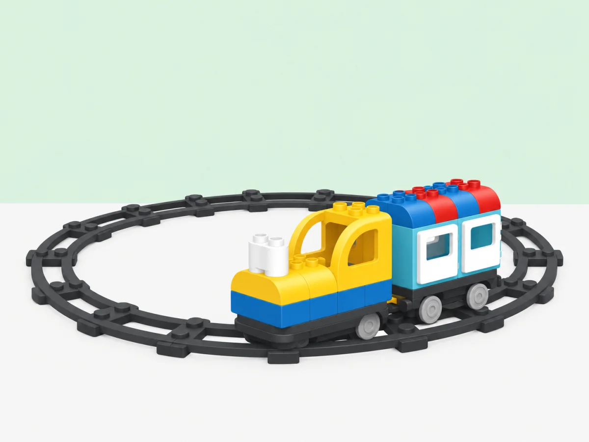

## 🎯 Repte i objectius

La biblioteca mòbil visita diverses parades en un circuit tancat. Predigueu en quin ordre passarà per les estacions i compteu les voltes. El tren no repeteix ordres de codi: la forma de la via el porta de nou al punt de partida.

- Representar una rutina que es repeteix amb una seqüència d’accions.
- Construir i comparar una via tancada i una via oberta.
- Registrar les voltes sense atribuir al tren un comptador que no té.

Aquesta activitat adapta la [lliçó oficial sobre vies en forma d’O i repetició](https://education.lego.com/en-us/lessons/preschool-coding-express/o-shaped-track-looping/) a un servei de biblioteca amb estacions i torns.

## 🧰 Materials i preparació

- Tren Coding Express i trams de via corbs i rectes per construir un circuit tancat.
- Tres estacions amb noms o pictogrames inventats per la classe.
- Fitxes de passatgers i una targeta de registre per comptar les voltes.
- Llapis de colors per dibuixar la ruta abans de construir-la.

Comproveu que el tren, les vies i les peces d’acció del kit funcionen. Coding Express està retirat comercialment; aquesta proposta és per als centres que ja disposen del conjunt.

## 🧩 Funcions del robot treballades

- Motor Push & Go i recorregut sobre vies.
- Bucle com a propietat de la via tancada; el tren no executa un bucle de codi ni compta voltes per si mateix.

## 👣 Seqüència guiada

### 1. Planifiqueu i munteu el circuit

Trieu dues o tres estacions i ordeneu-les amb targetes. Assenyaleu l’inici i dibuixeu una fletxa que mostre cap a on circularà el tren. Predigueu per quina estació passarà primer, segon i tercer. Després dibuixeu i munteu una via tancada que passe per les estacions i torne a l’inici. Comproveu les unions i marqueu el punt de partida amb una targeta.

### 2. Predigueu i proveu les voltes

Abans d’engegar, cada equip prediu l’ordre en què el tren passarà per les estacions. Doneu-li una empenta suau. Cada vegada que torne a passar per la targeta inicial, poseu una fitxa en una columna. Després de dues voltes, atureu el tren amb la mà i compareu el recompte amb la predicció.

### 3. Compareu amb una ruta oberta i milloreu-la

Si teniu prou vies, obriu un tram del circuit per convertir-lo en una via amb inici i final diferents. Feu passar el tren una vegada i observeu què ocorre quan arriba al final. Compareu-la amb la via tancada: el tren no gira ni torna automàticament a l’inici. Amb el tren aturat, afegiu una estació o canvieu-la de lloc i repetiu la predicció. Atureu sempre la locomotora abans de moure figures o peces.

## 🧪 Prova, depura i reflexiona

Registreu quantes vegades el tren passa pel punt inicial i l’ordre real de les estacions. Compareu el circuit tancat amb la via oberta. Si s’atura o descarrila, atureu-lo i reviseu les unions abans de tornar a començar.

### Preguntes per comprovar

- Quina part del recorregut es repeteix? On torna a començar?
- Com sabem que el tren ha fet una volta completa?
- Si afegim una parada, quina part del pla hem de revisar?
- Una via tancada és el mateix que un bucle en un programa? Què comparteixen i què no?

## ♿ Accessibilitat i seguretat

Per a una primera prova, feu una volta amb només dues estacions i una persona que assenyali el punt de retorn. Es pot participar movent passatgers, ordenant targetes o registrant voltes sense manipular el tren. Com a extensió, compareu dues rutes que visiten les mateixes parades en ordres diferents i justifiqueu quina és més clara per als viatgers.

Munteu les vies en una zona delimitada i manteniu els dits fora del mecanisme mentre el tren es mou. Atureu la locomotora abans de canviar vies o peces d’acció.

## ✅ Evidències d’aprenentatge
- Un esbós que mostra les estacions i el punt on el recorregut torna a començar.
- Una predicció de l’ordre de les parades i un registre del que ha passat.
- Una explicació que distingeix el cicle de la via d’una repetició escrita en un programa.

> **Per transferir-ho:** demaneu que cada infant identifique una rutina diària que torna a començar i la represente amb tres imatges en cercle.

## 🔗 Fonts oficials i límits

La [lliçó oficial sobre via en forma d’O](https://education.lego.com/en-us/lessons/preschool-coding-express/o-shaped-track-looping/) relaciona el circuit tancat amb la idea de repetició. En aquesta activitat, la repetició és una propietat del recorregut físic; el tren no executa un bucle escrit ni compta voltes.
