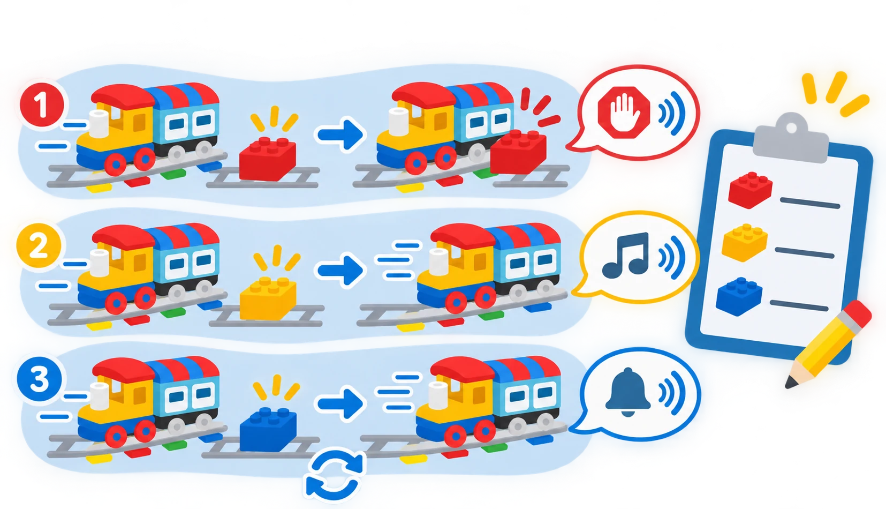

## 🎯 Què aprendrem?

Proveu un maó d’acció cada vegada i comproveu quina resposta activa en el tren. El sensor inferior llig els maons compatibles; no són sensors ambientals.

- Identificar els maons d’acció disponibles i associar color amb resposta observada.
- Ordenar els esdeveniments d’un trajecte i explicar-ne la relació de causa i efecte.
- Distingir les funcions verificades de les que poden variar segons la versió del tren o del kit.

## 🧰 Materials i preparació

- Locomotora Coding Express i vies DUPLO compatibles.
- Maons d’acció de colors disponibles: roig, groc, blau, blanc i verd si formen part del kit.
- Una via recta amb espai suficient abans i després de cada maó; estació o túnel de joguet opcional.
- Maons d’acció compatibles amb el model de tren disponible.

Comproveu que el tren està carregat o té piles en bon estat i que les vies estan ben unides. Feu una prova per maó, en una zona lliure. La documentació LEGO confirma el roig per aturar, el groc i el blau per a respostes sonores, i el blanc per encendre o apagar la llum del tren; verifiqueu la resposta del vostre model abans d’ensenyar-la com a regla universal.

## 🧩 Funcions i controls

- Motorització i lectura dels maons d’acció que passen sota el tren.
- Sensor òptic inferior: interpreta els maons d’acció codificats de la via; no mesura el color de superfícies ni detecta obstacles.
- Maó roig: ordre d’aturada del tren.
- Maons groc i blau: sons associats al tren, que cal escoltar i descriure en el model disponible.
- Maó blanc: encén o apaga la llum del tren segons la lliçó oficial.
- Maó verd: pot ajudar el tren a tornar cap a l’estació; el recorregut resultant depén de la via i cal provar-lo.

## 👣 Pas a pas

### 1. Col·loqueu un maó d’acció

Poseu un únic maó d’acció en un tram recte i deixeu espai lliure després. El sensor òptic de la part inferior del tren llig el codi del maó quan passa per damunt; no és un sensor de color ambiental. Feu passar el tren per damunt i comproveu la resposta abans de provar un altre maó.

### 2. Proveu el roig i els sons

Feu passar el tren pel maó roig i anoteu si s’atura. Després, repetiu amb el groc i el blau per separat. Descriviu els sons que sentiu amb paraules pròpies o pictogrames; no cal imitar exactament un xiulet o un so de càrrega si la resposta del model és diferent. Torneu a provar cada color per comprovar que el resultat es repeteix.

Per exemple, feu aquesta prova amb **un maó cada vegada**:

1. Poseu el maó roig a la via i feu passar el tren: espereu que s'ature.
2. Atureu el tren, canvieu el roig pel groc i escolteu la resposta.
3. Repetiu amb el blau i compareu els sons.

Si una resposta és diferent de la prevista, anoteu-la i comproveu la posició del maó abans de repetir.

### 3. Investigueu el maó blanc

Observeu primer si la llum del tren està encesa. Col·loqueu el maó blanc i registreu si la llum canvia d’estat. Repetiu-lo una vegada més i compteu quantes vegades passa el tren pel maó. Aquesta prova ajuda a descobrir si la resposta alterna en cada pas.

### 4. Exploreu el maó verd amb una ruta

Si el vostre kit inclou el maó verd, dissenyeu un recorregut amb estació i punt de retorn. Proveu el maó i observeu com afecta el trajecte. Canvieu la posició del maó només després d’aturar el tren. Registreu la resposta sense afirmar que sempre inverteix el motor: la guia oficial el presenta com una ajuda per tornar i el comportament observat depén de la disposició de la via.

## 🧪 Comprovació i resolució de problemes

Proveu un maó cada vegada. Si no activa la resposta esperada, comproveu que està centrat en la via i que el tren hi passa correctament. Reviseu també la compatibilitat del maó amb el model disponible.

## 🛡️ Ús i seguretat

Manteniu el volum moderat i feu les proves sobre una via estable. Atureu el tren abans de canviar els maons; deixeu lliure el tram posterior per observar la resposta sense obstacles.

## 🔗 Fonts i límits

La lliçó [Train Sound de LEGO Education](https://education.lego.com/en-us/lessons/preschool-coding-express/train-sound/) descriu els maons groc i blau associats a sons i explica que el blanc encén i apaga la llum del tren. [First Trip](https://education.lego.com/en-us/lessons/preschool-coding-express/first-trip/) mostra el maó roig com una manera d’aturar-lo i suggereix investigar el verd per ajudar el tren a tornar a l’estació. Aquests maons són marcadors d’acció llegits pel tren; no són sensors de distància, color de l’entorn o obstacles.
