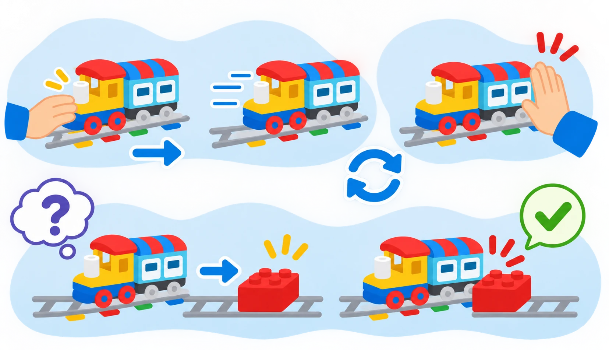

## 🎯 Què aprendrem?

Enceneu la locomotora, inicieu el moviment amb una empenta suau i proveu com aturar-la. Reviseu també les unions de la via abans del primer recorregut.

- Identificar l’encesa i la resposta de moviment del tren disponible.
- Construir una via connectada i provar el recorregut sense forçar les peces.
- Distingir l’impuls inicial, el moviment motoritzat i les maneres d’aturar el tren.

## 🧰 Materials i preparació

- Locomotora Coding Express del kit disponible, amb piles o bateria carregada segons el model.
- Vies rectes i corbes suficients per crear un recorregut senzill amb inici i final identificables.
- Peces de via per muntar un tram curt.
- Una marca per identificar el punt d’aturada.

Abans de començar, reviseu les unions de la via, retireu obstacles i localitzeu el comandament d’encesa del model concret. La forma i la posició del control poden variar entre versions; seguiu les indicacions impreses del vostre tren i no forceu cap peça.

## 🧩 Funcions i controls

- Encesa i indicadors visibles del tren, que cal observar en el model físic.
- Moviment Push & Go: una empenta posa en marxa el tren motoritzat.
- Aturada manual i aturada mitjançant un maó roig quan el kit el reconeix.
- Desplaçament sobre vies DUPLO; el tren no tria una destinació ni mesura per si mateix la distància recorreguda.

## 👣 Pas a pas

### 1. Prepareu el tren i la via

Col·loqueu la locomotora sobre una superfície plana i localitzeu el control d’encesa seguint la guia del kit. Engegueu-la i observeu si fa llum o so; si no respon, comproveu les piles abans de continuar. Després, dibuixeu una ruta curta entre l’estació i la destinació. Munteu-la, reviseu amb el dit que les unions encaixen i poseu-hi el tren. Identifiqueu el punt d’aturada abans d’engegar-lo.

### 2. Feu el trajecte i compareu les aturades

Doneu al tren una empenta curta i suau en el sentit de la via. Observeu si continua avançant tot sol. Atureu-lo amb la mà, tal com mostra la guia del kit. Repetiu la prova des del mateix punt i compareu què passa.

Si el kit inclou el maó roig, col·loqueu-lo sobre un tram recte abans de la destinació. Feu passar el tren i comproveu si s’atura. Si no ho fa, reviseu la posició del maó i repetiu la prova. No empenyeu la locomotora mentre el motor funciona.

## 🧪 Comprovació i resolució de problemes

Comproveu l’encesa, l’inici amb una empenta suau i l’aturada. Si el tren no respon, reviseu les piles i el control d’encesa. Si s’atura abans del punt previst, reviseu les unions i la posició del maó; no l’empenyeu amb el motor en marxa.

## 🛡️ Ús i seguretat

Feu servir una via curta i estable, lluny de vores, cabells i cables. Atureu el tren abans de moure vies o maons. No empenyeu la locomotora mentre el motor ja funciona.

## 🔗 Fonts i límits

La lliçó oficial [First Trip de LEGO Education](https://education.lego.com/en-us/lessons/preschool-coding-express/first-trip/) presenta l’ús dels maons d’acció i diverses formes d’aturar el tren. Aquesta guia és una adaptació pròpia per a la dotació disponible: localitzeu el control d’encesa segons el model i comproveu-ne la resposta física. Push & Go no equival a una seqüència de codi, i el tren no incorpora detecció de destinació ni mesura de distància.

La [guia inicial del conjunt](https://assets.education.lego.com/v3/assets/blt293eea581807678a/blt3ea3f99c26f0922c/632c43cfa982bd60a88d7db2/45025_Booklet_Collected_Pages_6259924_%282%29.pdf?locale=es-es) inclou dibuixos d'encesa, moviment i maons d'acció.
