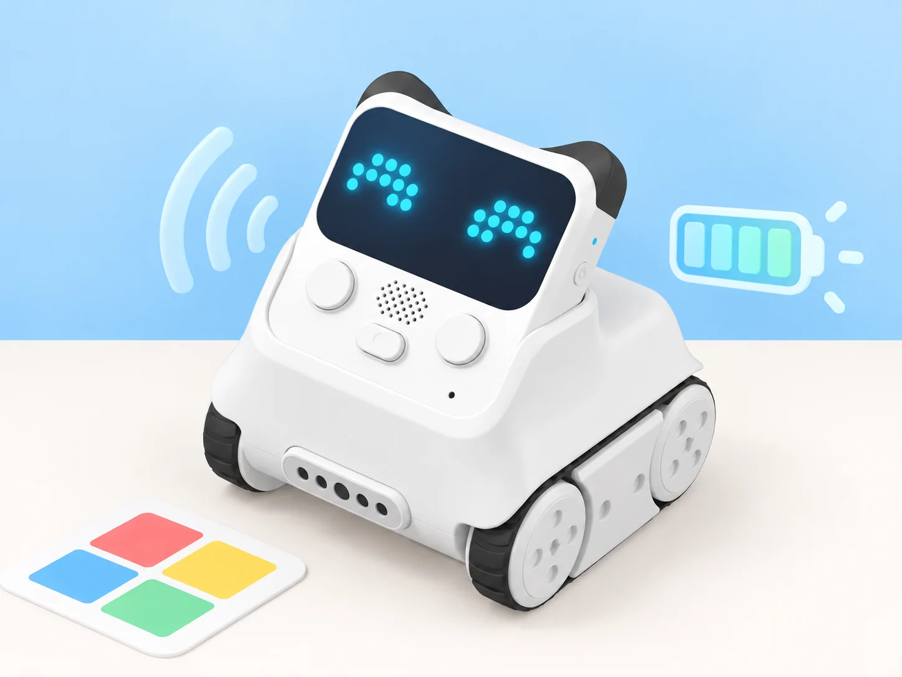

## 🎯 Repte i objectius

Dissenyeu una salutació robòtica que combine una expressió pròpia, un so breu i un moviment de dansa. Abans d’executar-la, comproveu la bateria i decidiu quina resposta visual mantindreu si l’aula necessita treballar sense so. La proposta parteix dels blocs oficials de Codey; els noms i la disponibilitat poden variar segons la versió de mBlock i el firmware.

- Dibuixar i mostrar una expressió a la matriu LED de 16 × 8.
- Vincular una acció als botons i a l’indicador RGB.
- Crear una seqüència curta de tons o una melodia i activar una dansa programada.
- Consultar el nivell de bateria abans de fer una prova llarga.

## 🧰 Materials i preparació

- Un Codey Rocky de la dotació, amb les erugues lliures i espai per a girar sense colpejar objectes.
- Ordinador amb mBlock 5 i el dispositiu/firmware de Codey actualitzats segons les instruccions del centre.
- Plantilla de 16 × 8 píxels, cartolines de colors i targetes amb icones de resposta.
- Opcional: un espai silenciós i un temporitzador per comparar la duració de la seqüència.

Connecteu Codey i confirmeu que la vista de blocs ofereix pantalla, botons, RGB i so. Si el bloc de bateria no apareix, anoteu l’estat indicat pel dispositiu o carregueu-lo abans de la prova; no deduïu un percentatge exacte a partir del temps d’ús. Manteniu el robot sobre una superfície plana i poseu el volum baix.

## 🧩 Funcions del robot treballades

- Matriu LED 16 × 8: dibuix d’icones o patrons propis.
- Botons programables de Codey i indicador RGB per a activar i comunicar estats.
- Altaveu integrat: tons, efectes o melodies disponibles en l’extensió del dispositiu.
- Motors d’eruga: moviment o dansa programada, executada en una zona lliure.
- Lectura de bateria disponible a mBlock; és un indicador d’estat, no una mesura de duració garantida.

## 👣 Seqüència guiada

### 1. Prepareu una expressió de 16 × 8

Dibuixeu una expressió pròpia —una cara o un símbol— que es puga reconéixer sense color. Reproduïu-la amb el bloc de mostrar imatge i compareu la pantalla real amb el dibuix. Feu una segona versió amb només tres canvis de píxel i expliqueu què continua sent llegible.

### 2. Associeu una resposta al botó i al RGB

Programeu el botó A perquè mostre la primera expressió i encenga l’indicador RGB amb un color triat. Feu que el botó B mostre una icona diferent. Després proveu una lògica d’estalvi: amb llum ambiental alta, el RGB queda apagat; amb poca llum, només s’encén quan el sensor de so supera el llindar que heu calibrat i s’apaga quan el so baixa. Repetiu cada prova tres vegades i comproveu que els botons no depenen de mantindre’ls premuts.

### 3. Afegiu un so o una melodia breu

Després de la resposta visual, reproduïu un to o una seqüència curta amb els blocs de so que ofereix el dispositiu. Si la versió permet triar notes, alterneu dues notes; si només ofereix efectes, compareu dos sons disponibles. Afegiu una pausa perquè una pulsació no dispare una cadena de sons superposats. Manteniu una alternativa només visual.

### 4. Proveu una dansa controlada

Afegiu una dansa o una seqüència de moviments predefinida a una activació separada. Poseu Codey Rocky al centre d’una àrea lliure, inicieu el programa amb el robot quiet i atureu-lo abans de canviar el muntatge. Si la versió instal·lada no inclou un bloc de dansa, construïu una seqüència pròpia amb dos girs curts i una pausa; identifiqueu-la com a programa de l’aula.

### 5. Registreu l’estat de la bateria

Abans de la prova final, consulteu el bloc o indicador de nivell de bateria de mBlock i anoteu què mostra. Executeu la salutació tres vegades i torneu a consultar l’estat. Compareu la lectura sense interpretar diferències menudes com una predicció exacta d’autonomia. Si el robot es desconnecta o respon irregularment, carregueu-lo i repetiu la mateixa prova.

_La imatge representa els elements del repte; els indicadors gràfics no són una captura literal de l’aplicació._

## 🧪 Prova, depura i reflexiona

Feu tres execucions completes i registreu per a cadascuna l’expressió, la resposta RGB, el so, el moviment i l’estat de bateria abans de començar. Si una part falla, proveu-la sola abans de tornar a unir la seqüència. Compareu la versió amb so i la versió silenciosa i comproveu que les dues transmeten el mateix missatge.

### Preguntes per comprovar

- Quina entrada activa cada resposta i quin component la mostra?
- Quins píxels són imprescindibles perquè l’expressió continue sent comprensible?
- El so o la dansa depenen d’un bloc oficial disponible en el vostre mBlock?
- Què podem concloure —i què no— d’una lectura de bateria abans i després de tres proves?

## ♿ Accessibilitat i seguretat

Permeteu expressar la resposta amb icona, color, so opcional o una targeta equivalent. No useu només el color per distingir estats i oferiu una alternativa silenciosa. Manteniu el robot allunyat de vores, cables i persones durant la dansa; no bloquegeu les erugues amb les mans mentre els motors estan actius. Si cal, feu aquesta part amb una animació de targetes sense moviment.

## ✅ Evidències d’aprenentatge

- Plantilla de píxels i programa de la salutació, amb la funció de cada botó identificada.
- Taula de tres execucions que compare les respostes visuals, sonores i motores.
- Registre de l’estat de bateria abans i després, amb una nota sobre els límits d’aquesta lectura.
- Versió accessible sense so o amb una alternativa visual equivalent.

## 🔗 Fonts oficials i límits

Makeblock enumera els casos de [pantalla emocional, RGB, sons, potenciòmetre, llum ambiental, bateria, sacsejada, postures, melodies i dansa](https://support.makeblock.com/hc/en-us/sections/360001829193-Codey-Rocky), inclòs l’[indicador RGB d’estalvi d’energia](https://support.makeblock.com/hc/en-us/articles/7463194482839-Case-12-Energy-conserving-RGB-LED-indicator), i descriu les funcions de [Codey Rocky](https://support.makeblock.com/hc/en-us/articles/1500004392242-About-Codey-Rocky). La lectura de bateria i els blocs de so depenen del dispositiu, firmware i versió de mBlock; les melodies i danses disponibles poden variar. Les lliçons de temps meteorològic i els jocs en línia depenen de serveis de xarxa externs; el reconeixement de veu també requereix un servei extern i no és una funció autònoma del robot.
