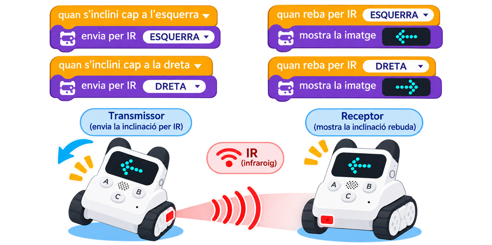

## 🎯 Repte i objectius

Feu que Codey mostre el valor de la rodeta i responga amb una icona quan l’inclineu. Si disposeu de dos robots, al final podeu provar d’enviar un missatge per infraroig.

- Llegir la rodeta en tres posicions i comparar els valors.
- Fer que una inclinació active una icona.
- Com a ampliació opcional, enviar i rebre un missatge IR amb dos robots.

## 🧰 Materials i preparació

- Dos Codey Rocky de la dotació, si es vol provar transmissió entre robots; amb un sol kit, la comunicació IR es pot simular amb targetes.
- mBlock 5 i connexió USB o Bluetooth admesa pel dispositiu.
- Una superfície plana i una marca per definir l’orientació inicial.
- Targetes amb les ordres fictícies «endavant», «aturar» i «gir».

Comproveu al mBlock instal·lat que els blocs de potenciòmetre, orientació/gest i infraroig apareixen per al dispositiu Codey. Les extensions i noms de blocs poden variar. Si un bloc no apareix, documenteu la funció com a no disponible en aquella versió; no el substituïu per una funció de Neuron o d’un altre robot.

## 🧩 Funcions del robot treballades

- Potenciòmetre/gear knob per llegir una entrada variable física.
- Connexió Bluetooth a l’app Makeblock per al control Drive i el traçat Draw & Run, quan l’app és compatible i està disponible.
- Giroscopi i acceleròmetre de sis eixos per detectar inclinació, gir o sacsejada.
- Altaveu i matriu LED de Codey com a eixides.
- Emissor i receptor d’infraroig per enviar/recollir un codi entre Codey Rocky compatibles.

## 👣 Seqüència guiada

### 1. Proveu el control manual de l’app

Si l’app Makeblock està disponible en el dispositiu del centre, activeu-hi Bluetooth, enceneu Codey i seleccioneu el model Codey Rocky. Apropeu el dispositiu i espereu la confirmació sonora de connexió descrita pel fabricant. Comproveu les tres opcions de l’app, sense donar per fet que totes les versions continuen disponibles:

- **Drive:** feu una ordre curta en una zona delimitada i observeu tant el moviment com el canvi d’imatge de la matriu LED. Atureu Codey abans de canviar de mode.
- **Draw and Run:** dibuixeu un trajecte senzill o poseu-hi un senyal disponible; prediu el camí i compareu-lo amb el recorregut observat.
- **Code:** obriu l’opció i comproveu que deriva a mBlock per programar. Distingiu aquest entorn de la conducció manual i de la ruta dibuixada.

Registreu quina opció heu pogut obrir i amb quin dispositiu. Si la connexió, una funció o l’app no està disponible, planifiqueu la mateixa ruta amb targetes i marqueu-la com a simulació; no presenteu aquesta alternativa com una prova del robot.

### 2. Llegiu el potenciòmetre

Mostreu a la pantalla el valor de la rodeta de Codey i gireu-la lentament d’un extrem a l’altre. Busqueu els blocs equivalents a la vostra versió:

```mblock
quan comença el programa
per sempre
mostra el valor de la rodeta
fi
```

Anoteu el valor amb la rodeta en tres posicions: un extrem, el centre i l’altre extrem. Torneu a cadascuna i comproveu si les lectures s’assemblen. Com a ampliació, feu que els valors activen icones diferents.

### 3. Calibreu la inclinació i afegiu una resposta

Busqueu a mBlock l’esdeveniment que detecta la inclinació cap a l’esquerra. Feu que mostre una fletxa cap a l’esquerra:

```mblock
quan Codey s'inclina cap a l'esquerra
mostra una fletxa cap a l'esquerra
```

Torneu Codey a la posició plana abans de cada intent i repetiu tres vegades. Si la vostra versió també ofereix l’esdeveniment d’inclinació cap a la dreta, afegiu una altra icona. La sacsejada és una acció diferent de mantindre Codey inclinat.

Com a ampliació, feu que la inclinació mostre una icona i reproduïsca un to breu. Afegiu una pausa perquè el senyal no es repetisca mentre Codey continua inclinat. Si el so no és adequat a l’aula, useu només la icona.

### 4. Ampliació opcional: envieu un senyal infraroig

Amb dos Codey Rocky, busqueu els blocs d’infraroig que oferisca la versió de mBlock instal·lada. Prepareu el primer perquè envie un missatge de prova en prémer A i el segon perquè mostre una icona quan reba eixe mateix missatge. Carregueu el programa corresponent a cadascun. Poseu-los encarats i pròxims, premeu A i observeu la pantalla del receptor. Després interposeu una cartolina i repetiu. Si falta un bloc o només hi ha un robot, representeu l’enviament amb targetes i marqueu-lo com a simulació.

Per al **primer Codey**, busqueu a «Infraroig» la peça d’enviar missatge i escriviu-hi `HOLA`:

```mblock
quan es prem el botó [A v]
envia el missatge IR [HOLA]
```

Per al **segon Codey**, combineu la peça que comprova el missatge rebut amb «si» i «per sempre». Feu que mostre una cara quan reba `HOLA`:

```mblock
quan comença el programa
per sempre
si <missatge IR [HOLA] rebut?> aleshores
mostra una cara feliç
fi
fi
```

Els dibuixos resumeixen les accions; els noms i l’aspecte de les peces poden variar. El [quadern oficial de Makeblock](https://qiniu.makeblock.com/education-makeblock-com/studentbook.pdf) mostra les peces d’enviament i de comprovació en l’activitat de comunicació entre Codeys. Si el bloc de recepció no apareix, useu les targetes i indiqueu que no s’ha provat la comunicació real.



_Il·lustració decorativa: els senyals no mostren la posició real dels emissors i receptors infrarojos._

## 🧪 Prova, depura i reflexiona

Completeu una taula amb els tres valors de la rodeta i el resultat de tres inclinacions cap a l’esquerra. Si proveu la inclinació cap a la dreta, anoteu-la en una columna separada. Registreu quines opcions de l’app heu pogut obrir.

Com a ampliació, si teniu dos robots, feu una prova amb els robots encarats i una altra amb una cartolina al mig. Abans de cada enviament, comproveu que la pantalla del receptor està neta i que una indicació anterior no es manté activa. Anoteu si apareix una resposta nova. Si no podeu distingir una recepció nova d’una indicació anterior, no compteu missatges: anoteu el límit i consulteu el comportament dels blocs de la versió instal·lada. Si no teniu dos robots o falta el bloc IR, marqueu la prova com a simulació.

### Preguntes per comprovar

- Quin component produeix cada lectura i quin programa transforma la lectura en una resposta?
- Quina diferència hi ha entre el valor del potenciòmetre i una inclinació del robot?
- Si heu fet la prova IR, en quines condicions heu observat una resposta nova?
- Què hauria de fer el programa si no arriba cap missatge?


## ♿ Accessibilitat i seguretat

La inclinació i la sacsejada són opcions; permeteu introduir el mateix codi amb botons, potenciòmetre o targetes. Manteniu els robots quiets durant les proves de recepció i no els feu córrer cap a persones. El so és breu i opcional, amb senyal visual equivalent. No envieu missatges personals.

## ✅ Evidències d’aprenentatge
- Taula dels valors de la rodeta i la resposta a les inclinacions.
- Nota de quines funcions de l’app s’han pogut provar.
- Si s’ha fet l’ampliació IR, els dos programes i les observacions de recepció; si s’ha simulat, esquema de la simulació.

## 🔗 Fonts oficials i límits

La pàgina oficial [About Codey Rocky](https://support.makeblock.com/hc/en-us/articles/1500004392242-About-Codey-Rocky) identifica el potenciòmetre, giroscopi, acceleròmetre, emissor/receptor IR, altaveu, matriu i indicador RGB. La guia de [control amb l’app Makeblock](https://support.makeblock.com/hc/en-us/articles/1500008637181-Control-Codey-Rocky-with-the-Makeblock-app), el [catàleg de casos de Codey Rocky](https://support.makeblock.com/hc/en-us/sections/360001829193-Codey-Rocky) i la guia de [programació amb mBlock 5](https://support.makeblock.com/hc/en-us/articles/1500008637961-Program-Codey-Rocky-with-mBlock-5) depenen de la versió de l’app i del programari. Makeblock aclareix a les [FAQ](https://support.makeblock.com/hc/en-us/articles/1500004266501-FAQs-on-Codey-Rocky) que Codey Rocky no té reconeixement de parla incorporat; les guies d’aquesta col·lecció que usen veu en línia o extensions ho indiquen com a dependència externa.
