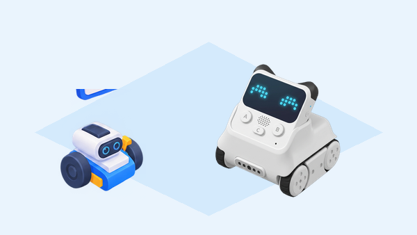

## 🎯 Repte i objectius

Prepareu una ruta curta perquè Rocky avance, detecte un obstacle i canvie de direcció abans de tocar-lo. Després, reorienteu el sensor inferior per provar una línia de contrast. La pràctica separa les funcions del sensor infraroig/color de les decisions del programa: el robot no comprén el mapa ni tria per si mateix la ruta.

- Canviar l’orientació del sensor de Rocky per provar obstacle o superfície.
- Llegir una condició del sensor i relacionar-la amb els motors de les erugues.
- Comparar una prova d’obstacle amb una prova de seguiment d’una línia.

## 🧰 Materials i preparació

- Codey Rocky de la dotació, acoblat i amb càrrega suficient.
- Ordinador amb mBlock 5 i la versió de firmware del centre.
- Obstacles amples, tous i no reflectants, com caixes de cartó.
- Cinta fosca ample i una base clara per fer una pista de contrast.
- Graella de registre per anotar l’estat del sensor, la condició i el resultat.

Comproveu que el mòdul Rocky està connectat amb Codey i que els blocs de sensor i motors apareixen a mBlock. Orienteu el sensor infraroig/color cap al davant per a la prova d’obstacles; abans de provar la línia, reorienteu-lo cap al terra segons el muntatge del fabricant. Manteniu el programa aturat mentre canvieu la posició del sensor.

## 🧩 Funcions del robot treballades

- Motors independents de les dues erugues per avançar i girar.
- Sensor infraroig/color orientable: detecció d’obstacles quan mira cap endavant i lectura de superfícies/línies quan mira cap avall.
- Blocs condicionals de mBlock per transformar una lectura en una acció motora.
- Límit de la prova: una detecció infraroja no és una mesura universal en centímetres; superfície, angle i llum poden canviar la resposta.

## 👣 Seqüència guiada

### 1. Connecteu i comproveu els actuadors

Obriu mBlock 5, afegiu Codey Rocky i connecteu el robot per USB o per una connexió Bluetooth compatible. Executeu una prova curta que moga les dues erugues lentament i després les ature. Comproveu que el xassís està ben acoblat i que el sensor es pot orientar cap a davant o cap avall sense forçar el suport.

### 2. Observeu la detecció d’un obstacle

Amb el sensor orientat cap al davant, mostreu a la matriu de Codey l’estat «lliure» o «obstacle» segons el bloc disponible. Poseu una caixa de cartó a una distància curta i després més lluny; repetiu amb una superfície clara i una fosca, mantenint l’angle. Registreu el resultat tal com l’exposa mBlock (estat o valor d’aproximació/distància) i no el convertiu a centímetres si el bloc no dona una mesura calibrada.

### 3. Programeu una maniobra d’esquiva

Feu que Rocky avance a baixa velocitat mentre el sensor indique espai lliure. Si detecta un obstacle, atureu-lo, feu una marxa enrere breu i gireu a un costat abans de reprendre l’avanç. Proveu primer amb una sola caixa al centre d’un passadís ampli; si el gir no deixa espai suficient, modifiqueu només la durada o la velocitat i torneu a provar.

### 4. Compareu amb el seguiment d’una línia

Atureu el programa, gireu el sensor perquè mire cap avall i col·loqueu Rocky sobre la pista de contrast. Mostreu les lectures sobre el fons clar i sobre la cinta fosca abans d’activar els motors. Després programeu una correcció lenta cap a la línia i observeu si el sensor la manté; si la pista es perd, reduïu la velocitat, eixampleu la cinta o reviseu la distància del sensor al terra.

_La mateixa peça sensora canvia de tasca segons la seua orientació. La lectura i el control del moviment depenen dels blocs disponibles a mBlock i del muntatge._

## 🧪 Prova, depura i reflexiona

Feu tres intents d’obstacle i tres de línia. Anoteu la posició del sensor, el material observat, l’estat o valor que mostra el programa i la resposta dels motors. Si falla, comproveu primer orientació, altura, reflexió de la superfície i connexions; després canvieu un únic llindar o paràmetre de moviment.

### Preguntes per comprovar

- Quina part del muntatge fa la lectura i quina part decideix girar?
- Com canvia la lectura quan el sensor passa de mirar cap endavant a mirar cap avall?
- Quines condicions de la superfície han alterat el resultat?
- Què hauria de fer Rocky si el sensor no dona una lectura estable?

## ♿ Accessibilitat i seguretat

Comenceu amb una caixa gran i un trajecte recte; les persones que no manipulen el robot poden predir la resposta amb targetes «lliure/obstacle» o registrar les lectures. Feu servir velocitats baixes, obstacles tous i un espai delimitat. Manteniu mans, cables i roba lluny de les erugues i atureu el programa abans de reorientar el sensor.

## ✅ Evidències d’aprenentatge

- Programa amb la condició de detecció i la resposta motora.
- Registre comparatiu de tres proves d’obstacle i tres de línia.
- Explicació de la diferència entre detectar una superfície i decidir una maniobra.
- Nota sobre el límit de precisió i les condicions del sensor utilitzat.

## 🔗 Fonts oficials i límits

La pàgina [About Codey Rocky](https://support.makeblock.com/hc/en-us/articles/1500004392242-About-Codey-Rocky) descriu els motors de Rocky i el sensor infraroig/color. Els casos oficials [Avoids Obstacles](https://support.makeblock.com/hc/en-us/articles/7463724329879-Case-18-Codey-Rocky-avoids-obstacles) i [Identifies Colors](https://support.makeblock.com/hc/en-us/articles/7484512467223-Case-19-Codey-Rocky-identifies-colors) mostren l’orientació del sensor cap al davant i cap avall. La resposta depén de la superfície i de l’angle; no és un sensor ultrasònic de distància calibrada.
