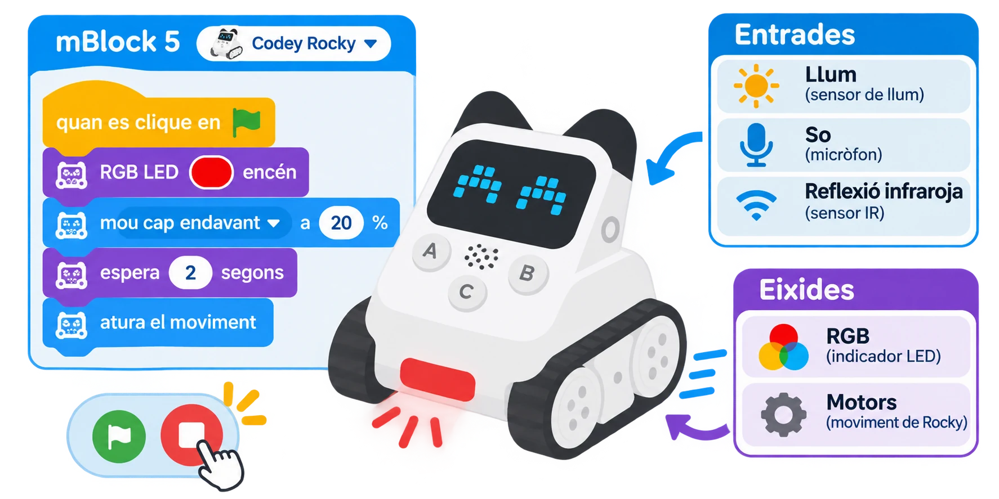

## 🎯 Repte i objectius

Feu que la llum de Codey responga als canvis de llum i de so. Després proveu el sensor de Rocky sobre una línia negra. Observeu què detecta el robot i què li heu indicat que faça.

- Calibrar els sensors de llum i so amb proves controlades.
- Relacionar la lectura del sensor infraroig/color amb una línia i els motors.
- Explicar per què els llindars depenen de la superfície i de la llum de l’aula.

## 🧰 Materials i preparació

- Codey Rocky de la dotació, carregat i muntat correctament.
- Ordinador amb una versió compatible de mBlock 5 i l’extensió/dispositiu Codey.
- Cartolines clara, fosca i de colors; una tira negra ampla sobre fons blanc.
- Un llum d’aula regulable o una caixa de cartó oberta per variar la il·luminació.
- Targetes de prova amb condicions de llum, so i color; les dades poden ser simulades.

Abans de començar, comproveu que el robot es connecta, que les erugues es mouen lliurement i que el sensor infraroig/color no està tapat. Els noms dels blocs poden variar amb la versió de mBlock i del firmware; no substituïu la lectura del sensor per una afirmació de distància o color exacte si l’aplicació no la proporciona.

## 🧩 Funcions del robot treballades

- Sensor de llum ambiental i indicador RGB programable del mòdul Codey.
- Sensor de so ambiental: detecta intensitat/llindar de so, no paraules ni identitat de qui parla.
- Sensor infraroig/color de Rocky i motors de les erugues per provar una ruta amb línia i targetes.
- Condicionals i ajust de llindars a mBlock 5; el sensor reflectit depén del material, la distància i l’angle.

## 👣 Seqüència guiada

### 1. Comprovem les entrades i eixides

Obriu mBlock 5, seleccioneu Codey Rocky i executeu una seqüència curta que mostre un color a l’indicador RGB i faça avançar Rocky a baixa velocitat durant un interval breu. Atureu el programa i verifiqueu que el botó d’aturada del projecte respon. Anoteu quins elements són entrades (llum, so i reflexió infraroja) i quins són eixides (RGB i motors).

Podeu començar amb aquesta prova curta:

```mblock
quan es prem el botó [A v]
encén el llum RGB de color [blau v]
avança a velocitat (20) durant (1) segons
atura el moviment
```

Busqueu els blocs equivalents a la vostra versió. En prémer A, observeu la llum i comproveu que Rocky s’atura; si no ho fa, atureu el programa abans de continuar.

### 2. Calibrem llum i color

Manteniu Codey en la mateixa orientació i registreu diverses lectures en llum habitual i en una zona més ombrejada. Trieu un llindar entre els valors observats, si les mostres se separen, i feu que l’indicador RGB canvie de color segons la condició. Després compareu una targeta clara, una fosca i dues de colors a la mateixa distància. Registreu què detecta realment el bloc; no suposeu que tots els colors es distingeixen amb la mateixa fiabilitat.

### 3. Proveu el sensor de so amb una entrada controlada

Registreu primer el valor en silenci i després feu tres sons breus i voluntaris a una distància fixa (per exemple, picar de mans suaument). Configureu un llindar a partir de les lectures, feu que l’indicador RGB done un senyal visual i afegiu una pausa perquè no es dispare repetidament. El sensor no reconeix instruccions parlades: si no hi ha una lectura estable, substituïu aquesta part per una taula de valors simulats.

### 4. Seguiu una línia i depureu la ruta

Atureu el programa i orienteu el sensor infraroig/color de Rocky cap al terra. Poseu-lo primer sobre el fons blanc i després sobre la línia negra; anoteu què mostra mBlock en cada cas. El sensor identifica la superfície que té davall, però no sap a quin costat queda el centre de la línia.

Per provar una correcció pròpia, comenceu amb el sensor sobre la **vora dreta** de la línia, mirant en el sentit del recorregut. Programeu un gir suau a la dreta quan veja negre i a l’esquerra quan veja blanc, de manera que busque la vora. Proveu-ho lentament en un tram recte i atureu-lo si perd la pista. Si comenceu per l’altra vora, intercanvieu els girs. Si la vostra versió ofereix un exemple de seguiment, també podeu provar-lo i comparar-ne el resultat.



_Les targetes i la línia són materials de prova; els resultats depenen del sensor, la superfície, la llum i la versió de mBlock._

## 🧪 Prova, depura i reflexiona

Anoteu què mostra el sensor amb llum i amb ombra, i després en silenci i amb una palmada suau. En la pista, registreu si Rocky manté la vora durant tres intents curts. Si falla, reviseu que el sensor mire a terra i que el robot comence a la vora correcta; canvieu una sola cosa abans de repetir.

### Preguntes per comprovar

- Quina entrada concreta activa cada canvi de color o moviment?
- El sensor de so reconeix paraules o només una variació de nivell sonor?
- Quina targeta ha donat una lectura més difícil de distingir? Quina variable podria explicar-ho?
- El robot segueix la línia millor després d’ajustar la velocitat o la posició del sensor?


## ♿ Accessibilitat i seguretat

Manteniu el robot a velocitat baixa i dins d’un recorregut delimitat, lluny de vores i dits. No useu sons forts, no enregistreu veus i no feu inferències sobre les persones a partir del nivell de so. Oferiu lectures simulades o targetes impreses a qui no vulga participar en una prova sonora; es poden comparar resultats sense conduir el robot.

## ✅ Evidències d’aprenentatge
- Conserveu el projecte mBlock, l’esquema entrada–procés–eixida, la taula de proves repetides i una nota sobre el llindar triat i les limitacions del sensor. La verificació del fabricant identifica el sensor de llum, el sensor de veu/so, els botons i l’indicador RGB de Codey, i les funcions de color, obstacle i seguiment de Rocky; la pràctica només afirma les funcions que s’han comprovat en la unitat del centre.

## 🔗 Fonts oficials i límits

[Makeblock · About Codey Rocky](https://support.makeblock.com/hc/en-us/articles/1500004392242-About-Codey-Rocky) descriu els elements de Codey i Rocky. [Makeblock · Programming Codey Rocky with mBlock 5](https://support.makeblock.com/hc/en-us/articles/1500008637961-Program-Codey-Rocky-with-mBlock-5) és el punt de partida per a la connexió; comproveu la compatibilitat del sistema i l’extensió instal·lada. La detecció de so no és reconeixement de parla, i el sensor infraroig/color no és una càmera ni un dispositiu de mesura universal.
