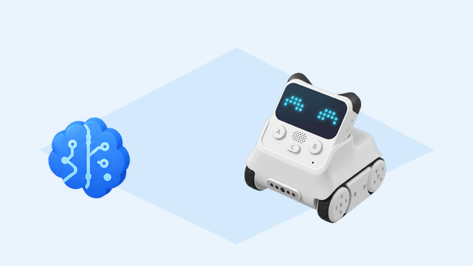

## 🎯 Repte i objectius

Investigueu què pot fer Codey Rocky quan escolta un so i què exigiria una funció de reconeixement de parla. El robot base incorpora un sensor que detecta el nivell sonor, però no inclou un mòdul que reconega paraules. El reconeixement, quan l’editor i el servei en línia encara l’ofereixen, depén del programari, la connexió, el compte i les condicions de privacitat del centre.

- Comparar una lectura de so ambiental amb una ordre de veu interpretada per programari.
- Comprovar si l’extensió de serveis cognitius està disponible abans de basar-hi l’activitat.
- Vincular una entrada de prova a una resposta visible i segura, sense activar moviments inesperats.
- Reconéixer quines dades ixen del dispositiu quan s’utilitza un servei de veu en línia.

## 🧰 Materials i preparació

- Codey Rocky de la dotació amb bateria suficient i espai de treball delimitat.
- Ordinador amb mBlock 5, micròfon del dispositiu i connexió de xarxa només si el servei en línia està autoritzat.
- Targetes grans amb les ordres fictícies «marxa», «para» i «gira» per a una simulació sense veu.
- Un registre per anotar component, programa, resposta i dependències de cada prova.

Obriu el projecte amb el dispositiu Codey i comproveu si la versió de mBlock disponible ofereix una extensió de veu compatible. No creeu un compte ni envieu cap enregistrament fins que el centre haja verificat les condicions del servei i el consentiment necessari. Si l’extensió no hi és, la guia es pot completar sencera amb targetes: la simulació no és una capacitat del robot.

## 🧩 Funcions del robot treballades

- Sensor de so integrat de Codey: permet llegir intensitat sonora i fer que una condició responga a un llindar; no transcriu ni entén paraules.
- Pantalla LED, indicador RGB i altaveu com a eixides per comunicar un estat de prova.
- Reconeixement de parla com a funció de programari o mòdul Neuron compatible, no com a sensor integrat del Codey Rocky base.
- Connexió i serveis en línia com a dependències externes que poden no estar disponibles o tindre límits d’idioma i compte.

## 👣 Seqüència guiada

### 1. Mesureu el so amb el robot base

Programa Codey perquè mostre una lectura del sensor de so o encenga l’indicador RGB quan el nivell supere un llindar. Proveu primer en silenci i després amb un so breu, com una palmada a distància; repetiu tres vegades i anoteu els valors o estats que expose el bloc. Feu servir un volum còmode. Si el bloc només dona un estat de so fort, registreu-lo com a estat i no com a decibels calibrats.

### 2. Reviseu si hi ha reconeixement de parla

Exploreu les extensions disponibles a mBlock sense activar la captura d’àudio. Anoteu el nom exacte, el dispositiu o servei al qual pertany i les llengües que indica la interfície. Si no trobeu una opció funcional, marqueu-la com a «no disponible en aquesta configuració» i passeu a la simulació. No interpreteu una lectura alta del sensor de so com si el robot haguera entés «marxa» o «para».

### 3. Proveu una resposta controlada, si el servei està autoritzat

Només si el centre autoritza el servei i l’extensió funciona en la versió instal·lada, feu una prova amb una frase fictícia i mostreu una icona quan el resultat coincidisca amb una paraula prevista. Comenceu amb un missatge visual o un so breu: no poseu en marxa els motors, perquè una transcripció errònia podria generar un moviment no previst. Registreu també una frase diferent i un cas sense parlar per observar falsos reconeixements o absència de resultat.

### 4. Simuleu les mateixes ordres sense enviar veu

Si el servei no està disponible o no es pot utilitzar, una persona tria una targeta sense mostrar-la al programador. El programador aplica la mateixa lògica a l’entrada de text fictícia —«marxa», «para» o «gira»— i Codey mostra una icona associada. Compareu la resposta amb la prova de veu, si n’hi ha, i etiqueteu clarament quina entrada s’ha simulat. La simulació permet estudiar condicionals, però no comprova el reconeixement acústic.

_El núvol és una dependència de programari: el robot base no incorpora reconeixement de parla._

## 🧪 Prova, depura i reflexiona

Compareu tres casos: silenci, so breu i, si està autoritzat, una frase de prova. Anoteu què ha llegit el sensor del robot, què ha retornat l’extensió i quina resposta s’ha mostrat. Repetiu el mateix cas sense canviar la distància ni el volum. Si el servei de veu no està disponible, completeu la comparació amb targetes i identifiqueu les dades com a simulades; no presenteu aquest resultat com a reconeixement real.

### Preguntes per comprovar

- Quina informació llig el sensor de so del Codey i quina no pot determinar?
- Quin component o servei hauria d’interpretar les paraules parlades?
- Quina diferència hi ha entre una resposta visual simulada i un reconeixement acústic real?
- Quins permisos i quina connexió calen abans d’enviar veu a un servei extern?

## ♿ Accessibilitat i seguretat

La veu és opcional: oferiu targetes, text fictici o botons com a entrada equivalent. Eviteu noms, converses personals i enregistraments d’infants. No useu el control de veu per activar motors en aquesta prova; delimiteu l’espai i manteniu una resposta visual o sonora suau. Si el servei envia àudio fora del dispositiu, seguiu les normes de privacitat i autorització del centre.

## ✅ Evidències d’aprenentatge

- Programa del sensor de so amb el llindar i la resposta visual.
- Taula que separa lectura integrada, resultat d’un servei extern i entrada simulada.
- Registre de tres casos de prova, amb les dependències tècniques disponibles.
- Explicació breu de per què Codey Rocky no reconeix parla de manera autònoma.

## 🔗 Fonts oficials i límits

Makeblock descriu el [sensor de so integrat de Codey Rocky](https://support.makeblock.com/hc/en-us/articles/1500004392242-About-Codey-Rocky) com una lectura del nivell sonor, i a les [FAQ oficials](https://support.makeblock.com/hc/en-us/articles/1500004266501-FAQs-on-Codey-Rocky) indica que el model base no té un mòdul de reconeixement de parla; la veu requeriria un mòdul Neuron compatible. La [guia oficial del cas de veu](https://support.makeblock.com/hc/en-us/articles/7463171094295-Case-11-Voice-activated-RGB-LED-indicator) treballa el nivell de so, no la transcripció de paraules. Les extensions d’IA i els serveis en línia depenen de la versió i de la xarxa del centre.
