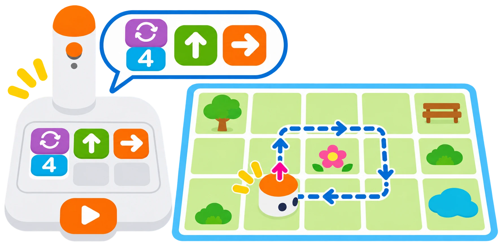

## 🎯 Què aprendrem?

Reduïu una seqüència llarga de moviments a una instrucció que es repeteix. Amb les peces de bucle del Coding Set, compareu la ruta completa amb la versió compacta i comproveu si totes dues arriben a la mateixa destinació.

- Comprendre el concepte de bucle (Loop).
- Distingir el bloc d'inici de bucle i el de tancament.
- Comparar una ruta quadrada amb i sense repetició.



## 🧰 Materials i preparació

- Blocs de bucle (verd fosc)
- Blocs direccionals
- Fitxa numèrica x4
- MatataBot, torre de control, tauler i una superfície plana amb espai lliure.
- Cinta o un full per marcar el punt de partida i la direcció inicial.

Enceneu el robot i la torre i espereu que es connecten. Deixeu lliure una zona quadrada d’almenys una casella per costat al voltant de la ruta.

## 🧩 Funcions i controls

- Blocs físics de bucle per repetir una seqüència de moviments del MatataBot.
- Execució seqüencial a través de la torre de lectura.

## 👣 Pas a pas

### 1. Prepareu el bucle i les instruccions

Col·loqueu el robot a la cantonada de la ruta i marqueu cap a on mira. Al tauler, poseu la fitxa verd fosc d’inici de bucle amb el número 4 a sota.

Al costat de l’inici de bucle, poseu **Endavant → Dreta**. Aquestes dues ordres es repetiran; el gir canvia l’orientació, però no fa avançar el robot.

### 2. Tanqueu i executeu el bucle

Poseu la fitxa verd fosc de final després de Dreta. Comproveu que el tauler queda així, amb el número sota l’inici:

```coding-set
repeteix 4
avançar -> girar dreta
fi
```

Premeu el botó gran i observeu els quatre costats. El robot hauria de tornar prop del punt de partida, mirant en la direcció inicial; la posició pot variar segons la superfície.

> **💡 Consell d’ús:** Compareu les vuit peces de moviment de la ruta llarga amb les dues peces de moviment de la ruta amb bucle. Aquesta última necessita, a més, les dues peces de bucle i el número 4.

## 🧪 Comprovació i resolució de problemes

1. Representeu la ruta llarga: **Endavant → Dreta → Endavant → Dreta → Endavant → Dreta → Endavant → Dreta**. Si teniu prou peces, col·loqueu-les al tauler i executeu-la; si no, seguiu-la amb targetes i el dit.
2. Torneu el robot al punt i a l’orientació inicials. Executeu la versió amb bucle tres vegades, reposicionant-lo abans de cada intent.
3. Compareu les posicions i orientacions finals de les dues versions. Si heu pogut executar-les totes dues, repetiu també la ruta llarga tres vegades.

```coding-set
avançar -> girar dreta -> avançar -> girar dreta -> avançar -> girar dreta -> avançar -> girar dreta
```

Compteu les peces de moviment de cada versió. Si el resultat no coincideix, reviseu el nombre, l’ordre de les peces i l’orientació inicial.

## 🛡️ Ús i seguretat

Manteniu les mans fora del trajecte mentre el robot es mou. Atureu-lo abans de reposicionar-lo i retireu les peces del tauler només quan la torre haja acabat de llegir-les.

## 🔗 Fonts i límits

La [guia oficial de bucles de Matatalab](https://matatalab.com/en/node/62) mostra on col·locar les peces d’inici i final i el nombre de repeticions. El resultat físic pot variar segons la superfície i l’alineació inicial del robot.
