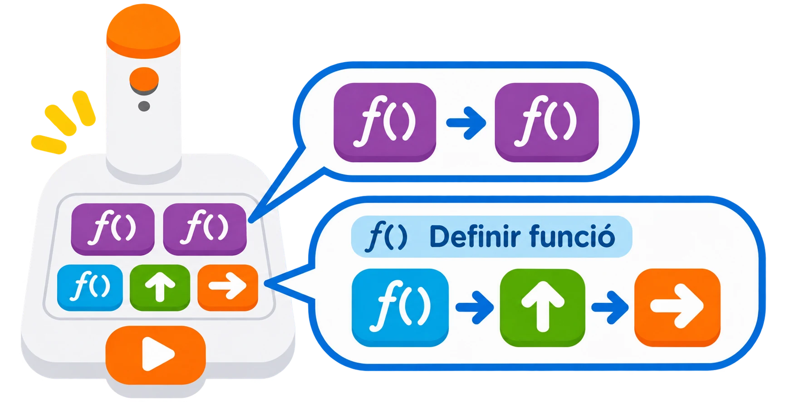

## 🎯 Què aprendrem?

Prepareu una ruta curta amb dos moviments que es repetisquen. Guardareu eixa parella de moviments en una funció i la cridareu dues vegades. Després, si el vostre kit té els blocs divertits, en provareu els comportaments predefinits.

- Definir i cridar una funció per reutilitzar una seqüència de moviments.
- Comparar la versió amb funció amb la seqüència escrita completa.
- Si el kit els inclou, provar els tres blocs divertits i distingir-los d’un programa propi.



## 🧰 Materials i preparació

- Coding Set amb torre de control, tauler, MatataBot i blocs de moviment i funció.
- Blocs divertits del kit, si estan disponibles; no cal el Musician Add-on per a les proves incloses.
- Mapa o graella plana amb una ruta senzilla.
- Full per anotar la seqüència i comptar els blocs utilitzats.

Carregueu torre i robot, col·loqueu la torre estable davant del tauler i confirmeu la connexió abans de prémer Play. Separeu qualsevol bloc del Sensor Add-on o del Musician Add-on: no és necessari ni forma part de les funcions base tractades ací.

## 🧩 Funcions i controls

- Blocs físics Define Function i Call Function per definir i reutilitzar una seqüència.
- Lectura del programa pel Control Tower i transmissió al MatataBot.
- Blocs divertits predefinits: moviment aleatori, música i dansa.
- Blocs numèrics associats a ordres compatibles, incloses les funcions de diversió documentades pel fabricant.

## 👣 Pas a pas

### 1. Planifiqueu, definiu i crideu una funció

Una funció és un grup d’ordres que podem utilitzar més d’una vegada. Dibuixeu una ruta amb **Endavant → Dreta → Endavant → Dreta** i marqueu el punt i l’orientació inicials. Poseu aquestes quatre peces a la fila principal, executeu-les i anoteu on acaba el robot i cap on mira. Repetiu des de la mateixa posició.

```coding-set
avançar -> girar dreta -> avançar -> girar dreta
```

Retireu les quatre peces del tauler. A la fila principal poseu les dues peces **Call Function → Call Function**; a la fila inferior poseu **Define Function → Endavant → Dreta**, seguint la [guia del fabricant](https://matatalab.com/en/node/63). Cada crida executa les dues ordres de la definició. Torneu el robot a l’inici amb la mateixa orientació, executeu i compareu-ne la posició final amb la del programa anterior. Si no coincideixen, reviseu les dues files i la posició inicial abans de tornar a provar.

Fila principal:

```coding-set
crida funció -> crida funció
```

Fila inferior (definició):

```coding-set
defineix funció -> avançar -> girar dreta
```

Les peces Define i Call van en files diferents. No afegiu un bloc número a la funció: el fabricant indica que aquesta combinació no és compatible.

### 2. Compareu els blocs divertits

Si el kit inclou aquests blocs, proveu per separat el moviment aleatori, la música i la dansa. Executeu una sola peça cada vegada per identificar-ne la resposta. Són comportaments incorporats al robot, no seqüències programades amb les peces de moviment. La música permet escoltar una resposta predefinida; per a compondre una melodia amb notes pròpies cal el Musician Add-on.

Cada peça següent correspon a una prova independent; no les col·loqueu juntes en un únic programa.

```coding-set
aleatori
```

```coding-set
música
```

```coding-set
dansa
```

### 3. Depureu la lectura del tauler

Canvieu una sola peça de la funció o de la ruta i torneu a executar. Si el MatataBot no fa la ruta esperada, comproveu ordre de lectura, orientació de les peces, posició de Define/Call i connexió de la torre. Registreu quin canvi ha resolt l’error; no mogueu peces mentre la torre està llegint.

## 🧪 Comprovació i resolució de problemes

Compareu la posició final de la ruta completa i de la versió amb funció, començant des del mateix punt i orientació. Si difereixen, reviseu l’ordre de lectura, les files de definició i crida i la connexió de la torre.

## 🛡️ Ús i seguretat

Manteniu la torre i el tauler en una superfície estable, sense peces soltes en la trajectòria del robot. Deixeu espai lliure abans de provar moviments aleatoris o danses i ajusteu el volum per a la música.

## 🔗 Fonts i límits

Les pàgines oficials Matatalab descriuen els [blocs de funció](https://matatalab.com/en/node/63), els [blocs de seqüència i paràmetres](https://matatalab.com/en/node/61) i l’[inventari dels blocs del Coding Set](https://matatalab.com/en/node/60). El [Musician Add-on](https://matatalab.com/en/node/65) és un complement separat per a treballar notes i melodies; el Sensor Add-on també és opcional i no s’utilitza en aquesta guia.
