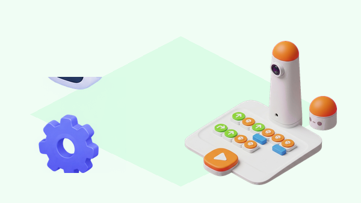

## 🎯 Repte i objectius

Planifiqueu una ruta en una graella i feu que el MatataBot avance diverses caselles amb el mínim de blocs possible. Compareu les ordres amb i sense nombre, i investigueu per què els girs es programen d’una altra manera. El Coding Set no incorpora sensors al robot base: en aquesta pràctica el grup observa el desplaçament sobre el mapa.

- Relacionar els blocs numèrics amb les ordres de moviment que poden modificar.
- Comparar una seqüència d’avanç amb diverses ordres i una ordre amb paràmetre.
- Explicar el límit dels blocs numèrics: s’apliquen a avançar o retrocedir, no als girs.

## 🧰 Materials i preparació

- Coding Set de la dotació: MatataBot, Control Tower, tauler i blocs de moviment i números.
- Mapa o quadrícula plana amb caselles de 10 cm, si el model del centre usa aquesta escala.
- Targetes de fletxes i una graella de registre amb previsió, ordre i resultat.

Carregueu el robot i la torre. Poseu el MatataBot a la casella d’inici, alineat amb la quadrícula; emparelleu-lo amb la torre i confirmeu el senyal de connexió. Abans de començar, identifiqueu les peces de moviment i comproveu com es disposa el nombre al tauler segons la guia del vostre model.

## 🧩 Funcions del robot treballades

- Torre de control que llig visualment les peces del tauler i envia el programa al MatataBot per Bluetooth.
- Ordres de moviment tangible: avançar, retrocedir i girar 90° a esquerra o dreta.
- Blocs numèrics com a paràmetre per repetir un nombre de vegades una ordre d’avanç o retrocés.
- Execució ordenada del programa després de llegir el tauler i prémer el botó d’inici.

## 👣 Seqüència guiada

### 1. Predigueu una ruta de tres caselles

Dibuixeu una ruta recta de tres caselles i marqueu l’orientació inicial del robot. Representeu-la primer amb tres blocs d’avanç, sense posar les peces al tauler. Cada persona de l’equip ha de poder llegir l’ordre i anticipar la destinació abans de passar al robot.

### 2. Compareu l’ordre repetida amb el nombre

Prepareu una primera seqüència amb tres ordres d’avanç i executeu-la. Esborreu el programa, col·loqueu una ordre d’avanç amb el bloc numèric 3 segons la disposició indicada pel fabricant i torneu a executar. Repetiu la comparació amb retrocedir, mantenint el mateix nombre de caselles i l’orientació inicial. Compareu els resultats i el nombre de peces; el bloc numèric repeteix l’ordre compatible, no representa centímetres ni una velocitat.

### 3. Comproveu el límit dels girs

Afegiu un gir de 90° al final de cada ruta. Proveu de fer servir el bloc numèric amb el gir i observeu que aquesta combinació no és compatible: els blocs numèrics no s’apliquen als girs esquerre/dret. Per fer un quadrat, construïu el patró amb avanç i gir de 90° dins d’un bucle compatible, o repetiu les peces de gir de la manera indicada al manual del kit.

### 4. Depureu i expliqueu el programa

Canvieu només el valor del nombre i feu una nova predicció abans de cada execució. Si el resultat no coincideix, reviseu l’orientació de la peça, la posició del nombre al tauler, l’ordre de lectura i l’alineació inicial del robot. Anoteu si l’error provenia del programa, de la lectura o de la col·locació sobre la graella.

_La quadrícula ajuda a comparar el desplaçament; el MatataBot base no llig la graella ni detecta les caselles._

## 🧪 Prova, depura i reflexiona

Executeu tres vegades la ruta curta i tres vegades la ruta amb paràmetre. Registreu les caselles previstes i observades, així com qualsevol desviació. Repetiu una prova amb el robot alineat de nou a l’inici; no canvieu alhora la superfície, el programa i la posició inicial.

### Preguntes per comprovar

- Quina diferència hi ha entre repetir físicament una ordre i donar-li un paràmetre numèric?
- Quines ordres de moviment admeten el bloc numèric segons la guia oficial?
- Per què el gir no es pot multiplicar amb el mateix bloc numèric?
- Quins factors del mapa o de l’alineació poden alterar el desplaçament observat?

## ♿ Accessibilitat i seguretat

Oferiu una ruta de dues caselles amb targetes grans i deixeu que una persona llig el programa mentre una altra col·loca les peces. Es pot predir el resultat assenyalant la graella, sense manipular el robot. Manteniu les mans fora del recorregut quan el MatataBot estiga en marxa i atureu-lo abans de canviar el tauler.

## ✅ Evidències d’aprenentatge
- Dues seqüències comparables: ordres repetides i ordre amb bloc numèric.
- Taula de previsió i resultat per a les sis execucions.
- Explicació visual o oral de quines ordres accepten el paràmetre i de la limitació dels girs.
- Nota sobre l’alineació i les condicions de la superfície utilitzada.

## 🔗 Fonts oficials i límits

La lliçó oficial Matatalab [Sequence](https://matatalab.com/en/node/61) indica que els blocs numèrics s’utilitzen amb ordres d’avanç i retrocés i que no es poden combinar amb els girs esquerre/dret. [Get to Know Matatalab Coding Set](https://matatalab.com/en/node/60) descriu la torre, el tauler, la connexió Bluetooth i les peces de moviment del conjunt. La quadrícula és una guia externa; el conjunt base no conté un sensor que mesure caselles o distàncies.
