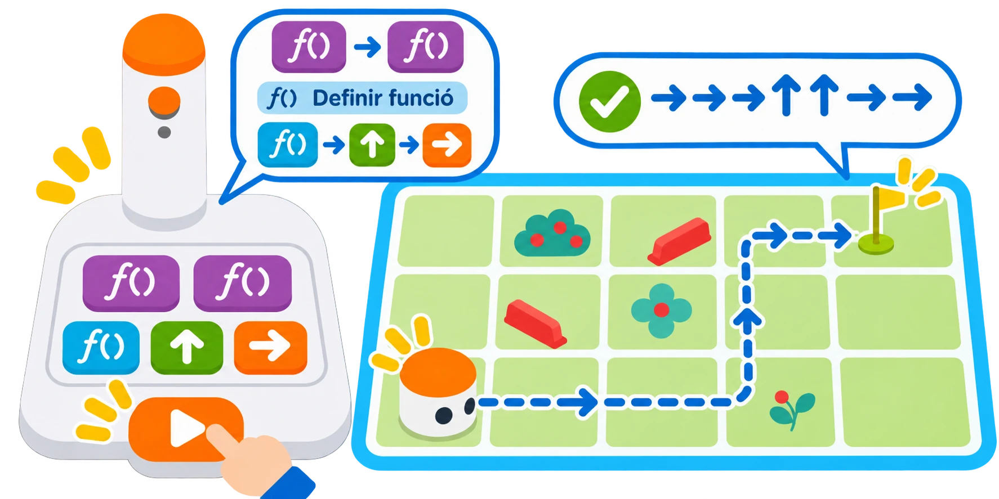

## 🎯 Què aprendrem?

Programeu una ruta que passe pel costat d’un obstacle i acabe a la bandera. Les peces del tauler determinen el recorregut; el MatataBot base no detecta ni esquiva obstacles automàticament.

- descriure inici, destinació i caselles prohibides;
- construir una seqüència de moviments que evite les peces d’obstacle;
- comprovar si la ruta arriba a la bandera i corregir-la amb una prova cada vegada;
- explicar per què «girar a l’esquerra» no vol dir «desplaçar-se cap a l’esquerra».



## 🧰 Materials i preparació

- Coding Set de la dotació: MatataBot, Control Tower, tauler de control, mapa, fitxes de moviment i bandera.
- Obstacles inclosos amb el conjunt; confirmeu que són les peces del kit base del vostre centre.
- Targetes o quadrícula de paper per a planificar una ruta abans de col·locar les fitxes.

Connecteu la torre, el tauler i el robot. Poseu una targeta d’obstacle davant del punt d’inici i una bandera dues caselles més enllà. Deixeu lliure una columna a la dreta per passar-hi. El Sensor Add-on no és necessari per a aquesta pràctica.

## 🧩 Funcions i controls

- Lectura del programa físic per la Control Tower i transmissió al MatataBot.
- Ordres direccionals: avançar, retrocedir i girar 90° a dreta o esquerra.
- Bandera com a destinació visible i obstacles físics com a restriccions de la ruta.
- Execució seqüencial i depuració d’un programa tangible.

## 👣 Pas a pas

### 1. Llegiu el mapa i planifiqueu la ruta

Poseu MatataBot a l’inici, mirant cap a l’obstacle i la bandera. Dibuixeu les tres posicions en una graella. Assenyaleu la dreta del robot: els girs depenen de cap a on mira.

Seguiu amb el dit aquesta ruta sobre la graella abans de col·locar les peces. Un gir canvia cap a on mira el robot, però no l’avança:

```coding-set
girar dreta -> avançar -> girar esquerra -> avançar -> avançar -> girar esquerra -> avançar
```

El recorregut passa pel costat de la targeta i torna a la columna de la bandera. Abans d'usar el robot, seguiu les fletxes amb el dit i comproveu que hi ha prou espai a la graella.

### 2. Traduïu el pla a fitxes físiques

Col·loqueu les fitxes en l’ordre de lectura del tauler. Reviseu cada moviment assenyalant alhora la fitxa i el tram dibuixat. Comproveu que cada gir canvia l’orientació i que la seqüència acaba quan MatataBot arriba a la bandera.

### 3. Executeu i observeu el trajecte

Poseu el robot a l’inici amb la mateixa orientació que al dibuix i executeu el programa. No mogueu els obstacles mentre es desplaça. En arribar a la bandera, confirmeu si ha seguit el camí previst; si topa amb una peça o passa de llarg, atureu la prova, localitzeu la primera diferència i torneu al tauler de control.

### 4. Depureu canviant una sola instrucció

Si el resultat no és el previst, reviseu la primera fitxa que no correspon a la ruta, canvieu-la i torneu a provar des de l’inici. Si ja funciona, busqueu una altra ruta. El Sensor Add-on és un complement diferent: les barreres del kit base no detecten res.

## 🧪 Comprovació i resolució de problemes

Comproveu que el recorregut evita l’obstacle i acaba a la bandera. Si no ho fa, atureu el robot i corregiu la primera peça que no correspon a la ruta. Torneu-lo al mateix punt i orientació abans de repetir.

## 🛡️ Ús i seguretat

Manteniu dits i cables fora del recorregut. Atureu el robot abans de moure obstacles o corregir les peces del tauler. El kit base no detecta l’obstacle automàticament: deixeu espai per aturar la prova si la ruta és incorrecta.

## 🔗 Fonts i límits

La lliçó oficial [Get to Know Matatalab Coding Set](https://matatalab.com/en/node/60) inclou obstacles i banderes en l’inventari del conjunt; [Hello, Matatalab Robots!](https://matatalab.com/en/node/88) treballa la bandera com a destinació i les ordres de moviment. Aquest manual mostra com programar una ruta amb aquests elements. Les peces físiques no detecten obstacles: la detecció amb fitxes «Obstacle/No Obstacle» pertany al Sensor Add-on, que és un complement diferent.
