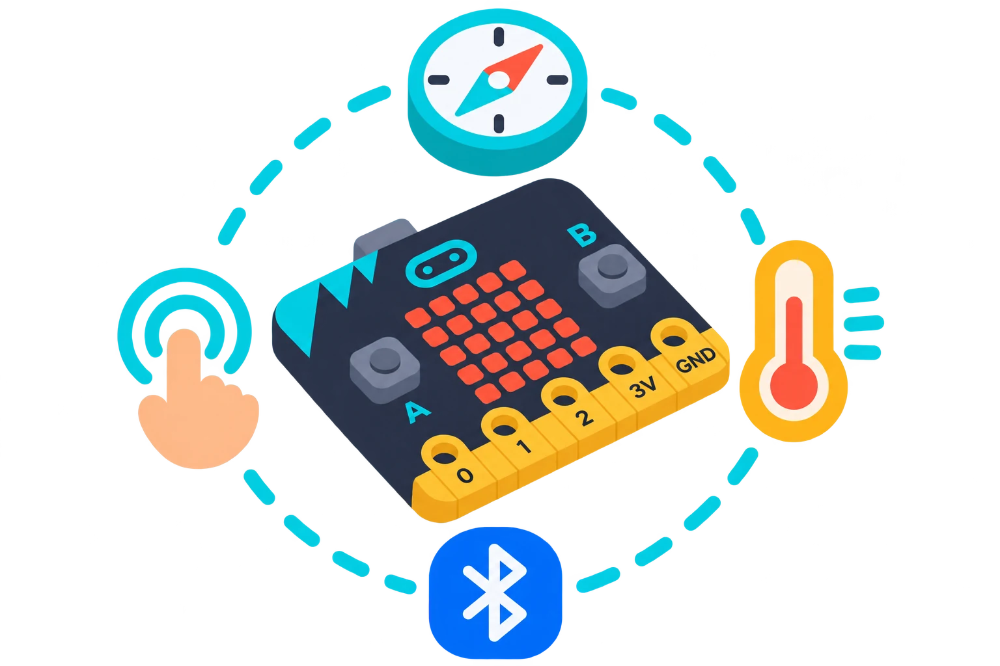

## 🎯 Què aprendrem?

Feu que la micro:bit mostre la direcció i una temperatura aproximada. Compareu-les amb una brúixola i un termòmetre; després exploreu el logotip tàctil de V2 i la connexió Bluetooth si teniu els dispositius necessaris.

- Calibrar la brúixola i comparar rumbs amb una referència.
- Contrastar la temperatura interna aproximada amb un termòmetre.
- Distingir l’entrada tàctil de V2 i la connexió Bluetooth de la ràdio.



## 🧰 Materials i preparació

- Placa BBC micro:bit i ordinador amb MakeCode o editor compatible.
- Brúixola i termòmetre de referència; tots dos poden ser analògics.
- Dispositiu compatible amb Bluetooth i editor/app adient, si la connexió està disponible.
- Portapiles opcional per a separar la placa de l’ordinador.

Comproveu la versió impresa a la placa. La brúixola pot requerir calibratge i es pot veure afectada per imants, altaveus, taules metàl·liques o cables amb corrent. El sensor tèrmic és dins del processador i només dona una aproximació de la temperatura de la placa/entorn.

## 🧩 Funcions i controls

- Magnetòmetre/brúixola integrada: rumb i calibratge, amb interferències identificades.
- Sensor tèrmic intern: lectura aproximada, no termòmetre ambiental calibrat.
- Logotip tàctil capacitiu i funcions de so només en micro:bit V2; V1 no incorpora aquestes peces.
- Bluetooth per a connexió amb dispositius compatibles, diferenciat de la ràdio local entre plaques.

## 👣 Pas a pas

### 1. Calibreu i compareu el rumb

Obriu MakeCode i prepareu dos botons:

1. En **Entrada**, afegiu «en prémer el botó A». Dins, poseu «mostra el número» i, al seu espai, la lectura de brúixola.
2. Afegiu un altre bloc de botó i canvieu-lo a **B**. Dins, poseu «mostra el número» amb la lectura de temperatura.

El botó A mostrarà la direcció i el B, la temperatura aproximada. Si preferiu copiar el programa, obriu **JavaScript** en MakeCode, enganxeu aquest text i torneu a **Blocs** per veure les peces:

```makecode
input.onButtonPressed(Button.A, function () {
    basic.showNumber(input.compassHeading())
})
input.onButtonPressed(Button.B, function () {
    basic.showNumber(input.temperature())
})
```

Descarregueu-lo a la placa i premeu A. Si demana calibrar-la, seguiu les indicacions de la pantalla. Manteniu-la plana, amb la vora superior cap a la direcció que voleu mesurar. Proveu quatre direccions lluny d’imants i objectes metàl·lics; compareu les lectures amb una brúixola de referència.

Podeu consultar el [bloc i l’exemple oficial de brúixola](https://makecode.microbit.org/reference/input/compass-heading) per identificar la peça en MakeCode.

### 2. Compareu temperatura i tacte segons la versió

Deixeu la placa i un termòmetre uns minuts al mateix lloc, a l’ombra. Premeu B i compareu els nombres. Anoteu-los sense tocar la placa durant la lectura: la micro:bit mesura la temperatura del xip, que pot ser diferent de la de l’aire.

En una micro:bit V2, creeu un projecte separat. En **Entrada**, afegiu l’esdeveniment «en tocar el logotip» i poseu-hi dins «mostra una icona». Transferiu-lo i toqueu el logotip metàl·lic: hauria d’aparéixer la icona. Si no apareix, confirmeu que la placa és V2 i que heu transferit aquest projecte. Com a ampliació, proveu els esdeveniments de deixar anar i mantindre el contacte si l’editor els ofereix. En V1, substituïu l’entrada per A/B; no presenteu la placa V1 com si tinguera logotip sensible al tacte.

### 3. Distingiu Bluetooth de ràdio

Si teniu una tauleta compatible amb l’app oficial de micro:bit, seguiu la [guia de l’app](https://microbit.org/get-started/user-guide/mobile/) per emparellar-la i enviar un programa a la placa per Bluetooth. Observeu si la placa executa el programa després de la transferència. Si no teniu l’app, feu la prova per cable i anoteu que no heu comprovat Bluetooth.

Compareu-ho amb la [guia de ràdio](../../tutorial/mb-radio-mesh/index.html), que envia números entre dues plaques. Per intercanviar dades amb un dispositiu Bluetooth des d’un programa cal una extensió i una aplicació compatibles; afegir l’extensió Bluetooth elimina els blocs de ràdio del mateix projecte. Guardeu cada prova en un projecte separat.

## 🧪 Comprovació i resolució de problemes

Proveu A en quatre direccions i B al costat del termòmetre; anoteu els resultats. Si teniu V2, comproveu també el logotip tàctil. Indiqueu si heu transferit el programa per Bluetooth o per cable. Si la brúixola dona valors inestables, allunyeu-la d’objectes metàl·lics i repetiu.

## 🛡️ Ús i seguretat

No useu imants forts prop de la brúixola durant les proves. Emparelleu només dispositius identificats i elimineu la vinculació quan ja no siga necessària. La temperatura indicada és aproximada i correspon al processador.

## 🔗 Fonts i límits

La [vista general oficial de micro:bit](https://microbit.org/get-started/features/overview/) descriu botons, brúixola, acceleròmetre, ràdio/Bluetooth, pins i les diferències de V2; la guia oficial de [sensors](https://microbit.org/get-started/features/sensors/) documenta la temperatura aproximada i el logotip tàctil. Consulteu també la [referència Bluetooth de MakeCode](https://makecode.microbit.org/reference/bluetooth). El Bluetooth depén de l’editor/dispositiu compatible; el sensor intern de temperatura no és un instrument calibrat.
